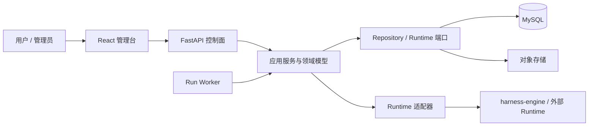

# Agent 平台

面向多租户场景的数字员工控制平台，提供员工与资源管理、部署、对话运行、执行观测和模型配置能力。仓库由 React 管理台、FastAPI 控制面和独立的 Python `harness-engine` 组成。

## 当前能力

- 管理数字员工及其版本、Skill、Tool 和租户资源。
- 创建部署并通过工作台发起对话运行，查看消息、Run 状态、执行轨迹和用量记录。
- 使用异步 Run Worker 和可替换的 Runtime 适配器执行任务；本地 Fake Runtime 用于离线演示和平台流程验证。
- 按租户管理模型配置，并通过 MCP 工具配置和审批边界接入外部能力。
- 使用 MySQL 保存控制面数据，使用本地对象存储保存对话正文及运行产物。

真实身份提供方、生产对象存储/KMS、外部调度系统业务闭环和目标环境沙箱仍需按部署环境单独集成或验收；Fake 模式不代表这些生产能力已验证。

## 架构概览



控制面负责编排租户、员工、部署和运行状态；Worker 执行异步 Run；Runtime 适配器隔离具体引擎。后端通过稳定端口依赖独立的 `harness-engine`，领域层不直接依赖供应商 SDK。

## 项目结构

```text
agentDemo/
├── backend/          FastAPI 控制面、应用服务、领域模型和 Worker
├── frontend/         React + TypeScript 管理台
├── harness-engine/   可独立安装的 Python Harness 引擎与工具
├── deploy/           Docker 等本地部署材料
├── docs/             架构、接口、运维、验证及迁移文档
└── openspec/         功能提案、设计、规格和实施任务
```

## 本地启动

### 启动后端（Fake 模式）

需要 Python 3.12 或更高版本。Fake 模式适合本地界面联调和离线演示，不需要连接 MySQL：

```bash
cd backend
python3.12 -m venv .venv
source .venv/bin/activate
python -m pip install -e ".[dev]"
AGENT_PLATFORM_MODE=fake python -m uvicorn agent_platform.main:app --host 127.0.0.1 --port 8000
```

健康检查地址：`http://127.0.0.1:8000/api/health`。Fake 身份模式的 API 调用示例和 MySQL 启动步骤见[运行与验证说明](docs/运行与验证说明.md)。

### 启动前端

需要 Node.js 和 npm：

```bash
cd frontend
npm ci
npm run dev
```

Vite 会在终端输出本地访问地址。若需验证完整 MySQL 持久化和异步 Worker 流程，按[本地控制面闭环与运维](docs/本地控制面闭环与运维.md)配置数据库、迁移和服务。

### 启动本地 MySQL

仓库提供 Docker Compose 配置：

```bash
cp deploy/mysql/.env.example deploy/mysql/.env
# 编辑 deploy/mysql/.env，设置本地密码
docker compose -f deploy/mysql/docker-compose.yml up -d
```

迁移由显式命令执行，不会在 API 启动时自动修改数据库。完整配置和操作步骤见[MySQL 开发说明](deploy/mysql/README.md)及[迁移目录说明](docs/migrations/README.md)。

## 常用验证命令

```bash
cd backend
python -m pytest tests -q
python -m ruff check src tests

cd ../frontend
npm test
npm run build
```

MySQL 集成、Runtime、Docker/Kubernetes 沙箱等验证范围和未验证项见[真实验证矩阵](docs/verification-matrix.md)及[运行与验证说明](docs/运行与验证说明.md)。

## 文档导航

| 主题 | 文档 |
|---|---|
| 系统分层与依赖方向 | [架构总览](docs/架构总览.md)、[后端与 Harness 引擎关系](docs/后端与Harness引擎关系.md) |
| 目录、模块和 API | [目录与模块说明](docs/目录与模块说明.md)、[接口与状态流程](docs/接口与状态流程.md) |
| 本地运行与运维 | [运行与验证说明](docs/运行与验证说明.md)、[本地控制面闭环与运维](docs/本地控制面闭环与运维.md)、[Docker 本地验证指南](docs/Docker本地验证指南.md) |
| 数据模型与数据库 | [数字员工数据模型](docs/数字员工数据模型.md)、[MySQL Schema 说明](docs/mysql-schema.md)、[迁移目录说明](docs/migrations/README.md) |
| 模型、资源和用量 | [模型管理与模型接入](docs/模型管理与模型接入.md)、[资源中心模型与授权](docs/资源中心模型与授权.md)、[用量计量](docs/usage-accounting.md) |
| Harness / DeepSeek 示例 | [Python 子项目说明](harness-engine/README.md)、[DeepSeek Harness 验证 Demo](docs/deepseek-harness-demo.md) |
| OpenSpec 流程 | `openspec/changes/` 中的进行中变更及 `openspec/changes/archive/` 中的已归档记录 |

## 贡献约定

项目文档、注释、OpenSpec 说明和 Git 提交信息使用中文。新增功能前先完善 OpenSpec 变更；表结构变更、测试、文档和原型要求见[项目协作约定](AGENTS.md)。
