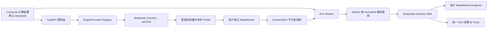
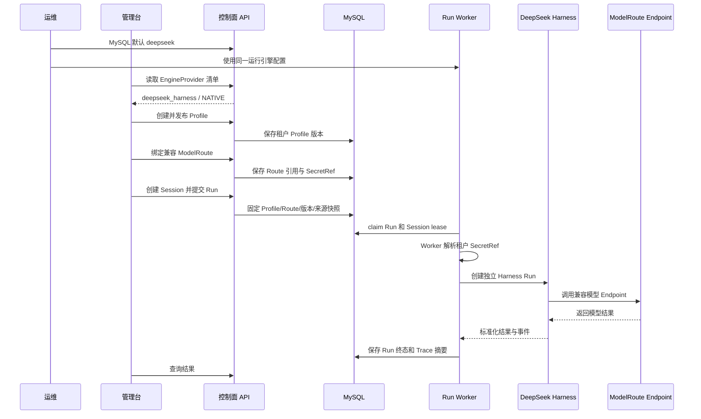

# DeepSeek Harness 默认引擎运行与验收

> **状态：已实现并完成本地验收。** 本文描述 MySQL/Compose 默认配置与本地确定性 ModelRoute 验收步骤；真实 DeepSeek 云端凭据和生产 Secret Manager 仍不在本次验收范围。

## 功能说明与使用角色

DeepSeek Harness 是 Agent 执行引擎，负责 Harness Agent Loop、Session 生命周期和工具调用；模型由独立 ModelRoute 选择。MySQL/Compose 环境默认装配 DeepSeek Harness，使管理员能创建可供 Session 使用的 ExecutionProfile，并由 Run Worker 真正调用 Harness SDK。Fake 仍可通过部署配置显式启用以进行离线验收。

| 角色 | 可执行操作 | 边界 |
|---|---|---|
| 平台运维 | 将同一 `AGENT_PLATFORM_RUNTIME_ENGINE` 配给 API 与 Worker；选择 `deepseek` 或 `fake` | 部署配置不接受租户 API 修改；不得将模型凭据注入 API 容器 |
| 当前租户管理员 | 新建/发布 Profile，配置租户 ModelRoute、个人/租户默认值或 Deployment 覆盖 | 只能使用当前租户拥有或授权的 Route；Profile 不存模型 Key |
| 当前租户成员 | 使用已授权默认配置创建 Session、提交 Run、查看允许范围内的结果 | 不得发布 Profile、修改租户默认或保存 Deployment 运行配置 |

每个 Session/Run 固定创建时解析出的 Profile、Route、版本和来源。修改默认配置只影响新 Session；旧 Session/Run 保留原快照。

## 架构图



## 正常流程



## 数据模型说明

不新增表或字段，不创建 migration。继续使用以下租户范围对象：

| 对象 | 本功能使用的字段 | 租户/版本边界 |
|---|---|---|
| ExecutionProfile | `tenant_id`、`profile_id`、`version`、`engine_name`、`status` | Profile 由当前租户授权；发布版本不可变；新 Profile 使用 `deepseek_harness` |
| ModelRoute/连接 | `tenant_id`、`route_id`、`route_version`、`endpoint`、`protocol`、`model_id`、`secret_ref` | 路由由接收租户持有或授权；SecretRef 不等于密钥值 |
| 默认绑定 | `scope_type`、`scope_id`、Profile/Route ID 与版本 | API 从 Identity 解析用户/租户范围，不信任请求体切换租户 |
| Deployment 运行修订 | Profile/Route ID、版本和配置修订 | 当前租户管理员写入；新修订只影响之后创建的 Session |
| Session/Run Snapshot | 精确 Profile、Route、来源、模型路由和版本摘要 | 创建后只读；不能在 Worker 领取任务时替换成最新配置 |

MySQL 表注释、约束和索引没有变化，因此本期无需执行 schema migration 或 `information_schema` 注释验证。

## API 与状态

| 接口/状态 | 行为 |
|---|---|
| `GET /api/v1/engine-providers` | 返回当前进程实际注册的 Provider 摘要；DeepSeek 默认时只有 `deepseek_harness` / `NATIVE`，显式 Fake 时只有 `fake` / `SIMULATION` |
| `POST /api/v1/execution-profiles` | 管理员为当前租户创建 DRAFT Profile；只提交 EngineProvider 名，不提交模型 Key |
| ExecutionProfile 发布 API | 发布不可变版本；不会自动改变用户或租户默认值 |
| ModelRoute 与运行默认 API | 按既有 API 管理当前租户 Route，并分别绑定 Profile/Route 默认值；两类默认互不修改 |
| Session/Run API | 创建时验证当前租户授权、Provider 能力和 Route 协议，写入固定快照；错误时不留下部分 Session/Run |
| Run/Trace 查询 | 返回状态、脱敏错误类别、请求摘要和结果；不返回密钥明文 |

常见错误：未注册引擎返回 `ENGINE_PROVIDER_UNAVAILABLE`；协议不兼容返回 `ENGINE_MODEL_INCOMPATIBLE`；运行配置缺失返回 `RUNTIME_CONFIGURATION_REQUIRED`；Worker 无法解析租户 SecretRef 时返回稳定配置错误。任何错误都不静默切回 Fake。

## 配置与使用

### 1. 选择运行引擎

在本地私有 `deploy/control-plane/.env` 中设置：

```dotenv
AGENT_PLATFORM_RUNTIME_ENGINE=deepseek
AGENT_PLATFORM_DEEPSEEK_PROFILE=sdk-minimal
AGENT_PLATFORM_DEEPSEEK_PROVIDER=deepseek-official
AGENT_PLATFORM_DEEPSEEK_MODEL=deepseek-v4-flash
```

不要把该 `.env` 提交到 Git。Compose 的 backend API 与 Run Worker 必须读取同一个值；修改后同时重启两者：

```bash
docker compose --env-file deploy/control-plane/.env \
  -f deploy/control-plane/docker-compose.yml config

docker compose --env-file deploy/control-plane/.env \
  -f deploy/control-plane/docker-compose.yml up --build -d
```

检查本机 Provider 清单：

```bash
curl -sS -H 'X-Fake-User: admin-local' \
  http://127.0.0.1:8088/api/v1/engine-providers
```

预期只出现一个 `deepseek_harness`，`execution_mode` 为 `NATIVE`。若要离线切回 Fake，将 `.env` 改为 `AGENT_PLATFORM_RUNTIME_ENGINE=fake`，再次执行 Compose `up`，并确认 API 和 Worker 一起切换。

### 2. 创建并发布 ExecutionProfile

以“租户 A · 管理员”打开“模型管理 → 默认运行环境”，新建 ExecutionProfile 并选 `DeepSeek Harness`，创建后发布版本。Profile 只固定引擎；模型 ID、Endpoint 和凭据仍在 ModelRoute 中管理。成员可以使用被授权的发布版本，但不能创建/发布配置或更改租户默认。

### 3. 配置兼容 ModelRoute

为当前租户配置 OpenAI 兼容连接，并创建 ACTIVE ModelRoute。DeepSeek Harness 支持 `openai-compatible`、`openai-chat-completions` 和 `openai-completions`。在 Route 中选模型 ID、Endpoint，并引用当前租户的 SecretRef；Worker 需要在自己的环境中提供对应的 `AGENT_PLATFORM_MODEL_SECRET_<TENANT>_<SECRET_ID>` 映射。实际密钥只放在本机未提交的环境文件/Secret Manager，不写入 Profile、API 或 RunSnapshot。

本地确定性验收可以将兼容 Route 指向专用 Mock，并在 Worker 环境配置本地测试 SecretRef。若使用 `docker-compose.staffdeck-acceptance.yml`，还需要它要求的本地配置文件和 MCP 验收环境变量；Mock 的结果只验证执行链路，不代表真实 DeepSeek 模型推理。

### 4. 固定默认值并运行

在“默认运行环境”中选择已发布的 DeepSeek Profile 和授权 ModelRoute，可分别保存为个人或租户默认；或者在员工 Deployment 的“运行配置”中指定覆盖。创建新的员工 Session，发送一条简单请求；查看 Run 状态与 Trace，确认快照中的引擎、ModelRoute 和版本一致，结果由 Worker 的 DeepSeek Harness Adapter 返回。

只在配置中看到 DeepSeek 不代表模型凭据已配置。真实 DeepSeek 云端调用需要租户授权的可访问 Endpoint 与有效 SecretRef；本地 Mock 验收不访问真实模型，不产生供应商费用。

## 权限、凭据与故障处理

- EngineProvider 清单是部署级能力，不替代租户资源授权；Profile、Route、Deployment 和结果查询仍按当前身份租户隔离。
- Profile 请求其他租户资源时按既有 404/依赖校验错误拒绝。成员修改 Profile、租户默认或 Deployment 配置时返回 403。
- API 与 Worker 配置不一致会使 Provider 可见性和运行时选择不一致；Compose 必须使用同一环境变量并共同重启。
- Route 协议不支持时在创建 Session 前拒绝，不自动替换 Route。SecretRef 缺失时 Run 失败，不从发布方或其他租户读取凭据，不切换 Fake。
- Worker 使用现有 claim、lease 和 fencing token；确定性配置错误结束为失败。模型出站后超时且结果不明时沿用既有 UNKNOWN 隔离，不盲目重试可能调用工具的 Run。
- API、Worker 日志与 Trace 仅记录 `engine_name`、Route 版本、请求 ID、稳定错误码和非敏感结果摘要；不记录 API Key、完整环境、SecretRef 值或模型原始秘密配置。

## 验收标准

1. 默认 MySQL/Compose 启动后，Provider 清单只含一个原生 DeepSeek Harness，管理员可创建/发布 Profile。
2. Profile 与兼容 ModelRoute 可以独立配置；创建 Session/Run 时快照固定精确版本。
3. Worker 通过 DeepSeek Harness SDK 调用确定性 Mock，并在 Run/Trace 中返回成功状态。
4. 成员权限、跨租户隔离、协议不兼容、缺少 SecretRef 和 Fake 显式覆盖符合上文错误行为。
5. API、Profile、快照和 Trace 不包含密钥明文；静态原型没有真实请求和真实凭据。

## 验证命令与结果状态

实现后运行：

```bash
docker compose --env-file deploy/control-plane/.env \
  -f deploy/control-plane/docker-compose.yml config

cd backend && pytest -q && ruff check src tests
cd frontend && npm test -- --run && npm run build
```

本次实现验证结果：后端 `352 passed, 73 skipped`；Ruff 检查通过；前端 `16` 个测试文件、`86 passed`；Vite production build 通过（保留既有大 chunk warning）。Compose config 确认 backend/worker 均为 `deepseek`，显式 `AGENT_PLATFORM_RUNTIME_ENGINE=fake` 时两端均为 `fake`。

本机 MySQL Compose 已完成一次真实 Worker 验收：Provider 清单返回 `deepseek_harness` / `NATIVE`；创建并发布 Profile `profile-5ca4f8b280`；使用租户 A 的 ACTIVE ModelRoute `route-4b44b825aec3437ea1b6278fc2ac61bc`；Conversation turn 入队后由独立 Worker 调用固定版本 DeepSeek Harness SDK，Run `ta2fg74zfza3vow36oom6ea5yu` 返回 `SUCCEEDED`，结果为“DeepSeek Harness 本地模型调用成功。”；RunSnapshot 固定 `deepseek_harness`、Profile v1、该 ModelRoute，Trace 有 19 个 Span，并保存 Harness Session/Result 引用。Worker 镜像内的 `deepseek-harness-sdk` 与 `deepseek-harness-runtime-bin` 均为 `0.2.2rc2`。这次验收使用本地确定性 ModelRoute，不代表真实 DeepSeek 云端推理。

后续仍需验证：真实 DeepSeek 云端凭据与生产 Secret Manager、真实生产身份系统、生产网络/TLS、跨 Worker 长会话恢复和生产 MCP 写操作。验收结果应继续追加到项目验证记录。

## HTML 原型

静态演示位于 [DeepSeek Harness 默认引擎配置原型](原型/DeepSeekHarness默认引擎配置.html)。页面沿用模型管理的管理台导航、租户身份栏、标签和双栏卡片；交互对应已实现的个人/租户默认值分别保存、Profile 表格与创建/发布弹窗。状态预览覆盖加载、空目录、读取失败与成功反馈；不展示凭据值，也不连接 API。
