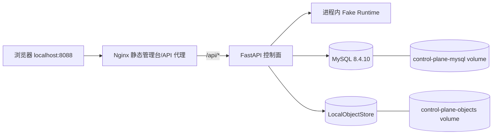
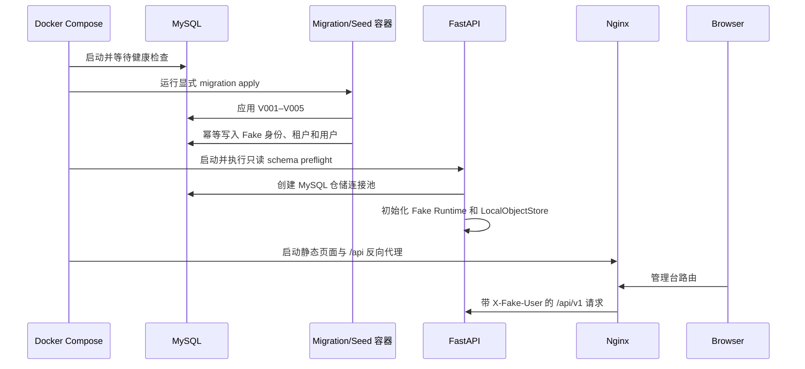

# Docker 本地验证指南

本 Compose 栈供本地验收数字员工管理台和资源中心使用，包含 MySQL 8.4.10、FastAPI 控制面、Fake Runtime、Nginx 前端和 LocalObjectStore。它使用 Fake Identity，不接入真实租户身份；对象文件持久化在 Docker 命名卷中。

## 架构与启动流程





## 数据与 API 状态

| 数据 | 所在位置 | 生命周期 |
|---|---|---|
| 租户、员工、Skill/Tool 版本、Hub/Grant、Deployment、Session、Run、Trace | `control_plane_mysql` 命名卷中的 MySQL | `docker compose down` 保留；`down -v` 删除 |
| ZIP 文件、Skill 辅助文件和其它 MediaAsset 内容 | `control_plane_objects` 命名卷中的 LocalObjectStore | `docker compose down` 保留；`down -v` 删除 |
| ZIP staging | 后端进程内存 | 后端重启或过期后需重新 Preview |

健康探针 `/api/health` 无需身份。管理 API 从 Nginx 同源转发到 FastAPI；`/api/v1/*` 通过 `X-Fake-User` 选择 `admin-local`、`member-local` 或 `admin-other`。页面默认管理员身份，可以在管理壳顶部切换为两个租户和成员角色。MySQL 启动后，`bootstrap` 容器显式执行 V001–V005 和 Fake seed；后端不会在每次启动时自动执行 DDL。

## 启动

首次启动时复制环境模板并生成本地随机密码。不要将 `.env` 密码提交到代码库：

```bash
cp deploy/control-plane/.env.example deploy/control-plane/.env
```

将 `.env` 中两个 `replace-with-...` 替换为随机密码，然后构建并启动：

```bash
docker compose --env-file deploy/control-plane/.env \
  -f deploy/control-plane/docker-compose.yml up --build -d
```

Compose 会等待 MySQL 健康检查，再显式执行 V001–V005 migration 和 Fake 租户身份 seed，然后启动后端和前端。API 仍以 Fake Identity header 校验当前身份；管理台顶部可切换租户 A 管理员、租户 A 成员和租户 B 管理员。

MySQL 仅绑定到本机 `127.0.0.1:3309`，可用于本机检查 schema 或运行 MySQL 集成测试；应用流量仍通过 Web 容器代理到后端。

Fake seed 只创建身份、租户和角色，不创建员工/Skill/Tool 演示数据，因此全新卷的列表为空。当前运行实例已添加一组可操作的验收数据：租户 A 的“Docker 验收样例”员工及 DRAFT v1、一个已发布 Skill 和一个已发布 Tool；已通过 API 创建/列表/详情/PATCH 验证。请使用“租户 A · 管理员”身份查看和编辑。租户 A 成员为只读，租户 B 与租户 A 数据隔离。

打开管理台：<http://localhost:8088/enterprise/employees>。可先在“数字员工”页面创建员工，再进入详情配置版本；“资源中心”提供租户资源发布、Grant、COPY/REFERENCE；“部署记录”查看部署与审计。健康检查端点为 <http://localhost:8088/api/health>，OpenAPI 为 <http://localhost:8088/docs>。

旧 `/workspace/gallery`、`/enterprise/platform` 地址由 Nginx 直接重定向到 `/enterprise/resources`；根路径 `/` 重定向到 `/enterprise/employees`。若浏览器仍停留在旧页，刷新该标签即可触发重定向。

已验证 Docker Compose 启动 `mysql`、`bootstrap`、`backend`、`web` 四个服务；MySQL health check、migration 和身份 seed、后端 health check、Nginx 管理台路由与带 Fake 身份的 MySQL 员工列表读取均成功。当前浏览器 URL 只绑定 `127.0.0.1`。

查看容器与日志：

```bash
docker compose --env-file deploy/control-plane/.env \
  -f deploy/control-plane/docker-compose.yml ps
docker compose --env-file deploy/control-plane/.env \
  -f deploy/control-plane/docker-compose.yml logs -f backend web
```

## 停止和重置

停止容器但保留员工、迁移和对象数据：

```bash
docker compose --env-file deploy/control-plane/.env \
  -f deploy/control-plane/docker-compose.yml down
```

彻底重置本地验收数据时，使用 `down -v` 删除 Compose 命名卷；该操作会删除此 Docker 验收栈的全部 MySQL 和对象文件数据：

```bash
docker compose --env-file deploy/control-plane/.env \
  -f deploy/control-plane/docker-compose.yml down -v
```

## 范围

- Fake Runtime 会返回可重复的模拟结果，不调用真实模型或工具执行器。
- Fake Identity 仅用于本机验收，不能公开暴露到网络。
- 对象存储使用 LocalObjectStore；MinIO、S3、OSS、COS 和生产密钥管理仍需单独配置与验证。
- ZIP Preview staging 是后端进程内存状态；若容器重启或预览过期，重新预览 ZIP 后提交。
- 前端生产打包当前有约 1.20 MB 主 JS chunk 的体积提示，但不影响本地验证功能。
- 尚未验证真实身份提供方、真实 Runtime、云对象存储、TLS、生产网络策略和多实例 staging 协调。
