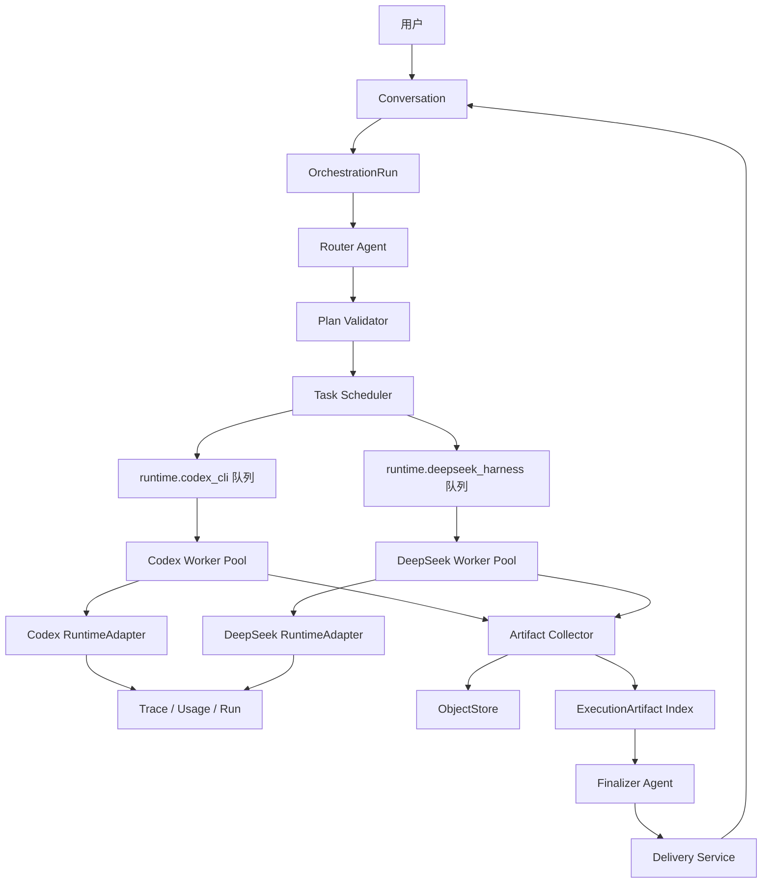

# Agent 团队群聊设计

## 文档状态

- 文档类型：项目级功能设计
- 设计版本：v0.1
- 适用范围：智能编排型 Agent 团队群聊
- 当前阶段：方案确认，尚未进入代码实施
- 原型路径：`docs/原型/agent团队群聊.html`（后续创建）
- 迁移计划：`docs/migrations/V011__agent_team_orchestration.sql`（以实际迁移序号为准）

## 1. 目标与范围

### 1.1 目标

为一个 Conversation 绑定多个数字员工组成的团队。用户提交一个需求后，系统由路由 Agent 拆分任务，形成任务依赖图，按成员能力和负载分配任务，并使用不同执行引擎的独立 Worker Pool 并行执行。任务结果和文件产出物统一保存、追踪、预览和交付。

本设计支持以下执行方式：

- 用户指定成员执行任务。
- 路由 Agent 动态拆分任务并提出成员分配建议。
- Scheduler 根据任务依赖、成员能力和 Worker Pool 健康状态派发任务。
- 多个引擎并行执行同一个团队请求。
- 汇总 Agent 读取标准化任务结果和产出物，生成最终答复。
- 用户查看任务状态、执行引擎、产出物来源和交付状态。

### 1.2 本期范围

- Team、TeamVersion 和 TeamMember 模型。
- Conversation 与固定 TeamVersion 的绑定。
- OrchestrationRun 父级编排运行。
- 基于 DAG 的任务拆分和依赖调度。
- 每个 EngineProvider 独立 Worker Pool。
- 成员级固定 EngineProvider、ExecutionProfile 和 ModelRoute。
- 任务级能力要求和成员匹配校验。
- Task 状态、认领租约、重试、取消和重新分配。
- 标准化 TaskOutput 和 ExecutionArtifact。
- Web 工作台的任务面板、产出物面板和交付确认。
- 租户隔离、权限、审计、Trace、幂等和错误处理。

### 1.3 明确不做

- 本期不允许在一个 Session 中途切换 EngineProvider。
- 本期不让 Agent 直接写入任务状态或产出物索引。
- 本期不共享不同引擎的原生 Session、Thread 或隐藏上下文。
- 本期不自动把失败任务静默切换到其他引擎。
- 本期不接入新的外部 IM 渠道；外部渠道交付通过后续阶段扩展已有 OutboundDelivery。
- 本期不展示原始思考链、隐藏 Prompt、SecretRef 明文或完整凭据。

## 2. 已有能力与集成边界

当前项目已经提供以下可复用能力：

| 现有能力 | 复用方式 |
|---|---|
| `Conversation`、`AgentBinding`、用户参与者 | 作为团队对话和成员 Session 的基础 |
| `ConversationService` | 维护 Conversation、成员绑定和消息权限 |
| `ConversationTurnService` | 团队模式下扩展为创建 OrchestrationRun |
| `ControlPlaneService` | 创建 Session/Run、执行 Runtime、保存 Trace 和 Usage |
| `EngineProviderRegistry` | 精确解析 EngineProvider，不允许隐式回退 |
| `RuntimeAdapter` | 向不同引擎提供统一的生命周期和请求协议 |
| `RuntimeCapabilities` | 校验工具、MCP、Workspace、Sandbox、思考等能力 |
| `ObjectStore`、`MediaAsset` | 保存消息正文、任务输出和产出物文件 |
| `OutboundDelivery` | 后续扩展为带附件的外部渠道投递 |

引擎选择、Session 固定和 Run 快照必须继续遵守现有执行引擎规格。团队编排层只创建带有明确 `engine_name` 的子 Run，不绕过 ControlPlaneService 直接调用供应商 SDK。

## 3. 总体架构

### 3.1 组件关系



### 3.2 关键职责

| 组件 | 职责 | 不负责的内容 |
|---|---|---|
| Conversation | 用户可见消息和参与者边界 | 任务调度和引擎调用 |
| OrchestrationService | 编排父运行、计划版本和聚合状态 | 直接调用供应商 SDK |
| Router Agent | 生成任务 DAG、能力要求和成员建议 | 直接修改数据库状态 |
| Plan Validator | 校验 DAG、权限、能力、预算和成员范围 | 执行任务 |
| TaskScheduler | 发现 READY 任务、创建子 Run、派发引擎队列 | 生成业务结论 |
| Worker Pool | 领取指定引擎的 Run 并执行 | 选择其他引擎替代 |
| RuntimeAdapter | 转换平台请求并调用单一引擎 | 保存平台任务和产出物索引 |
| ArtifactCollector | 收集文本、结构化结果、文件和 Workspace 输出 | 修改任务计划 |
| DeliveryService | 生成交付清单、预览、下载和渠道投递 | 决定任务是否成功 |

### 3.3 Conversation 工作模式

Conversation 创建时固定 `conversation_mode`：

| 模式 | 绑定关系 | 执行路径 | 工作台右侧内容 |
|---|---|---|---|
| `SINGLE_AGENT` | 一个活动 AgentBinding 和一个 Session | 用户消息直接创建单个 Run | 数字员工、Session、Run 快照、工具和审批 |
| `TEAM` | 一个 ConversationTeamBinding 和多个 AgentBinding | 用户消息创建 OrchestrationRun，再拆分多个子 Run | 团队成员、任务 DAG、Worker Pool、产出物和交付 |

两种模式共享 Conversation、Message、权限、Run、Trace、Usage、ObjectStore 和 Artifact 服务。模式在创建时固定，系统不把已有单员工 Conversation 原地转换为团队 Conversation。用户可以从单员工工作台点击“以团队协作继续”，创建新的团队 Conversation，并复制用户当前任务摘要作为初始输入。

单员工路径必须保持现有行为：一个用户消息对应一个固定 Session 的 Run，保留当前的时间线、回答策略、工具审批和运行快照。团队路径只在 `conversation_mode=TEAM` 时进入 OrchestrationService。

## 4. 团队与成员模型

### 4.1 TeamVersion

Team 使用不可变版本。Conversation 创建时固定版本，后续团队配置变更只对新 Conversation 生效。

TeamVersion 包含：

- 路由 Agent 成员。
- 汇总 Agent 成员。
- 任务拆分模式：`USER`、`ROUTER`、`HYBRID`。
- 分配模式：`USER`、`ROUTER`、`HYBRID`。
- 最大任务数量。
- 最大 DAG 深度。
- 单个编排的最大并发数。
- 单成员最大并发数。
- 最大重试次数。
- 最大重规划次数。
- Token、费用和运行时间预算。
- 失败继续策略。
- 产出物保留和交付策略。

团队配置需要在工作台中可查看。Owner 或具备团队管理权限的成员可以编辑下一版草稿；当前 Conversation 使用的 TeamVersion 保持只读，配置变更不会改写已创建的 Session、Run 或任务。

### 4.2 TeamMember

每个 TeamMember 固定一个 Deployment 和一组运行配置引用：

| 字段 | 说明 |
|---|---|
| `member_id` | 团队成员稳定标识 |
| `employee_id` | 数字员工标识 |
| `employee_version` | 数字员工版本 |
| `deployment_id` | 成员 Deployment |
| `execution_profile_id/version` | 固定引擎和执行能力 |
| `engine_name` | 展示用的 EngineProvider 标识 |
| `model_route_id` | 固定模型路由 |
| `role` | 成员角色 |
| `capabilities_snapshot` | 创建 TeamVersion 时的能力快照 |
| `max_concurrency` | 成员并发上限 |
| `status` | `ACTIVE`、`DISABLED`、`REMOVED` |

`engine_name` 和能力快照用于计划展示与审计，真正执行以 Session/Run 的固定快照为准。

### 4.3 ConversationTeamBinding

一个团队 Conversation 绑定一个 TeamVersion：

- `conversation_id`
- `team_id`
- `team_version`
- `orchestration_mode`
- `approval_mode`
- `created_at`

Conversation 还需要保存 `conversation_mode`。`SINGLE_AGENT` 不创建 ConversationTeamBinding；`TEAM` 必须在创建时完成 TeamVersion 和成员 Session 的准入校验。

已有的 `AgentBinding` 继续表示 Conversation 中每个成员的独立 Session。团队模式只是为这些绑定增加团队成员元数据和编排关系。

## 5. 编排与任务模型

### 5.1 OrchestrationRun

一次用户请求对应一个父级 OrchestrationRun：

- `orchestration_id`
- `conversation_id`
- `input_message_id`
- `team_id`
- `team_version`
- `plan_revision`
- `router_run_id`
- `finalizer_run_id`
- `status`
- `approval_mode`
- `idempotency_key`
- `task_count`
- `completed_task_count`
- `failed_task_count`
- `cancelled_task_count`
- `created_at`
- `updated_at`

OrchestrationRun 是控制面对象。实际模型执行仍然由成员 Session 对应的子 Run 完成。

### 5.2 Task DAG

任务使用有向无环图表达依赖：

```text
用户需求
   |
   +--> T1 需求分析 --------+
   |                         |
   +--> T2 数据准备 --------+--> T4 汇总
   |                         |
   +--> T3 方案调研 --------+
```

任务字段包括：

- `task_id`
- `orchestration_id`
- `client_key`
- `title`
- `instruction_ref`
- `parent_task_id`
- `required`
- `depends_on`
- `required_capabilities_json`
- `preferred_engine_name`
- `preferred_member_id`
- `assigned_member_id`
- `assignment_source`
- `claim_token`
- `attempt`
- `max_attempts`
- `output_ref`
- `error_code`
- `created_at`
- `started_at`
- `finished_at`

### 5.3 TaskAttempt

一个 Task 可以有多次执行尝试。每次尝试单独记录：

- `attempt_id`
- `task_id`
- `attempt_no`
- `member_id`
- `session_id`
- `run_id`
- `engine_name`
- `model_route_id`
- `worker_pool`
- `status`
- `error_code`
- `started_at`
- `finished_at`

这样可以保留“第一次由 DeepSeek 执行失败，第二次由 Codex 执行成功”的完整审计链。

## 6. 执行引擎交互

### 6.1 路由 Agent

路由 Agent 自身也是一个普通 Agent Run，使用 TeamVersion 固定的路由成员 Session。

它输出结构化计划：

```json
{
  "plan_revision": 1,
  "tasks": [
    {
      "client_key": "analyze_requirement",
      "title": "分析用户需求",
      "instruction": "提取目标、限制条件和验收标准",
      "depends_on": [],
      "required_capabilities": ["reasoning"],
      "candidate_member_ids": ["member-analyst"],
      "required": true
    },
    {
      "client_key": "implement_solution",
      "title": "实现解决方案",
      "instruction": "修改代码并运行验证",
      "depends_on": ["analyze_requirement"],
      "required_capabilities": ["workspace", "tool_calls"],
      "candidate_member_ids": ["member-developer"],
      "required": true
    }
  ],
  "approval_required": true
}
```

服务端必须重新校验 Router 输出：

- 任务数量、DAG 深度和依赖数量。
- DAG 是否存在环。
- 成员是否属于当前 TeamVersion。
- 成员是否为 `ACTIVE`。
- EngineProvider 是否满足任务能力。
- ModelRoute 协议是否兼容。
- 是否超过预算、并发或工具策略。
- 是否包含跨租户资源引用。

### 6.2 子 Run 创建

Scheduler 为每个 READY Task 创建子 Run：

```text
Task
  -> assigned_member_id
  -> AgentBinding.session_id
  -> SessionRecord.engine_name
  -> RunSnapshot.engine_name
  -> runtime.<engine_name> queue
```

子 Run 继续通过 `ControlPlaneService` 创建，不由 Scheduler 直接调用 RuntimeAdapter。

### 6.3 独立 Worker Pool

每个 Worker Pool 只消费一个引擎队列：

```text
runtime.codex_cli          -> Codex Worker Pool
runtime.deepseek_harness   -> DeepSeek Worker Pool
runtime.fake               -> Fake Worker Pool
```

Worker 领取时必须带 `engine_name` 过滤条件。Worker 只能使用本地注册的对应 RuntimeAdapter，并使用 RunSnapshot 中固定的执行配置。

### 6.4 Runtime 请求

平台向 RuntimeAdapter 传递与供应商无关的 `RuntimeRequest`：

- `run_id`
- 任务指令
- 用户需求摘要
- 上游 TaskOutput 摘要
- Skill 和 Tool 白名单
- Workspace/Sandbox 引用
- ModelRoute 快照
- RuntimeOptions
- `engine_name`
- `orchestration_id`
- `task_id`

适配器负责将该请求映射为引擎私有协议。供应商 SDK 类型、私有 Thread 格式和凭据读取保持在适配器及 Worker 边界内。

## 7. 任务状态

### 7.1 Task 状态

| 状态 | 含义 |
|---|---|
| `PROPOSED` | Router 刚生成，等待校验或确认 |
| `READY` | 依赖已满足，可以执行 |
| `ASSIGNED` | 已分配给成员 |
| `CLAIMED` | Worker 已认领并获得租约 |
| `RUNNING` | Agent 正在执行 |
| `BLOCKED` | 引擎、能力、依赖或权限阻塞 |
| `WAITING_APPROVAL` | 等待工具或计划审批 |
| `SUCCEEDED` | 任务成功 |
| `FAILED` | 任务失败且无法继续 |
| `CANCELLED` | 用户或父级编排取消 |
| `SKIPPED` | 根据继续策略跳过 |

### 7.2 状态流转

```text
PROPOSED -> READY -> ASSIGNED -> CLAIMED -> RUNNING -> SUCCEEDED
     |         |         |          |          |
     |         |         |          |          +--> FAILED -> READY
     |         |         |          |          +--> WAITING_APPROVAL
     |         |         |          |          +--> CANCELLED
     |         |         |          +--> CANCELLED
     |         |         +--> CANCELLED
     |         +--> BLOCKED -> READY
     +--> CANCELLED
```

### 7.3 Orchestration 状态

- `PLANNING`
- `AWAITING_PLAN_APPROVAL`
- `READY`
- `RUNNING`
- `WAITING_INPUT`
- `PAUSED`
- `CANCELLING`
- `SUCCEEDED`
- `PARTIAL_FAILED`
- `FAILED`
- `CANCELLED`
- `UNKNOWN`

所有必需任务成功后，OrchestrationRun 才能进入 `SUCCEEDED`。存在已完成任务和不可恢复失败任务时进入 `PARTIAL_FAILED` 或 `FAILED`，具体由 TeamVersion 的继续策略决定。

## 8. 产出物设计

### 8.1 三层结果模型

```text
Task Result
  -> 任务简短结论和状态

Execution Artifact
  -> 文件、结构化 JSON、图片、补丁、报告

Delivery Manifest
  -> 最终交付清单和用户可见答复
```

一个 Task 可以产生多个 Artifact：

- Markdown 报告。
- CSV、JSON 或 XLSX 数据。
- SQL、代码补丁和测试报告。
- 图片、图表和 PDF。
- ZIP 交付包。
- 工具输出摘要。

### 8.2 ExecutionArtifact

`execution_artifacts` 保存执行层索引，不重复保存文件正文。正文继续存入现有 ObjectStore，并关联 `MediaAsset`。

字段包括：

- `artifact_id`
- `platform_id`
- `tenant_id`
- `orchestration_id`
- `task_id`
- `run_id`
- `attempt_no`
- `media_asset_id`
- `object_ref`
- `filename`
- `mime_type`
- `size_bytes`
- `sha256`
- `source_engine`
- `source_model`
- `visibility`
- `retention_policy`
- `status`
- `created_at`
- `expires_at`

### 8.3 产出物状态

```text
CREATED -> UPLOADING -> SCANNING -> READY -> DELIVERING -> DELIVERED
                                      |                    |
                                      +--> FAILED          +--> EXPIRED
```

Artifact Collector 负责：

- 收集 Runtime 文本结果。
- 收集 Workspace 中允许导出的文件。
- 生成文件摘要和 SHA-256。
- 创建 ObjectStore 上传意图。
- 完成 MediaAsset 登记。
- 创建 ExecutionArtifact 索引。
- 记录来源 Task、Run、Attempt 和 EngineProvider。

### 8.4 引擎对应的产出物

Codex Worker 主要收集：

- Git diff。
- 修改后的文件。
- 测试结果。
- 构建日志。
- 代码审查报告。

DeepSeek Worker 主要收集：

- 文本报告。
- Markdown 文档。
- JSON 结构化结果。
- SQL 文件。
- CSV 数据和图表描述。

RuntimeAdapter 不直接写 ExecutionArtifact 表。引擎特有的输出收集逻辑由按引擎注册的 ArtifactCollector 执行。

## 9. 产出物交付

### 9.1 Delivery Manifest

Finalizer Agent 读取标准化 TaskOutput 和 Artifact 元数据，生成 Delivery Manifest：

- 最终结论。
- 完成任务列表。
- 失败或阻塞任务列表。
- 产出物列表。
- 每个产出物的来源任务和来源引擎。
- 预览和下载权限。
- 是否需要用户确认。

示例：

```text
最终结论：本季度销售下降主要来自价格变化、区域结构和客户流失。

产出物：
- 销售分析报告.md      数据 Agent / DeepSeek Harness
- 销售趋势图.png        数据 Agent / DeepSeek Harness
- 分析 SQL.sql          代码 Agent / Codex CLI
- 执行结果.zip          平台打包服务
```

### 9.2 交付模式

| 模式 | 行为 |
|---|---|
| `INLINE` | 只在群聊内显示文本结果 |
| `ATTACHMENTS` | 自动附带已完成产出物 |
| `BUNDLE` | 自动生成 ZIP 或报告包 |
| `CONFIRM` | 用户确认后发送产出物 |
| `MANUAL` | 用户手动选择需要交付的文件 |

Web 工作台默认使用 `CONFIRM`。内部低风险报告可以使用 `ATTACHMENTS`。高风险代码变更和外部渠道默认使用 `MANUAL` 或 `CONFIRM`。

### 9.3 ArtifactDelivery

`artifact_deliveries` 记录产出物对用户或外部渠道的投递：

- `delivery_id`
- `artifact_id`
- `conversation_id`
- `channel_name`
- `idempotency_key`
- `status`
- `external_message_id`
- `retry_count`
- `last_error_code`
- `created_at`
- `delivered_at`

下载使用租户授权的短期签名 URL。API 不返回可枚举的对象存储路径。

### 9.4 部分失败交付

已有产出物可以在部分任务失败时交付：

```text
Orchestration = PARTIAL_FAILED
Delivery = PARTIAL
```

最终答复需要明确：

- 已完成任务。
- 失败任务和错误摘要。
- 可交付产出物。
- 未生成的产出物。
- 可执行的重试操作。

## 10. API 设计

### 10.1 创建团队 Conversation

```http
POST /api/v1/conversations
```

```json
{
  "title": "季度数据分析",
  "is_group": true,
  "conversation_mode": "TEAM",
  "team_id": "team-data-analysis",
  "team_version": 3,
  "orchestration_mode": "HYBRID",
  "approval_mode": "CONFIRM"
}
```

单员工 Conversation 示例：

```json
{
  "title": "检查数据源配置",
  "is_group": false,
  "conversation_mode": "SINGLE_AGENT",
  "employee_id": "employee-dolphin"
}
```

### 10.2 提交团队需求

```http
POST /api/v1/conversations/{conversation_id}/orchestrations
```

```json
{
  "text": "分析本季度销售下降原因并给出改进方案",
  "idempotency_key": "request-001",
  "planning_mode": "ROUTER",
  "approval_mode": "CONFIRM"
}
```

### 10.3 查询编排和任务

```http
GET /api/v1/orchestrations/{orchestration_id}
GET /api/v1/orchestrations/{orchestration_id}/tasks
GET /api/v1/orchestrations/{orchestration_id}/events?cursor=...
GET /api/v1/orchestrations/{orchestration_id}/artifacts
GET /api/v1/orchestration-tasks/{task_id}/artifacts
```

现有单员工接口继续可用：

```http
POST /api/v1/conversations/{conversation_id}/turns
GET /api/v1/conversations/{conversation_id}/messages
GET /api/v1/runs/{run_id}
GET /api/v1/runs/{run_id}/trace
POST /api/v1/conversations/{conversation_id}/continue-as-team
```

服务端根据 Conversation 的固定模式路由：`SINGLE_AGENT` 进入现有 ConversationTurnService，`TEAM` 进入 OrchestrationService。调用方不需要用同一接口猜测 Conversation 是否绑定团队。

`continue-as-team` 只允许从 `SINGLE_AGENT` Conversation 发起。服务端创建新的 TEAM Conversation，复制用户当前任务摘要和必要的可见 Artifact 引用，返回新的 `conversation_id` 和 `source_conversation_id`。原单员工 Conversation、Session、Message 和 Run 保持不变。

### 10.4 计划和任务控制

```http
POST /api/v1/orchestrations/{orchestration_id}/plan/approve
POST /api/v1/orchestrations/{orchestration_id}/pause
POST /api/v1/orchestrations/{orchestration_id}/resume
POST /api/v1/orchestrations/{orchestration_id}/cancel
POST /api/v1/orchestrations/{orchestration_id}/replan
PATCH /api/v1/orchestration-tasks/{task_id}
POST /api/v1/orchestration-tasks/{task_id}/retry
POST /api/v1/orchestration-tasks/{task_id}/cancel
```

### 10.5 团队配置和活动

```http
POST /api/v1/teams
GET /api/v1/teams/{team_id}/versions/{version}
GET /api/v1/teams/{team_id}/worker-pools
GET /api/v1/conversations/{conversation_id}/team-activity
PUT /api/v1/teams/{team_id}/draft
POST /api/v1/teams/{team_id}/publish
```

“团队管理”入口负责创建团队草稿、选择成员、指定路由 Agent 和汇总 Agent、配置编排模式和并发上限。团队草稿发布后生成不可变 TeamVersion，Conversation 只能绑定已发布版本。

团队配置查询需要返回：

- Team Version 和当前 Conversation 固定版本。
- 路由 Agent、汇总 Agent 和普通成员。
- 每个成员的 EngineProvider、ModelRoute、能力快照和并发额度。
- Codex、DeepSeek 等 Worker Pool 的队列长度、Worker 数量、健康状态和最近心跳。
- 编排模式、计划审批策略、最大并发、预算和产出物交付策略。

团队活动查询需要返回每个成员当前正在认领或执行的任务：

- `member_id`、`employee_name`。
- `task_id`、任务名称和状态。
- 当前执行阶段摘要。
- `engine_name`、`worker_pool` 和 `run_id`。
- 认领时间、开始时间、已运行时长和最近事件。
- 当前用户可执行的查看、暂停、取消、重试或重新分配操作。

### 10.6 产出物交付

```http
GET /api/v1/artifacts/{artifact_id}
GET /api/v1/artifacts/{artifact_id}/preview
POST /api/v1/artifacts/{artifact_id}/download-url
POST /api/v1/orchestrations/{orchestration_id}/deliver
POST /api/v1/artifact-deliveries/{delivery_id}/retry
```

## 11. 权限和租户边界

### 11.1 权限

| 操作 | Owner | Member | Viewer | Router Agent |
|---|---:|---:|---:|---:|
| 查看团队任务 | 是 | 是 | 是 | 内部 |
| 提交团队需求 | 是 | 是 | 否 | 否 |
| 确认计划 | 是 | 按策略 | 否 | 否 |
| 分配任务 | 是 | 按策略 | 否 | 提案 |
| 修改任务 | 是 | 按策略 | 否 | 提案 |
| 取消编排 | 是 | 按策略 | 否 | 请求 |
| 下载用户可见产出物 | 是 | 是 | 按授权 | 否 |
| 交付外部渠道 | 是 | 按策略 | 否 | 否 |

### 11.2 租户隔离

- 所有新增表使用 `platform_id` 和 `tenant_id`。
- Conversation、Team、Session、Run、Task 和 Artifact 查询都附加当前租户范围。
- Agent 只能被分配到当前 Conversation 的活动绑定。
- ObjectStore 读取必须通过当前租户授权的 `MediaAsset`。
- 产出物下载使用短期授权 URL。
- Router Agent 不读取 SecretRef 明文。
- 外部交付不能使用其他租户的 Artifact。

### 11.3 产出物可见性

支持以下可见范围：

- `INTERNAL`：仅 Worker 和平台内部可读。
- `TEAM`：团队成员和具备权限的用户可读。
- `USER`：Conversation 用户可读。
- `EXTERNAL`：允许投递到外部渠道。

产出物只有在显式提升可见范围后才能进入外部交付。

## 12. 错误、重试、取消和幂等

### 12.1 幂等

- `conversation_id + idempotency_key` 唯一确定一个 OrchestrationRun。
- 一个 TaskAttempt 只能对应一个子 Run。
- Artifact 上传使用内容摘要和 Attempt 范围的幂等键。
- Delivery 使用 `artifact_id + channel + idempotency_key` 防止重复投递。

### 12.2 重试

可重试错误：

- Worker 暂时不可用。
- Runtime 网络超时。
- 引擎服务临时错误。
- 租约过期。

不可自动重试错误：

- 权限拒绝。
- Engine 能力不支持。
- ModelRoute 协议不匹配。
- SecretRef 配置错误。
- 任务指令违反策略。

### 12.3 取消

取消父级编排时：

1. 停止派发新的 READY 任务。
2. 将未领取任务标记为 `CANCELLED`。
3. 向运行中的子 Run 发送取消请求。
4. 等待 Worker 释放租约。
5. 任务和父级编排进入终态。

### 12.4 引擎故障

Engine Pool 不可用时，任务进入 `BLOCKED`。路由 Agent 可以提出新的成员和引擎，但必须重新经过能力、权限和预算校验。系统不做静默引擎切换。

## 13. 可观测性和审计

所有日志、Trace 和状态事件关联：

```text
tenant_id
conversation_id
orchestration_id
plan_revision
task_id
attempt_id
run_id
trace_id
member_id
engine_name
model_route_id
worker_pool
```

需要观测：

- 计划生成耗时。
- 任务等待时间。
- Worker Pool 队列长度。
- Worker Pool 心跳和健康状态。
- 任务执行耗时。
- 实际并发数。
- 成功率、失败率和重试次数。
- 引擎重新分配次数。
- Token、费用和预算占用。
- Artifact 收集和交付耗时。
- 外部交付失败和重试次数。

`orchestration_task_events` 采用追加写入，记录：

- 计划生成。
- 计划确认。
- 成员分配。
- Worker 认领。
- Run 启动和结束。
- Artifact 创建。
- Artifact 交付。
- 任务重试、取消和重新分配。

## 14. 工作台设计

沿用现有浅色管理台、三栏布局、字体、圆角、间距和状态颜色。

### 14.1 左栏：团队对话

显示：

- 团队名称。
- 最近消息。
- 当前编排状态。
- 已完成任务数。
- 待审批数。
- 更新时间。

### 14.0 工作模式切换

侧栏统一使用“执行工作台”入口，工作台顶部提供两个互斥入口：

- **数字员工对话**：进入现有单员工 Conversation 列表和 Run 时间线。
- **团队协作**：进入团队 Conversation、任务队列、成员活动、Worker Pool 和产出物面板。

切换只改变工作台查看范围，不改变已存在 Conversation 的模式。单员工对话右侧提供“以团队协作继续”，该操作创建新的 TEAM Conversation，不修改原 Conversation 的 Session、消息和 Run。

右上角只保留一个当前工作上下文选择器：团队模式显示“当前团队”，单员工模式显示“当前数字员工”。左侧最近对话列表不再重复提供员工或团队选择器，只展示当前模式下的 Conversation；时间线标题和右侧快照以只读方式显示已选上下文。

右上角同时提供当前模式对应的运行配置入口：团队模式打开团队成员的 EngineProvider、ModelRoute、能力和 Worker Pool 配置；单员工模式打开当前 Deployment 的 ExecutionProfile、ModelRoute、回答策略和审批策略。运行配置沿用现有“新配置只对新 Conversation 生效”的固定快照规则。

### 14.1 左栏：团队对话

### 14.2 中栏：群聊时间线

显示：

- 用户消息。
- Router Agent 计划。
- 各成员 Agent 消息。
- Task 状态事件。
- Finalizer 最终答复。
- 任务使用的引擎和模型摘要。

内部 Prompt、原始思考链、凭据和完整工具响应不展示。

单员工模式中栏保持当前实现：显示用户消息、思考阶段、工具事件、审批预览和助手最终答复，不显示任务 DAG 或其他成员状态。

### 14.3 右栏：任务与产出物

任务统计：

```text
全部 8
待执行 2
已认领 1
进行中 2
已完成 3
失败 0
已取消 0
```

产出物统计：

```text
已生成 5
待交付 3
已交付 2
交付失败 0
```

任务卡显示：

- 任务名称。
- 状态。
- 负责人。
- EngineProvider。
- ModelRoute。
- 依赖任务。
- 尝试次数。
- 产出物数量。
- 重试、取消、重新分配操作。

产出物卡显示：

- 文件名。
- 内容类型。
- 来源任务。
- 来源 Agent。
- 来源引擎。
- 文件大小。
- 预览。
- 下载。
- 加入交付包。

单员工模式右栏显示 Run 快照：数字员工版本、Session、EngineProvider、ModelRoute、回答策略、Skill 和 Tool。单员工产生的 Artifact 仍使用相同的预览、下载和交付服务。

### 14.4 团队配置入口

侧栏提供“团队管理”入口，当前团队选择旁提供“新建团队”按钮。新建弹框先保存团队草稿，再由团队管理页完成成员和运行策略校验后发布版本。工作台顶部的“团队配置”入口用于查看当前 Conversation 所绑定的 TeamVersion。

团队配置弹框沿用当前管理台弹框、字段和按钮样式，包含：

- 团队名称和 Team Version。
- 编排模式：`HYBRID`、`ROUTER`、`USER`。
- 路由 Agent 和汇总 Agent。
- 最大并发任务数。
- 产出物交付策略。
- 每个成员的 EngineProvider、ModelRoute、能力标签和并发额度。
- Codex、DeepSeek Worker Pool 的队列、Worker、健康状态和最近心跳。

普通成员和 Viewer 只能查看固定版本；没有团队管理权限的用户不能保存配置。

### 14.5 成员当前活动

任务面板增加“成员当前活动”区，按成员显示：

- 当前认领的 Task。
- 执行阶段，例如“读取销售明细”“Workspace 中运行分析 SQL”“等待依赖”。
- 使用的 EngineProvider 和 Worker Pool。
- 认领时间和已运行时长。
- 最近一条状态事件。
- “查看任务”和“查看最近事件”入口。

“查看任务”打开任务详情弹框，展示状态、负责人、EngineProvider、Worker Pool、依赖、认领时间、Attempt、Trace、当前阶段和产出物摘要；“查看最近事件”打开事件弹框，按服务端 `sequence` 展示 Worker 认领、Runtime 启动、工具阶段、Artifact 收集和错误事件。两个弹框都沿用当前管理台的浅色弹框、状态颜色和只读边界。

这个区域用于回答“团队成员现在在做什么”，与任务队列和群聊时间线共享相同的 Task、Run 和 EngineProvider 字段。

### 14.6 必须覆盖的界面状态

- 团队为空。
- 成员正在加载。
- 任务计划生成中。
- 等待计划确认。
- 多任务并行执行。
- Worker Pool 不可用。
- 任务失败和重试。
- 任务取消。
- 产出物扫描中。
- 产出物交付成功。
- 产出物交付失败。
- 部分任务失败但仍有可交付内容。
- 用户只读权限。
- 团队配置弹框。
- Team Version 已固定且配置只读。
- Worker Pool 忙碌、可用和离线。
- 成员已认领任务、执行阶段和最近事件。
- 成员活动的任务详情弹框。
- 成员活动的最近事件弹框。
- 新建团队草稿。
- 团队草稿未发布。

独立原型文件：`docs/原型/agent团队群聊.html`。

## 15. 数据库和迁移

### 15.1 新增表

建议新增：

- `teams`
- `team_versions`
- `team_members`
- `conversation_team_bindings`
- `orchestration_runs`
- `orchestration_tasks`
- `orchestration_task_dependencies`
- `orchestration_task_attempts`
- `orchestration_task_events`
- `execution_artifacts`
- `artifact_links`
- `artifact_deliveries`

### 15.2 现有表扩展

`runs` 增加：

- `orchestration_id`
- `task_id`
- `parent_run_id`
- `attempt_no`

`agent_bindings` 增加或关联：

- `team_member_id`
- `role`
- `capabilities_snapshot_json`

### 15.3 迁移规则

- 所有可执行 SQL 放在 `docs/migrations/`。
- 新表和新增字段使用准确中文 `COMMENT`。
- 不改写已应用 migration。
- 通过 forward migration 增加新表和字段。
- 为每个新表提供 down migration。
- MySQL 集成测试通过 `information_schema.TABLES` 和 `information_schema.COLUMNS` 验证表和字段注释。

### 15.4 回滚边界

- 回滚前停止新的团队编排创建。
- 等待或取消所有未完成的 OrchestrationRun。
- 保留已有 ObjectStore 文件和 Artifact 记录，避免删除用户已下载的产出物。
- 只有在确认无引用后，才执行表结构回滚和对象垃圾回收。
- 单 Agent Conversation 不依赖团队新表，可以继续使用旧路径。

## 16. 分阶段交付

### 阶段一：团队编排和独立 Worker Pool

- Team、TeamVersion、TeamMember。
- Conversation 团队绑定。
- Router Agent 任务拆分。
- Task DAG 和并行调度。
- Codex、DeepSeek 独立 Worker Pool。
- Engine Capability 校验。
- Task 状态、租约、重试和取消。
- 基础 TaskOutput。

### 阶段二：产出物和 Web 交付

- `execution_artifacts`。
- ObjectStore 和 MediaAsset 复用。
- Artifact Collector。
- 文件预览和下载。
- Delivery Manifest。
- 交付确认。
- ZIP 打包。
- 部分失败交付。

### 阶段三：动态重规划和外部渠道

- 运行中补充任务。
- 路由 Agent 动态重新分配。
- Worker Pool 恢复后的续跑。
- IM 文件附件。
- OutboundDelivery 附件投递。
- 交付失败重试。
- 跨团队产出物复用。

## 17. 验收标准

### 17.1 多引擎执行

- 一个团队可以同时包含 Codex CLI 和 DeepSeek Harness 成员。
- 同一个 OrchestrationRun 可以创建两个不同引擎的并行子 Run。
- 每个子 Run 的 `RunSnapshot.engine_name` 与成员 Session 一致。
- Codex Worker 只领取 Codex Run，DeepSeek Worker 只领取 DeepSeek Run。
- 引擎不可用时任务明确进入 `BLOCKED`，不会静默切换。

### 17.2 任务编排

- Router Agent 可以生成至少包含两个并行分支和一个汇总任务的 DAG。
- Scheduler 只派发依赖已满足的任务。
- 用户可以查看、确认、分配、重试和取消任务。
- 任务状态能恢复到工作台。
- 失败任务保留每次 Attempt 的引擎和成员记录。

### 17.3 产出物交付

- Task 可以产生文本、结构化 JSON 和文件 Artifact。
- Artifact 具备租户、Task、Run、Attempt 和 EngineProvider 来源。
- 用户可以在工作台预览和下载有权限的 Artifact。
- 多个 Artifact 可以生成一个交付包。
- 部分任务失败时，已完成 Artifact 仍然可以交付。
- 重复提交和重复交付不会生成重复业务记录。

### 17.4 权限和安全

- 任何任务、Run、Artifact 和下载请求都按平台和租户隔离。
- Viewer 不能修改计划、分配任务或触发交付。
- Agent 不能跨团队分配成员。
- SecretRef 不进入 Router 输出、TaskOutput 或用户消息。
- 原始思考链和隐藏 Prompt 不进入用户可见交付物。

### 17.5 团队配置和活动可见性

- 用户可以从侧栏“团队管理”或当前团队旁的“新建团队”入口创建团队草稿。
- 新建团队草稿可以选择成员、路由 Agent、汇总 Agent、编排模式和最大并发。
- 团队草稿发布后生成不可变 TeamVersion，Conversation 只绑定已发布版本。
- Owner 可以打开团队配置，查看并保存下一版 TeamVersion 草稿。
- 当前 Conversation 显示固定的 TeamVersion，配置修改不会改变旧 Session/Run。
- 普通成员可以查看成员、EngineProvider、ModelRoute、能力和 Worker Pool 状态。
- Viewer 只能查看团队配置、任务、成员活动和产出物，不能保存配置或控制编排。
- 工作台能够显示每个成员当前认领的任务、执行阶段、Worker Pool、已运行时长和最近事件。
- 点击“查看任务”可以打开任务详情弹框，查看负责人、依赖、Attempt、Trace、执行阶段和产出物。
- 点击“查看最近事件”可以打开事件弹框，按服务端 sequence 查看认领、Runtime、工具和 Artifact 事件。
- 成员活动、任务队列和群聊时间线使用相同的 Task/Run 标识，点击“查看任务”可以定位到对应任务。

### 17.6 单员工与团队兼容性

- 用户可以在同一工作台切换“数字员工对话”和“团队协作”模式。
- `SINGLE_AGENT` Conversation 继续使用现有单 Session、单 Run 和单员工时间线。
- `TEAM` Conversation 使用 OrchestrationRun、Task DAG、多个 Session 和独立 Worker Pool。
- 单员工 Conversation 不会因为团队配置变更而新增任务或成员。
- 从单员工对话点击“以团队协作继续”会创建新的 TEAM Conversation，并保留原 Conversation 不变。
- 两种模式都能查看和交付 Artifact，Artifact 来源标明 Conversation、Run、Task（如有）和 EngineProvider。

## 18. 已验证项与未验证项

### 已验证项

- 当前项目已有 EngineProviderRegistry 和 RuntimeAdapter 抽象。
- Session 和 Run 已固定 EngineProvider 和 ModelRoute 快照。
- 当前已有 RuntimeCapabilities 能力校验。
- 当前已有 ObjectStore、MediaAsset 和对象引用隔离能力。
- 当前已有 Conversation、AgentBinding、Run、Trace 和消息持久化基础。

### 未验证项

- 多个 EngineProvider 在不同 Worker 进程中的并行部署。
- Worker Pool 按 `engine_name` 过滤领取队列。
- Runtime Workspace 文件收集和 ArtifactCollector 接口。
- 产出物扫描、预览、签名下载和大文件打包。
- 外部渠道附件上传和幂等投递。
- 运行中 DAG 增量重规划。
- 多引擎同时占用同一租户预算的限流策略。

## 19. 验证命令

当前设计阶段建议执行：

```bash
openspec list --json
openspec list --specs --json
python -m pytest backend/tests/test_runtime_adapter.py backend/tests/test_engine_provider_registry.py -q
python -m pytest backend/tests/test_session_runtime_resolution.py -q
python -m pytest backend/tests/test_content_store.py backend/tests/test_mysql_migration_runner.py -q
git diff --check
```

实施阶段还需要补充：

```bash
python -m pytest backend/tests/test_team_orchestration.py -q
python -m pytest backend/tests/test_worker_pool_routing.py -q
python -m pytest backend/tests/test_execution_artifacts.py -q
python -m pytest backend/tests/integration/test_mysql_team_orchestration.py -q
```

## 20. 后续 OpenSpec 产物

实现前需要创建独立 OpenSpec change：

```text
openspec/changes/agent-team-orchestration/
├── proposal.md
├── design.md
├── tasks.md
└── specs/agent-team-orchestration/spec.md
```

其中：

- `proposal.md` 说明目标、范围、非目标、影响面和分阶段交付。
- `design.md` 固化本文档中的架构、流程、数据、引擎、产出物和迁移设计。
- `spec.md` 描述多引擎任务编排、状态、权限、失败、超时、取消和交付场景。
- `tasks.md` 列出后端、Worker Pool、Artifact、前端、原型、中文文档和验证任务。

本 Markdown 文档是方案基线。进入实现前，OpenSpec 规格、任务清单和 `docs/原型/agent团队群聊.html` 必须与本文档保持一致。
