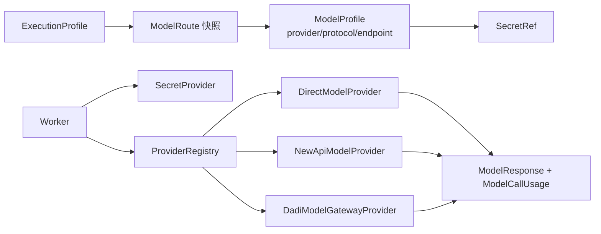
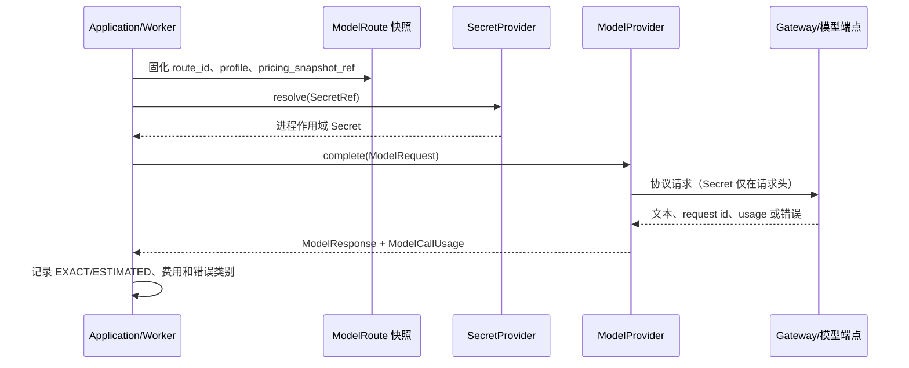

# 模型路由与 Provider 适配

模型路由用 `ModelRoute` 表示租户可绑定的模型入口，用 `ModelProfile` 保存供应商中立的模型名、协议、端点和 `SecretRef`。配置对象不保存 API Key；Worker 解析 Secret 后只把它交给当前进程中的 Provider transport。

## 架构图



Provider 只实现 `ports.model_provider.ModelProvider` 端口。业务对象只依赖 `ModelRoute` 和标准请求/响应，因此切换 new-api 或 Dadi 不要求增加平台自有兼容性矩阵。

## 数据模型与状态

| 类型 | 关键字段 | 边界 |
| --- | --- | --- |
| `SecretRef` | `secret_id`、`scope`、`provider` | 仅引用；不含凭据值 |
| `ModelProfile` | `model_name`、`provider`、`protocol`、`endpoint`、`secret_ref` | 与租户绑定，保存价格快照引用 |
| `ModelRoute` | `route_id`、`tenant_id`、`alias`、`profile`、`status` | 不可变；启动 Run 时复制为快照 |
| `ModelCallUsage` | 输入/输出/总 Token、费用、请求 ID | `EXACT` 或 `ESTIMATED`，估算必须有方法 |

`ModelRoute` 和 `ModelProfile` 是冻结对象。管理员修改入口应创建新路由或新 Profile；已开始的 Run 继续使用启动时的路由快照，后续 Run 才解析新 Provider。

## 调用流程



### 凭据行为

- `to_public_dict()`、`to_snapshot()` 和 `to_snapshot_json()` 只输出 `SecretRef` 元数据，不输出 API Key。
- `repr()` 对 `SecretRef`、`ModelProfile`、`ModelRoute`、`ModelResponse` 和 `ModelCallUsage` 做脱敏。
- Provider 异常只返回稳定错误类别；不把上游原始 payload 或认证值写入日志、审计和持久化快照。
- 生产环境应注入受控 `SecretProvider`；测试可使用确定性的 `FakeModelProvider` 或显式 Secret 映射。

### 用量与定价

上游提供输入、输出或总 Token 时，`normalize_usage()` 统一兼容 `input_tokens/output_tokens` 与 OpenAI 风格的 `prompt_tokens/completion_tokens`，并标记 `UsageStatus.EXACT`。上游缺少 usage 时保存估算 Token、`usage_status=ESTIMATED` 和 `estimation_method`；费用关联 `pricing_snapshot_ref`，避免价格表变更后重算历史 Run。

## Provider 与错误契约

- `DirectModelProvider` 调用已配置端点，负责请求字段和统一响应解析；未配置 transport、Secret 无法解析、响应无文本或上游报错时抛出 `ModelProviderError`。
- `NewApiModelProvider` 与 `DadiModelGatewayProvider` 共享同一端口，协议转换留在适配器内部。它们可以在不改动领域对象的前提下替换注册表中的实现。
- `ProviderRegistry.resolve(route)` 按路由快照的 `provider` 选择实现；未注册 Provider 直接失败，不回退到其他供应商。
- `FakeModelProvider` 用于契约测试和本地开发，可返回文本、标准化 usage、provider request id 或可控模型错误。

## 已验证项与未验证项

已验证：

- 路由和 Profile 的冻结性、租户边界与 Secret 脱敏。
- Fake Provider 的文本、精确 usage、请求引用和错误路径。
- Direct Provider 的 Secret 解析、请求头注入、OpenAI 风格 usage 归一化。
- new-api/Dadi Provider 的可替换注册与按路由选择。
- 缺少上游 usage 时的 `ESTIMATED` 标记、估算方法和定价快照引用。

未验证：

- 真实 new-api、Dadi Gateway 的网络协议、重试、流式事件和限流行为。
- 生产 SecretProvider、加密存储和数据库迁移；这些由后续基础设施任务接入。
- 费用计算规则目前只保留上游 cost 与 pricing snapshot 引用，未在本模块自行推导价格。

## 验证命令

```bash
backend/.venv/bin/pytest -q backend/tests/test_model_routes.py
backend/.venv/bin/ruff check backend/src/agent_platform/domain/model_routes.py backend/src/agent_platform/ports/model_provider.py backend/src/agent_platform/adapters/model_provider.py backend/tests/test_model_routes.py
```
