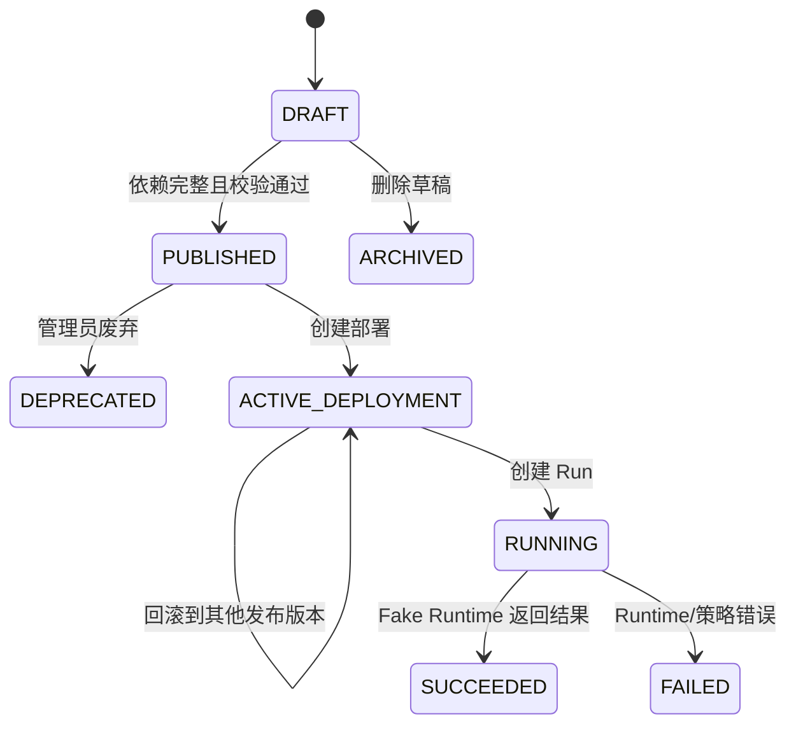
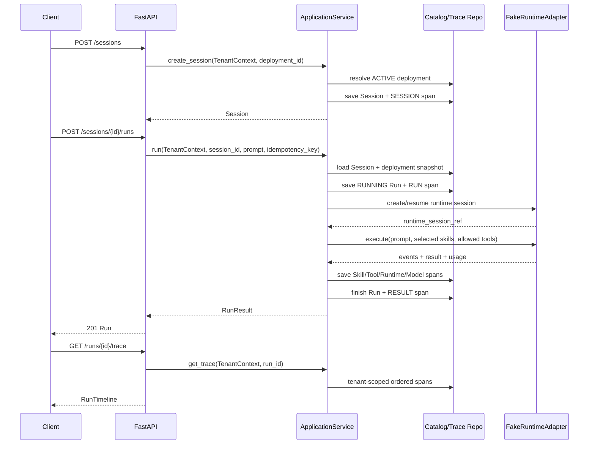

# 数字员工最小闭环设计

日期：2026-11-14  
状态：已确认，进入实现  
范围：后端 API + Fake Runtime 为主，前端提供最小 Trace 查询入口

## 1. 目标与验收

本次实现把以下链路变成一条可重复验证的本地闭环：

```text
创建 Skill/Tool 草稿
       |
       v
发布 Skill/Tool
       |
       v
创建数字员工草稿并绑定已发布 Skill/Tool
       |
       v
发布数字员工版本
       |
       v
部署到当前租户
       |
       v
创建 Session -> 创建 Run
       |
       v
AgentResolver 固化版本快照
       |
       v
FakeRuntimeAdapter 执行指令并产生标准事件
       |
       v
保存 Trace/Span/Usage/RuntimeReference
       |
       v
按租户查询 Run Trace
```

验收必须证明：

- 已发布版本不可直接修改，部署固定发布版本。
- Skill 声明的 Tool 与数字员工部署允许的 Tool 取交集；未授权工具不会进入执行。
- Run 保存员工版本、Skill、Tool、ExecutionProfile 和 Runtime 引用快照。
- Fake Runtime 返回确定性文本和标准化运行事件，不把 Runtime 私有状态暴露给控制面。
- Trace 可按 Session/Run 查询，至少包含 Session、Run、Skill、Runtime、Tool 和 Model/Usage 相关 Span。
- 跨租户资源按不存在处理，不能通过请求体或普通请求头切换租户。
- 相同幂等键重复创建 Run 返回原 Run，不重复执行。

## 2. 架构

采用模块化单体：

```text
FastAPI 路由
   |
   v
ApplicationService（发布、部署、运行、查询）
   |
   +--> CatalogRepository（内存实现）
   +--> RuntimeAdapter（端口）
   |       |
   |       +--> FakeRuntimeAdapter
   |               |
   |               +--> harness-engine FakeEngine（仅生命周期调用）
   +--> TraceRepository（内存实现）
   +--> Identity/Authorization（现有 Fake 实现）
```

后端控制面不依赖 Harness 的持久化类型。适配器只把平台输入转换为 `RuntimeRequest`，把 Fake Engine 结果转换为 `RuntimeResult`；Runtime 私有 Session 以 opaque `runtime_session_ref` 保存。

本阶段使用进程内内存仓储，应用启动时加载确定性示例 Skill、Tool 和员工，便于离线 API 验收。仓储接口以租户上下文为第一参数，后续可替换为 MySQL，不改变应用服务与 API 契约。

## 3. 领域模型与状态

### 3.1 资源

- `ToolVersion`：工具名、版本、输入 Schema、实现标识、状态。
- `SkillVersion`：Skill 名称、版本、类型（instruction/tool-bundle/workflow）、指令、允许工具、输入输出 Schema、状态。
- `DigitalEmployee`：稳定员工身份与租户归属。
- `DigitalEmployeeVersion`：不可变的指令、Skill 顺序、Tool 绑定、ExecutionProfile 和策略快照。
- `Deployment`：租户范围的 ACTIVE 绑定，指向一个已发布员工版本。
- `ExecutionProfile`：运行引擎、模型别名、上下文/工具策略的不可变版本。
- `Session`：当前租户与员工部署的上下文，保存 `trace_id` 和 Runtime opaque 引用。
- `Run`：一次输入执行，保存版本快照、状态、结果、幂等键和 `trace_id`。
- `TraceSpan`：不可变完成 Span，包含 `span_id`、父 Span、类型、状态、错误类别和结构化属性。
- `UsageRecord`：Fake Runtime 的输入/输出/总 Token 估算与来源标记。

### 3.2 状态



已发布 `ToolVersion`、`SkillVersion`、`DigitalEmployeeVersion` 和 `ExecutionProfile` 使用冻结数据类；更新必须创建新版本。

## 4. API 契约

所有接口前缀为 `/api/v1`，身份从 `X-Fake-User` 解析。请求体中的 `tenant_id` 只用于一致性校验，不能改变认证租户。

### 4.1 管理资源

- `POST /skills`、`POST /skills/{id}/publish`
- `POST /tools`、`POST /tools/{id}/publish`
- `POST /digital-employees`
- `POST /digital-employees/{id}/versions`
- `POST /digital-employees/{id}/versions/{version}/publish`
- `POST /deployments`
- `GET /deployments`

最小创建请求只暴露业务字段；版本发布时服务端校验 Skill/Tool 均为当前租户可用的 PUBLISHED 版本。

### 4.2 执行与追踪

- `POST /sessions`：用 deployment_id 创建 Session，返回 session_id 和 trace_id。
- `POST /sessions/{session_id}/runs`：输入 prompt 和幂等键，创建并同步执行 Run。
- `GET /runs/{run_id}`：返回状态、结果、快照引用。
- `GET /runs/{run_id}/trace`：返回有序 Span、RuntimeReference 和 Usage。
- `GET /sessions/{session_id}/trace`：按 Session 聚合 Run 时间线。

错误响应统一为 `{code, message, request_id, details}`；跨租户资源返回 `404 RESOURCE_NOT_FOUND`。

## 5. 执行时序



Fake Runtime 的确定性行为：对每个 instruction Skill 生成一个 Skill Span；如果允许工具集合中包含 `echo` 且 prompt 以 `echo:` 开头，生成一次 Tool Span；最终文本为 `fake: {prompt}`，Usage 标记为 `ESTIMATED`。工具调用仅使用注册的无副作用处理器。

## 6. 错误与隔离

- 发布缺少依赖：返回 `DEPENDENCY_VALIDATION_ERROR` 和缺失资源列表，不创建发布版本。
- 已发布对象修改：返回 `IMMUTABLE_VERSION`。
- 非 ACTIVE 部署或 Session：返回 `INVALID_STATE`。
- 未声明/未授权工具：记录 `POLICY_DENIED` Tool Span，Run 失败且没有伪造成功输出。
- Runtime 能力缺失：返回 `UNSUPPORTED_CAPABILITY`，保留原 Session。
- 跨租户查询：不泄露资源存在性。
- 幂等键复用不同 prompt：返回 `IDEMPOTENCY_CONFLICT`。
- Trace 只存元数据和摘要，不保存完整 prompt、工具参数和响应正文。

## 7. 测试与文档

测试分层：

1. 领域状态和依赖校验单元测试。
2. RuntimeAdapter/FakeRuntimeAdapter 契约测试。
3. FastAPI API 契约测试，覆盖身份、租户隔离、幂等和错误码。
4. 一条端到端 API 测试完整执行上述时序并查询 Trace。

本阶段新增/更新：

- `backend/src/agent_platform/domain/catalog.py`
- `backend/src/agent_platform/domain/execution.py`
- `backend/src/agent_platform/domain/observability.py`
- `backend/src/agent_platform/application/control_plane.py`
- `backend/src/agent_platform/ports/runtime.py`
- `backend/src/agent_platform/adapters/runtime/fake.py`
- `backend/src/agent_platform/api/routes.py`
- `backend/tests/test_control_plane_api.py`
- `frontend/src/api/client.ts`
- `frontend/src/features/runs/RunTrace.tsx`
- `docs/数字员工最小闭环.md`

已验证项和未验证项会在中文文档中明确列出；MySQL、真实 DeepSeek/Codex、生产 Worker 和浏览器 E2E 不在本阶段验收范围。

