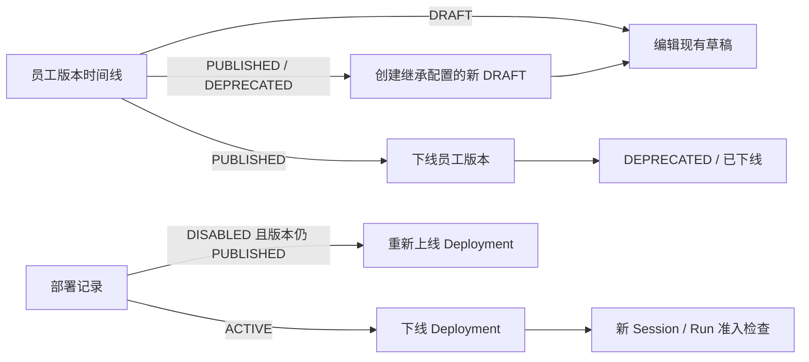
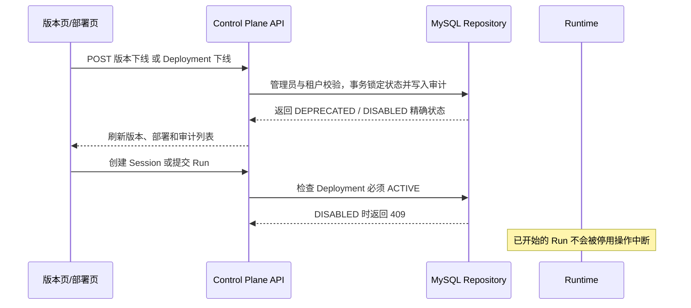

# 员工版本编辑与下线设计

## 背景

员工版本配置页已支持编辑 DRAFT、保存、测试和发布；员工版本时间线只为 DRAFT 提供“继续配置”。管理员从 PUBLISHED 版本页无法直接创建可编辑副本，成员身份下表单被禁用但页面没有解释。版本领域已有 `DEPRECATED` 状态转换，Deployment 表已有 `ACTIVE`/`DISABLED` 状态，但当前没有对应的 API、审计操作或运行时停用检查。

本设计补齐三类操作：编辑当前 DRAFT、从已发布/已废弃版本创建新草稿、废弃已发布版本；并为 Deployment 增加独立的下线/重新上线操作。已确认的语义是版本废弃不自动停止现有 Deployment。

本地 API 查询确认当前链接中的员工 v1 状态为 DRAFT；管理员可以编辑，成员身份会使表单只读。版本“下线”操作只对 PUBLISHED 版本开放。

## 目标

- 在版本时间线和版本详情页明确区分编辑草稿、复制版本、废弃版本。
- 为租户管理员提供版本废弃和 Deployment 下线/重新上线操作。
- 版本废弃阻止后续新 Deployment、回滚和员工版本发布使用该版本，但保留历史数据。
- Deployment 下线后拒绝该 Deployment 的新会话和新运行；已开始的运行可以完成。
- 保持租户隔离、审计可追溯和 PUBLISHED 快照不可变。
- 复用现有状态字段，不新增数据库表或字段。

## 非目标

- 不从版本废弃操作中级联停用已有 Deployment。
- 不中断正在执行的 Runtime 请求，不删除会话、运行、Trace 或历史 Deployment。
- 不允许原地编辑 PUBLISHED 或 DEPRECATED 版本。
- 不提供管理员以外的版本/Deployment 写操作。

## 方案比较

### 方案 A：版本和 Deployment 独立管理（采用）

“下线版本”只阻止该版本今后的新用途；管理员可在部署记录中逐个下线使用该版本的 Deployment。优点是每次停用范围明确，不会因一个版本操作意外影响多个运行入口。代价是管理员可能需要执行两个步骤，因此版本确认提示必须列出当前仍 ACTIVE 的 Deployment，并提供前往部署记录的入口。

### 方案 B：废弃版本时自动停用所有关联 Deployment

一个操作即可停止该版本所有运行入口，但会批量改变多个 Deployment 的状态，调用方不易预见影响范围；不同 Deployment 也可能承担不同流量职责。本轮不采用。

### 方案 C：只增加 Deployment 下线

只能停止指定运行入口，仍允许创建新的 Deployment 或回滚到相同员工版本，不能满足版本退役需求。本轮不采用。

## 交互设计

### 员工版本时间线

版本卡片按状态展示不同操作：

| 状态 | 管理员操作 | 成员操作 |
|---|---|---|
| DRAFT | 编辑草稿、查看 Skills/Tools | 查看 |
| PUBLISHED | 查看配置、基于此版本创建草稿、下线版本 | 查看 |
| DEPRECATED | 查看配置、基于此版本创建草稿 | 查看 |

“新建空白草稿”保留为独立操作。编辑 PUBLISHED 或 DEPRECATED 版本时，先 fork 完整配置到新 DRAFT，再进入新版本编辑页；原版本不会改变。fork 成功后页面显示新版本号和来源版本。

“下线版本”确认展示版本号、当前 ACTIVE Deployment 数量和明确说明：下线版本不会自动停止已有 Deployment；如需停止运行，应在部署记录中逐个下线。若当前没有 ACTIVE Deployment，确认内容说明该版本只会停止今后的新部署和回滚。

### 版本编辑页

- DRAFT 标题为“编辑草稿 vN”，管理员可以保存、测试已保存配置和发布；显示未保存状态。
- 草稿表单提交保留折叠的 Workspace/Sandbox 参数和 ExecutionProfile 精确版本号；仅管理员明确选择新的 Profile 时才改变固定版本。目录只提供较新 Profile 版本时保留历史固定值并明确说明无法读取旧版本策略，不静默升级。
- PUBLISHED 标题为“已发布版本 vN”，表单只读，管理员可创建编辑副本或废弃该版本。
- DEPRECATED 标题为“已下线版本 vN”，表单只读，管理员可以基于该历史版本创建新草稿。
- 成员看到只读说明和当前身份提示；归档员工的版本不可编辑、分叉、发布或废弃。
- 手机窄屏将操作按钮纵向排列；键盘焦点可见，表单继续使用现有纵向分组。
- Fork 成功后的异步导航仅在原版本页仍为当前活动路由时执行；Query Cache 失效始终执行，避免晚到回调覆盖用户后续页面和未保存编辑。

### 部署记录

- ACTIVE 行显示“下线”；确认时显示员工、版本和 Deployment 标识。
- DISABLED 行显示“重新上线”。仅当员工未归档且其固定员工版本状态为 PUBLISHED 时允许重新上线；版本已废弃时解释重新上线不可用。
- 成员只读；管理员操作成功后刷新部署列表和审计记录。

## 生命周期与状态

### 员工版本

```text
DRAFT ──发布并通过预检──> PUBLISHED ──下线──> DEPRECATED
  │                           │                     │
  └──继续编辑                 └──fork 新 DRAFT──────┘
```

- `DEPRECATED` 是终态；界面显示为“已下线”，不支持重新发布该版本。
- 新 Deployment 和 Deployment 回滚只接受 `PUBLISHED` 员工版本。新员工版本可以从已下线版本 fork 到 DRAFT；新版本能否发布由其自身 Skill/Tool 等依赖预检决定。
- 已有 Deployment 可以继续引用 `DEPRECATED` 员工版本并保持运行，直到管理员单独停用。
- 允许从 PUBLISHED 或 DEPRECATED 版本 fork 到新的 DRAFT。fork 保留精确 Skill/Tool 绑定与执行配置。

### Deployment

```text
ACTIVE ⇄ DISABLED
```

- ACTIVE 可下线为 DISABLED。
- DISABLED 仅在员工未归档、固定员工版本仍为 PUBLISHED 时可重新上线。
- 下线后新建 Session 返回稳定的 `DEPLOYMENT_DISABLED`/409；已有 Session 新建 Run 也返回同一状态错误。
- 已提交 Run 的幂等重放先于新的 Session/Deployment 准入检查：相同租户、Session、幂等键和摘要返回原 Run；同一键但摘要不同返回 `IDEMPOTENCY_CONFLICT`。只有没有历史 Run 的请求才会因 Deployment 为 DISABLED 返回 `DEPLOYMENT_DISABLED`。
- 已经通过 ACTIVE 检查并进入 Runtime 的运行视为已开始，允许完成；平台不尝试取消正在执行的外部 Runtime。
- 重新上线不修改固定员工版本、历史 Session 或 RunSnapshot。

### 并发边界

版本下线和 Deployment 创建/回滚都必须在 repository 事务内锁定对应员工版本状态。下线事务提交之后，新建 Deployment 和回滚不能再指向该版本；从该历史版本 fork 出来的新员工版本按自身配置与依赖进行发布预检。与 Deployment 下线并发的会话/运行请求以 Deployment 状态检查作为准入点：在 DISABLED 状态提交后开始检查的请求必须拒绝；已通过准入检查的请求视为已开始并允许完成。

## 架构与流程





## API 变更

| 方法与路径 | 行为 | 约束 |
|---|---|---|
| `POST /digital-employees/{id}/versions/{version}/deprecate` | 下线精确员工版本 | 管理员；源版本必须为 PUBLISHED；重复请求稳定返回当前 DEPRECATED 状态 |
| `POST /digital-employees/{id}/versions/{source_version}/fork` | 从版本创建下一 DRAFT | 管理员；源版本允许 PUBLISHED/DEPRECATED；事务内分配版本号 |
| `POST /deployments/{deployment_id}/disable` | 下线指定 Deployment | 管理员；只允许 ACTIVE -> DISABLED |
| `POST /deployments/{deployment_id}/enable` | 重新上线指定 Deployment | 管理员；只允许 DISABLED -> ACTIVE，员工必须未归档且版本仍为 PUBLISHED |
| `POST /sessions` | 创建 Session | Deployment 必须 ACTIVE |
| `POST /sessions/{session_id}/runs` | 创建 Run | 关联 Deployment 必须 ACTIVE；已开始的 Run 不受后续状态变更影响 |

状态冲突返回 409，成员写入返回 403，跨租户/不存在资源沿用当前 404 约定。错误正文保持稳定的业务码，供界面显示具体原因。

## 数据模型与持久化

- 复用 `digital_employee_versions.status` 的 `PUBLISHED`/`DEPRECATED` 状态，界面分别显示“已发布/已下线”。
- 复用 `deployments.status` 的 `ACTIVE`/`DISABLED` 状态。
- 不新增表、字段、索引或 migration。
- `Deployment` 作为历史持久对象时允许其固定 `employee_version` 为 PUBLISHED 或 DEPRECATED；创建 Deployment 和 rollback 的应用服务仍单独强制目标版本为 PUBLISHED。这样版本废弃不会使历史 Deployment 无法读取。
- repository 更新状态时锁定当前记录，并在同一事务中写入 `audit_events`。版本下线事件记录员工 ID、版本号；Deployment 状态事件记录 Deployment ID、员工 ID、固定版本和前后状态。
- API 和 Query Cache 保持当前 Fake User/租户隔离规则。

## 文件范围

- `backend/src/agent_platform/domain/catalog.py`：员工版本废弃状态与 Deployment 启停领域转换；允许历史部署引用 DEPRECATED 版本。
- `backend/src/agent_platform/application/catalog_service.py`、`application/control_plane.py`：管理员授权、状态转换、准入检查与状态冲突处理。
- `backend/src/agent_platform/infrastructure/mysql_catalog.py`：事务锁、状态更新、审计写入与历史部署读取。
- `backend/src/agent_platform/api/route_modules/catalog.py`、`route_modules/deployments.py`：新增版本废弃和 Deployment 启停路由。
- `frontend/src/api/client.ts`、`EmployeeDetailPage.tsx`、`EmployeeVersionEditorPage.tsx`、`DeploymentListPage.tsx`：状态类型、显式编辑/分叉/废弃/下线/重新上线操作。
- `frontend/src/styles.css`：窄屏操作区、状态说明和键盘焦点样式。
- `docs/前端交互设计.md` 与 `openspec/changes/digital-employee-resource-center/`：同步生命周期、API、权限和状态说明。

## 验收与验证

需要覆盖的行为：

- 管理员编辑 DRAFT 并保存；成员页展示只读原因。
- PUBLISHED/DEPRECATED 版本不会被原地修改，fork 后新 DRAFT 的绑定和运行配置完整继承。
- 已下线版本不能创建新 Deployment 或回滚；已 ACTIVE 的历史 Deployment 仍可读取和运行。基于它 fork 的新员工版本按自身依赖进行发布预检。
- 下线 Deployment 后，新 Session 与已有 Session 的新 Run 均失败；正在执行的 Run 可完成。
- 重新上线只对未归档员工且固定版本仍 PUBLISHED 的 Deployment 成功。
- 租户隔离、并发状态转换和每种状态操作的审计事件正确。
- 手机布局、键盘焦点、操作确认文本和状态错误说明可访问。

建议验证命令：

```bash
cd backend && pytest tests/test_catalog_service.py tests/test_catalog_crud_rollback.py tests/test_control_plane_api.py
cd frontend && npm run build
```

本设计阶段尚未实现或验证上述行为；实现阶段须记录执行命令、通过/跳过项和未验证边界。数据库无 migration 变更，因此无需新增 MySQL 字段 COMMENT 检查。
