# DeepSeek Harness 默认引擎设计

## 意图

让 MySQL/Compose 环境默认使用 DeepSeek Harness，使管理员新建 ExecutionProfile 时能选择唯一的“DeepSeek Harness”选项，并能创建配置、提交 Run，由 Worker 实际进入 Harness Runtime。保留 `AGENT_PLATFORM_RUNTIME_ENGINE=fake` 作为显式离线回退方式。

## 当前状态

- `harness-engine` 已包含 DeepSeek Harness SDK 适配器，后端可通过 `AGENT_PLATFORM_RUNTIME_ENGINE=deepseek` 构造 Runtime。
- Profile 选择器只展示 `/api/v1/engine-providers` 返回的 Provider。
- Compose 没有把 `.env` 中的运行引擎变量传给 API/Worker；MySQL 入口因而退回 `fake`。现有验收覆盖配置只给 Worker 设置 DeepSeek，API 仍返回 Fake Provider。
- DeepSeek Provider 注册同时公开 `deepseek_harness` 和 `deepseek` 两个名字，会产生重复的显示选项。

## 目标与非目标

目标：

- MySQL 模式默认选择 DeepSeek Harness；Fake 模式仍默认 Fake。
- Compose 将同一个引擎配置传给 API、Run Worker 和验收 Worker；用户可通过 `.env` 显式选择 `fake`。
- DeepSeek Harness 在选择器中只显示一个规范名称 `deepseek_harness`，历史 `deepseek` Profile 仍能解析。
- 验证从 Provider 查询、Profile 创建/发布、ModelRoute 配置、Session/Run 快照到 Worker Harness 执行的链路。
- Profile 不保存密钥；租户模型 SecretRef 只在 Worker 解析和传入 Harness。

非目标：

- 不改数据库表、API 的租户/权限模型、Run 快照格式或 Harness SDK 版本。
- 不把真实 DeepSeek 凭据写入仓库或注入 API 容器。
- 本地验收使用现有确定性模型 Mock，不发起真实模型请求；生产 DeepSeek 凭据与公网请求另行验收。

## 方案

1. **DeepSeek 默认并统一配置（采用）**：MySQL 模式缺省为 DeepSeek，Fake 模式仍为 Fake；Compose 从一个 `AGENT_PLATFORM_RUNTIME_ENGINE` 配置向 API 和 Worker 传值。配置值改回 `fake` 可离线运行。Provider 注册只公开 `deepseek_harness`，通过 `deepseek` 别名解析兼容旧 Profile。这样选择器、Session 校验和 Worker 的实际 Runtime 由同一配置驱动。
2. **只在 API 注册 DeepSeek**：Profile 看似可选，但 Worker 可能仍是 Fake，运行到提交后才失败，形成控制面与执行面的错配。
3. **API 和 Worker 分别配置启用开关**：允许独立注册状态，增加组合复杂度，也容易再次出现配置漂移。

## 主要流程

```mermaid
flowchart LR
  Env[AGENT_PLATFORM_RUNTIME_ENGINE 默认 deepseek] --> API[API 构造 DeepSeek Runtime]
  Env --> Worker[Worker 构造 DeepSeek Runtime]
  API --> Registry[注册 deepseek_harness]
  Registry --> UI[Profile 选择器]
  UI --> Profile[创建并发布 ExecutionProfile]
  Profile --> Route[租户选择独立 ModelRoute]
  Route --> Session[创建固定运行快照]
  Session --> Run[提交 Run]
  Run --> Worker
  Worker --> Harness[DeepSeek Harness SDK]
  Harness --> Result[统一 Run 结果与 Trace]
```

## 凭据和错误边界

- DeepSeek Profile 只记录 `engine_name`；Endpoint、模型 ID 和 SecretRef 仍属于租户 ModelRoute。
- Worker 根据已固定的 ModelRoute SecretRef 解析租户凭据，并只向本次 Harness 运行环境注入；API、RunSnapshot、Trace 不接触密钥明文。
- Provider/协议不兼容时 Session 创建失败；Worker 缺少 SecretRef 对应密钥时返回稳定配置错误，不回退到 Fake。
- `AGENT_PLATFORM_RUNTIME_ENGINE=fake` 是运维级显式切换，应用重启后 API 和 Worker 必须同时使用 Fake。

## 验证计划

- 单元测试覆盖 MySQL 默认 DeepSeek、Fake 模式默认 Fake、显式 Fake 覆盖和规范名称/旧别名解析。
- `docker compose config` 验证 API 与 Worker 得到相同 Runtime 值。
- 使用本机 deterministic model mock 创建/发布 DeepSeek Profile 和兼容 ModelRoute，创建 Session 并由 Worker 提交 Run；结果标明走过真实 DeepSeek Harness SDK 适配层及 Mock 模型端点，不代表真实 DeepSeek 云端推理。
- `pytest`、Ruff、前端测试和 production build 验证相关回归；静态 HTML 原型检查键盘操作、窄屏、租户上下文、权限与空/加载/错误/结果状态。

## 待确认限制

- 本地 Mock 只能证明 Harness、ModelRoute、Worker、Run 状态和结果映射已打通；真实 DeepSeek API 凭据、模型调用和生产密钥服务仍需独立验收。
- 无数据库结构变化，因此不需要 migration。
