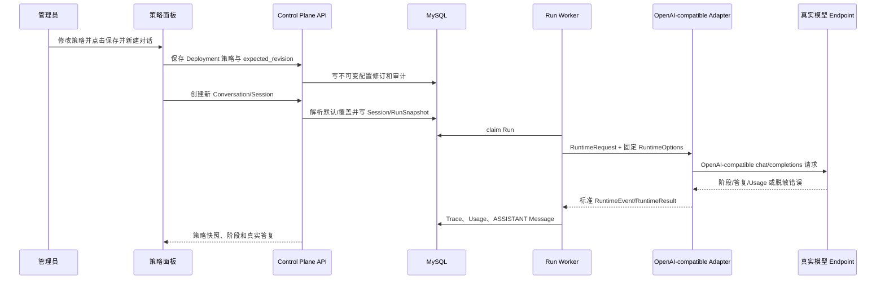

# 运行策略独立面板与真实模型闭环设计

## 状态与范围

- 状态：待用户评审，尚未进入实现。
- 目标：把 Deployment/默认环境中的回答策略抽成统一面板，并使用现有 OpenAI-compatible 本地/内网 ModelRoute 完成一轮真实模型验收。
- 真实模型入口：`http://host.docker.internal:63072/v1`，模型通过租户 ModelRoute 选择，凭据只使用 Worker 进程的 `local-model-key` SecretRef 环境映射。
- 已探测：该 Endpoint 在当前机器可达，带现有 SecretRef 可返回模型目录；未把凭据写入仓库或文档。

## 目标与非目标

### 目标

- 用一个可复用策略面板统一默认运行环境、Deployment 覆盖和工作台“新建对话”入口。
- 清楚区分当前生效值、作用域来源、本次覆盖、引擎能力和新 Session 影响范围。
- 保存后以固定策略快照启动新 Session，真实模型执行后在工作台显示策略和阶段。
- 真实模型验收可重复、可脱敏、可回滚，不依赖 Fake 结果。

### 非目标

- 不展示原始思考链、隐藏 Prompt、API Key 或完整工具 payload。
- 不把真实模型调用改成 API 进程同步调用；仍由 Worker 负责出站。
- 不在本期让 Codex app-server 的未验证预算字段或 Tool/MCP 能力变成可选项。
- 不替换现有 ModelRoute、Session/RunSnapshot 或租户授权模型。

## 方案取舍

### 方案 A：独立双栏策略面板（采用）

把策略字段、能力摘要、来源和快照预览封装为 `RuntimeStrategyPanel`，Deployment、默认环境和工作台只传上下文与保存回调。优点是视觉和字段语义只有一份，能直接承载“保存并新建对话”的真实验收；代价是需要改造现有表单和组件测试。

### 方案 B：保留各页面表单，仅抽公共字段

只抽出四个选择器，保留各页面布局。改动较小，但会继续出现来源提示、能力告警和新 Session 入口不一致的问题，不满足本次“独立策略面板”的目标。

### 方案 C：完全改成工作台侧抽屉

把配置全部放入工作台抽屉。交互集中，但默认运行环境和 Deployment 管理入口会失去独立审计上下文，不符合现有管理台原型的分区。

## 交互设计

### 双栏布局

左栏“策略设置”：

1. 思考模式：继承默认、自动思考、深度思考、关闭思考。
2. 推理强度：继承默认、自动、低、中、高。
3. 答复详细程度：继承默认、简洁、标准、详细。
4. 推理预算：自动、8K、16K；能力不支持时禁用并解释原因。

右栏“运行预览”：

- 当前生效策略与来源：用户、租户、平台或 Deployment 覆盖。
- 本次修改差异：只列发生变化的字段。
- EngineProfile、ModelRoute、模型 ID、配置修订和 capability 状态。
- 明确提示“只影响新 Session；当前对话保留旧快照”。
- 管理员显示“保存并新建对话”；成员只读，不显示保存按钮。

弹框底部固定动作：取消、保存策略、保存并新建对话。保存失败保留未提交选择，提供重试；保存成功后显示修订号和新 Session 入口。

### 工作台显示

新建对话成功后，右侧 Run 快照显示：策略、来源、EngineProfile、ModelRoute、模型 ID、配置修订。时间线按服务端序号显示：排队中、准备运行、思考中、调用工具、生成答复、已完成/失败。时间统一 `YYYY-MM-DD HH:mm:ss`。

## 架构与流程

```mermaid
flowchart LR
  P[RuntimeStrategyPanel] --> API[策略读取/保存 API]
  API --> R[策略解析器]
  R --> S[Session 快照]
  S --> T[Conversation Turn]
  T --> W[Run Worker]
  W --> C[Capability 校验]
  C --> A[RuntimeAdapter]
  A --> M[OpenAI-compatible ModelRoute]
  M --> E[RuntimeEvent/Usage]
  E --> O[Trace/RunSnapshot/Message]
  O --> UI[Workbench 时间线与策略快照]
```





## 数据与 API

本期不新增表。继续使用：

- Deployment `runtime_options_json`：只保存白名单策略覆盖。
- `runtime_strategy_bindings`：保存用户/租户/平台默认策略。
- Session/RunSnapshot：保存解析后的不可变策略、来源、Profile/Route 版本。
- Trace/Usage：保存阶段、耗时、非敏感 Provider request reference 和用量状态。

面板需要的接口组合：

- 读取 Deployment 当前修订、默认策略、EngineProvider capability 和 ModelRoute 摘要。
- 保存策略时携带 `expected_config_version`，冲突返回 `RUNTIME_CONFIG_REVISION_CONFLICT`。
- 保存成功返回修订、解析后的策略和“新建 Session”所需上下文。
- 新建 Session/Conversation 时只使用已授权的固定 Profile/Route，不接受前端传入的 Secret 值。

## 权限与凭据边界

- 租户管理员可以保存租户默认和 Deployment 覆盖；成员只能查看并保存个人默认（如现有权限允许）。
- 面板只显示 SecretRef ID 的脱敏摘要，不显示值。
- API/Web 不读取真实模型密钥；Worker 通过未提交环境变量解析 `local-model-key`。
- 跨租户 Profile、ModelRoute、Session、Run、Trace 返回 404/403，不泄露存在性。

## 异常、重试与回滚

- 配置修订冲突：保留用户未提交选择，重新读取当前值后让用户重试。
- 真实模型 401/403、模型不存在、协议错误：Run FAILED，显示稳定错误类别，不切换 Fake。
- 出站超时且结果不明：Run UNKNOWN，禁止自动重放真实请求。
- Worker 失败：沿用 lease/fencing；旧 Session 不改变。
- 回滚：通过恢复旧 Deployment 配置修订或切换旧 ModelRoute；已有 Session/Run 仍保持快照。

## 真实模型验收

验收前提：

1. `http://host.docker.internal:63072/v1/models` 使用 Worker SecretRef 可访问。
2. 当前租户有 ACTIVE ModelRoute，协议为 OpenAI Chat Completions 或 OpenAI-compatible。
3. 新建 Session 使用 DeepSeek Harness Adapter，不使用 Fake Runtime。

验收动作：

1. 打开 `/enterprise/workbench`，打开运行配置面板。
2. 选择深度/自动思考、推理强度、答复详细程度和预算，保存并新建对话。
3. 提交“请用一句话确认当前模型名称”的短请求。
4. 确认 Run/Trace 显示真实 ModelRoute、策略快照、真实 provider request reference、阶段和 Usage。
5. 刷新页面，确认 USER/ASSISTANT 消息与策略快照仍在；修改配置后旧 Conversation 不变。

真实模型未验证项：真实 reasoning 私有字段是否逐字段生效、供应商 reasoning token 的精确含义、长时恢复、生产身份与 Secret Manager。验收记录必须区分真实模型与 Mock。

## 回滚与验证命令

```bash
cd /Users/liulisheng/IdeaProjects/git/agentDemo
docker compose --env-file deploy/control-plane/.env \
  -f deploy/control-plane/docker-compose.yml up --build -d
curl -fsS http://127.0.0.1:8088/api/health
cd backend
PYTHONPATH=../harness-engine/src .venv/bin/python -m pytest -q
cd ../frontend
npm test -- --run
npm run build
```

已验证的本地 Endpoint 目录访问不得把 Authorization 值写入命令记录；真实模型 Run 需要单独记录时间、模型 ID、脱敏 request reference、Run ID 和费用/配额影响。
