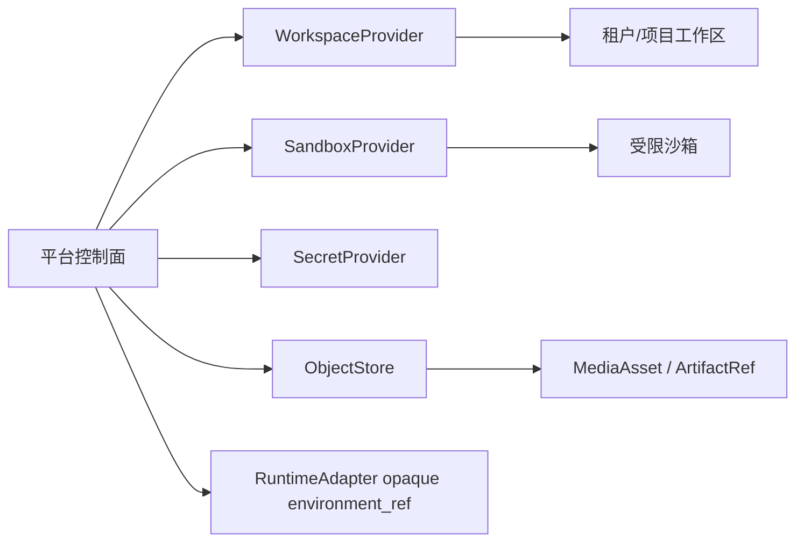
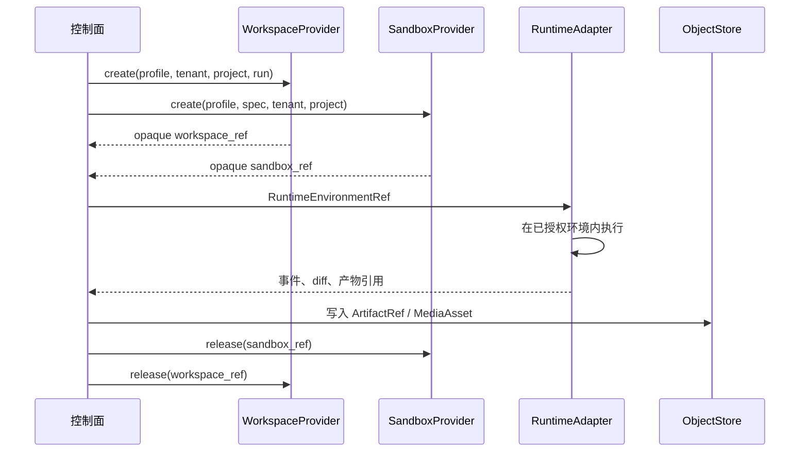
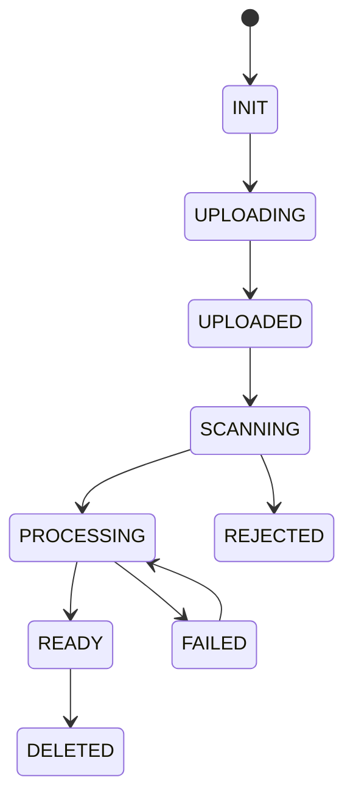

# Workspaces、Sandboxes 与对象存储

状态：第一阶段端口、Fake Provider 和本地 ObjectStore 已实现；外部存储仅提供配置与适配器契约。

## 架构图



平台负责工作区和沙箱的创建、授权、租约、配额、凭据注入、停止与回收。Runtime 只接收 `RuntimeEnvironmentRef`，在已授权环境内执行自己的文件和命令操作；平台不复制 Runtime 的 shell 实现。

## 环境模式与数据模型

`WorkspaceProfile` 描述 `no-files`、`ephemeral` 和 `persistent` 模式，以及仓库、网络、远程数据工具、资源配额和持久化策略。宿主路径、设备、特权和长期凭据会在 profile/spec 校验阶段拒绝。

`WorkspaceRef`、`SandboxRef` 和 `RuntimeEnvironmentRef` 都是 opaque 引用。引用带租户、项目、Run 和租约边界，Fake Provider 会拒绝跨租户或跨项目挂载。持久工作区必须记录所有者、配额、生命周期和访问策略。

代码环境通过 `GitCheckoutRequest` 绑定仓库地址和不可变提交；默认只读，`main`/`master` 不允许写入。运行产物和 diff 使用 `ArtifactRef` 交付。

对象存储通过 `StorageProfile` 显式选择 `local`、`s3`、`minio`、`oss` 或 `cos`。凭据字段只能是 `SecretRef`，签名 URL TTL 受 profile 上限约束；未安装外部适配器时明确失败，不回退本地。`LocalObjectStore` 使用服务端生成的 `object:<platform>:<tenant>:<token>` 引用，客户端永远看不到宿主路径，读取必须带租户边界与大小上限。

`MessageAttachment` 只保存平台 `MediaAsset` 引用。`RuntimeAttachmentRef` 表示复制到 Runtime Workspace 的执行副本；对话附件只有在再次校验租户授权后才可被后续 Run 使用。保留策略为 `EPHEMERAL`、`SESSION`、`CONVERSATION`、`KNOWLEDGE_BASE`。

## 生命周期与时序



对象上传流程是 `create_upload_intent -> complete_upload -> 受控 read -> delete -> collect_garbage`。删除先撤销读取，垃圾回收失败可重试。



## 运维能力边界

日志 Agent 使用 `LogQueryCapability`，只查询授权日志 API，不获得宿主文件或 shell。运维写操作（`restart`、`delete`、`configure`、`scale`）使用 `OperationsCapability`，必须经过审批检查；读取状态和日志可直接执行。

## 已验证项

- Workspace/Sandbox profile 拒绝宿主路径、设备、特权和长期凭据。
- Fake Provider 返回 opaque 引用，并拒绝跨租户、跨项目挂载。
- Git checkout 固定提交且默认禁止写主分支。
- 日志查询可读；重启、删除和配置等写操作需要审批。
- LocalObjectStore 生成租户安全键，限制上传/读取大小，拒绝任意路径和跨租户读取，支持删除与 GC。
- StorageProfile 仅接受显式 provider 与 `SecretRef`；外部签名 URL TTL 不能超过 profile 上限。
- MessageAttachment 与 RuntimeAttachmentRef 保持平台资产和执行副本分离。

## 未验证项

- 真实 S3、MinIO、OSS、COS SDK 上传、签名和断点续传。
- 容器级 CPU、内存、网络和设备隔离，以及真实 SecretProvider 注入。
- 媒体扫描、OCR、ASR、转码和知识库索引流水线。

## 验证命令

```bash
cd backend
python -m pytest -q tests/test_workspaces_storage.py
python -m pytest -q
ruff check src tests
```
