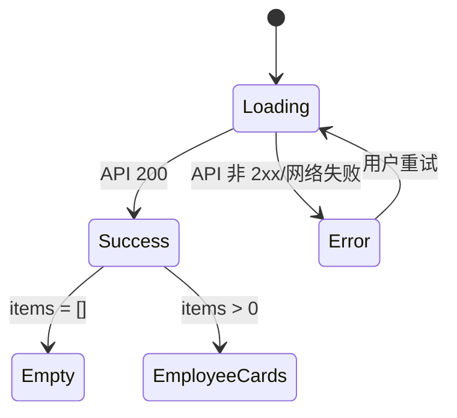
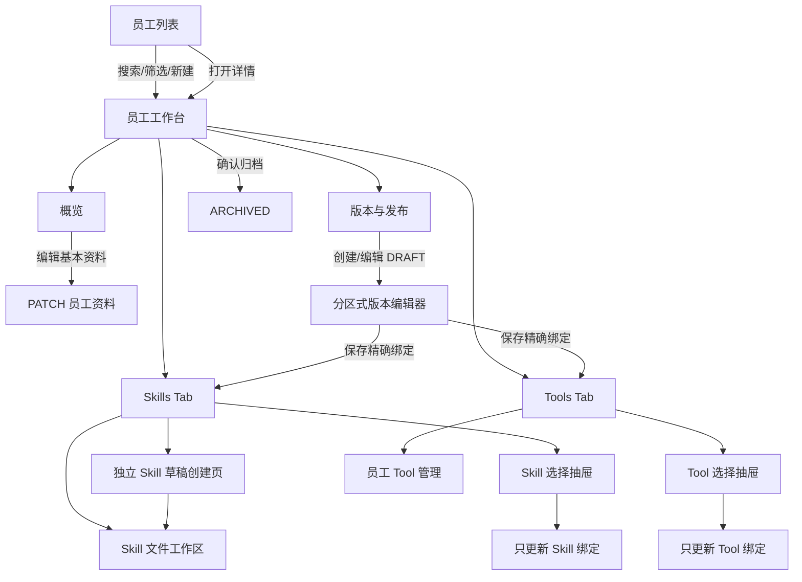
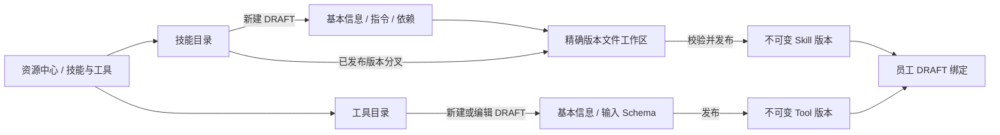
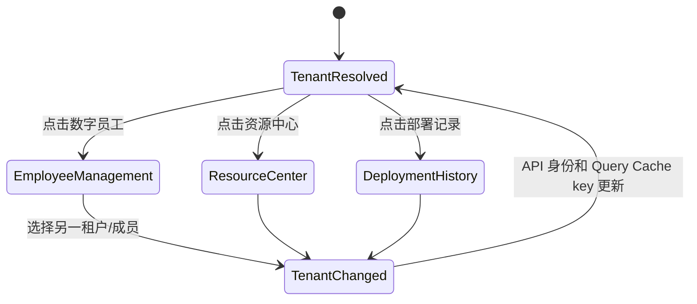

# 前端交互设计

## 技术栈

- React
- TypeScript
- Vite
- React Router
- TanStack Query
- Ant Design

## 旧 Gallery 地址兼容

旧 `/workspace/gallery` 和 `/enterprise/platform` 路由不再显示旧 Gallery，也不保留占位导航；访问时重定向到管理台的 `/enterprise/resources`。首页 `/` 和旧 dashboard/skills 入口默认重定向至 `/enterprise/employees`。管理台的共享资源入口统一命名为“资源中心”。

## 组件边界

```text
EmployeeGallery
    +-- PlatformNavigation
    +-- PageHeader
    +-- EmployeeGrid
          +-- EmployeeCard
```

服务器状态由 TanStack Query 管理，页面组件不直接拼接 fetch 请求。

## 状态展示



## 交互原则

- 卡片展示只读摘要。
- 点击卡片进入详情，不自动创建 Session。
- 点击“使用员工”才创建工作台上下文。
- 所有页面保留加载、空数据和错误状态。
- 前端只依赖 API 类型，不依赖后端领域实现。
- 页面组件使用本项目自己的样式和组件组合。

## 第一批实现关联

- 页面组件：`frontend/src/features/digital-employees/EmployeeGallery.tsx`
- API Client：`frontend/src/api/client.ts`
- 页面测试：`frontend/src/features/digital-employees/EmployeeGallery.test.tsx`
- 验证命令：`npm test`、`npm run build`

## 管理控制台页面壳

`/enterprise` 使用独立的控制台 Layout，一级导航为“数字员工 / 资源中心 / 部署记录”。Skill/Tool 不单独占一级导航：资源中心负责本租户能力目录、共享发现与发布；员工详情负责把精确版本绑定到员工 DRAFT，避免资源管理和员工版本配置混在一起。

```text
ManagementLayout
├── 左侧导航
│   ├── 数字员工       /enterprise/employees
│   ├── 资源中心       /enterprise/resources
│   └── 部署记录       /enterprise/deployments
├── Header
│   ├── 当前租户名称
│   └── 开发身份/租户选择器
└── Outlet
    └── 员工列表 / 员工详情 / 资源中心 / 部署记录
```

本地 Fake 身份选择器包含租户 A 管理员、租户 A 成员和租户 B 管理员；切换时请求身份头同步切换。页面 Query Cache 必须把 Fake User/租户范围纳入 key，防止切换后展示前一个租户的数据。生产环境身份由认证上下文提供，选择器仅作为本地验收工具。

当前管理控制台路由壳位于 `frontend/src/features/management/ManagementLayout.tsx`，租户上下文位于 `frontend/src/features/management/TenantContext.tsx`，由 `App.tsx` 注册员工、资源中心和部署记录路由。桌面使用左侧导航；窄屏将同一组链接移到租户栏下方并横向滚动，保留键盘焦点提示。

## 员工列表与详情

### 员工列表 `/enterprise/employees`

- 顶部提供“新建数字员工”，管理员可以打开 Modal 输入名称、员工类型和描述；提交成功后进入新员工详情。
- 搜索框匹配员工名称、类型和描述；状态下拉过滤 DRAFT/ACTIVE/DISABLED/ARCHIVED；条件变化会重置游标栈。
- 表格显示名称/类型、状态、Skill/Tool 数量、描述和详情入口；“上一页/下一页”使用服务端 `next_cursor`，不通过页码猜偏移。
- 加载状态使用页面提示，零记录显示创建引导，过滤无结果显示筛选提示，API 错误显示错误说明与重试。
- 成员保留查询和详情能力，隐藏新建入口；权限仍以服务端 403 为准。

### 员工详情 `/enterprise/employees/{employee_id}`

员工详情是员工工作台，头部展示员工名称、类型、状态和说明。一级内容 Tab 直接按任务拆开：“概览 / Skills / Tools / 版本与发布”。每个资源类型有自己的 Tab 和列表；界面不再先进入统一资源页再区分类型。

- **概览**：一张员工概览卡显示基本资料、版本数、最新发布和当前草稿；编辑资料/归档留在页头。概览只展示信息，不放跳往其他管理页的快捷卡片。
- **Skills**：单独的 Skills Tab，顶部选择员工版本，列表只显示该版本的 Skill 绑定。添加 Skill 打开类型专属抽屉，提供本租户精确版本和资源中心授权导入；确认只调用 Skill 绑定 API，页面留在 Skills Tab。已发布员工版本先完整 fork 为 DRAFT，再打开抽屉。新建 Skill 进入独立 DRAFT 创建页和 Skill 文件工作区。
- **Tools**：单独的 Tools Tab，顶部使用同一个员工版本上下文，列表只显示 Tool 绑定。绑定 Tool 打开只含 Tool 的抽屉，保存只更新 Tool 绑定；创建/编辑 Tool 仍使用独立 Tool 管理页。
- **版本与发布**：用宽松的版本卡片时间线展示草稿、已发布、已下线和资源数量；操作随状态和当前身份变化。
- 新资源类型启用后增加独立 Tab。知识库页面尚未启用，因此当前不展示知识库 Tab。

管理员可编辑基本信息、归档和创建 DRAFT；成员只读。员工版本编辑器纵向分区显示系统指令、Skills、Tools 和运行配置；Workspace/Sandbox 等高级参数默认收起。



新建、PATCH、归档成功后按租户身份失效员工目录/详情/版本 Query Cache，并显示成功提示；员工列表状态、详情只读状态和详情写按钮共同表达权限，API 仍负责最终授权。

页面组件位于 `frontend/src/features/digital-employees/EmployeeListPage.tsx` 和 `EmployeeDetailPage.tsx`，API 类型/请求位于 `frontend/src/api/client.ts`。测试 `EmployeeManagementPages.test.tsx` 覆盖创建后导航、资料编辑、归档、成员只读、空列表和服务错误。

## DRAFT 员工版本向导

路由 `/enterprise/employees/{employee_id}/versions/{version}` 从员工详情进入。编辑器使用纵向分区卡片，每个区域单独说明用途，主内容宽度限制在约 1040px 并保持充足行距：

1. **角色指令**：编辑 `system_prompt`。
2. **Skills**：只选择 Skill 精确版本。此编辑器的“新建 Skill 草稿”进入独立 Skill 创建页；创建/编辑/发布 Skill 不提交系统指令、Tool 清单或员工运行配置。
3. **Tools**：只选择员工允许的 Tool 精确版本；Tool 管理为独立入口。有效 Tool 交集只在此区展示。
4. **运行配置**：ExecutionProfile、ModelRoute 和审批策略单独成卡；Workspace/Sandbox 放入默认收起的“高级环境参数”。

保存使用 `PUT /api/v1/digital-employees/{id}/versions/{version}`，提交 `skill_version_refs` 和 `tool_version_refs`，不会把 UI 选择转成“当前最新”。页面保存成功后清除未保存状态；编辑过程中刷新、关闭或点击应用内链接会提示未保存修改。

保存按 `execution_profile_id` 和 `execution_profile_version` 固定引用。目录缺少历史精确版本时，现有固定值仍显示并提交，历史选项不可重新选中；精确策略不可读时提示无法预览有效 Tools，不借用更新版本的策略。管理员显式选择其他配置才改变引用。Workspace/Sandbox 的 ID 和版本即使在折叠状态也保留，因此修改指令等无关字段不会丢失分叉继承的运行环境。

“测试版本”打开 prompt Modal，调用 `POST /api/v1/digital-employees/{id}/versions/{version}/test`。它运行已保存的 DRAFT 配置并显示 Fake Runtime 返回，不创建 Deployment、正式 Session、Run 或 Trace；若编辑内容尚未保存，提示先保存。发布使用二次确认，服务端发布预检失败时展示 `details.missing[]` 中的资源/原因。

技能、工具、ExecutionProfile、ModelRoute、资源中心、部署列表、审计事件和 Run Trace 的 Query Cache key 都包含当前 Fake User，租户切换会切换 API `X-Fake-User` 并重新读取数据；旧租户缓存不作为新租户的页面数据。

页面组件：`frontend/src/features/digital-employees/EmployeeVersionEditorPage.tsx`。测试 `EmployeeVersionEditorPage.test.tsx` 覆盖精确绑定保存、有效 Tool 预览、Fake Runtime 版本测试和未保存离页提示。

员工 Skills Tab 的“新建 Skill”创建租户 DRAFT，创建后直接打开该 Skill 的文件工作区。管理员可在工作区编辑 INLINE 内容、创建文件或上传 ZIP；FILE_PACKAGE ZIP 根目录必须包含唯一 `SKILL.md`。完成校验后单独发布 Skill 精确版本，再回到员工 Skills Tab 绑定它。Hub REFERENCE 文件只读，先 COPY 才能修改；PUBLISHED Skill 文件工作区提供创建下一 DRAFT 版本的入口。

Tool 从员工详情的“Tool 管理”或版本编辑器的“管理 Tool”入口进入 `/enterprise/employees/{employee_id}/tools/{tool_id}`。页面列出当前租户 Tool，支持新建 DRAFT、编辑 DRAFT 的名称/描述/JSON Schema 和发布；只有 PUBLISHED Tool 可绑定员工版本，已发布 Tool 不显示编辑操作。管理员有写入口，成员只读。页面/API 位于 `frontend/src/features/digital-employees/ToolManagementPage.tsx`、`frontend/src/api/client.ts` 和 `/api/v1/tools` 路由；测试 `ToolManagementPage.test.tsx` 验证创建及发布。

## Skill 文件工作区

文件工作区路由为 `/enterprise/employees/{employee_id}/skills/{skill_id}/versions/{version}/files`，只从员工版本的 Skill 绑定行进入。左侧文件树和右侧编辑区同时显示精确 Skill 版本、文件 SHA-256 和清单摘要；INLINE 虚拟入口可在创建根 `SKILL.md` 时转换为 FILE_PACKAGE。

- DRAFT 可新建文件、在线编辑、重命名和删除；修改/重命名/删除请求带当前文件 `expected_sha256`。摘要过期时显示冲突错误并要求重读。
- 根 `SKILL.md` 入口不显示重命名/删除按钮。辅助文件支持文本编辑，二进制文件以 Base64 显示。
- ZIP 通过文件选择器上传；先调用 preview API，展示入口、摘要、文件数、replace/merge 差异，用户确认后提交同一 File 和 staging ID。
- 压缩包超过 20 MiB 会在浏览器先提示；路径、压缩/展开大小、符号链接等权威校验仍由后端给出具体错误。
- PUBLISHED 和 Hub REFERENCE 显示只读标记，隐藏新建、上传、保存、重命名和删除操作；文件正文仍按授权来源显示。
- 文件切换遇到未保存编辑会询问是否放弃；切换身份时文件树和内容 Query Cache 均按当前 Fake User 隔离。

页面组件：`frontend/src/features/digital-employees/SkillFileWorkspacePage.tsx`。测试 `SkillFileWorkspacePage.test.tsx` 覆盖 SHA 更新、文件创建/重命名/删除、ZIP merge 预览/确认和 REFERENCE 只读提示。

## 资源中心

路由 `/enterprise/resources` 包含“技能与工具 / 发现资源 / 我发布的 / 我导入的”四个页签，默认进入当前租户的技能与工具目录。能力目录内部切换“技能 / 工具”，按名称或内容搜索并按草稿/已发布过滤；其余三个页签继续管理跨租户 Hub 资源。列表与状态动作优先，避免把目录拆成互不相关的统计卡片。

### 本租户技能与工具

管理员在“技能与工具”中分别新建技能或工具。技能表单按“基本信息（名称、类型）/ 指令内容 / 工具依赖”分组；创建后进入 Skill 文件工作区继续编辑和校验。工具表单按“基本信息（名称、用途）/ 调用输入（JSON Schema）”分组，前端校验 Schema 顶层为对象。工具依赖选择只列出已发布工具。

| 目录对象 | 展示与编辑边界 | API 与状态 |
|---|---|---|
| Skill | 显示类型、精确版本、工具依赖数和状态；DRAFT 可编辑内容/发布，PUBLISHED 只读并可分叉新草稿 | `GET /skills`、`POST /skills`、`POST /skills/{id}/versions/{version}/publish`、`POST /skills/{id}/versions/{version}/fork`；Skill 文件编辑继续使用精确版本文件 API |
| Tool | 显示说明、精确版本、接收方凭据状态；DRAFT 可改基本信息和输入 Schema/发布，已发布版本只读 | `GET /tools`、`POST /tools`、`PATCH /tools/{id}`、`POST /tools/{id}/publish` |

员工绑定仍只接受同租户已发布的精确 Skill/Tool 版本，并只写入员工 DRAFT；资源目录不替用户自动修改员工版本。Skill 文件工作区同时支持员工上下文路由 `/enterprise/employees/{employee_id}/skills/{skill_id}/versions/{version}/files` 和目录路由 `/enterprise/resources/skills/{skill_id}/versions/{version}/files`，全局入口返回资源中心。



目录写操作仅管理员可见，成员维持只读；服务端 403 仍为最终权限判定。抽屉表单在手机端铺满视口，按钮顺序适合触屏，列表允许横向滚动，Tab 顺序沿字段分组，焦点轮廓在键盘操作时可见。系统减少动效并尊重 `prefers-reduced-motion`。

本轮界面变更验证：`cd frontend && npm run build` 通过 TypeScript 与 Vite 构建；本轮未执行前端测试。当前尚未完成资源中心目录的浏览器截图检查。

```bash
cd frontend
npm run build
```

### 发现与导入

共享目录只显示发布方名称、资源类型、名称、描述、最新已发布版本和可用导入方式；查询支持名称/描述关键词与资源类型筛选。`PLATFORM` 可见性下没有 Grant 的租户能发现卡片，但显示“导入需授权”，打开详情只返回脱敏信息，不请求 Manifest，也没有 COPY/REFERENCE 操作。`RESTRICTED` 对未授权租户不显示。

### 发现与导入

点“详情”打开抽屉，展示发布者、可见性、精确版本、Manifest SHA-256、依赖数量、授权模式和说明。授权模式存在时才查询对应模式的授权 Manifest，并展示 Skill 文件相对路径/摘要、依赖类型/版本和接收租户凭据要求。管理员可分别“复制到租户”或“引用为只读资源”；COPY 在租户中成为独立草稿，REFERENCE 显示只读并将精确来源/摘要用于后续员工绑定。提交成功后更新导入列表和可发现目录缓存。

### 我发布的

页面查询当前发布租户自己的 Hub 条目，不把其他租户条目混入。管理员可从“发布资源”选择本租户已发布的数字员工、Skill 或 Tool 精确版本，并选择 `PLATFORM`（可发现、导入仍需授权）或 `RESTRICTED`。创建 Hub DRAFT 后由一次页面操作发布该版本；已存在条目从详情抽屉使用“追加资源版本”，只能选择相同类型的新源版本，不覆盖旧版本。

打开自己发布的版本详情后可创建 Grant：接收租户 ID、COPY/REFERENCE 勾选项、可选失效时间；至少选择一种模式。详情仅列出该精确 Hub 版本的 Grant，管理员可二次确认撤销。新 Hub 版本需单独授权，不自动沿用旧版本 Grant。

### 我导入的

导入行显示来源名称、COPY/REFERENCE 模式、代理状态、本地资源 ID、Hub 固定版本和摘要前缀。新版本已发布且同模式有授权时提供“升级到 vN”；升级建立新代理，页面提示需到员工 DRAFT 显式重绑。REFERENCE 带只读标记、“修改请复制到租户”和撤销确认；COPY 不提供撤销入口，因为它属于接收租户独立资源。撤销 Grant 或导入后的缓存失效按当前 Fake User/租户隔离。

资源中心的列表、详情、授权清单、导入、Grant、升级与撤销都使用当前 Fake User 的 API 请求头和 React Query key。成员可读发现目录和自己的导入记录，但不能看到管理写入口；接口返回的 `403` 仍作为最终权限判定。

页面组件：`frontend/src/features/resources/ResourceCenterPage.tsx`。测试 `ResourceCenterPage.test.tsx` 覆盖无 Grant 的可发现卡片不显示导入操作/不请求 Manifest、REFERENCE 详情显示文件/依赖且导入后只读、撤销引用确认。

## 版本时间线与部署记录

员工详情版本时间线按版本号倒序显示，编辑器使用相同的状态和权限。新建空白草稿仍为独立操作。

| 版本状态 | 未归档员工的管理员操作 | 成员 |
|---|---|---|
| `DRAFT` 草稿 | 编辑草稿、保存、测试已保存版本、发布 | 查看配置 |
| `PUBLISHED` 已发布 | 查看配置、基于此版本创建草稿、下线版本 | 查看配置 |
| `DEPRECATED` 已下线 | 查看配置、基于此版本创建草稿 | 查看配置 |

成员界面说明只读及当前身份；归档员工隐藏写操作。分叉成功后刷新发起身份的缓存，以新版本号打开编辑器并显示来源版本；若当前身份、浏览器路径或历史条目与发起时不同，则跳过导航。下线版本前分页查询该精确版本的 ACTIVE Deployment，确认框展示数量和标识；查询失败禁用确认并允许重试。说明现有部署仍可运行，并提供部署记录入口。成功后刷新员工、版本和部署数据；审计保存在服务端，员工页面没有独立版本审计面板。

部署记录 `/enterprise/deployments` 按员工和 ACTIVE/DISABLED 筛选，展示固定员工版本、Skill/Tool 数量及执行配置。管理员创建和回滚时只能选择 PUBLISHED 目标；回滚后历史 Run 仍从自己的 RunSnapshot 读取原版本。

- ACTIVE 行提供“下线”。确认框显示员工、固定版本和 Deployment ID，并说明下线会停止接收新 Session 和 Run，已通过准入的运行可以完成。
- DISABLED 行提供“重新上线”。打开时重新分页读取该部署，再查询对应员工和精确版本，使用本次读取的版本确认。仅当读取成功、部署仍 DISABLED、员工未归档、固定版本仍 PUBLISHED 时可提交；状态变化或读取失败时说明原因并禁用确认。
- 启停成功刷新发起身份的部署列表和部署审计；当前筛选页为空但有上一页时仍保留返回控件。管理员可通过审计查看 `DEPLOYMENT_CREATED`、`DEPLOYMENT_ROLLED_BACK`、`DEPLOYMENT_DISABLED`、`DEPLOYMENT_ENABLED`。成员只能查看部署，界面隐藏写操作及审计入口。
- 窄屏（720 px 及以下）的部署表格缩小单元格留白，行内操作纵向排列。键盘操作有可见的焦点样式，版本下线框里的部署清单可通过 Tab 聚焦；表单保留未保存离页提示。

页面组件位于 `frontend/src/features/deployments/DeploymentListPage.tsx`。本轮生命周期变更通过 `cd frontend && npm run build`，Vite 仍提示有产物块超过 500 kB；未新增或运行自动化测试，也未做浏览器、手机或键盘验收。后文“管理壳状态”的测试记录属于此前交付。

## 管理壳状态



验证：

```bash
cd frontend
npm test -- --run src/features/management/ManagementLayout.test.tsx src/features/digital-employees/EmployeeManagementPages.test.tsx
npm run build
```

已验证：员工工作台与定向编辑更新后，`npm test` 通过 11 个测试文件、35 个用例，`npm run build` 通过 TypeScript 与 Vite 生产构建。测试覆盖 Skills/Tools 独立抽屉、已发布员工 fork、只更新一种资源绑定、Skill 独立 DRAFT 创建、文件工作区 fork/publish、成员只读、资源中心授权依赖、COPY 绑定和旧路由。版本编辑器的系统指令、Skill、Tool 与运行配置以纵向卡片分区显示；Workspace/Sandbox 等高级参数默认收起。

已验证：MySQL + LocalObjectStore 下租户 A 发布、租户 B COPY/REFERENCE、员工发布部署、创建 Run 并读取 Trace 的闭环由 OpenSpec 任务 6.1 覆盖。本地 Docker 本轮还验证了员工 Skills 定向绑定、已发布 Skill fork 和精确版本发布。

未验证：生产身份中心和云对象存储（MinIO/S3/OSS/COS），这些能力不属于当前本地管理台范围。

## 运行策略与工作台原型追踪（当前 Change）

| 原型字段/状态 | 实现区域 | API/快照边界 | 验收证据 |
| --- | --- | --- | --- |
| 思考模式：自动/深度/关闭 | Deployment 运行配置、默认运行环境 | RuntimeOptions → Session → RunSnapshot | 原型字段、能力校验测试、Session 快照测试 |
| 推理强度、推理预算 | 回答策略区域、Run 快照 | EngineProvider/ModelRoute capability | Adapter 契约测试和不兼容错误测试 |
| 答复详细程度 | 回答策略区域、工作台策略 chip | RunSnapshot、Trace 策略摘要 | UI 组件测试和 Trace 查询测试 |
| 思考中/调用工具/生成答复 | 时间线用户可见事件 | RuntimeEvent/TraceSpan | 阶段事件顺序测试 |
| 原始思考链不展示 | 时间线和历史消息 | 不进入 Message/ObjectStore/Trace | 敏感正文禁止持久化测试 |
| 时间到秒 | Conversation、Message、Tool、Approval、Run 状态 | 服务端 UTC + 前端用户时区 | `YYYY-MM-DD HH:mm:ss` 格式和同秒 sequence 测试 |
| 加载/空/错误/只读 | 列表、消息、配置和审批区域 | 不修改服务端状态 | 原型状态按钮、组件测试和权限测试 |
| 独立运行策略面板 | Deployment、默认运行环境、工作台新 Session | 策略默认/覆盖、能力摘要、Session/RunSnapshot | `RuntimeStrategyPanel.test.tsx`、原型 parser、前端构建 |
| 保存并新建对话 | 面板底部主操作 | 保存修订后创建新 Conversation/Session，旧 Session 不切换 | `ConversationWorkbenchPage.test.tsx`、真实 NATIVE Run |
| 真实 ModelRoute 答复 | 工作台时间线和 Run 快照 | Worker-only SecretRef、NATIVE EngineProvider、Trace/Usage | Run `k2y767h7qvg7jkjnkbigilo4ie`、Trace HTTP 200、消息刷新恢复 |

当前 Change 的视觉基线为：`docs/原型/运行策略独立面板.html`，并继承 `docs/原型/员工Deployment运行配置.html`、`docs/原型/DeepSeekHarness默认引擎配置.html`、`docs/原型/海豚调度员工工作台.html` 和当前 `frontend/src/styles.css`。如果实现页面与原型在字段、文案、布局、状态、颜色、秒级时间或权限操作上不一致，任务不得标记完成，必须先更新设计或记录经批准的差异。
