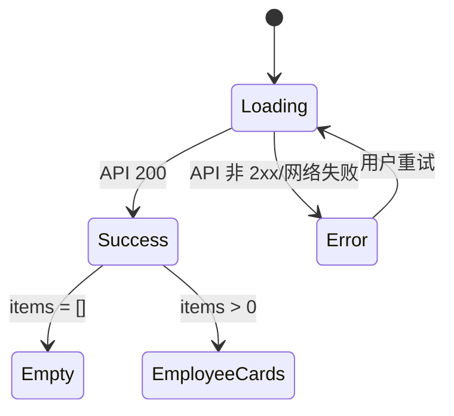

# 前端交互设计

## 技术栈

- React
- TypeScript
- Vite
- React Router
- TanStack Query
- Ant Design

## Gallery 页面结构

```text
页面
├── 左侧导航
│   ├── 开放广场平台
│   ├── 我的数字员工
│   ├── 我的团队
│   ├── 渠道接入
│   ├── 模型配置
│   └── 运行设置
├── 页面标题和说明
└── 数字员工卡片网格
    ├── 名称和岗位
    ├── 在线状态
    ├── 描述
    └── 资料 / Skill / SOP 数量
```

## 组件边界

```text
EmployeeGallery
    +-- PlatformNavigation
    +-- PageHeader
    +-- EmployeeGrid
          +-- EmployeeCard
```

服务器状态由 TanStack Query 管理，页面组件不直接拼接 fetch 请求。

## 状态展示



## 交互原则

- 卡片展示只读摘要。
- 点击卡片进入详情，不自动创建 Session。
- 点击“使用员工”才创建工作台上下文。
- 所有页面保留加载、空数据和错误状态。
- 前端只依赖 API 类型，不依赖后端领域实现。
- 页面组件使用本项目自己的样式和组件组合。

## 第一批实现关联

- 页面组件：`frontend/src/features/digital-employees/EmployeeGallery.tsx`
- API Client：`frontend/src/api/client.ts`
- 页面测试：`frontend/src/features/digital-employees/EmployeeGallery.test.tsx`
- 验证命令：`npm test`、`npm run build`
