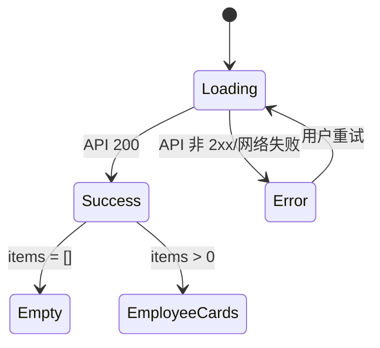
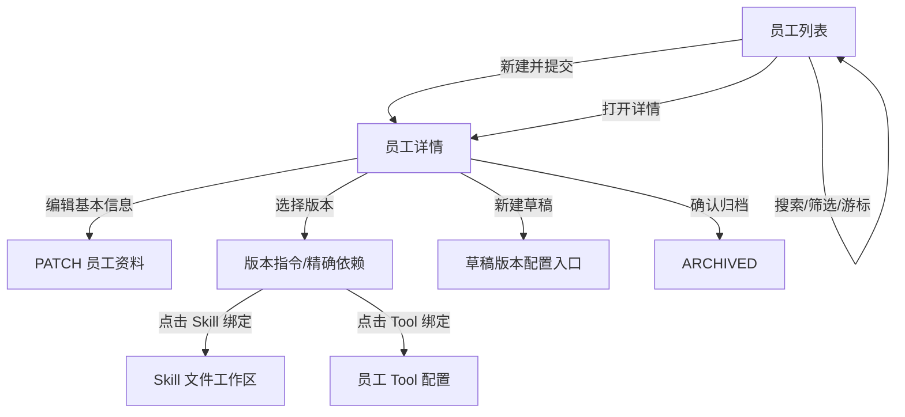
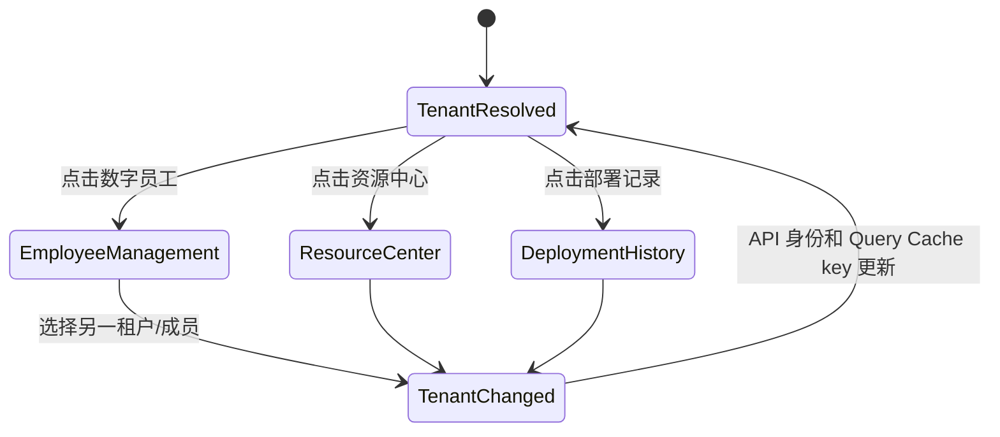

# 前端交互设计

## 技术栈

- React
- TypeScript
- Vite
- React Router
- TanStack Query
- Ant Design

## 旧 Gallery 地址兼容

旧 `/workspace/gallery` 和 `/enterprise/platform` 路由不再显示旧 Gallery，也不保留占位导航；访问时重定向到管理台的 `/enterprise/resources`。首页 `/` 和旧 dashboard/skills 入口默认重定向至 `/enterprise/employees`。管理台的共享资源入口统一命名为“资源中心”。

## 组件边界

```text
EmployeeGallery
    +-- PlatformNavigation
    +-- PageHeader
    +-- EmployeeGrid
          +-- EmployeeCard
```

服务器状态由 TanStack Query 管理，页面组件不直接拼接 fetch 请求。

## 状态展示



## 交互原则

- 卡片展示只读摘要。
- 点击卡片进入详情，不自动创建 Session。
- 点击“使用员工”才创建工作台上下文。
- 所有页面保留加载、空数据和错误状态。
- 前端只依赖 API 类型，不依赖后端领域实现。
- 页面组件使用本项目自己的样式和组件组合。

## 第一批实现关联

- 页面组件：`frontend/src/features/digital-employees/EmployeeGallery.tsx`
- API Client：`frontend/src/api/client.ts`
- 页面测试：`frontend/src/features/digital-employees/EmployeeGallery.test.tsx`
- 验证命令：`npm test`、`npm run build`

## 管理控制台页面壳

`/enterprise` 使用独立的控制台 Layout，一级导航为“数字员工 / 资源中心 / 部署记录”。技能、工具和 Skill 文件工作区不放在一级导航；它们从员工详情的版本和能力区进入，避免跳出员工上下文后丢失版本绑定。

```text
ManagementLayout
├── 左侧导航
│   ├── 数字员工       /enterprise/employees
│   ├── 资源中心       /enterprise/resources
│   └── 部署记录       /enterprise/deployments
├── Header
│   ├── 当前租户名称
│   └── 开发身份/租户选择器
└── Outlet
    └── 员工列表 / 员工详情 / 资源中心 / 部署记录
```

本地 Fake 身份选择器包含租户 A 管理员、租户 A 成员和租户 B 管理员；切换时请求身份头同步切换。页面 Query Cache 必须把 Fake User/租户范围纳入 key，防止切换后展示前一个租户的数据。生产环境身份由认证上下文提供，选择器仅作为本地验收工具。

当前管理控制台路由壳位于 `frontend/src/features/management/ManagementLayout.tsx`，租户上下文位于 `frontend/src/features/management/TenantContext.tsx`，由 `App.tsx` 注册员工、资源中心和部署记录路由。Skill/Tool 导航入口暂留员工详情实现中。

## 员工列表与详情

### 员工列表 `/enterprise/employees`

- 顶部提供“新建数字员工”，管理员可以打开 Modal 输入名称、员工类型和描述；提交成功后进入新员工详情。
- 搜索框匹配员工名称、类型和描述；状态下拉过滤 DRAFT/ACTIVE/DISABLED/ARCHIVED；条件变化会重置游标栈。
- 表格显示名称/类型、状态、Skill/Tool 数量、描述和详情入口；“上一页/下一页”使用服务端 `next_cursor`，不通过页码猜偏移。
- 加载状态使用页面提示，零记录显示创建引导，过滤无结果显示筛选提示，API 错误显示错误说明与重试。
- 成员保留查询和详情能力，隐藏新建入口；权限仍以服务端 403 为准。

### 员工详情 `/enterprise/employees/{employee_id}`

基本信息卡展示名称、类型、描述、员工 ID、版本数和最新发布版本。管理员可通过 Modal 部分编辑基本信息，归档通过 Popconfirm 二次确认。归档后隐藏编辑和新建版本按钮。

版本区按版本号倒序显示 DRAFT/PUBLISHED 状态、固定 Skill/Tool 数量和操作。选中版本后展开系统指令与精确 Skill/Tool 绑定摘要。Skill 文件工作区和 Tool 配置入口放在绑定行内，由 employee/version/resource ID 组成路由；页面侧边栏不放全局 Skill/Tool 页面。



新建、PATCH、归档成功后按租户身份失效员工目录/详情/版本 Query Cache，并显示成功提示；员工列表状态、详情只读状态和详情写按钮共同表达权限，API 仍负责最终授权。

页面组件位于 `frontend/src/features/digital-employees/EmployeeListPage.tsx` 和 `EmployeeDetailPage.tsx`，API 类型/请求位于 `frontend/src/api/client.ts`。测试 `EmployeeManagementPages.test.tsx` 覆盖创建后导航、资料编辑、归档、成员只读、空列表和服务错误。

## DRAFT 员工版本向导

路由 `/enterprise/employees/{employee_id}/versions/{version}` 从员工详情版本行进入。向导按三部分布局：

1. **系统指令**：编辑 `system_prompt`，保存时携带同一 DRAFT 版本号。
2. **Skill / Tool 绑定**：多选租户 Skill 和 Tool 的精确版本，显示依赖状态。右侧通过所选 Skill `allowed_tool_ids`、员工 Tool 选择与 ExecutionProfile `tool_policy` 计算有效 Tool 交集，并列出被策略排除的 Tool。
3. **执行配置**：选择 ExecutionProfile 和 ModelRoute，填写可选 Workspace/Sandbox ID 与版本，并设置审批策略。

保存使用 `PUT /api/v1/digital-employees/{id}/versions/{version}`，提交 `skill_version_refs` 和 `tool_version_refs`，不会把 UI 选择转成“当前最新”。页面保存成功后清除脏状态；编辑过程中刷新/关闭和点击应用内链接都会提示未保存修改。

“测试版本”打开 prompt Modal，调用 `POST /api/v1/digital-employees/{id}/versions/{version}/test`。它运行已保存的 DRAFT 配置并显示 Fake Runtime 返回，不创建 Deployment、正式 Session、Run 或 Trace；若编辑内容尚未保存，提示先保存。发布使用二次确认，服务端发布预检失败时展示 `details.missing[]` 中的资源/原因。

技能、工具、ExecutionProfile、ModelRoute、资源中心、部署列表、审计事件和 Run Trace 的 Query Cache key 都包含当前 Fake User，租户切换会切换 API `X-Fake-User` 并重新读取数据；旧租户缓存不作为新租户的页面数据。

页面组件：`frontend/src/features/digital-employees/EmployeeVersionEditorPage.tsx`。测试 `EmployeeVersionEditorPage.test.tsx` 覆盖精确绑定保存、有效 Tool 预览、Fake Runtime 版本测试和未保存离页提示。

版本编辑器提供“新建 Skill”：管理员填写名称、类型、入口指令和可选的已发布 Tool，提交后创建并发布精确 Skill 版本，再自动加入当前员工 DRAFT 的 Skill 选择；保存员工草稿后可从员工详情进入该 Skill 文件工作区，上传 ZIP 或编辑文件。

Tool 从员工详情的“Tool 管理”或版本编辑器的“管理 Tool”入口进入 `/enterprise/employees/{employee_id}/tools/{tool_id}`。页面列出当前租户 Tool，支持新建 DRAFT、编辑 DRAFT 的名称/描述/JSON Schema 和发布；只有 PUBLISHED Tool 可绑定员工版本，已发布 Tool 不显示编辑操作。管理员有写入口，成员只读。页面/API 位于 `frontend/src/features/digital-employees/ToolManagementPage.tsx`、`frontend/src/api/client.ts` 和 `/api/v1/tools` 路由；测试 `ToolManagementPage.test.tsx` 验证创建及发布。

## Skill 文件工作区

文件工作区路由为 `/enterprise/employees/{employee_id}/skills/{skill_id}/versions/{version}/files`，只从员工版本的 Skill 绑定行进入。左侧文件树和右侧编辑区同时显示精确 Skill 版本、文件 SHA-256 和清单摘要；INLINE 虚拟入口可在创建根 `SKILL.md` 时转换为 FILE_PACKAGE。

- DRAFT 可新建文件、在线编辑、重命名和删除；修改/重命名/删除请求带当前文件 `expected_sha256`。摘要过期时显示冲突错误并要求重读。
- 根 `SKILL.md` 入口不显示重命名/删除按钮。辅助文件支持文本编辑，二进制文件以 Base64 显示。
- ZIP 通过文件选择器上传；先调用 preview API，展示入口、摘要、文件数、replace/merge 差异，用户确认后提交同一 File 和 staging ID。
- 压缩包超过 20 MiB 会在浏览器先提示；路径、压缩/展开大小、符号链接等权威校验仍由后端给出具体错误。
- PUBLISHED 和 Hub REFERENCE 显示只读标记，隐藏新建、上传、保存、重命名和删除操作；文件正文仍按授权来源显示。
- 文件切换遇到未保存编辑会询问是否放弃；切换身份时文件树和内容 Query Cache 均按当前 Fake User 隔离。

页面组件：`frontend/src/features/digital-employees/SkillFileWorkspacePage.tsx`。测试 `SkillFileWorkspacePage.test.tsx` 覆盖 SHA 更新、文件创建/重命名/删除、ZIP merge 预览/确认和 REFERENCE 只读提示。

## 资源中心

路由 `/enterprise/resources` 有“发现资源 / 我发布的 / 我导入的”三个页签。目录默认只显示发布方名称、资源类型、名称、描述、最新已发布版本和可用导入方式；查询支持名称/描述关键词与资源类型筛选。`PLATFORM` 可见性下没有 Grant 的租户能发现卡片，但显示“导入需授权”，打开详情只返回脱敏信息，不请求 Manifest，也没有 COPY/REFERENCE 操作。`RESTRICTED` 对未授权租户不显示。

### 发现与导入

点“详情”打开抽屉，展示发布者、可见性、精确版本、Manifest SHA-256、依赖数量、授权模式和说明。授权模式存在时才查询对应模式的授权 Manifest，并展示 Skill 文件相对路径/摘要、依赖类型/版本和接收租户凭据要求。管理员可分别“复制到租户”或“引用为只读资源”；COPY 在租户中成为独立草稿，REFERENCE 显示只读并将精确来源/摘要用于后续员工绑定。提交成功后更新导入列表和可发现目录缓存。

### 我发布的

页面查询当前发布租户自己的 Hub 条目，不把其他租户条目混入。管理员可从“发布资源”选择本租户已发布的数字员工、Skill 或 Tool 精确版本，并选择 `PLATFORM`（可发现、导入仍需授权）或 `RESTRICTED`。创建 Hub DRAFT 后由一次页面操作发布该版本；已存在条目从详情抽屉使用“追加资源版本”，只能选择相同类型的新源版本，不覆盖旧版本。

打开自己发布的版本详情后可创建 Grant：接收租户 ID、COPY/REFERENCE 勾选项、可选失效时间；至少选择一种模式。详情仅列出该精确 Hub 版本的 Grant，管理员可二次确认撤销。新 Hub 版本需单独授权，不自动沿用旧版本 Grant。

### 我导入的

导入行显示来源名称、COPY/REFERENCE 模式、代理状态、本地资源 ID、Hub 固定版本和摘要前缀。新版本已发布且同模式有授权时提供“升级到 vN”；升级建立新代理，页面提示需到员工 DRAFT 显式重绑。REFERENCE 带只读标记、“修改请复制到租户”和撤销确认；COPY 不提供撤销入口，因为它属于接收租户独立资源。撤销 Grant 或导入后的缓存失效按当前 Fake User/租户隔离。

资源中心的列表、详情、授权清单、导入、Grant、升级与撤销都使用当前 Fake User 的 API 请求头和 React Query key。成员可读发现目录和自己的导入记录，但不能看到管理写入口；接口返回的 `403` 仍作为最终权限判定。

页面组件：`frontend/src/features/resources/ResourceCenterPage.tsx`。测试 `ResourceCenterPage.test.tsx` 覆盖无 Grant 的可发现卡片不显示导入操作/不请求 Manifest、REFERENCE 详情显示文件/依赖且导入后只读、撤销引用确认。

## 版本时间线与部署记录

员工详情版本时间线按版本号倒序显示 DRAFT/PUBLISHED。选中版本后展示系统指令与固定 Skill/Tool 版本；PUBLISHED 快照仅查看。草稿版本编辑器提供依赖发布预检、显式发布二次确认和 Fake Runtime 测试入口。Hub REFERENCE Skill 展示固定 Hub 版本与摘要，打开文件区后只读。

部署记录页 `/enterprise/deployments` 支持按员工和 ACTIVE/DISABLED 过滤，展示 Deployment 当前版本、Skill/Tool 数量、ExecutionProfile 版本和 ModelRoute。管理员创建 Deployment 时先选员工，再选择该员工的 PUBLISHED 版本；回滚弹窗展示当前版本和目标版本，再通过二次确认提交。回滚成功后刷新列表和审计事件；历史 Run Trace 使用自己的 RunSnapshot 保持原版本。

列表旁可展开审计记录，展示 `DEPLOYMENT_CREATED`/`DEPLOYMENT_ROLLED_BACK` 时间、操作者和版本变化。前端只展示审计 payload，不允许直接编辑审计记录。

页面组件：`frontend/src/features/deployments/DeploymentListPage.tsx`。测试 `DeploymentListPage.test.tsx` 覆盖 PUBLISHED 版本选择、Deployment 创建、回滚二次确认和审计查询；后端发布预检/RunSnapshot 回滚行为分别由员工 API 和 MySQL Catalog 集成测试覆盖。

## 管理壳状态



验证：

```bash
cd frontend
npm test -- --run src/features/management/ManagementLayout.test.tsx src/features/digital-employees/EmployeeManagementPages.test.tsx
npm run build
```

已验证：补齐 Tool 管理页、Skill 创建和旧 Gallery 路由迁移后，`npm test` 通过 11 个测试文件、22 个用例，`npm run build` 通过 TypeScript 与 Vite 生产构建。测试覆盖根路径/旧 Gallery 重定向、管理壳身份切换、员工读写、DRAFT 版本编辑/测试和 Skill 创建、Tool DRAFT 创建/编辑/发布、Skill 文件 CRUD/ZIP、资源中心授权导入、Deployment 创建/回滚/审计与 Run Trace 展示。Docker Nginx 的旧 URL 302 路由在本地容器进行 HTTP 冒烟验证。

未验证：MySQL + LocalObjectStore 下的租户 A 发布、租户 B COPY/REFERENCE、员工部署到 Run/Trace 的整链路在 OpenSpec 任务 6.1 验收；生产身份中心和对象存储不在本地管理台验证范围。
