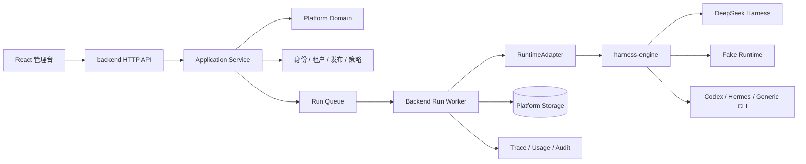
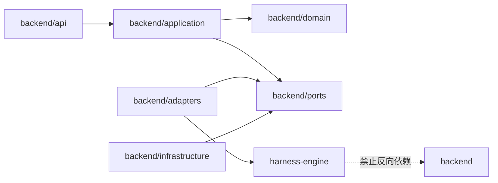
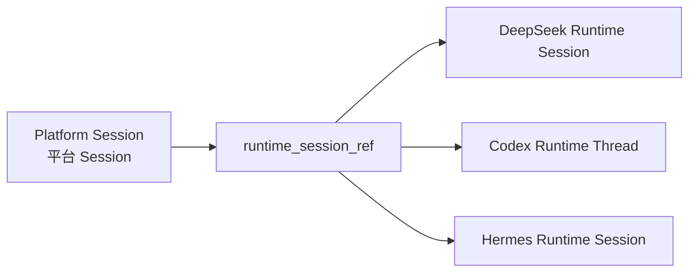
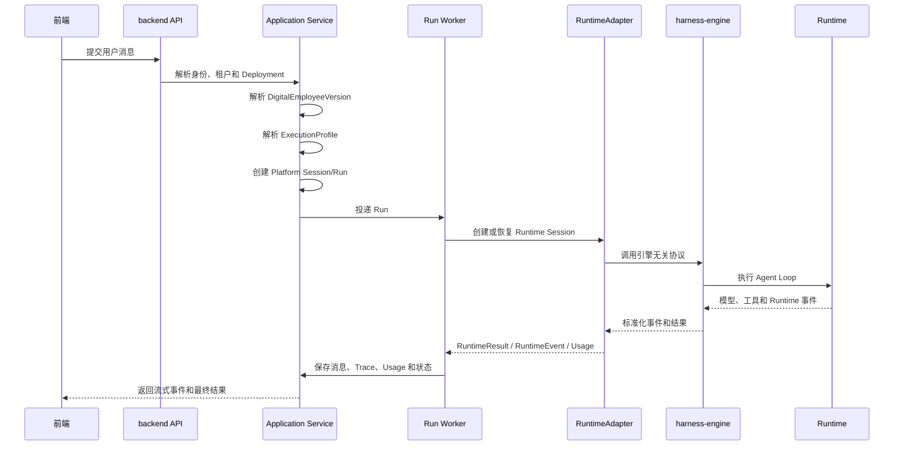

# 后端与 Harness 引擎关系

状态：RuntimeAdapter 端口、Harness 适配原型和 MySQL 租约仓储已存在；生产 Worker 执行闭环尚未接通
更新时间：2026-11-18

本文前半部描述目标分层。当前实现状态、代码缺口、MCP Stdio、审批和工作台交互的统一方案见[Harness 数字员工执行闭环设计](Harness员工执行闭环设计.md)。

## 一、职责边界



### backend 控制面

backend 负责企业平台规则：

- HTTP API
- Platform、Tenant、User 和授权
- DigitalEmployee、Skill、Tool、Deployment
- ExecutionProfile 和引擎选择
- Conversation、Session、Run 的平台记录
- Workspace/Sandbox 的创建、租约、配额和回收
- 审批、审计、Trace、Usage 和费用
- IM、业务系统和渠道集成

### harness-engine Runtime 层

`harness-engine` 负责 Agent 执行能力：

- DeepSeek Harness 适配
- Fake Runtime
- Runtime 生命周期
- Runtime Session 创建和恢复
- Agent Loop 调用
- 模型和工具执行
- MCP 工具桥接
- Runtime 事件转换
- Runtime 能力声明

`harness-engine` 不负责平台用户、租户、数字员工目录和业务权限。

## 二、依赖方向



依赖规则：

1. backend 可以依赖 `harness-engine`。
2. `harness-engine` 不得导入 backend 模块。
3. backend 业务代码不直接导入 DeepSeek SDK 类型。
4. 供应商类型只出现在 Runtime Adapter 内部。
5. 前端只访问 backend API，不直接访问 `harness-engine`。
6. API 进程不直接执行 Runtime 进程，统一由 Worker 调用。

## 三、RuntimeAdapter 边界

下列接口是目标边界的示意。当前 Protocol 定义位于 backend/src/agent_platform/ports/runtime.py，实际字段尚未完全覆盖 on_event 与创建 Session 的 request 参数。

backend 使用统一的 RuntimeAdapter：

```python
class RuntimeAdapter(Protocol):
    def capabilities(self) -> RuntimeCapabilities: ...

    def create_session(self, request: SessionCreateRequest) -> RuntimeSessionRef: ...

    def resume_session(self, ref: RuntimeSessionRef) -> RuntimeSessionRef: ...

    def run(
        self,
        request: RuntimeRequest,
        on_event: EventHandler | None = None,
    ) -> RuntimeResult: ...

    def cancel(self, run_id: str) -> CancelResult: ...

    def close(self) -> None: ...
```

适配器实现：

~~~text
backend/src/agent_platform/adapters/runtime/
├── harness.py            # Harness 适配原型
├── fake.py               # 当前可用的 Fake Runtime
├── cli.py                # CLI 适配边界
└── registry.py           # Runtime 注册表原型
~~~

上方目录是现有文件位置；Harness 适配器当前尚未成为 MySQL 模式 API 的执行引擎。

## 四、平台 Session 与 Runtime Session

两类 Session 必须分开：

```text
Platform Session
- session_id
- tenant_id
- user_id
- digital_employee_version_id
- runtime_name
- runtime_session_ref
- workspace_ref
- status
```

```text
Runtime Session
- 由 DeepSeek / Codex / Hermes 自己管理
- 内部上下文格式由 Runtime 决定
- 内部压缩和恢复由 Runtime 决定
- 平台只保存 opaque reference
```

关系：



切换引擎时，新 Run 创建新的 Runtime Session。平台不把 DeepSeek 私有历史强行转换成 Codex 或 Hermes 历史。

## 五、一次 Run 的执行流程



## 六、上下文、记忆和工作区边界

### 平台负责

- 业务对象上下文
- Skill 和 Tool 策略
- 用户、租户和项目权限
- 企业级记忆
- Workspace/Sandbox 生命周期
- 资源配额、凭据和审计

### Runtime 负责

- Agent Loop
- 内部消息格式
- 上下文压缩
- Runtime 私有记忆
- 内部工具循环
- 文件读写和命令执行

平台传递业务上下文和 opaque 引用，不重复实现 Runtime 内部压缩和私有记忆格式。

对话附件遵循同样边界：平台 ObjectStore 是持久化权威来源，Runtime Workspace 只是执行副本，RuntimeAdapter 只接收 `RuntimeAttachmentRef`。

## 七、当前代码状态

已存在：

- RuntimeAdapter Protocol 和平台 RuntimeRequest / RuntimeResult 类型。
- HarnessRuntimeAdapter 原型、FakeRuntimeAdapter 和 RuntimeRegistry。
- Session、Run、RunSnapshot、Trace、Usage、MySQL 租约与 fencing 持久化。
- DeepSeek/Fake Harness Engine 生命周期和 Stdio MCP Server 示例。

尚未接通：

- api/app.py 的 MySQL 模式仍固定注入 FakeRuntimeAdapter。
- ControlPlaneService 的 Run 路径仍在请求调用链同步执行；workers 包没有 Worker 主循环。
- HarnessRuntimeAdapter 使用动态请求对象，Session 恢复依赖本地集合；尚未以真正 EngineRequest 完整传递员工系统指令、Skill 文件和工具调用执行器。
- DeepSeek 适配当前只把 prompt/session_id 传给 SDK；MCP Profile 未由 Worker 消费。
- Conversation 列表、审批请求及批准后的一次性 MCP 写操作尚未实现。

实施方案、数据格式、状态转换、API 契约、各阶段验收和原型见[Harness 数字员工执行闭环设计](Harness员工执行闭环设计.md)。在 Worker、真实 Harness 输入和 MCP 隔离执行验证完成前，不得把适配器原型当作生产能力。

## 八、验证命令

以下命令适用于已实现代码的回归；Harness Worker、真实 SDK 工具注入和 DolphinScheduler 写审批仍需后续集成验证。

```bash
backend/.venv/bin/python -m pytest backend/tests -q
backend/.venv/bin/ruff check backend

cd frontend
npm test
npm run build
```

关联设计：

- [架构总览](架构总览.md)
- [目录与模块说明](目录与模块说明.md)
- [执行引擎规格](../openspec/changes/archive/2026-11-17-agent-platform-foundation/specs/execution-engines/spec.md)
- [后端架构说明](backend-architecture.md)
