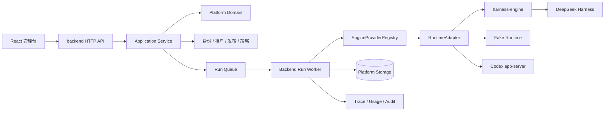
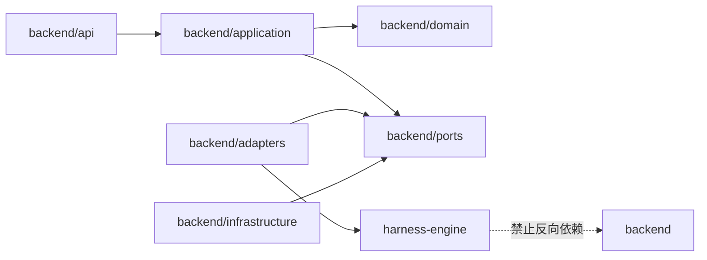
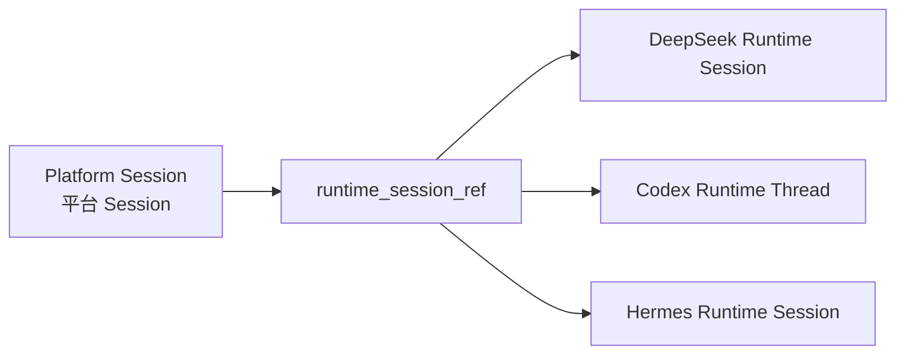
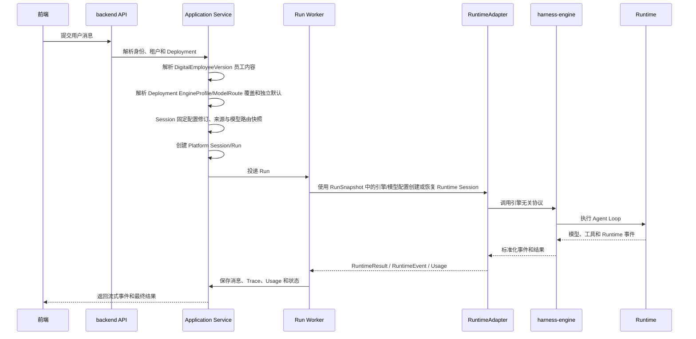

# 后端与 Harness 引擎关系

状态：EngineProviderRegistry、Session/Run 配置快照和 MySQL Worker 执行闭环已接通；Codex app-server 需显式启用
更新时间：2026-11-22

本文前半部描述目标分层。当前实现状态、代码缺口、MCP Stdio、审批和工作台交互的统一方案见[Harness 数字员工执行闭环设计](Harness员工执行闭环设计.md)。

## 一、职责边界



### backend 控制面

backend 负责企业平台规则：

- HTTP API
- Platform、Tenant、User 和授权
- DigitalEmployee、Skill、Tool、Deployment
- ExecutionProfile 和引擎选择
- Conversation、Session、Run 的平台记录
- Workspace/Sandbox 的创建、租约、配额和回收
- 审批、审计、Trace、Usage 和费用
- IM、业务系统和渠道集成

### harness-engine Runtime 层

`harness-engine` 负责 Agent 执行能力：

- DeepSeek Harness 适配
- Fake Runtime
- Runtime 生命周期
- Runtime Session 创建和恢复
- Agent Loop 调用
- 模型和工具执行
- MCP 工具桥接
- Runtime 事件转换
- Runtime 能力声明

`harness-engine` 不负责平台用户、租户、数字员工目录和业务权限。

## 二、依赖方向



依赖规则：

1. backend 可以依赖 `harness-engine`。
2. `harness-engine` 不得导入 backend 模块。
3. backend 业务代码不直接导入 DeepSeek SDK 类型。
4. 供应商类型只出现在 Runtime Adapter 内部。
5. 前端只访问 backend API，不直接访问 `harness-engine`。
6. API 进程不直接执行 Runtime 进程，统一由 Worker 调用。

## 三、RuntimeAdapter 边界

实际 Protocol 定义位于 `backend/src/agent_platform/ports/runtime.py`，适配器通过平台 RuntimeRequest/RuntimeResult 传递一次 Run 上下文和标准化事件，不让 API 请求携带本机命令或进程环境。

backend 使用统一的 RuntimeAdapter：

```python
class RuntimeAdapter(Protocol):
    capabilities: RuntimeCapabilities

    def create_session(self) -> str: ...
    def resume_session(self, session_ref: str) -> str: ...
    def run(self, request: RuntimeRequest) -> RuntimeResult: ...
    def cancel(self, session_ref: str) -> bool: ...
```

适配器实现：

~~~text
backend/src/agent_platform/adapters/runtime/
├── harness.py            # DeepSeek Harness RuntimeAdapter
├── codex_app_server.py   # 显式启用的 Codex app-server RuntimeAdapter
├── fake.py               # 离线 Fake Runtime
├── cli.py                # 受控 CLI 进程调用边界
└── registry.py           # 底层 Runtime 工厂兼容层

backend/src/agent_platform/application/engine_providers.py
└── EngineProviderRegistry # 按 Profile 选择 adapter 并校验协议/能力

## 四、平台 Session 与 Runtime Session

两类 Session 必须分开：

```text
Platform Session
- session_id
- tenant_id
- user_id
- digital_employee_version_id
- runtime_name
- runtime_session_ref
- workspace_ref
- status
```

```text
Runtime Session
- 由 DeepSeek / Codex / Hermes 自己管理
- 内部上下文格式由 Runtime 决定
- 内部压缩和恢复由 Runtime 决定
- 平台只保存 opaque reference
```

关系：



切换引擎时，新 Run 创建新的 Runtime Session。平台不把 DeepSeek 私有历史强行转换成 Codex 或 Hermes 历史。

## 五、一次 Run 的执行流程



Worker 的 EngineProvider、ExecutionProfile、ModelRoute 和来源只能从 RunSnapshot 读取，并交叉核对所属 Session 固定的引擎。Profile/依赖撤销或 SecretRef 在模型 Turn 出站前失败时，Run 以 `FAILED` 和稳定错误类别收尾；Trace 不保存端点、SecretRef 或密钥。Runtime 调用后发生超时或连接中断时结果不确定，Run 收敛为 `UNKNOWN`，使用 `complete_run` 持久化 Trace 错误 Span 并隔离 Session Runtime lease；UNKNOWN 不自动重试、不切换 Fake 或其他 Provider。失去租约的旧 Worker 仍由 fencing token 阻止写回。

## 六、上下文、记忆和工作区边界

### 平台负责

- 业务对象上下文
- Skill 和 Tool 策略
- 用户、租户和项目权限
- 企业级记忆
- Workspace/Sandbox 生命周期
- 资源配额、凭据和审计

### Runtime 负责

- Agent Loop
- 内部消息格式
- 上下文压缩
- Runtime 私有记忆
- 内部工具循环
- 文件读写和命令执行

平台传递业务上下文和 opaque 引用，不重复实现 Runtime 内部压缩和私有记忆格式。

对话附件遵循同样边界：平台 ObjectStore 是持久化权威来源，Runtime Workspace 只是执行副本，RuntimeAdapter 只接收 `RuntimeAttachmentRef`。

## 七、当前代码状态

已存在：

- RuntimeAdapter Protocol 和平台 RuntimeRequest / RuntimeResult 类型。
- Session 保存 Deployment 配置修订、ExecutionProfile/ModelRoute 来源和模型路由快照；RunSnapshot 固定同一组解析结果。
- EngineProviderRegistry 按 Profile 选择已注册 adapter，验证 ModelRoute 协议和 Tool/MCP/Workspace/Sandbox/审批能力；未知 Provider 不回退 Fake。
- MySQL Worker、Run lease/fencing、Conversation/Message、审批和 Stdio MCP Proxy 闭环。
- MySQL/Compose 默认注册 DeepSeek Harness，API 与 Run Worker 共用 `AGENT_PLATFORM_RUNTIME_ENGINE`；可显式设为 `fake` 离线运行。DeepSeek Profile 固定引擎，模型 Endpoint/协议/SecretRef 仍由租户 ModelRoute 管理。本机已用 Conversation turn、独立 Worker、本地确定性 ModelRoute 和 DeepSeek SDK 完成一次成功 Run/Trace。Codex app-server 可通过 `AGENT_PLATFORM_CODEX_APP_SERVER_ENABLED=1` 显式注册，命令默认为 `codex app-server --stdio`，可用 `AGENT_PLATFORM_CODEX_APP_SERVER_COMMAND` 覆盖；当前仅接收带租户 SecretRef 的 OpenAI Responses ModelRoute，不接收平台 Tool/MCP 或定制 Workspace/Sandbox/审批要求。
- Worker RunSnapshot 固定引擎/模型/来源；撤销 Profile 和缺失 Codex SecretRef 的出站前失败、Runtime Turn 超时的 UNKNOWN/不重试和 Trace 错误类别已有定向回归测试。

尚未完成：

- Codex app-server 的假 JSON-RPC 测试覆盖 start/turn/resume；本机 CLI 已验证 initialize/thread-start，没有调用真实模型。真实模型用量、取消和长时间恢复仍需验证。
- Claude Code 未注册。Workspace/Sandbox 与更多 Runtime 能力要等 adapter 明确实现并通过隔离验证后再开放。
- `/enterprise/workbench` 当前员工的 Deployment 配置入口已接入；全局默认与 ExecutionProfile 版本管理位于“模型管理 → 默认运行环境”。Claude Code 仍未注册，需等适配器能力、隔离与凭据契约通过验证。

实施方案、数据格式、状态转换、API 契约、各阶段验收和原型见[Harness 数字员工执行闭环设计](Harness员工执行闭环设计.md)。Codex 产品集成采用 app-server 持久线程协议；[OpenAI 的 Codex 平台集成说明](https://developers.openai.com/blog/codex-as-a-platform)区分了非交互 exec 与产品级 app-server/SDK 生命周期。

## 八、验证命令

以下命令适用于已实现代码的回归；Harness Worker、真实 SDK 工具注入和 DolphinScheduler 写审批仍需后续集成验证。

```bash
backend/.venv/bin/python -m pytest backend/tests -q
backend/.venv/bin/ruff check backend

cd frontend
npm test
npm run build
```

关联设计：

- [架构总览](架构总览.md)
- [目录与模块说明](目录与模块说明.md)
- [执行引擎规格](../openspec/changes/archive/2026-11-17-agent-platform-foundation/specs/execution-engines/spec.md)
- [后端架构说明](backend-architecture.md)
