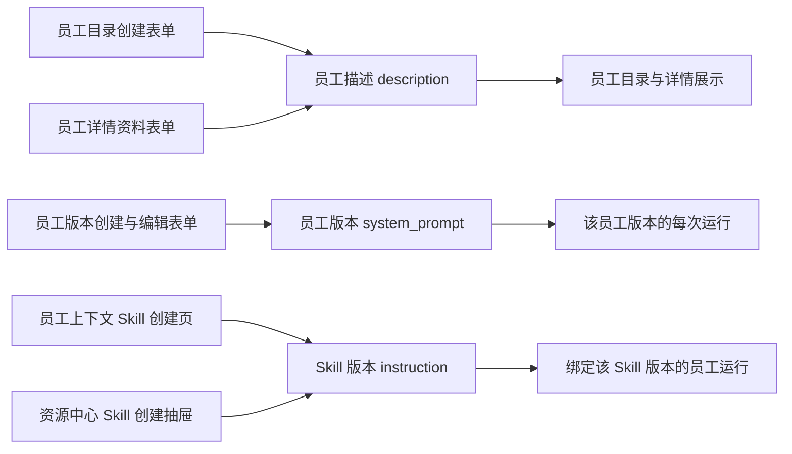
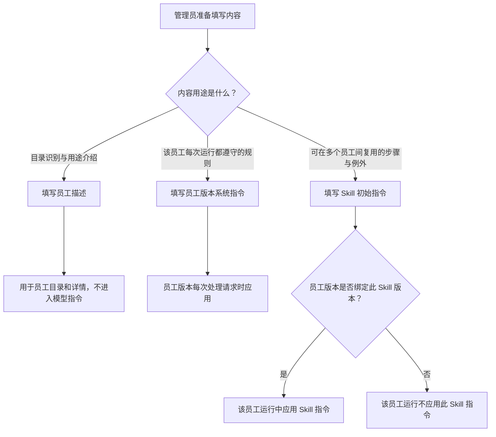

# 员工字段用途与填写说明

本文说明管理台中员工描述、员工版本系统指令和 Skill 初始指令的填写位置及生效范围。表单说明只帮助管理员选择字段，不参与提交值、API 契约或运行时行为。

## 组件关系图



## 填写与运行流程



## 字段与数据模型

| 表单字段 | 数据归属 | 生效范围 | 填写判断 |
| --- | --- | --- | --- |
| 员工描述 | `DigitalEmployee.description`，API 字段 `description` | 员工目录与详情展示，不作为模型运行指令 | 写给管理员看的用途介绍 |
| 系统指令 | `DigitalEmployeeVersion.system_prompt`，API 字段 `system_prompt` | 对应员工版本的每次运行 | 写该员工始终遵守的角色、规则和边界 |
| Skill 初始指令 | `SkillVersion.instruction`，API 字段 `instruction` | 员工版本绑定该 Skill 的精确版本后，才随该版本进入运行 | 写可复用的处理步骤、触发条件和例外 |

员工版本保存固定的 Skill ID 与版本号，因此 Skill 后续发布新版本不会自动改变既有员工版本的绑定。FILE_PACKAGE Skill 的正文由 Skill 文件工作区管理，入口文件为 `SKILL.md`；此处说明的是创建表单中的初始指令字段用途。

## API 与状态边界

本次只在表单字段下方展示辅助说明：

- 员工创建和资料更新仍使用现有 `POST /digital-employees`、`PATCH /digital-employees/{employee_id}`，只提交员工资料字段。
- 员工版本创建和草稿保存仍使用现有版本 API，由 `system_prompt` 保存员工版本指令及精确资源绑定。
- Skill 创建仍使用现有 `POST /skills`，将 `instruction` 保存到 Skill DRAFT 版本；Skill 发布与员工版本绑定仍是独立操作。
- 辅助说明不是表单字段值，不会进入请求体、数据库或 RuntimeRequest；无新增 API、数据字段或状态转换。

## 验证记录

### 已验证

- 三个前端测试文件共 24 个测试通过：员工目录/详情、员工版本编辑器和资源中心。
- 测试断言三类说明与各自输入控件处于同一表单项，并覆盖员工资料创建/编辑、员工版本创建/编辑和两个 Skill 创建入口。
- `npm --prefix frontend run build` 成功；Vite 提示主 JavaScript chunk 超过 500 kB，未影响构建结果。
- `openspec validate employee-instruction-field-guidance --strict` 通过。

### 尚未验证

- 尚未在真实浏览器中检查窄屏排版或辅助技术朗读；当前验证使用前端组件测试。
- 本次没有更改 API、数据库或 Runtime，因此没有执行后端、MySQL 或运行时集成验证。

### 验证命令

```bash
npm --prefix frontend test -- EmployeeManagementPages.test.tsx EmployeeVersionEditorPage.test.tsx ResourceCenterPage.test.tsx
npm --prefix frontend run build
openspec validate employee-instruction-field-guidance --strict
```
