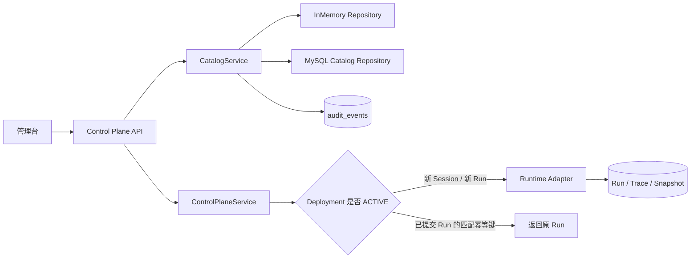
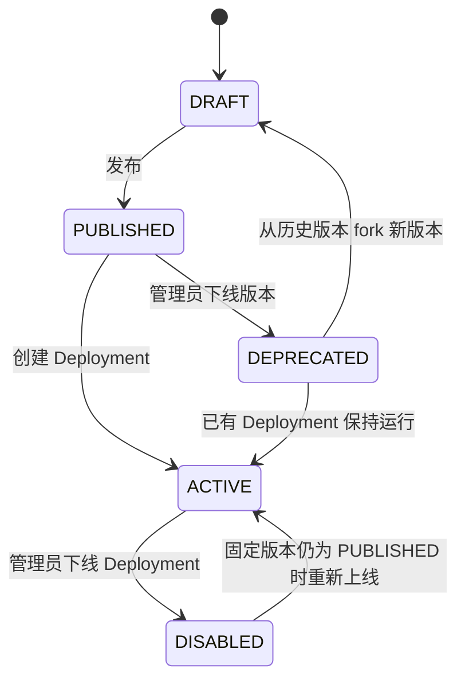
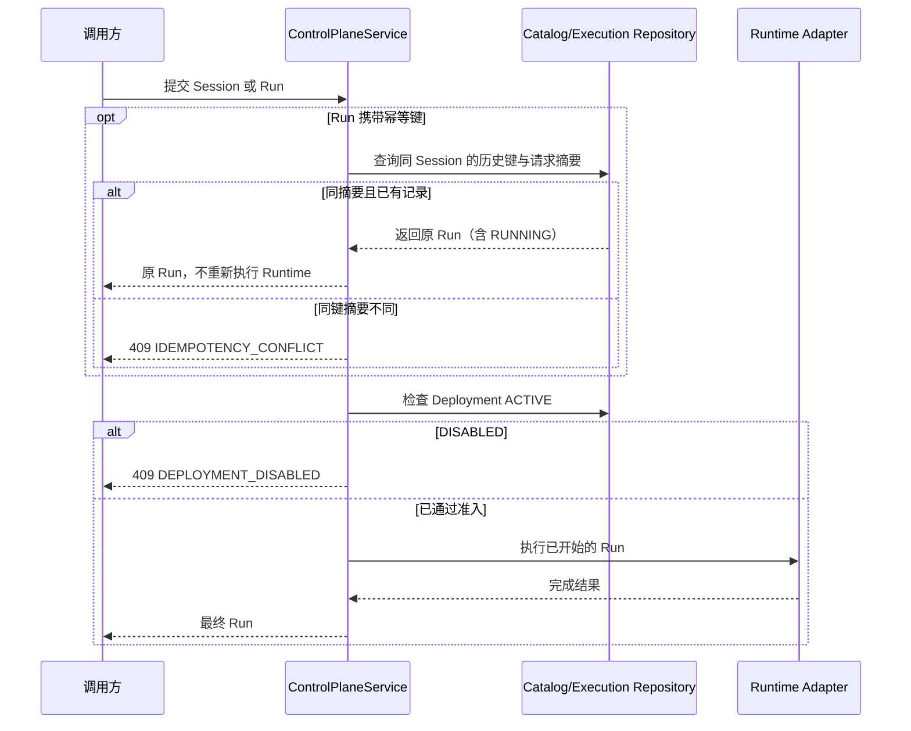

# 员工版本与部署生命周期回归记录

验收日期：2026-11-17（Asia/Shanghai）

## 验收范围

验证员工版本下线和 Deployment 启停的 API、租户/角色隔离、审计事务、并发转换、持久化 Run 幂等重放，以及已进入 Runtime 的运行在 Deployment 下线后能否完成。本记录对应 OpenSpec Change `digital-employee-resource-center` 的任务 8.7。

## 架构



## 状态流程



运行准入与幂等顺序：



## 数据模型与 API/状态

本次没有新增表、字段或 migration，复用现有状态：

| 对象 | 状态字段 | 转换与边界 |
|---|---|---|
| `digital_employee_versions` | `status` | `DRAFT → PUBLISHED → DEPRECATED`；DEPRECATED 不可重新发布，可作为新 DRAFT 的 fork 来源 |
| `deployments` | `status` | `ACTIVE ⇄ DISABLED`；重新上线要求员工未归档且固定版本为 PUBLISHED |
| `runs` / `RunSnapshot` | 运行状态、`idempotency_key`、请求摘要、固定版本快照 | 匹配的历史幂等键先于新的 Deployment 准入检查；已开始运行不会被下线取消 |
| `audit_events` | `event_type` 与事件载荷 | 版本下线、部署启停的状态更新和审计记录在同一 MySQL 事务中提交 |

主要接口：

| 方法与路径 | 行为 | 关键结果 |
|---|---|---|
| `POST /api/v1/digital-employees/{id}/versions/{version}/deprecate` | 下线员工版本 | `PUBLISHED → DEPRECATED`；重复请求不重复写审计 |
| `POST /api/v1/deployments/{id}/disable` | 下线部署 | `ACTIVE → DISABLED`，写 `DEPLOYMENT_DISABLED` |
| `POST /api/v1/deployments/{id}/enable` | 重新上线部署 | 仅固定版本仍为 PUBLISHED 时允许，写 `DEPLOYMENT_ENABLED` |
| `POST /api/v1/sessions` | 创建 Session | DISABLED 部署返回 409 `DEPLOYMENT_DISABLED` |
| `POST /api/v1/sessions/{id}/runs` | 创建或重放 Run | 新 Run 需 ACTIVE；同键同摘要返回原 Run，同键不同摘要返回 409 `IDEMPOTENCY_CONFLICT` |

## 已验证项

- 内存态 API 用例验证管理员/成员/跨租户边界、版本下线幂等、禁用和重新上线、禁用状态的 Session/Run 准入、审计事件数量及事件类型。
- 阻塞式 Fake Runtime 用例验证：Run 登记并进入 Runtime 后下线 Deployment，原运行仍可完成；同键同摘要重放返回同一个运行中/完成记录，新幂等键被拒绝，改写摘要返回冲突。
- MySQL 8.4.10 用例通过审计失败触发器注入，确认审计写入失败会回滚版本/Deployment 状态更新；并发重复下线只产生一次状态变更审计，竞争的 Deployment 下线只有一个成功。
- MySQL API 用例在 App 重启后验证持久化幂等重放、禁用状态下的新 Session/Run 拒绝、重新上线固定版本不变，以及审计事件持久化。
- 后端全量测试：225 passed，0 skipped；有 1 条 Starlette/httpx 弃用提示，不影响结果。
- Ruff 和 Python `compileall` 通过。

## 浏览器验收

- 管理员版本页显示编辑草稿、从版本创建草稿和下线等操作；成员版本页显示只读原因，并隐藏新建、编辑、分叉、发布和下线入口。
- 管理员部署记录显示启停、回滚和审计；成员只看到部署状态和固定版本，不显示写操作或审计入口。
- 在 390×844 视口检查部署表格和窄屏导航；表格、筛选和操作仍可访问，Tab 移动到员工筛选器时显示清晰焦点边框。
- 员工版本下线确认说明该操作不会自动停止现有 Deployment；部署下线确认列出员工、固定版本和 Deployment ID，并说明已开始运行仍可完成。
- 对固定版本已下线的 Deployment 打开重新上线确认时，页面显示“固定员工版本已下线”并禁用确认；跨租户打开租户 A 员工时显示“员工详情加载失败 资源不存在”。
- 恢复验证后，验收样例 `Docker 验收样例` 的 v4 保持 DEPRECATED；v3 发布后将验收 Deployment 回滚到 v3 并重新上线。验证实例中保留 Deployment `deployment-1137a99dcb`（ACTIVE，v3）和相应审计记录，便于复查。

## 尚未验证项

- 生产身份提供方、真实 Runtime 和生产 MySQL 部署未纳入本轮验证；运行行为使用 Fake Identity/Fake Runtime，MySQL 使用一次性验证实例。
- 浏览器使用本地 Fake Identity 环境；生产身份切换、真实运行时中的 Session/Run 与并发关闭行为仍需生产级环境验收。

## 验证命令

在 `backend/` 执行内存态回归：

```bash
python -m pytest tests/test_deployment_lifecycle_api.py tests/test_control_plane_service.py -q
```

在已确认的一次性 MySQL 8.4.10 实例上执行完整后端回归。MySQL 密码通过环境变量提供，不写入文档或日志：

```bash
AGENT_PLATFORM_MYSQL_TEST_ALLOW_CREATE_DATABASE=1 \
MYSQL_HOST=127.0.0.1 MYSQL_PORT=60547 MYSQL_USER=root MYSQL_PASSWORD=<一次性实例密码> \
python -m pytest tests -q
python -m ruff check src tests
python -m compileall -q src tests
```

测试 fixture 为每个 MySQL 集成用例创建随机命名数据库，结束后删除。本次没有修改 SQL schema，因此没有新的 MySQL 字段注释或 migration 校验项。

## OpenSpec 归档

2026-11-17 将 3 个资源中心能力和 1 个员工字段说明能力同步到主规格目录，并通过 `openspec validate --specs`（4 passed、0 failed）及两个 Change 的 strict validation。归档位置：

- `openspec/changes/archive/2026-11-17-digital-employee-resource-center/`
- `openspec/changes/archive/2026-11-17-employee-instruction-field-guidance/`
