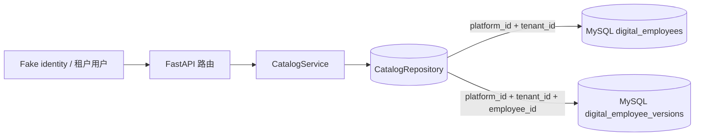
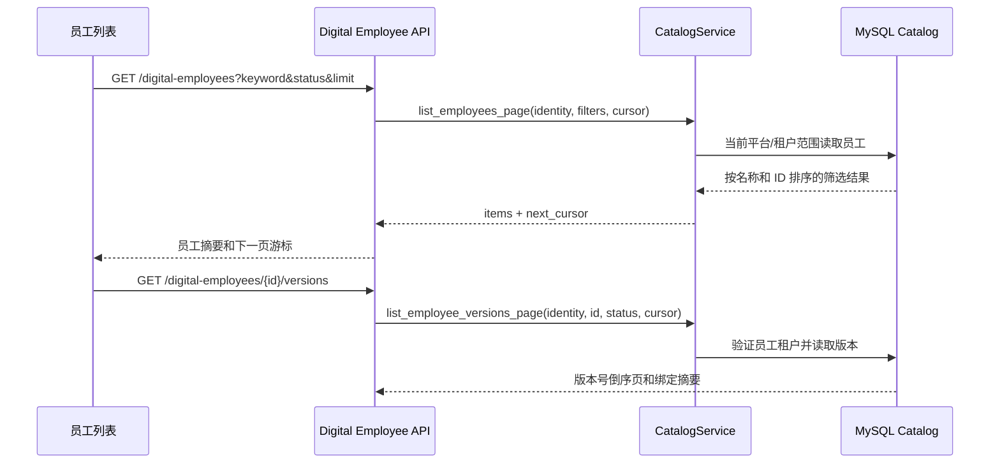
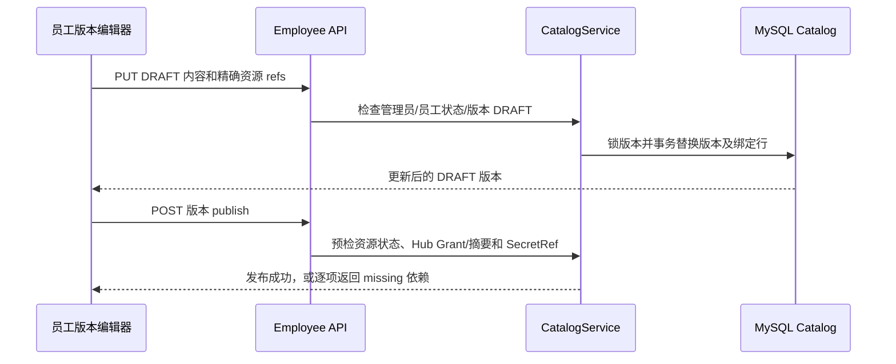

# 员工目录查询与版本 API

## 架构



员工目录查询从认证上下文取租户，不接受查询参数覆盖租户。详情、版本清单和版本详情均通过 Repository 的平台/租户复合条件读取；列表分页基于确定的名称和 ID 排序键。



## 数据模型

| 模型 | 作用 | 本次查询使用字段 |
|---|---|---|
| `DigitalEmployee` | 员工稳定身份和基本资料 | `employee_id`, `tenant_id`, `name`, `role_name`, `description`, `status` |
| `DigitalEmployeeVersion` | 不可变执行版本 | `version`, `status`, `system_prompt`, exact Skill/Tool version refs, ExecutionProfile version |
| `Deployment` | 固定一个已发布版本 | 员工详情只查询版本，不自动创建或切换 Deployment |

员工版本响应保留兼容的 `skill_ids`/`tool_ids` 数组，并增加 `skill_version_refs`/`tool_version_refs`，包含 ID 和绑定版本，避免客户端用“当前最新”猜依赖。

## API 与游标约定

以下路径均以 `/api/v1` 为前缀。身份通过 `X-Fake-User` 解析；请求租户范围始终来自身份上下文。

| 方法与路径 | 查询/请求 | 返回 |
|---|---|---|
| `GET /digital-employees` | `keyword`、`status`、`limit`（1–200，默认 50）、`cursor` | `{items, next_cursor}`，条目保留旧字段并含最新发布版本资源计数 |
| `GET /digital-employees/{employee_id}` | 无 | 员工基本信息、版本数、最新发布版本摘要 |
| `GET /digital-employees/{employee_id}/versions` | `status`、`limit`、`cursor` | `{items, next_cursor}`，版本号倒序 |
| `GET /digital-employees/{employee_id}/versions/{version}` | 精确版本号 | 系统指令、状态、策略、Skill/Tool 精确版本绑定 |
| `POST /digital-employees` | `name`、`role_name`、`description` | 创建当前租户员工，返回基础资料 |
| `POST /digital-employees/{employee_id}/versions` | 创建初始 DRAFT 版本的执行配置 | 返回版本号和 DRAFT 状态 |
| `PATCH /digital-employees/{employee_id}` | 至少包含 `name`、`role_name`、`description` 之一 | 部分更新稳定资料；省略字段保持不变 |
| `PUT /digital-employees/{employee_id}/versions/{version}` | 完整 DRAFT 指令、精确 Skill/Tool refs、执行配置 | 原子替换该 DRAFT 版本及绑定 |
| `POST /digital-employees/{employee_id}/versions/{version}/test` | `{ "prompt": "..." }` | 运行当前已保存版本的非持久化 Fake/Runtime 预览 |
| `POST /digital-employees/{employee_id}/versions/{version}/publish` | 无 | 预检通过后将 DRAFT 固定为 PUBLISHED |
| `POST /digital-employees/{employee_id}/archive` | 无 | 设置员工状态为 `ARCHIVED`，保留历史数据 |
| `GET /tools` | 无 | 当前租户 Tool 清单，含状态、输入 Schema 和凭据是否配置的布尔值 |
| `POST /tools` | `name`、`description`、`input_schema`、可选协议 | 管理员创建 DRAFT Tool |
| `PATCH /tools/{tool_id}` | DRAFT 的 `name`、`description`、`input_schema` 部分字段 | 管理员更新 DRAFT Tool；PUBLISHED 返回 `409 IMMUTABLE_VERSION` |
| `POST /tools/{tool_id}/publish` | 无 | 管理员发布 Tool；需要凭据的 Tool 必须先配置 SecretRef |
| `GET /skills` | 无 | 当前租户 Skill 清单和精确版本 |
| `POST /skills` | `name`、`skill_type`、`instruction`、`allowed_tool_ids` | 管理员创建 DRAFT Skill |
| `POST /skills/{skill_id}/publish` | 无 | 管理员发布 Skill；其声明的 Tool 必须已发布 |

DRAFT 版本 PUT 请求示例：

```json
{
  "system_prompt": "按租户政策处理工单。",
  "skill_version_refs": [{"resource_id": "01...", "version": 2}],
  "tool_version_refs": [{"resource_id": "01...", "version": 1}],
  "execution_profile_id": "01...",
  "execution_profile_version": 1,
  "model_route_id": "01...",
  "workspace_profile_id": null,
  "sandbox_profile_id": null,
  "approval_policy": "required-for-write"
}
```

PUT 将系统指令、Skill/Tool 精确版本引用和 ModelRoute/Workspace/Sandbox/审批设置作为一个版本替换，并在 MySQL 一个事务中保存版本正文、Skill 绑定、Tool 绑定和 Capability 绑定。Repository 行锁和状态检查防止写入 PUBLISHED 版本。

成功保存响应为该 DRAFT 的完整固定版本；客户端应使用响应的资源 refs 展示状态，不把旧数组 `skill_ids`/`tool_ids` 解释成“绑定最新版本”：

```json
{
  "employee_id": "emp-123",
  "version": 2,
  "system_prompt": "按租户政策处理工单。",
  "skill_version_refs": [{"skill_id": "skill-1", "version": 2}],
  "tool_version_refs": [{"tool_id": "tool-1", "version": 1}],
  "execution_profile_id": "profile-1",
  "execution_profile_version": 1,
  "model_route_id": "route-1",
  "workspace_profile_id": null,
  "workspace_profile_version": null,
  "sandbox_profile_id": null,
  "sandbox_profile_version": null,
  "approval_policy": "required-for-write",
  "status": "DRAFT"
}
```

PATCH 请求示例 `{"tenant_id":"tenant-a","description":"处理售后工单"}` 返回更新后的员工基本信息；没有提供的字段不变。归档响应返回员工状态 `ARCHIVED`。以上 API 不返回其他租户的 ID、SecretRef 明文或对象存储地址。

版本测试执行前重用 AgentResolver 校验员工 Skill/Tool、Hub Grant/摘要和 FILE_PACKAGE 摘要，创建仅存在于本次调用中的 Deployment 视图并直接调用 Runtime。它不写入 `deployments`、`sessions`、`runs`、`Trace` 或 Usage Ledger；请求只能由租户管理员执行。



员工列表按 `(name.casefold(), employee_id)` 升序排序。游标是 URL-safe Base64 JSON，含最后一条 `name`/`employee_id` 和当前 keyword/status；不透明字段与另一组筛选条件混用时返回 `422 INVALID_ARGUMENT`。员工版本按 `version DESC` 稳定排序，游标包含员工 ID、状态筛选和最后版本号。

列表响应示例：

```json
{
  "items": [
    {
      "id": "01...",
      "tenant_id": "01...",
      "name": "工单助手",
      "role_name": "客服",
      "description": "处理客户工单",
      "status": "ACTIVE",
      "published_to_gallery": false,
      "resource_counts": {"knowledge_base": 0, "skill": 2, "sop": 0, "tool": 1}
    }
  ],
  "next_cursor": "eyJlbXBsb3llZV9pZCI6Li4ufQ"
}
```

## 状态、权限与错误

- 同平台同租户可读取员工资料和版本；跨租户 ID 返回 `404 RESOURCE_NOT_FOUND`，避免资源存在性探测。
- 租户成员可读；创建、PATCH、草稿版本 PUT、发布、归档、部署和回滚要求租户管理员。PATCH/PUT 使用租户身份角色授权，客户端传入的 `tenant_id` 不可扩大权限。
- `DRAFT` 版本可继续配置；`PUBLISHED`/`DEPRECATED` 版本只读。版本详情始终按请求版本号返回，不退化为最新版本。
- 员工状态 `ARCHIVED` 阻止资料修改、新版本创建、发布和新 Deployment；历史版本、已有 Deployment 与 Run 保留供审计。
- PATCH 必须至少包含一个字段；空值字符串被 schema 拒绝。归档为软状态变更，不物理删除版本或来源资源。
- 发布预检逐项验证 Skill/Tool 已发布、ExecutionProfile/ModelRoute/Workspace/Sandbox 存在，REFERENCE Grant 仍有效且 Hub Manifest 摘要匹配，FILE_PACKAGE 清单摘要一致，Tool 所需接收方 SecretRef 已配置。失败保留 DRAFT，并返回 `DEPENDENCY_VALIDATION_ERROR` 与 `details.missing[]`，每项包含 `kind`、资源 `id` 和稳定 `reason`。
- `limit` 越界、游标损坏或游标过滤条件改变返回 `422 INVALID_ARGUMENT`。
- PUBLISHED 版本 PUT 返回 `409 IMMUTABLE_VERSION`；管理员角色缺失返回 `403 AUTHORIZATION_DENIED`；跨租户资源 ID 返回 `404 RESOURCE_NOT_FOUND`。
- DRAFT 版本 `/test` 失败时返回依赖校验或 Runtime 错误；测试结果只返回状态、文本、Usage 和脱敏事件摘要，不产生正式运行记录。
- 旧 `GET /digital-employees` 仍包含 `items`，并增加可空 `next_cursor`；旧客户端继续可读取列表。

| 页面/接口操作 | 成员 | 管理员 | 验证边界 |
|---|---|---|---|
| 列表、详情、版本清单和精确版本读取 | 允许 | 允许 | 服务端由 IdentityContext 取平台/租户；跨租户 ID 隐藏为 404 |
| 创建、PATCH、DRAFT 版本 PUT、版本发布、归档 | 拒绝 | 允许 | 每次写入检查管理员角色；版本 PUT 只能写 DRAFT |
| Skill 文件清单/内容读取 | 允许 | 允许 | 精确 Skill 版本与租户作用域查询 |
| Skill 文件在线编辑、ZIP 预览/提交 | 拒绝 | 允许 | DRAFT、预期 SHA/staging ID、入口和文件大小限制 |
| Tool/Skill 创建、DRAFT Tool 编辑和发布 | 拒绝 | 允许 | Tool/Skill 资源与员工版本均按当前租户隔离 |
| 版本 Fake Runtime 测试 | 拒绝 | 允许 | 仅执行已保存 DRAFT，不写 Deployment/Session/Run/Trace |

接口错误结构为 `{ "code": "...", "message": "...", "request_id": "...", "details": {} }`。常见状态码：`404 RESOURCE_NOT_FOUND`（跨租户或隐藏资源）、`403 AUTHORIZATION_DENIED`（成员写入/租户身份不匹配）、`409 IMMUTABLE_VERSION`（写已发布版本）、`409 DEPENDENCY_VALIDATION_ERROR`（发布预检失败并含 `details.missing[]`）、`409 IDEMPOTENCY_CONFLICT`（文件 SHA 或 ZIP staging 修订冲突）、`422 INVALID_ARGUMENT`（筛选、游标、路径或请求体不合法）。Hub 权限与 COPY/REFERENCE 的细分矩阵见[资源中心模型与授权](资源中心模型与授权.md)。

## 验证

```bash
cd backend
python -m pytest tests/test_employee_management_api.py -q
AGENT_PLATFORM_MYSQL_TEST_ALLOW_CREATE_DATABASE=1 \
MYSQL_HOST=127.0.0.1 MYSQL_PORT=3306 MYSQL_USER=<一次性账号> MYSQL_PASSWORD=<一次性密码> \
python -m pytest tests/integration/test_mysql_catalog_api.py::test_mysql_employee_search_cursor_and_version_detail_are_tenant_scoped tests/integration/test_mysql_catalog_api.py::test_mysql_employee_patch_draft_put_archive_and_admin_write_scope -q
python -m ruff check src tests
```

已验证：重复名称时稳定按 ID 断页、keyword/status 过滤、跨页无重复、版本号倒序分页、版本精确详情和跨租户 404；成员写操作拒绝、管理员 PATCH/DRAFT PUT/归档和 PUBLISHED 版本不可变；MySQL 8.4.10 Catalog API 集成测试通过。Tool API 覆盖管理员 DRAFT 新建/编辑/发布和成员拒绝；Skill API 覆盖管理员创建、依赖有效 Tool 发布和成员拒绝。发布预检覆盖 Grant 撤销、Hub Manifest/Skill 文件摘要不匹配及 Tool 接收方 SecretRef 缺失；DRAFT 版本及绑定通过 Catalog 事务保存。

未验证：MySQL + LocalObjectStore 下从租户 A 发布、租户 B COPY/REFERENCE，到员工发布部署、创建 Run 并读取 Trace 的完整闭环（任务 6.1）；生产身份中心与云对象存储在当前 Change 范围外。
