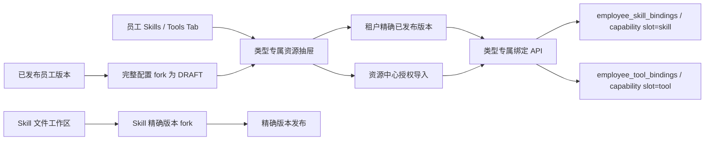
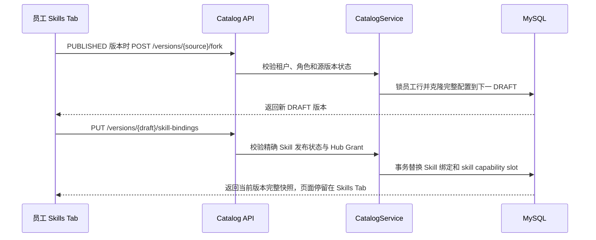
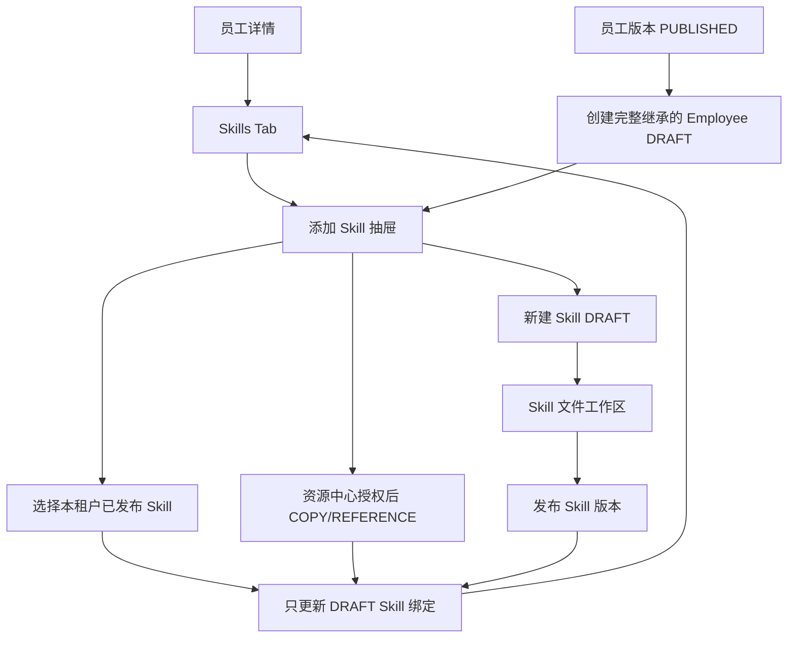

# 员工资源定向编辑方案

## 目标与现状

员工详情的 Skills 页点击“添加 Skill”后，当前会跳转到 `/enterprise/employees/{id}/versions/{version}`。该页同时展示系统指令、Skill 绑定、Tool 绑定和运行配置，与“只添加 Skill”的意图不一致，也会让用户担心改 Skill 时覆盖其他配置。

本方案让资源操作保持在员工工作台的对应类型页内：Skills 只管理 Skills，Tools 只管理 Tools；系统指令和运行环境只在版本配置入口编辑。已发布员工版本和 Skill 版本继续不可变。

## 架构与数据边界



员工 fork 在 `digital_employee_versions` 创建完整配置快照，并复制两类绑定与 Capability slot；类型绑定只变更 `employee_skill_bindings` 或 `employee_tool_bindings` 和同类型 Capability slot。Skill fork 在 `skill_versions` 新增版本，`skill_tool_declarations`、`skill_file_entries` 复制依赖和不可变 MediaAsset 引用。没有新增数据库对象，因此本次不增加 migration；所有既有 SQL 来源继续位于 `docs/migrations/`。



## 页面结构

员工工作台维持一级导航“数字员工 / 资源中心 / 部署记录”，员工详情使用直接的类型 Tab：

```text
员工详情：工单助手 · ACTIVE                         [编辑资料]
概览 | Skills (2) | Tools (1) | 版本与发布

Skills Tab：工单助手 / v3 DRAFT
已绑定 Skills                                                [+ 添加 Skill]

┌───────────────────────────────────────────────────────────┐
│ 工单规范        v2 · PUBLISHED · 本租户 COPY   [文件] [移除] │
│ 退款规则        v1 · PUBLISHED · Hub REFERENCE  [只读文件]   │
└───────────────────────────────────────────────────────────┘
```

### “添加 Skill”抽屉

按钮留在 Skills Tab，不跳到版本总编辑页。抽屉只显示 Skill 内容：

```text
添加 Skill 到 工单助手 · v3 DRAFT
[本租户 Skills] [资源中心]                         搜索 Skill…

□ 工单规范      v2 · PUBLISHED · TOOL 依赖 1 项       [查看]
□ 客服问答      v4 · PUBLISHED · FILE_PACKAGE        [查看]

已选 1 项                         [取消] [绑定到 v3 草稿]
```

- **本租户 Skills**：仅选择本租户已发布的精确 Skill 版本；草稿版本显示不可绑定状态和“继续编辑”入口。
- **资源中心**：只筛选 `SKILL`。平台可发现但没有 Grant 的资源可以展示脱敏目录信息，不允许读取 Manifest 或绑定；有权后可选择 COPY 或 REFERENCE，展示依赖和只读状态。
- **新建 Skill**：独立创建 Skill DRAFT，再进入 Skill 专属编辑器；不会进入员工版本全量配置页。
- 确认绑定后抽屉关闭，停留在 Skills Tab，只更新当前员工 DRAFT 的 Skill 清单和数量。

Tools Tab 使用相同的列表/抽屉模式，但抽屉和资源行只包含 Tool。其他已启用的资源类型以后各自增加独立 Tab，不加入一个混合类型表格。

### Skill 文件编辑和版本

Skill 文件始终由 Skill 专属工作区负责，展示文件树、正文、SHA-256、ZIP Preview/Commit、创建、重命名和删除；页面不展示员工系统指令、Tool 绑定或 Runtime 设置。

- 本地 Skill DRAFT 可在线编辑和上传 ZIP；根目录唯一 `SKILL.md` 仍是 FILE_PACKAGE 入口，不能重命名或删除。
- PUBLISHED Skill 显示“基于此版本创建 Skill 草稿”。创建的新版本复制名称、依赖和文件清单，旧版本保持不变；文件内容修改会生成新的租户 MediaAsset。
- Hub REFERENCE Skill 不提供编辑入口；要修改时先在资源中心 COPY 到租户，再从副本创建/编辑 DRAFT。
- 文件校验通过后发布 Skill 固定版本，再回到员工 Skills Tab 绑定新版本。已有员工版本和历史 RunSnapshot 不改变。

### 版本编辑页

完整版本配置入口保留在“版本与发布”中，改用独立页签：

```text
工单助手 / v3 DRAFT                    [测试] [保存草稿] [发布版本]
系统指令 | Skills | Tools
```

每个页签只显示对应员工内容字段。运行引擎、模型、工作区、沙箱和审批策略归 Deployment 管理，不属于这个版本编辑页。点击“添加 Skill”只打开 Skill 抽屉；该操作不跳转到上述全量编辑页，也不提交系统指令或 Tool 清单。

## 操作流程与状态



- 若用户从 PUBLISHED 员工版本发起“添加 Skill”，先创建下一 Employee DRAFT，复制系统指令和现有 Skill/Tool 精确绑定，再打开 Skill 抽屉。ExecutionProfile/ModelRoute、审批和环境配置属于 Deployment，不随员工版本 fork；原发布版本保持不变。
- DRAFT 员工的 Skill 绑定更新不得改写系统指令、Tool 绑定、运行配置或版本状态；Tools 的更新规则相同。
- 成员可以查看版本和资源清单，但不能创建草稿、添加/移除绑定、编辑文件或发布。
- Grant 被撤销或过期时阻止新的 REFERENCE 绑定和 Run；已启动 Run 的固定快照保持可读。

## API 与数据边界

建议增加聚焦 API；现有 `PUT /digital-employees/{id}/versions/{version}` 继续用于版本配置页的完整版本保存：

| 方法与路径 | 作用 | 只影响的数据 |
|---|---|---|
| `POST /digital-employees/{id}/versions/{source_version}/fork` | 基于精确员工版本创建下一 DRAFT | 新建 `digital_employee_versions` 和两类绑定快照 |
| `PUT /digital-employees/{id}/versions/{version}/skill-bindings` | 替换当前 DRAFT 的 Skill 绑定 | 仅 `employee_skill_bindings` 和对应 Skill capability bindings |
| `PUT /digital-employees/{id}/versions/{version}/tool-bindings` | 替换当前 DRAFT 的 Tool 绑定 | 仅 `employee_tool_bindings` 和对应 Tool capability bindings |
| `POST /skills/{skill_id}/versions/{version}/fork` | 从本地 PUBLISHED Skill 创建下一 DRAFT | 新建 Skill 版本和文件清单；复用同租户不可变 MediaAsset 引用 |
| `POST /skills/{skill_id}/versions/{version}/publish` | 校验并发布精确 Skill DRAFT 版本 | 只更新该 Skill 版本状态 |
| `GET /skills?include_versions=true` | 绑定选择器读取所有精确 Skill 版本 | 只读；默认 `/skills` 仍返回最新版本 |
| `GET /skills/{skill_id}/versions/{version}/files` | 返回文件清单、`source_mode` 和 `fork_allowed` | 只读；前端据此显示本地版本 fork 或 REFERENCE COPY 提示 |
| 已有 ZIP/文件 API | 编辑 Skill DRAFT 文件 | 新 MediaAsset、Skill 文件清单和 manifest 摘要 |

员工 fork 与 Skill fork 的源版本必须为 PUBLISHED，目标版本自动分配为下一 DRAFT。绑定请求以 `skill_version_refs` 或 `tool_version_refs` 提交 `{resource_id, version}` 数组；员工 fork 用 `POST /digital-employees/{id}/versions/{source_version}/fork`。REFERENCE 资源在类型绑定前由 Resource Center Service 检查 Grant 和 manifest；无权资源按 404/409 契约拒绝。

员工克隆和类型绑定操作在 MySQL 事务内检查 DRAFT/租户范围；类型绑定 API 只更新自身绑定表。REFERENCE 资源必须通过 Resource Center Service 校验 Grant 和精确 Manifest 摘要。新建数据库对象预计不需要新 migration；若实现发现需要增加修订字段，必须在 `docs/migrations/` 新增前向迁移并补中文表/字段 COMMENT。

错误映射沿用现有契约：成员写入 `403 AUTHORIZATION_DENIED`，跨租户资源 `404 RESOURCE_NOT_FOUND`，写入 PUBLISHED 版本 `409 IMMUTABLE_VERSION`，Grant/Manifest 冲突 `409 DEPENDENCY_VALIDATION_ERROR` 或 `IDEMPOTENCY_CONFLICT`。

## 验收结果

员工资源定向编辑闭环复用现有 Skill/Tool 绑定 API；PUBLISHED 员工版本 fork 为只含员工指令和 Skill/Tool 精确绑定的 DRAFT，Deployment 运行配置保持独立。运行配置版本和回填由 `docs/工作台运行配置方案.md` 与 V009 migration 记录；Skill 创建生成独立 DRAFT 并进入文件工作区；本地 PUBLISHED Skill 可 fork 和发布精确版本，REFERENCE 保持只读并要求先 COPY。

验证命令：

```bash
cd backend
set -a
. ../deploy/control-plane/.env
set +a
export MYSQL_HOST=127.0.0.1 MYSQL_PORT=3309 MYSQL_USER=root MYSQL_PASSWORD="$MYSQL_ROOT_PASSWORD"
export AGENT_PLATFORM_MYSQL_TEST_ALLOW_CREATE_DATABASE=1
python -m pytest -q
python -m ruff check src tests
python -m compileall -q src tests

cd ../frontend
npm test
npm run build

cd ..
openspec validate digital-employee-resource-center --strict
docker compose --env-file deploy/control-plane/.env -f deploy/control-plane/docker-compose.yml up --build -d
```

验证结果：backend 全量 221 passed、0 skipped；MySQL 8.4.10 集成测试包括员工 fork 并发版本号分配、类型绑定只改本类型 Capability slot、Skill 文件包 fork 后复用同一 MediaAsset 与 manifest。Ruff、compileall 和 OpenSpec strict validation 通过。frontend 11 个测试文件、35 个用例通过，Vite 生产构建成功；构建仍报告主 bundle 超过 500 kB 的体积提示。Docker backend/web/MySQL 健康，`http://localhost:8088` 返回员工管理台重定向，员工详情与 Skill 文件工作区实际交互通过。

Docker 验收使用本地样例 `employee-4cc70e164c`：v3 DRAFT 绑定一个 Skill，系统指令 `5555`、Tool 绑定和运行配置保持原值；v1 PUBLISHED 绑定未变。Skill 文件工作区从本地 PUBLISHED v1 fork 出 v2，入口内容保持原值，并通过 Docker API 发布 v2 为 PUBLISHED。`fork_allowed` 对本地已发布版本为 true；REFERENCE 则返回只读来源标记并要求 COPY。

未验证项：生产身份中心、云对象存储（MinIO/S3/OSS/COS）和真实 Runtime 不在当前 Change 范围。
