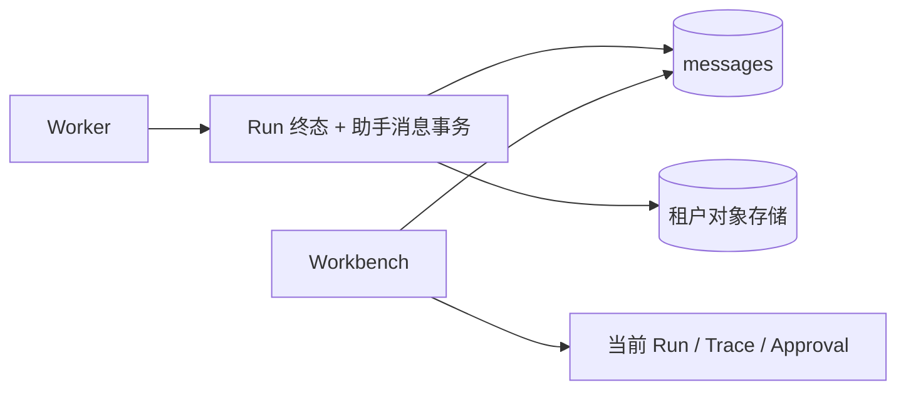
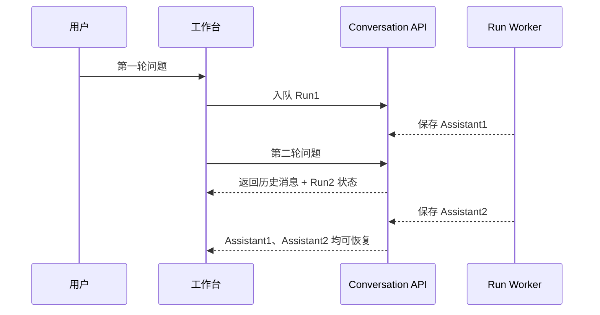

# 对话回复历史恢复

## 功能说明

本修复保证员工工作台同一 Session 连续问答时，第一轮助手答复不会因第二轮 Run 成为当前 Run 而消失。助手答复与产生它的 Run 绑定，正文保存在租户隔离对象存储，消息索引按 Session 序号保存。

## 使用角色与边界

租户成员可查看自己参与的 Conversation；服务端按 platform、tenant、participant 和 Session 绑定校验。助手正文不写入 MySQL 明文字段，也不记录到 Trace 或日志。其他租户和非参与者按资源不存在/拒绝语义处理。

## 数据、API 与状态

`GET /api/v1/conversations/{conversation_id}/messages` 返回 `user`、`assistant` 两类消息，按服务端 `sequence_no` 顺序。SUCCEEDED 或 AWAITING_APPROVAL 的确定性结果会有 ASSISTANT/COMPLETE；FAILED、CANCELLED、UNKNOWN 不伪造成功答复。第二轮执行期间，第一轮历史保持可见。

前端在服务端助手消息回写前，会按 Conversation 暂存已读取的 Run 答复并与服务端消息去重；切换租户会清空这段临时缓存，重新打开 Conversation 以后以服务端持久化消息为准。

## 架构图

## 流程图

## 验收标准

- 两轮问答后，时间线同时显示两轮用户消息和两轮助手答复。
- 刷新或重新进入 Conversation 后历史仍存在。
- 第二轮执行中，第一轮答复仍存在。
- 失败/UNKNOWN 不产生成功答复；跨租户读取被拒绝。

## 已验证项与未验证项

已验证项和验证命令由 OpenSpec change 的 design.md 维护。本地测试不连接用户提供的真实 Session `xzma2w5xq5fj5emvyjrozo362u`，该 Session 需在授权的集成环境单独核对。
