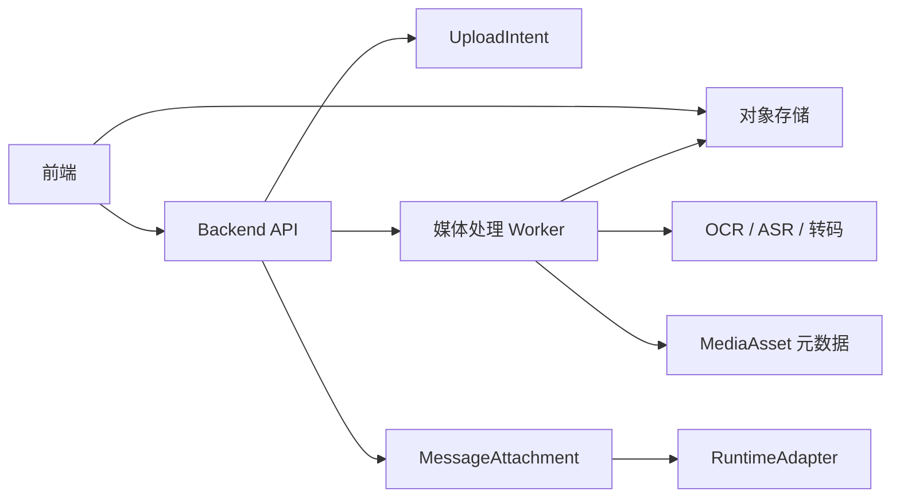
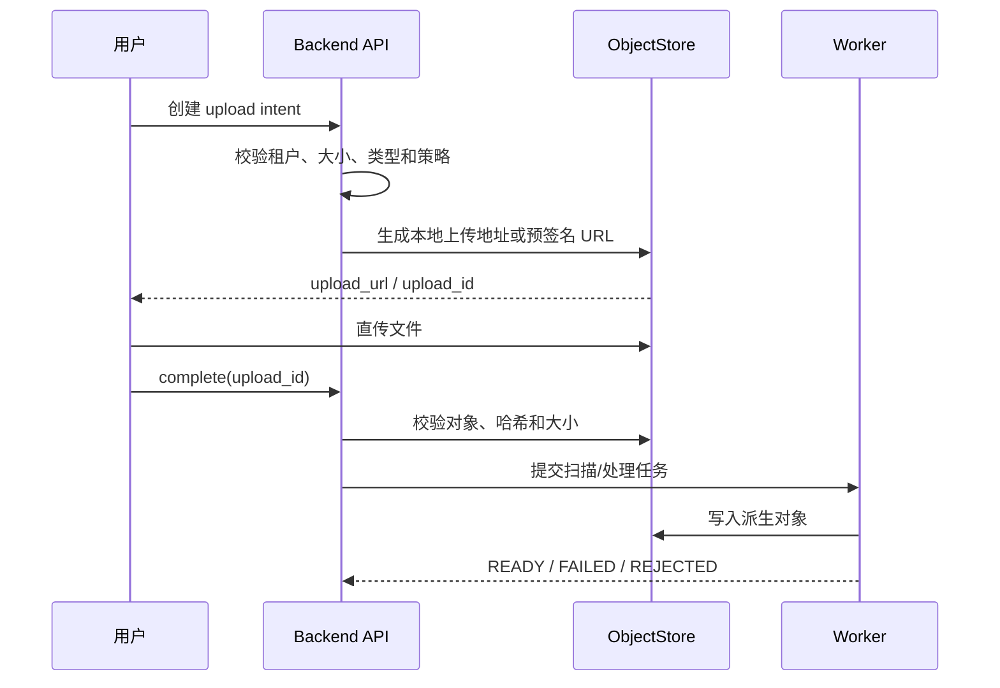
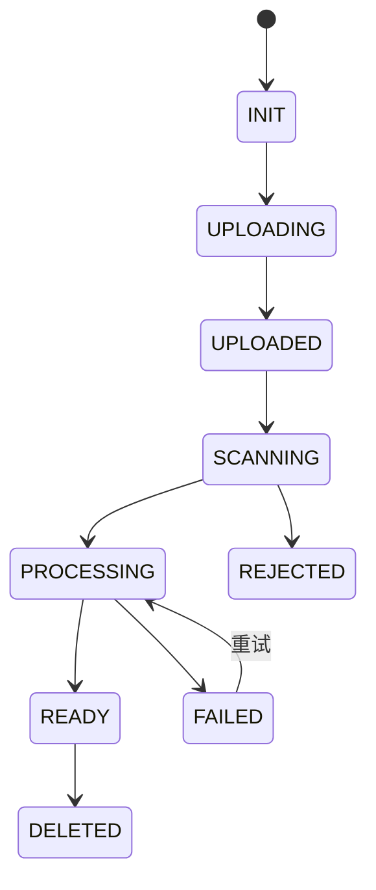
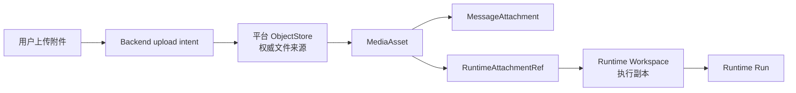
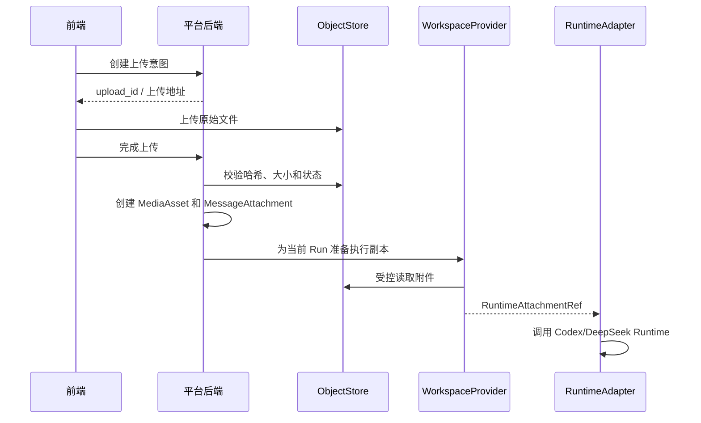

# 对象存储与媒体处理设计

状态：设计阶段，第一批本地 ObjectStore 尚未实现
更新时间：2026-11-14

## 目标

平台统一管理图片、文件、音频、视频、消息附件、知识库文件和 Runtime 产物。二进制内容通过 ObjectStore 保存，MySQL 只保存索引、引用、状态和处理元数据。

## 总体架构



## 存储后端

```text
provider=local  本地开发默认
provider=s3    通用 S3 兼容服务
provider=minio  自建 MinIO
provider=oss   阿里云 OSS
provider=cos   腾讯云 COS
```

统一端口：

```python
class ObjectStore(Protocol):
    def create_upload_intent(self, request: UploadRequest) -> UploadIntent: ...
    def complete_upload(self, upload_id: str) -> MediaAsset: ...
    def get(self, object_ref: str, tenant: TenantContext) -> BinaryStream: ...
    def delete(self, object_ref: str, tenant: TenantContext) -> None: ...
```

## 配置模型

```text
StorageProfile
- id
- provider: local | s3 | minio | oss | cos
- endpoint
- region
- bucket
- base_prefix
- credential_ref
- local_root
- signed_url_ttl_seconds
- encryption_policy
- retention_policy
```

```text
StorageBinding
- scope_type: PLATFORM | TENANT | PROJECT
- platform_id
- tenant_id
- project_id
- storage_profile_id
```

选择优先级：

```text
Project > Tenant > Platform > System Default
```

配置示例：

```env
OBJECT_STORAGE_PROVIDER=local
OBJECT_STORAGE_LOCAL_ROOT=.artifacts/object-store
OBJECT_STORAGE_SIGNED_URL_TTL_SECONDS=600
```

外部存储示例：

```env
OBJECT_STORAGE_PROVIDER=s3
OBJECT_STORAGE_ENDPOINT=https://s3.example.com
OBJECT_STORAGE_REGION=cn-shanghai
OBJECT_STORAGE_BUCKET=agent-platform
OBJECT_STORAGE_CREDENTIAL_REF=secret/object-store/prod
OBJECT_STORAGE_SIGNED_URL_TTL_SECONDS=600
```

API Key、Secret Key 和临时令牌只通过 `credential_ref` 注入，不能写入配置文件、数据库或日志。

## 上传流程



本地后端不把宿主文件路径返回给客户端。LocalObjectStore 使用服务端生成的 upload_id 和 object_ref，通过一次性接口访问。

## 生命周期



## 对象键

对象键由服务端生成：

```text
platform/{platform_id}/tenant/{tenant_id}/media/{asset_id}/original
platform/{platform_id}/tenant/{tenant_id}/media/{asset_id}/derivatives/{type}
platform/{platform_id}/tenant/{tenant_id}/runtime/{session_id}/{name}
```

客户端提交的路径、文件名和对象键只作为展示信息，不能控制真实存储路径。

## 对话附件和 Runtime 文件

对话中上传的图片、文件、音频和视频默认先进入平台 ObjectStore。Codex、DeepSeek 或其他 Runtime 的文件系统、Thread 文件引用和 Session 存储属于 Runtime 私有状态，不能作为平台唯一的长期文件来源。



平台对象存储和 Runtime 工作区的关系：

```text
Platform ObjectStore = 持久化、权限、审计、复用和删除的权威来源
Runtime Workspace    = 当前 Session/Run 的执行副本
Runtime Session      = 引擎私有状态和上下文引用
Message              = 用户消息与 attachment_id 的关系
```

### 附件保留策略

```text
EPHEMERAL
    只用于当前 Run，Run 结束并经过宽限期后清理

SESSION
    在当前 Runtime Session 生命周期内保留

CONVERSATION
    跟随 Conversation 历史保留，后续 Run 可以再次引用

KNOWLEDGE_BASE
    转入知识库，生成文档、Chunk、索引和引用
```

默认策略：普通聊天附件使用 `CONVERSATION`，代码临时文件使用 `EPHEMERAL`，用户明确导入知识库的文件使用 `KNOWLEDGE_BASE`。

### Message 和 Runtime 的附件引用

```text
Message
  +-- attachment_id
          |
          v
MediaAsset
  +-- object_ref
  +-- mime_type
  +-- sha256
  +-- retention_policy
          |
          v
RuntimeAttachmentRef
  +-- Codex file reference
  +-- workspace path
  +-- DeepSeek input reference
```

Message 不保存完整二进制内容，只保存附件引用。RuntimeAdapter 根据目标引擎能力，把平台附件转换成 Runtime 支持的文件、图片、音频、视频或派生文本输入。

### 典型流程



平台可以把文件复制到 Runtime Workspace，但不能把宿主路径直接暴露给用户或模型。Runtime 执行完成后，diff、报告、缩略图、转写文本和其他产物继续回写 ObjectStore，并通过 ArtifactRef 关联 Run。

## 媒体处理

```text
图片：原图 -> 扫描 -> 缩略图 -> OCR/视觉输入
文档：原文件 -> 扫描 -> 文本提取 -> 页码/段落引用
音频：原音频 -> 扫描 -> ASR -> 时间轴/说话人
视频：原视频 -> 扫描 -> 音频 ASR + 关键帧 + OCR
```

RuntimeAdapter 根据 Runtime 能力选择：

- 直接传递图片或文件引用。
- 传递 ASR/OCR/摘要后的文本。
- 传递关键帧和时间轴。
- 只传递派生内容，不传递原始媒体。

## 安全和删除

- MIME 类型必须真实探测，不能只相信扩展名。
- 限制文件大小、图片尺寸、音频和视频时长。
- 压缩包执行路径必须防止路径穿越和符号链接逃逸。
- 原始媒体和派生媒体都必须带租户授权。
- 删除先撤销读取，再写入 GC 队列。
- GC 失败可重试，不回滚已经提交的业务删除。
- 普通日志只保存 asset_id、哈希、大小、状态和错误类别。
- 原始 prompt、媒体正文和工具响应不进入普通审计日志。

## 第一阶段实现顺序

1. 定义 ObjectStore、StorageProfile 和 StorageBinding。
2. 实现 LocalObjectStore。
3. 增加 upload intent 和 MediaAsset 状态机。
4. 增加图片和普通文件附件。
5. 增加 FakeMediaProcessor。
6. 增加 S3/MinIO/OSS/COS 适配器契约和配置校验。
7. 增加音频 ASR、视频关键帧和派生对象处理。
8. 增加 Conversation Message 的 `attachment_id` 关联和 RuntimeAttachmentRef 转换。
9. 增加 EPHEMERAL、SESSION、CONVERSATION、KNOWLEDGE_BASE 保留策略和删除回收。
