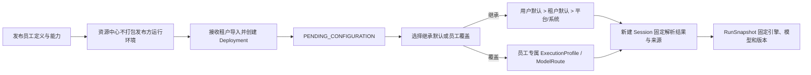
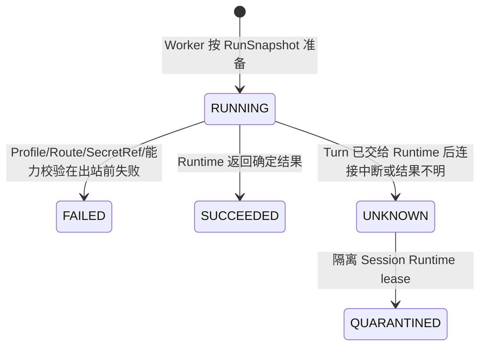

# 接收方 Deployment 运行配置方案

## 结论

采用 B：数字员工发布的是可复用的员工定义和能力；执行环境属于使用者租户。引擎和 ModelRoute 分别设置用户/租户默认，每个员工 Deployment 可单独覆盖引擎、模型或两者。各自解析顺序为 Deployment 覆盖、用户默认、租户默认、平台/系统默认。

这样发布者不需要知道接收方是否有同一 ModelRoute、ExecutionProfile、Sandbox 或 Workspace。资源中心 COPY/REFERENCE 继续共享员工指令和 Skill/Tool 依赖，但不复制发布方租户的环境标识、运行策略或凭据。不同员工 Deployment 可以分别绑定 Codex CLI、DeepSeek Harness 或以后通过验证的其他 EngineProvider。

## 主流程



| 阶段 | 行为 | 验收结果 |
|---|---|---|
| 发布/导入 | 发布包仅含员工定义、精确 Skill/Tool 和必要的能力要求 | 接收方没有发布方模型或沙箱时仍可导入 |
| 创建 Deployment | 新 Deployment 进入 `PENDING_CONFIGURATION` | 选择继承默认或员工独立配置前不创建 Session/Run |
| 继承默认 | 工作台解析当前 Session 创建者可用的用户/租户默认 Profile | 快照记录实际 Profile 和 `USER_DEFAULT`/`TENANT_DEFAULT` 等来源 |
| 员工覆盖 | 管理员点击 `/enterprise/workbench` 当前员工旁的“运行配置”，在轻量对话框选择本地 Profile/ModelRoute | 该员工配置优先于所有全局默认；工作台保持现有三栏布局 |
| 修改配置 | 保存下一不可变 Deployment 修订或更新作用域默认 | 新 Session 使用新解析结果；旧 Session/Run 保留旧快照 |

## 与当前模型管理页的关系与原型调整说明

当前截图中的“连接与模型”及“模型路由”两个页签继续负责现有连接、模型目录、测试和路由操作。本方案只在同一页签栏新增第三个“默认运行环境”，不另加模型管理主页面，也不改变现有连接/路由数据。

本轮将“默认运行环境”实际页面调整为原型里的作用域选择器、独立引擎/模型默认字段、分别保存动作和旁侧 ExecutionProfile 方案目录；有效引擎/模型与各自来源放在同一配置卡中。普通成员只能选择个人作用域，租户默认作为只读摘要显示。工作台弹窗用“全部继承默认 / 设置员工覆盖”切换；继承态展示引擎、模型和来源，覆盖态的每个字段都可单独回退到默认值。

原型中的调整点：ExecutionProfile 表单移除必选 ModelRoute；引擎和模型分别保存，切换引擎不改模型选择。ModelRoute 页签仍负责创建/授权路由，默认运行环境和 Deployment 只引用这些路由。为了展示独立选择，静态原型列出多条演示路由；上线界面以当前租户实际授权的 ModelRoute 目录为准。V009 会将现有 `execution_profiles.model_alias` 改为可空，历史 alias 保留为兼容回退，不作为新模型的绑定入口。

ModelRoute 页签提供直接创建入口和行内编辑、测试、停用/启用、删除。创建/编辑只从当前租户已启用连接及 ACTIVE 模型目录中选择，不让操作人填写端点密钥；编辑需携带期望 `route_version` 并创建下一版本，旧 RunSnapshot 不变。删除是逻辑撤销：状态转为终态 `REVOKED`，数据库路由行、审计和 RunSnapshot 保留；仍被默认绑定、ACTIVE Deployment 或会影响新 Session 的 Profile fallback 引用时，返回 `MODEL_ROUTE_IN_USE` 并要求先解绑。停用仍可恢复；REVOKED 不可重新启用，且 DISABLED Deployment 恢复 ACTIVE 前会重新校验固定路由。本次没有增改数据库字段或 migration，沿用现有 `status` 约束。

默认运行环境页签分别展示用户/租户 EngineProfile 默认和 ModelRoute 默认。ExecutionProfile 选择引擎；模型在默认运行环境或员工 Deployment 中通过独立 ModelRoute 选择。切换引擎不会自动更换或锁定模型。Workspace/Sandbox/附加审批策略暂不在 Profile 表单或 Deployment 弹窗中开放；待 Worker 消费这些字段后再启用。模型列表显示当前租户已授权的路由，Session 创建前校验引擎兼容性；不兼容时给出错误，不静默替换模型。租户管理员可创建 ExecutionProfile；个人和租户 ModelRoute 默认独立绑定到现有“模型路由”页签中的路由。工作台的员工“运行配置”对话框允许分别继承或覆盖这两个值，点击“管理默认运行环境”进入模型管理第三页签。原型保留截图中的左侧导航、租户身份栏、连接卡片、12 个模型目录、ModelRoute 列表；新增部分是第三页签和从工作台跳转的关系。

已发布 ExecutionProfile 不原地编辑，但不会为每次修改创建新的 Profile ID。模型管理“默认运行环境”页的 Profile 版本区提供“创建新版本”：从 Profile ID 下的已发布 vN 创建 DRAFT vN+1；保存草稿可继续编辑，发布后默认绑定和 Deployment 仍固定 vN，直到管理员显式切换到 vN+1。已实现 `POST /api/v1/execution-profiles/{id}/versions/{version}/fork`、`PUT /api/v1/execution-profiles/{id}/versions/{version}`、`POST /api/v1/execution-profiles/{id}/versions/{version}/publish` 与同租户版本历史读取 API；发布版本直接修改返回 `IMMUTABLE_VERSION`。新版本清除旧模型 alias/route 绑定；ModelRoute 继续独立选择。新建版本只开放引擎字段；fork 自历史版本的 Workspace/Sandbox/附加审批字段必须清除后才能发布。旧 Profile 中的 Route 会在 V009 回填到独立绑定，若迁移后仍没有独立模型默认，历史 alias/route 可作为兼容回退。

继承模式下，EngineProfile 与 ModelRoute 分别按 User > Tenant > Platform/System 解析；两者的有效组合必须通过 EngineProvider 兼容校验。用户/租户 EngineProfile 复用 `execution_profile_bindings`，ModelRoute 默认单独持久化在 `model_route_bindings`。用户默认只影响由该用户创建的新 Session。

## 配置归属与数据模型

员工版本只固定指令、Skill、Tool 和员工能力策略。引擎默认复用 V003 `execution_profile_bindings`；ModelRoute 默认由独立 `model_route_bindings` 保存。接收方的 `deployment_runtime_config_versions` 按 `(platform_id, tenant_id, deployment_id, config_version)` 保存 `INHERIT` 或 `OVERRIDE` 修订；本期覆盖入口可单独固定 ExecutionProfile、ModelRoute 或两者。Workspace/Sandbox/审批列保留在 V009 用于历史回填，但当前 Worker 不消费 Deployment 级新覆盖；API 对新的非空值明确返回 `ENGINE_CAPABILITY_UNSUPPORTED`，Session 也拒绝与精确 Profile 不一致的历史字段。旧 Profile 的 Route/alias 只作兼容迁移数据；V009 将 `execution_profiles.model_alias` 改为可空，新 Session 优先使用独立 ModelRoute 的模型名。

Deployment 指向当前配置修订。新的 Deployment 未配置时指针为空；已有 Deployment 在 V009 迁移时从其原员工版本回填配置修订 1，保持当前运行行为。新建 Session 固定该修订；历史 Session 可保留旧字段且 `runtime_config_version` 为空，不推断其历史配置。

| 数据对象 | 租户归属和约束 | 版本/状态 |
|---|---|---|
| EmployeeVersion | 发布者租户；不再保存 Profile、Route、Workspace/Sandbox 或运行审批绑定 | 不可变；只包含可复用员工内容和能力 |
| Hub Employee Package | 平台资源中心版本；不含发布方环境 ID、SecretRef 或密钥 | COPY/REFERENCE 均固定员工包版本 |
| ExecutionProfileBinding | User/Tenant/Platform 作用域；独立绑定 EngineProfile ID/version | User > Tenant > Platform > System；系统默认来自受控部署配置 |
| ModelRouteBinding | User/Tenant/Platform 作用域；独立绑定 ModelRoute ID | User > Tenant > Platform > System；已选 Route 需兼容最终 EngineProvider |
| Deployment Runtime Config | 接收方 `platform_id + tenant_id + deployment_id`；可独立覆盖 EngineProfile、ModelRoute | 配置版本递增且不可改写 |
| Deployment | 接收方租户范围 | `PENDING_CONFIGURATION → ACTIVE ⇄ DISABLED` |
| Session/RunSnapshot | 继承 Deployment 当前修订 | 已创建快照不可被后续配置修改 |

## API 与权限

全局默认值放在**模型管理 → 默认运行环境**。在截图中的“连接与模型”“模型路由”两个页签旁新增第三个页签；用户在这里设置个人默认，租户管理员在同处设置租户默认。租户管理员在此用已注册的 EngineProvider 创建 ExecutionProfile，再独立选择 ModelRoute 并绑定为默认；不会复制连接或路由数据。Workspace/Sandbox/审批 Profile 编辑在当前 UI 中显示为待 Worker 接线后开放；API 对新 Deployment 覆盖返回明确的 capability error。工作台的 Deployment 对话框只提供“继承默认”或“员工覆盖”，并跳转到这个页签管理默认值。

建议提供 Deployment 运行配置 API、个人/租户 `execution_profile_bindings` API 和独立的 `model_route_bindings` API。Deployment 可只覆盖 EngineProfile、只覆盖 ModelRoute 或同时覆盖；未覆盖的维度继续按用户/租户默认解析。保存两项时各自独立；新 Session 创建前校验组合是否受 EngineProvider 支持。不兼容时返回明确错误且不换模型，用户可改模型而不必改引擎。

首期默认 API 使用认证身份决定作用域，不接受客户端指定其他用户或租户 ID：

| 方法与路径 | 作用 | 权限与边界 |
|---|---|---|
| `GET /api/v1/engine-providers` | 返回已注册且启用的 EngineProvider、ModelRoute 协议与能力摘要 | 不返回进程命令或凭据；演示模式明确标为 `SIMULATION`；未注册 Provider 不提供选择入口 |
| `GET /api/v1/execution-profile-bindings/effective` | 返回用户 > 租户 > 平台顺序解析出的引擎 Profile 摘要及来源 | 仅返回引擎/策略摘要，不返回模型凭据 |
| `GET/PUT /api/v1/execution-profile-bindings/user` | 读取、更新或清除当前用户的 Profile 绑定 | 用户可维护个人默认；只允许引用本租户已发布 Profile 的精确版本 |
| `GET/PUT /api/v1/execution-profile-bindings/tenant` | 读取或更新当前租户的 Profile 默认 | 只读对成员开放；只有租户管理员可更新/清除 |
| `GET /api/v1/model-route-bindings/effective` | 返回独立解析的 ModelRoute 摘要及来源 | 不因引擎默认变化而改写 Route；响应不包含 endpoint 或 SecretRef |
| `GET/PUT /api/v1/model-route-bindings/user` | 读取、更新或清除当前用户的 Route 绑定 | 用户可维护个人默认；只允许选择当前租户可用路由 |
| `GET/PUT /api/v1/model-route-bindings/tenant` | 读取或更新当前租户的 Route 默认 | 只有租户管理员可更新/清除；成员可只读 |
| `GET/PUT /api/v1/deployments/{deployment_id}/runtime-config` | 读取当前修订，或按期望修订保存 `INHERIT`/`OVERRIDE` 新版本 | 管理员可写，运行成员只读；字段可分别覆盖 Profile 或 ModelRoute，响应不包含模型端点/SecretRef |
| `POST /api/v1/sessions` | 创建 Session 时解析 Deployment 覆盖和独立默认，并返回固定的 Profile/Route 与来源 | Session 固定 `runtime_config_version`、`runtime_profile_source` 和 `runtime_model_route_source`；无 EngineProfile 时返回 `RUNTIME_CONFIGURATION_REQUIRED`（409） |

两个默认分别保存和审计。更新请求将资源字段置为 `null` 可清除当前作用域绑定并回退到下一优先级。API 保存 ModelRoute 时只验证租户授权和路由启用状态；最终模型与 EngineProvider 的兼容性在创建 Session 前校验，失败时保留两项选择并拒绝启动。

Deployment 写入需要携带 `expected_config_version`：首次配置用 `null`，后续更新必须等于当前修订号。成功时创建下一不可变修订；并发管理员基于过期修订保存时返回 `RUNTIME_CONFIG_REVISION_CONFLICT`（409）。新 Deployment 在首次保存前为 `PENDING_CONFIGURATION`，此状态下创建 Session 返回 `RUNTIME_CONFIGURATION_REQUIRED`（409），不保存部分会话或消息。

租户管理员可以修改租户默认值和 Deployment 覆盖；用户只能修改自己的个人默认值。运行成员可以查看有效配置摘要和配置来源。所有 Profile、ModelRoute、Workspace、Sandbox 都必须属于当前租户或经过平台授权；跨租户资源按 404 处理。凭据使用接收方自己的 SecretRef，API、快照、Trace 和日志均不返回密钥明文。

配置不能扩大员工的 Tool allowlist，也不能降低平台或 Tool 风险策略规定的审批下限。高级参数来自后端白名单，不接受任意环境变量或 Secret。

## Session、Run 与错误状态

新建 Session 时分别解析 Deployment EngineProfile 和 ModelRoute 覆盖/默认，固定两个来源和配置修订。同一个 Conversation 的旧 Session 保持原 Engine/Model；修改默认值或 Deployment 配置后，新建 Session 才应用新值，避免在已建立的 Harness/CLI Session 中静默切换引擎或模型。

Session 响应包含接收方 ExecutionProfile ID/版本、ModelRoute ID（或旧 Profile alias 兼容值）、配置修订号和两个独立来源。Session 的 MySQL `metadata_json` 固定非凭据 ModelRouteSnapshot；后续 Run 从该 Session 快照生成 RunSnapshot，不重新读取新默认或当前 Deployment 修订。RunSnapshot JSON 同时保存 `runtime_config_version`、`runtime_profile_source`、`runtime_model_route_source` 和实际模型路由快照；HTTP 响应只公开路由/模型摘要，不公开 endpoint 或 SecretRef。

没有作用域默认的 INHERIT Deployment 创建 Session 返回 `RUNTIME_CONFIGURATION_REQUIRED`（409）。未注册 Provider 返回 `ENGINE_PROVIDER_UNAVAILABLE`；协议组合不兼容返回 `ENGINE_MODEL_INCOMPATIBLE`；ExecutionProfile 要求了 adapter 不支持的 Tool/MCP/Workspace/Sandbox/审批能力时返回 `ENGINE_CAPABILITY_UNSUPPORTED`（均为 409），不替换路由或回退到其他引擎。配置目录读取失败时保留未提交表单并提供重试；跨租户/撤销资源拒绝保存；并发修订冲突返回 `RUNTIME_CONFIG_REVISION_CONFLICT`（409）。

Worker 执行时以 RunSnapshot 固定的员工版本、EngineProvider、ExecutionProfile、ModelRoute 和来源为准，并校验 Session 与 Run 的引擎一致；不读取当前默认值、发布方配置或其他租户资源。Worker 重启后仍按同一快照解析。快照 Profile/依赖被撤销或接收方 SecretRef 无法解析时，在 Runtime Turn 出站前将 Run 标记为 `FAILED`，Trace 写入不含端点和凭据的稳定错误类别（例如 `RESOURCE_NOT_FOUND`、`ENGINE_CONFIGURATION_REQUIRED`），不调用 Fake 或其他引擎。



`UNKNOWN` 表示 Runtime 可能已产生外部副作用，Trace 写入 `RUNTIME_RESULT_UNKNOWN`，会话 Runtime lease 被隔离且 fencing token 失效；平台不自动重试，也不回退 Fake。只有明确的出站前错误进入 `FAILED`。Worker 租约失效且无法证明模型 Turn 已出站时，按租约回收规则标记 UNKNOWN 并等待只读对账。

## 迁移与回滚边界

新增 `docs/migrations/V009__deployment_runtime_config.sql`。迁移创建 `model_route_bindings` 并从已有 Profile/EmployeeVersion route 为历史数据回填独立绑定；将 `execution_profiles.model_alias` 改为可空，并设置字段 COMMENT `历史兼容模型别名；新 Session 模型由独立 ModelRoute 或运行时默认解析`。新建或编辑 Profile 不要求绑定 ModelRoute/alias。迁移后新 Session 优先从独立 Route 绑定解析模型，历史 Profile alias 仅在无独立默认时兼容回退。为已有 Deployment 回填 `OVERRIDE` 修订 1。部署配置表允许 EngineProfile 和 ModelRoute 分别为空或覆盖；新增字段及所有 route-binding 字段均写中文 COMMENT，使用 `information_schema.TABLES` 和 `information_schema.COLUMNS` 校验。不改写 V003/V008 历史 migration。

生产回滚保留 V009 表、列和历史修订。新员工版本可能不再有 Profile 字段，不能直接回退至要求 Profile 非空的旧二进制；如需回退，先恢复兼容读取并为新 Deployment 绑定接收方本地旧版 Profile。不得将接收方配置回写到资源中心包。

## 验证

**已验证：**V009 回填 Route 快照可按 `ModelRouteSnapshot` 完整格式反序列化，并用真实 MySQL Catalog 创建迁移后 Session；Worker/Profile/Route 快照与接收方 SecretRef 保持一致。EmployeeVersion fork 只保存员工指令和精确 Skill/Tool 绑定；两租户 MySQL COPY/REFERENCE 流程中发布方不传递 Profile、ModelRoute 或模型/沙箱环境，接收方对 COPY 与 REFERENCE Deployment 分别固定 Codex CLI/OpenAI Responses 和 DeepSeek Harness/Chat Completions，并断言 RunSnapshot 的引擎/模型。Session Resolver 按独立优先级解析，覆盖引擎不改模型；协议不兼容、未注册 Claude 和连字符 EngineProvider 别名的规范化边界有测试。ExecutionProfile 同 ID 草稿版本 API、管理员/成员权限、已发布不可变、默认版本保持旧绑定及 MySQL 重启读取通过。Worker 未接通的 Profile/Deployment Workspace/Sandbox/附加审批字段显示不可用并拒绝新写入；旧 Profile 不能作为默认/Deployment 可用值，Session/Worker 也显式拒绝未清理的历史值。INHERIT 弹窗会清除残留覆盖值；旧 `approval_policy: {name: ...}` 可见不兼容告警。MySQL V009 全量集成 `70 passed`，包含 `information_schema.TABLES`/`COLUMNS` 中文注释、租户键、回填、Session 重建和回滚边界；后端 `338 passed, 71 skipped`；前端 `77 passed`；Ruff 检查通过；前端 TypeScript/Vite production build 通过。静态 HTML 原型离线启动、工作台跳转和成员只读状态通过。

Worker 失败验证覆盖 RunSnapshot Profile 被移除和 Codex 接收方 SecretRef 缺失时出站前 `FAILED`，以及 Runtime Turn 响应丢失后 `UNKNOWN`、只调用选定 Provider 一次、不重试 Fake；RUNTIME Trace Span 仅保存引擎名、配置修订和稳定错误类别。Codex app-server 的 JSON-RPC start/turn/resume、隔离 CODEX_HOME 和密钥脱敏用假服务器验证；本机 Codex CLI 只做 initialize/thread-start smoke，未提交模型 Turn。

**未验证：**Codex 对真实模型服务的 Turn、用量与长时间恢复没有网络调用；Claude Code 未注册。本地 Docker 的 Fake 身份页面已人工验收运行配置弹窗、模型路由独立选择、模型管理全局默认入口和成员只读权限；该结果不代表真实租户身份/授权环境验收。生产 Codex Provider 仅在运维显式设置 `AGENT_PLATFORM_CODEX_APP_SERVER_ENABLED=1` 且命令可执行时注册；命令默认为 `codex app-server --stdio`，可以通过 `AGENT_PLATFORM_CODEX_APP_SERVER_COMMAND` 覆盖。Codex 当前只接收带接收方 SecretRef 的 OpenAI Responses ModelRoute，不接收 Platform Tool/MCP 或自定义 Workspace/Sandbox/审批要求。

Vite build 成功，但主 JavaScript bundle 约 1.31 MB，超过默认 500 kB 建议阈值；可在后续性能工作中进行页面级代码拆分。

复验命令：

```bash
openspec validate workbench-runtime-configuration-options --strict
cd backend && PYTHONPATH=.:../harness-engine/src .venv/bin/pytest tests -q
cd backend && PYTHONPATH=.:../harness-engine/src AGENT_PLATFORM_MYSQL_TEST_ALLOW_CREATE_DATABASE=1 MYSQL_HOST=127.0.0.1 MYSQL_PORT=33306 MYSQL_USER=root MYSQL_PASSWORD='' .venv/bin/pytest tests/integration -q
cd backend && .venv/bin/ruff check src tests
cd frontend && npm test -- --run
cd frontend && npm run build
```
