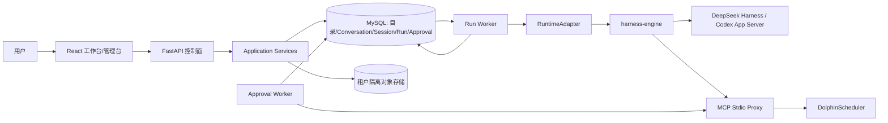
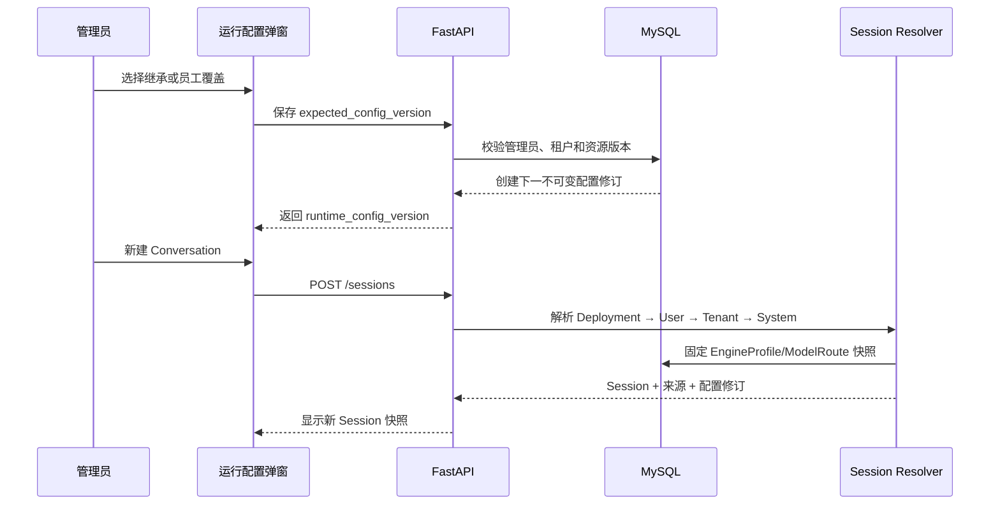
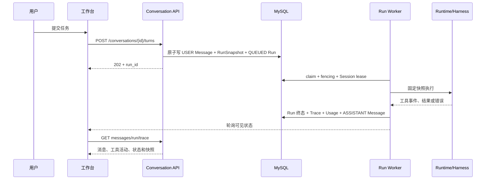
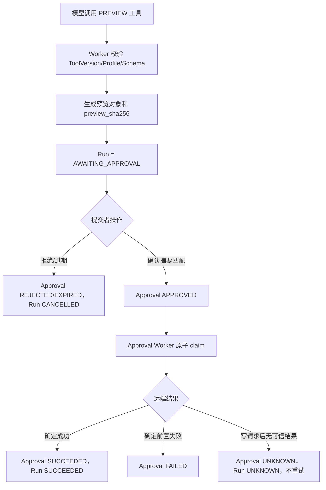
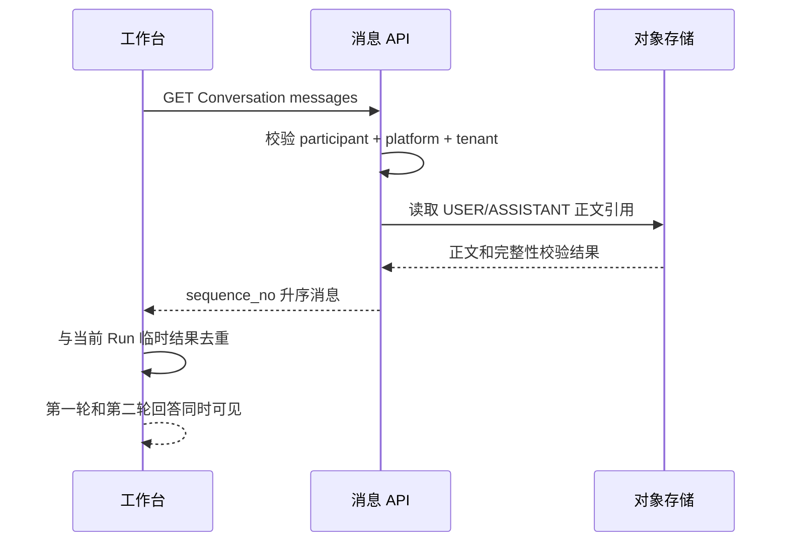

# Agent Platform 当前方案需求与设计总览

## 1. 文档定位

本文根据当前仓库中的实现、OpenSpec 变更和 `docs/原型/` 静态原型，整理当前可交付方案的需求边界和设计基线。它用于产品评审、研发拆分、验收和运维交接，不替代具体 API、数据库 migration 或 Runtime 适配器文档。

当前基线日期：2026-11-23。

**本轮整理范围：**

- 数字员工目录、版本和能力绑定
- 模型连接、ModelRoute、ExecutionProfile 和默认运行环境
- Deployment 运行配置
- Conversation 工作台、消息历史、Run、Trace 和 Approval
- DeepSeek Harness、Run Worker、Approval Worker 和 MCP Stdio
- 资源中心的发布、授权、COPY/REFERENCE
- 租户、角色、凭据、对象存储、审计和验证边界

**当前不纳入：**

- 真实生产身份中心接入
- 真实 DeepSeek 云端推理验收
- 知识库和通用长期记忆
- 发布/启动/调度 DolphinScheduler 工作流
- Workspace、Sandbox 和 Deployment 附加审批策略的完整 Worker 消费

## 2. 当前方案结论

系统采用“员工定义与执行环境分离”的模型：发布方负责员工指令、Skill、Tool 和版本；接收方租户负责 EngineProvider、ExecutionProfile、ModelRoute、凭据、Workspace/Sandbox 和审批策略。

一次运行的配置链路固定为：

```text
租户/用户默认值或 Deployment 覆盖
        ↓
新建 Session 时解析并固定运行配置修订
        ↓
提交 Conversation turn 时生成 RunSnapshot
        ↓
Worker 按 RunSnapshot 创建 Runtime / Harness / MCP
        ↓
Run、Trace、Message、Usage 和 Approval 按租户边界持久化
```

当前已实现的主要闭环是：

1. 管理员创建或发布数字员工版本。
2. 租户配置模型连接、模型目录、ModelRoute 和 ExecutionProfile。
3. Deployment 选择继承默认或设置员工覆盖。
4. 工作台创建 Conversation/Session，提交异步 turn。
5. Run Worker 使用固定快照执行 Harness。
6. 只读或预览工具产生结果；写操作进入一次性 Approval。
7. 提交者确认后由 Approval Worker 执行一次写操作。
8. 工作台恢复用户消息、助手回答、工具活动、Run 状态、Trace 和审批结果。

## 3. 使用角色与租户边界

| 角色 | 可执行操作 | 不可执行操作 |
| --- | --- | --- |
| 租户管理员 | 管理员工、版本、Skill/Tool、Deployment、模型连接、ModelRoute、租户默认值、审批 | 不能读取其他租户正文、凭据值或对象内容 |
| 租户成员 | 查看员工和运行配置、创建自己的 Conversation/Run、查看自己提交的审批 | 不能修改 Deployment、租户默认值或他人的审批正文 |
| 只读成员 | 查看已授权目录、Deployment 摘要和运行快照 | 不能创建草稿、发布、提交 Run 或审批 |
| Run Worker | 领取和执行固定 Run、写入受控状态和 Trace | 不能改变员工版本、扩大 Tool allowlist 或替换模型 |
| Approval Worker | 领取已批准的一次性动作并执行绑定 ToolVersion | 不能代替用户审批、重试 UNKNOWN 写操作 |
| System/运维 | 迁移、租约回收、对象 GC、健康检查 | 不伪造普通用户身份，不读取正文内容 |

所有请求都从认证身份得到 `platform_id`、`tenant_id`、`user_id` 和角色。客户端不能自报租户、Session、Run、ObjectRef 或凭据引用。

## 4. 当前产品需求

### RQ-01 数字员工目录和版本

- 系统必须支持创建数字员工、创建 DRAFT 版本和发布不可变版本。
- EmployeeVersion 固定系统指令、Skill 精确版本和 Tool 精确版本。
- 已发布版本不能原地编辑；修改必须 fork 新 DRAFT。
- 员工发布不携带发布方租户的 ModelRoute、ExecutionProfile、SecretRef、Workspace 或 Sandbox。
- 成员可查看版本；只有管理员可创建、编辑、发布和下线。

### RQ-02 能力资源目录

- Skill 和 Tool 分开管理、分开绑定、分开发布。
- Skill 文件工作区支持文件读取、编辑、重命名、删除、ZIP 上传预览和发布校验。
- 已发布 Skill/Tool 版本不可原地修改；员工 DRAFT 只能绑定当前租户可用的已发布精确版本。
- Tool 必须声明风险级别；WRITE Tool 不得直接进入模型工具 allowlist，必须通过预览和审批。

### RQ-03 模型和运行环境

- 模型连接保存租户范围的连接信息和凭据引用，不向页面返回密钥明文。
- 一个连接可拥有多个模型目录项。
- ModelRoute 是员工版本、默认环境和 Deployment 可选择的稳定路由；修改通过新版本完成。
- ExecutionProfile 只负责 EngineProvider 和引擎运行策略，ModelRoute 独立选择。
- 默认运行环境分别维护 EngineProfile 默认和 ModelRoute 默认。
- 用户默认、租户默认、平台/系统默认按优先级解析；Deployment 可只覆盖引擎、只覆盖模型或同时覆盖。
- 引擎和模型协议不兼容时必须阻止创建 Session，不自动替换模型。

### RQ-04 Deployment 运行配置

- 新 Deployment 初始为 `PENDING_CONFIGURATION`。
- 管理员可以选择“全部继承默认”或“设置员工覆盖”。
- 每次保存生成不可变 `runtime_config_version`。
- 新 Session 固定 Deployment 当前修订、EngineProfile、ModelRoute 和两个来源字段。
- 已有 Session/Run 不因后续配置变更而切换运行环境。
- 当前 Workspace、Sandbox、附加审批策略字段保留兼容读取，但新写入在 Worker 未接线前必须拒绝。

### RQ-04A 思考模式与回答策略（当前已实现）

- 运行配置支持“自动思考 / 深度思考 / 关闭思考”、推理强度、答复详细程度和推理预算，并保留最大输出、最大工具步骤和超时字段的统一契约。
- 默认策略支持用户、租户和平台作用域；Deployment 可覆盖，创建 Session 时解析并固定有效策略。
- EngineProvider capability 和 RuntimeAdapter 在出站前完成兼容校验与引擎私有字段映射；不支持时返回明确错误，不静默切换 Fake 或其他模型。
- 工作台只展示“思考中 / 调用工具 / 生成答复”等阶段，不展示原始思考链；Trace/Usage 记录策略摘要、阶段、秒级时间和 reasoning token 可用性。
- 真实 Provider 的最终字段名、预算语义、token 统计、生产身份和长时恢复仍属于未验证边界，详见[思考模式与回答策略方案](思考模式与回答策略方案.md)。

### RQ-05 Conversation 工作台

- 工作台按当前员工过滤 Conversation，并支持稳定游标分页。
- 左栏展示最近工作、标题、最后消息摘要、更新时间、Run 状态和待审批数。
- 中栏展示用户消息、助手回答、工具调用/结果、审批状态和最终结果。
- 对话列表、消息、思考阶段、工具事件、审批和 Run 状态均显示本地时间到秒；同一秒内以服务端 `sequence_no` 或 Trace `sequence` 排序。
- 右栏展示本次 Run 的员工版本、Skill、Tool、Engine、ModelRoute、配置来源和 Session。
- 内部 Session、Context、Runtime、Model Span 默认折叠，展开后显示中文解释和原始事件类型。
- 第二轮问答不能替换第一轮回答；消息必须按 Session 序号持久化并可恢复。
- 当前缓存用于覆盖助手消息回写的短暂窗口，重新打开页面以服务端消息为准。

### RQ-06 异步 Run 和 Runtime

- Conversation turn 必须原子保存用户消息、RunSnapshot 和 QUEUED Run，并立即返回 202。

### RQ-05A 单员工与团队执行工作台

- 工作台提供 `SINGLE_AGENT` 数字员工对话和 `TEAM` 团队协作两个互斥模式；右上角只显示当前模式上下文。
- 单员工模式继续使用固定 Session/Run、运行配置、工具审批和 Run 快照。
- 团队模式绑定不可变 TeamVersion，由 Router Agent 生成 Task DAG，成员通过独立 Engine Worker Pool 并行执行。
- 团队工作台展示成员当前认领任务、执行阶段、EngineProvider、Worker Pool、Attempt、Trace、任务详情和最近事件。
- Runtime 文本、SQL、CSV、报告、图片和补丁通过 ExecutionArtifact/Delivery Manifest 统一预览、下载和交付。
- 单员工“以团队协作继续”创建新的 TEAM Conversation，原 Conversation、Session 和 Run 保持固定。
- Worker 使用 MySQL claim、lease、heartbeat 和 fencing token 执行 Run。
- Worker 不在 API 请求线程内启动 Harness 或 MCP。
- Runtime 只能使用 RunSnapshot 固定的员工、Skill、Tool、Profile、ModelRoute 和 MCP Profile。
- 出站前可证明的配置错误进入 `FAILED`；已出站但无法确认结果进入 `UNKNOWN`，不得自动重试。
- 同一 Session Home 同时只能有一个活动 Worker Run。

### RQ-07 工具审批和 DolphinScheduler

- READ 工具可以直接执行；PREVIEW 工具用于生成用户可读预览；WRITE 工具只能由 Approval Worker 执行。
- Approval 绑定精确 ToolVersion、MCP Profile 版本、参数对象引用、预览摘要、提交者和过期时间。
- 只有 Run 提交者可以读取、确认或拒绝自己的审批。
- 确认必须提交精确 `preview_sha256` 和幂等键。
- 远端写请求只执行一次；结果不确定时为 `UNKNOWN`，要求人工只读对账。
- 当前首个写场景只创建 DolphinScheduler OFFLINE 工作流；发布、启动、调度另行审批。

### RQ-08 观测、用量和历史

- Run、Trace、Usage、Approval、消息和租约状态都必须可按租户查询。
- 消息、模型结果、工具参数和审批预览正文只保存租户隔离对象引用。
- Trace 和日志只保留稳定错误类别、工具名、状态、版本和摘要，不保存 Prompt、密钥或完整工具正文。
- 消息历史必须区分 USER、ASSISTANT、TOOL 和内部 RUN 事件。

## 5. 原型设计总览

| 原型文件 | 产品区域 | 当前实现对应 | 关键交互 | 状态 |
| --- | --- | --- | --- | --- |
| [模型管理.html](原型/模型管理.html) | 模型连接、模型目录、ModelRoute、模型测试 | `/enterprise/models` | 创建连接、录入模型、创建/编辑/停用路由、确认模型测试 | 原型完整；当前实现已覆盖主要数据流 |
| [运行策略独立面板.html](原型/运行策略独立面板.html) | 独立回答策略、能力提示和真实模型新 Session 入口 | `/enterprise/workbench` 的“运行配置” | 双栏策略、来源差异、管理员/成员只读、保存并新建对话 | 原型已完成；React 面板实现中，本地 NATIVE 模型链路已验收 |
| [DeepSeekHarness默认引擎配置.html](原型/DeepSeekHarness默认引擎配置.html) | 默认运行环境、ExecutionProfile 版本和回答策略默认值 | `/enterprise/models?tab=runtime-defaults` | 选择默认引擎、默认模型、回答策略、Profile fork/publish、加载/空/错误状态 | 引擎/模型/策略默认绑定已接入；真实云端模型未验证 |
| [员工Deployment运行配置.html](原型/员工Deployment运行配置.html) | Deployment 运行配置、回答策略和工作台入口 | `/enterprise/workbench` 的“运行配置” | 继承/覆盖、独立选择 EngineProfile/ModelRoute、回答策略、兼容性提示 | EngineProfile/ModelRoute/RuntimeOptions 已实现；本地 OpenAI-compatible NATIVE 已验证 |
| [海豚调度员工工作台.html](原型/海豚调度员工工作台.html) | 员工工作台、工具活动和 Approval | `/enterprise/workbench` | Conversation、Run 时间线、DAG 预览、OFFLINE 创建、拒绝/确认 | 原型完整；当前真实 UI 使用 React 工作台 |
| [对话回复历史恢复.html](原型/对话回复历史恢复.html) | 多轮消息历史恢复 | 工作台消息时间线 | 加载历史、第二轮问答、无权访问 | 已实现历史回复修复的静态验收原型 |
| [当前方案总览.html](原型/当前方案总览.html) | 当前方案入口和验收状态 | 文档导航 | 按产品区域查看需求、流程和验证状态 | 本文新增的总览原型 |

所有原型均为静态演示，不连接真实 API、不包含凭据。原型需要保持键盘可操作、窄屏可读，并明确标注加载、空、错误、无权和只读状态。

## 6. 架构设计



### 组件边界

| 组件 | 负责 | 不负责 |
| --- | --- | --- |
| React 管理台 | 表单、状态、分页、展示、提交保护 | 不直连模型、MCP、DolphinScheduler |
| FastAPI API | 认证、租户、版本、入队、审批校验、查询 | 不运行 Agent Loop |
| Application Service | 快照、状态转换、授权、幂等和业务规则 | 不保存凭据明文 |
| MySQL | 索引、状态、租约、摘要、对象引用 | 不保存 Prompt 和完整模型结果 |
| Run Worker | Claim、Runtime 生命周期、Trace、结果收敛 | 不扩大 Tool 权限 |
| RuntimeAdapter | 平台请求与 Harness/Codex 契约映射 | 不决定租户授权 |
| Harness/MCP | Agent Loop、工具发现、工具调用 | 不管理平台身份和租户 |

## 7. 核心流程设计

### 7.1 Deployment 配置到 Session



### 7.2 Conversation turn 到 Run 完成



### 7.3 预览与一次性审批



### 7.4 多轮消息恢复



## 8. 数据模型设计

| 对象 | 核心字段 | 不可变/约束 |
| --- | --- | --- |
| EmployeeVersion | employee、version、system_prompt、skill_refs、tool_refs | 发布后不可变 |
| ExecutionProfile | profile_id、version、engine_name、runtime_policy | 发布版本不可变；只配置引擎 |
| ModelRoute | route_id、version、connection、model_id、protocol、status | 新版本更新；撤销不删除历史 |
| DeploymentRuntimeConfig | deployment、config_version、mode、profile_ref、route_ref、runtime_options | 乐观锁、版本递增 |
| Conversation | conversation_id、tenant、title、status | 参与者可见 |
| AgentBinding | conversation、employee、session、status | 同一员工工作台按绑定过滤 |
| Session | deployment、employee_version、runtime_config_version、profile/route 来源 | 创建后固定 |
| RunSnapshot | employee/skill/tool/profile/route/MCP 精确版本和摘要 | Run 创建后固定 |
| Message | message_id、session、run、conversation、role、source、sequence_no、content_ref | 正文在对象存储 |
| ToolApproval | run、tool/profile 精确版本、preview_ref、preview_sha256、requested_by、state | 一次性、幂等、过期 |
| TraceSpan | trace、run、span_type、status、受限 attributes | 不存敏感正文 |

## 9. API 与状态设计

### 核心 API

| API | 状态/用途 |
| --- | --- |
| `GET /api/v1/digital-employees` | 员工目录和分页 |
| `GET/POST /api/v1/digital-employees/{id}/versions` | DRAFT/发布版本 |
| `GET /api/v1/model-connections` | 租户模型连接和目录 |
| `GET/POST/PUT /api/v1/model-routes` | ModelRoute 创建、版本、停用/撤销 |
| `GET/PUT /api/v1/execution-profile-bindings/{scope}` | 用户/租户默认引擎 |
| `GET/PUT /api/v1/model-route-bindings/{scope}` | 用户/租户默认模型 |
| `GET/PUT /api/v1/deployments/{id}/runtime-config` | Deployment 配置修订 |
| `POST /api/v1/sessions` | 固定 Session 运行配置 |
| `GET /api/v1/conversations` | 按员工、状态、游标分页 |
| `POST /api/v1/conversations/{id}/turns` | 原子入队异步 Run |
| `GET /api/v1/conversations/{id}/messages` | 恢复 USER/ASSISTANT 消息 |
| `GET /api/v1/runs/{id}` | Run 状态、结果和快照 |
| `GET /api/v1/runs/{id}/trace` | Trace、工具活动、用量 |
| `GET/POST /api/v1/tool-approvals/{id}` | 读取、确认、拒绝审批 |

### 状态边界

```text
Deployment: PENDING_CONFIGURATION → ACTIVE ⇄ DISABLED
Session: ACTIVE → PAUSED / INTERRUPTED / CLOSED
Run: QUEUED → STARTING → RUNNING → SUCCEEDED
Run: RUNNING → AWAITING_APPROVAL → SUCCEEDED / FAILED / CANCELLED / UNKNOWN
Run: QUEUED → CANCELLED
Run: STARTING/RUNNING → CANCELLING → CANCELLED / UNKNOWN
Approval: PENDING → APPROVED → RUNNING → SUCCEEDED / FAILED / UNKNOWN
Approval: PENDING → REJECTED / EXPIRED
```

## 10. 错误、重试和幂等

| 场景 | 用户可见结果 | 服务端处理 |
| --- | --- | --- |
| 配置读取失败 | 显示错误和重试 | 不修改已有配置 |
| 配置修订冲突 | 提示配置已变化，要求重新读取 | 拒绝过期 `expected_config_version` |
| Engine/Model 不兼容 | 阻止创建 Session | 返回 `ENGINE_MODEL_INCOMPATIBLE` |
| Profile/SecretRef 缺失 | Run 失败且不出站 | `FAILED` + 稳定错误类别 |
| Worker 租约失效 | 结果待对账 | fencing 旧 token，Run `UNKNOWN` |
| 同幂等键重试 | 返回原 Message/Run | 不重复启动 Runtime |
| 审批摘要变化 | 拒绝确认 | 不执行 MCP 写调用 |
| 远端写请求超时 | 结果待对账 | Approval/Run `UNKNOWN`，不自动重试 |
| 消息正文对象缺失 | 历史消息不可读提示 | 不泄露对象路径，记录稳定错误 |

## 11. 安全与凭据边界

- API 响应、Session、RunSnapshot、Trace 和日志不返回密钥明文。
- ModelRoute 只保存 SecretRef；Worker 在出站前解析实际凭据。
- Prompt、模型完整结果、工具参数、审批预览和消息正文进入租户隔离对象存储。
- MySQL 只保存索引、状态、摘要、大小、版本和不透明引用。
- MCP 命令、工作目录和工具目录必须通过 Profile allowlist 校验。
- Agent 不能自行扩大工具权限；WRITE 工具必须经过审批。
- UNKNOWN 不能自动重试；同一 Session Home 在 lease 未知时隔离。
- 非法租户、非参与者、非提交者按 404/403 语义处理，不泄露资源存在性之外的信息。

## 12. 当前已实现与待实现

### 已实现

- 员工、版本、Skill、Tool 的版本化目录与权限。
- 模型连接、模型目录、ModelRoute、ExecutionProfile 和默认运行环境。
- Deployment 继承/覆盖配置、配置版本和旧 Session 快照保持。
- Conversation 列表、异步 turn、Run/Trace/Approval 查询。
- MySQL Run Worker、Approval Worker、lease/fencing、UNKNOWN 隔离。
- DeepSeek Harness RuntimeAdapter、MCP Stdio Host、工具目录和 Schema 校验。
- 三栏工作台、审批预览、内部 Trace 折叠。
- 助手回复持久化和多轮历史恢复。
- 本地 Docker Compose 构建与发布。

### 原型已有但尚未完整接入

- 真实 Provider 的 reasoning 字段最终语义、token 统计和长时恢复。
- 工作台内本轮运行策略快捷切换。
- Workspace、Sandbox 的实际 Worker 消费。
- Deployment 附加审批策略的实际执行。
- 工作台内本轮运行策略快捷切换。
- 真实模型提供商的长时恢复、用量和限额验证。

### 明确后续

1. P0：本期已完成类型化 RuntimeOptions、默认绑定和思考模式能力矩阵。
2. P0：本期已完成工作台“思考中/调用工具/生成答复”阶段状态。
3. P1：上下文压缩、最大工具步数、超时和预算上限。
4. P1：模型 fallback、工具失败策略和成本看板。
5. P2：Workspace/Sandbox/网络策略可视化和真实生产身份。

## 13. 验收标准

### 功能验收

- 管理员可以为 Deployment 选择继承默认或独立覆盖。
- 新 Session 显示固定 Engine、ModelRoute、配置修订和来源。
- 两轮问答后第一轮和第二轮助手回答同时可见。
- Run Worker 按固定快照执行，不读取后续默认值。
- 预览未确认前，远端写调用数为 0。
- 只有提交者可以确认/拒绝审批。
- 远端结果未知时不自动重试，并显示“结果待对账”。

### 权限验收

- 成员不能修改租户默认和 Deployment 配置。
- 其他租户不能读取 Conversation、Message、Run、Trace、Approval 或对象正文。
- 非提交者不能读取审批预览正文。
- API 不返回 SecretRef 明文或对象存储路径。

### 稳定性验收

- 相同幂等键不会重复创建 Run 或消息。
- 配置并发保存返回修订冲突。
- Worker 重启后 QUEUED Run 可继续处理。
- lease 过期会隔离 Session，不接管不确定的旧 Harness。
- 历史 RunSnapshot、Message 和 Trace 不随新版本发布改变。

## 14. 设计文档索引

- [思考模式与回答策略方案](思考模式与回答策略方案.md)：当前已接入的平台统一入参、引擎私有映射和平台到 Runtime 的完整时序，另列真实 Provider 未验证边界。
- [工作台运行配置方案](工作台运行配置方案.md)：已实现的 EngineProfile/ModelRoute 继承与覆盖设计。
- [Harness 员工执行闭环设计](Harness员工执行闭环设计.md)：Worker、Harness、MCP、Approval 和观测边界。
- [对话回复历史恢复](对话回复历史恢复.md)：多轮助手回复持久化修复。

## 15. 验证命令

```bash
cd backend
python -m pytest tests -q
python -m ruff check src tests
python -m compileall -q src tests

cd ../frontend
npm test
npm run build

cd ..
openspec validate --all --strict
docker compose --env-file deploy/control-plane/.env \
  -f deploy/control-plane/docker-compose.yml up --build -d
curl -fsS http://127.0.0.1:8088/api/health
```

当前本地发布入口为 `http://127.0.0.1:8088/enterprise/workbench`。Docker Compose 中 bootstrap 正常退出为 0，backend/web 健康，worker 和 approval-worker 持续运行。

## 16. 现阶段风险和决策

- **平台思考模式已接入 RuntimeOptions。** 本地 OpenAI-compatible ModelRoute 已完成 NATIVE Run、Trace、Usage 和消息刷新验收；真实 DeepSeek/Codex 云端 Provider 的最终字段语义、推理质量和 token 统计仍未验证。
- **MCP 外部副作用边界已明确。** 写操作只允许经过预览、提交者确认和一次性 Approval Worker。
- **Session 快照优先于动态配置。** 这是历史可解释性和租户隔离的基本约束，不能因为新增思考模式而改成运行中静默切换。
- **原型不等于已接入能力。** 原型中的按钮、状态和配置字段只有在 API、RuntimeAdapter、Worker 和验收命令同步后才可标记为已实现。
