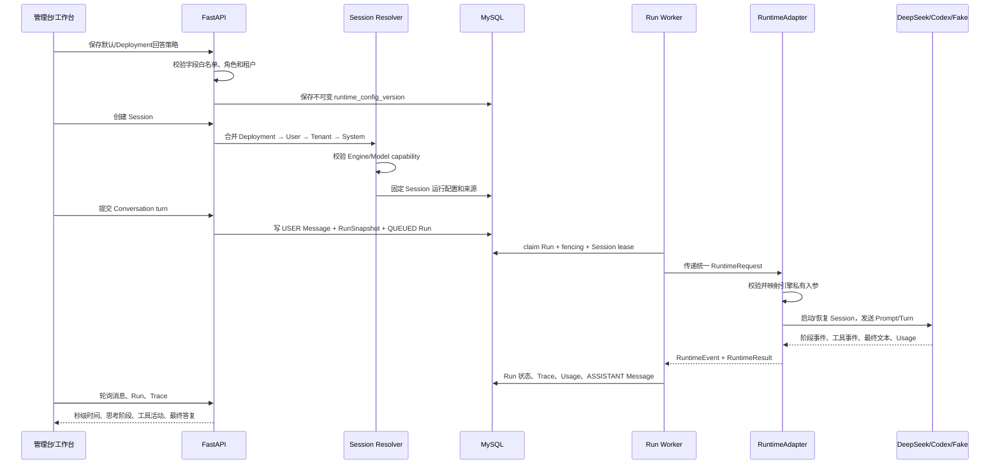
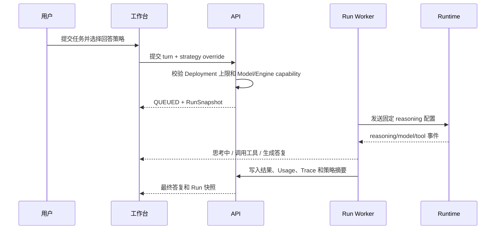

# 思考模式与回答策略方案

## 1. 方案定位

这是基于当前 Codex / DeepSeek Harness 桌面端使用习惯形成的**当前实现方案**。回答策略已经进入平台统一契约、默认绑定、Deployment 覆盖、Session/Run 快照和工作台展示；真实云端 Provider 的字段语义和用量仍需单独验证。

当前已实现的运行配置包括：

- ExecutionProfile / EngineProvider
- ModelRoute
- 用户、租户、平台默认作用域和 Deployment 覆盖
- 类型化 `RuntimeOptions` 与不可变 Session/Run 快照
- EngineProvider capability 校验和 RuntimeAdapter 映射
- Trace/Usage 的阶段、秒级时间和 reasoning token 可用性标记

## 2. 与现有原型的对应关系

| 现有原型 | 调整内容 |
| --- | --- |
| `员工Deployment运行配置.html` | 在原有 EngineProfile/ModelRoute 覆盖区域下增加“回答策略”区域，包含思考模式、推理强度、答复详细程度和推理预算 |
| `DeepSeekHarness默认引擎配置.html` | 在默认运行环境卡片增加回答策略默认值，并提供用户/租户作用域保存入口；真实 Provider 仍显示未验证边界 |
| `海豚调度员工工作台.html` | 展示“思考中 / 调用工具 / 生成答复”阶段，不展示原始思考链 |
| `当前方案总览.html` | 将回答策略标记为“已接入 / 本地已验证”，并单独列出真实 Provider 未验证边界 |

## 2A. 平台统一入参与引擎私有入参

不同执行引擎的真实调用协议不一致，平台不应让前端直接填写供应商字段。平台先使用统一、可审计的回答策略，再由 RuntimeAdapter 做引擎映射。

| 层级 | 统一字段/协议 | DeepSeek Harness | Codex App Server | Fake Runtime |
| --- | --- | --- | --- | --- |
| 平台配置 | `reasoning_mode`、`reasoning_effort`、`reasoning_budget_tokens`、`response_verbosity`、`max_output_tokens`、`max_tool_steps`、`timeout_seconds` | 由 DeepSeek 适配器映射到 Harness/SDK 能力；具体字段名需 SDK 契约验证 | 由 Codex 适配器映射到 app-server 的 turn/thread 参数；具体字段名需协议验证 | 只记录配置并生成确定性模拟事件，不执行真实推理 |
| Session | `session_ref`、`harness_home_ref`、员工/Skill/Tool 快照 | Harness Session + 稳定 Session Home | Codex thread + 隔离 CODEX_HOME/workspace | Fake session ref |
| Runtime 请求 | `RuntimeRequest`：prompt、EmployeeContext、ToolDefinition、MCP、ModelRouteSnapshot、回答策略 | 转成 `EngineRequest`、`EmployeeContext`、`EngineModelConfig` | 转成 JSON-RPC `initialize`、`thread/start/resume`、`turn/start` | 直接读取统一请求 |
| 结果 | `RuntimeResult` + 标准化 `RuntimeEvent` + `UsageRecord` | 归一化模型、工具、结果事件 | 归一化 JSON-RPC 事件和最终文本 | 生成模拟事件 |

当前代码的实际边界：

- `RuntimeRequest.runtime_options` 携带固定的回答策略快照，`ControlPlaneService` 从 Deployment/默认绑定解析后写入 Session 和 RunSnapshot。
- `HarnessRuntimeAdapter` 将推理强度、预算、答复详细程度和输出上限映射到 `EngineRequest`；`CodexAppServerRuntimeAdapter` 将可验证字段映射到 `turn/start`。
- `FakeRuntimeAdapter` 接受统一策略并生成确定性思考阶段事件，只用于平台契约和工作台验收，不能证明真实引擎的推理质量。
- EngineProvider capability 已包含 reasoning、reasoning_effort、reasoning_budget 和 max_output_tokens；不支持时在 Runtime 出站前返回明确错误，不切换 Fake 或其他模型。

因此，当前四个回答策略字段是**目标平台契约**，不是现有供应商请求字段的直接拼接。

## 2B. 从当前平台到执行引擎的具体流程



平台必须在 `RuntimeAdapter` 之前完成租户、版本、工具和回答策略校验。适配器只能把已授权的统一请求映射为引擎私有请求，不能在适配器内偷偷换模型、扩大工具权限或改变思考预算。

## 3. 产品需求

### 3.1 运行配置字段

| 字段 | 选项 | 说明 |
| --- | --- | --- |
| `reasoning_mode` | `inherit` / `auto` / `deep` / `off` | 当前 Deployment 继承默认、自动思考、深度思考或关闭思考 |
| `reasoning_effort` | `auto` / `low` / `medium` / `high` | 仅在引擎和模型支持时生效 |
| `response_verbosity` | `concise` / `standard` / `detailed` | 控制最终答复长度和说明程度 |
| `reasoning_budget_tokens` | `null` / 固定上限 | 约束推理预算，不代表一定消耗该额度 |
| `max_output_tokens` | `null` / 固定上限 | 约束最终答复长度 |
| `max_tool_steps` | 正整数 | 限制一次 Run 的工具调用轮数 |
| `timeout_seconds` | 正整数 | 限制单轮 Runtime 时间 |

### 3.2 工作台体验

提交任务后，工作台显示以下用户可理解的阶段：

```text
排队中 → 准备运行 → 思考中 → 调用工具 → 生成答复 → 已完成
```

用户只看到阶段、耗时、用量和最终答复。系统不保存、不展示原始思考链；如果引擎提供安全的可读摘要，可在内部 Trace 中按权限展示摘要。

### 3.3 时间显示

- 对话列表显示最后活动时间到秒，例如 `10:24:18`。
- 消息、思考阶段、工具调用、审批卡和 Run 状态事件显示完整本地时间，例如 `2026-11-23 10:23:49`。
- 服务端保留 UTC 时间；前端按当前租户用户的时区格式化到秒。
- 同一秒内发生的事件按 `sequence_no`、Trace `sequence` 或服务端创建顺序排序，不依赖浏览器时间。
- 时间只表示事件发生或被服务端记录的时间，不表示模型思考内容的持续证明。

右侧 Run 快照显示：

```text
思考模式：深度思考
推理强度：高
答复详细程度：标准
推理预算：自动
```

### 3.3 生效范围

1. 用户/租户默认值提供回答策略默认配置。
2. Deployment 可以覆盖回答策略。
3. 新 Session 固定有效运行配置。
4. 每个 Run 保存实际使用的策略和预算。
5. 工作台可提供“本轮深度思考”快捷选择，但不能超过 Deployment 允许范围。
6. 已有 Session 不因后续修改而改变。

## 4. 能力矩阵

EngineProvider 和 ModelRoute 需要声明或推导以下能力：

```text
reasoning
reasoning_effort
reasoning_budget
streaming
max_output_tokens
```

规则：

- `auto` 在能力未知时可以保存，由 Provider 使用默认行为。
- `deep` 只有 EngineProvider 和 ModelRoute 都明确支持时才允许创建 Session。
- 不兼容时返回明确错误，不静默降级、不自动换模型。
- Codex App Server 和 DeepSeek Harness 由各自 RuntimeAdapter 负责参数映射。
- 适配器尚未验证真实 Provider 时，只允许静态原型、确定性 Mock 和 capability-gated 配置；真实 Provider 字段不得在文档中伪造为已验证。

## 5. 状态和时序设计



Run 不建议新增 `THINKING`、`RESPONDING` 等主状态，避免扩大现有状态机；这些阶段应作为 Trace/Event 的用户可见映射。Run 主状态仍然使用 `QUEUED/RUNNING/AWAITING_APPROVAL/SUCCEEDED/FAILED/UNKNOWN`。

## 6. 权限、隐私和数据边界

- 只有管理员可以修改租户默认和 Deployment 默认策略。
- 成员可以查看有效策略和本次 Run 快照。
- 本轮策略覆盖必须写入 RunSnapshot，不能只保留在前端。
- reasoning token、耗时、预算和状态可以进入 Usage/Trace。
- 原始思考链、隐藏 Prompt、凭据、工具参数和完整工具返回不进入普通消息或审计日志。
- 跨租户不能读取策略、用量、Trace 或消息正文。

## 7. 失败和降级

| 场景 | 行为 |
| --- | --- |
| 模型不支持深度思考 | 阻止创建 Session 或阻止本轮提交，显示兼容性原因 |
| Provider 不返回 reasoning token | 仍可显示思考状态，但用量标记为 unavailable/estimated |
| 推理预算耗尽 | Run 正常结束或失败，显示预算结果，不自动重试 |
| Runtime 超时 | 按现有规则进入 FAILED 或 UNKNOWN，不伪造完成 |
| 思考配置被后续修改 | 已创建 Session/Run 保留旧快照 |

## 8. 分期实施

### P0：产品入口和快照（已实现）

- Deployment 默认配置增加回答策略字段。
- Session/RunSnapshot 固定实际策略。
- 工作台显示阶段状态和 Run 快照。
- 后端允许白名单 `runtime_options`，拒绝未知字段。

### P1：真实 Runtime 映射（平台边界已实现，真实供应商待验证）

- EngineProvider/ModelRoute capability 矩阵。
- Codex App Server 的 reasoning effort 映射。
- DeepSeek Harness 的 thinking/effort 映射。
- reasoning token 和耗时用量落库。

### P2：高级运行策略

- 上下文自动压缩。
- 最大工具步骤和成本预算。
- 工具失败重试策略。
- 模型 fallback。
- 按租户、员工、角色设置上限。

## 9. 验收标准

- 现有 EngineProfile/ModelRoute 选择不被改变。
- Deployment 弹窗可以展示回答策略，并明确是否继承默认。
- 新 Session/Run 快照能看到实际回答策略。
- 工作台显示“思考中”阶段，但不展示原始思考链。
- 不支持深度思考的模型不能被静默降级。
- 历史 Session 不受新策略修改影响。
- 平台 API、默认绑定、Deployment 覆盖、Session/Run 快照和工作台阶段已可验收；真实 Provider 的最终字段名、推理预算语义、token 统计、生产身份和长时恢复仍明确标记为未验证。

### 本地 OpenAI-compatible NATIVE 验收

- Endpoint：`http://host.docker.internal:63072/v1`；ModelRoute：`本地模型测试 · gpt-6.1-sol`。
- 已使用 Worker 的 `local-model-key` SecretRef 完成真实 NATIVE Session/Conversation/Run；Run 状态 `SUCCEEDED`，EngineProvider 为 `deepseek_harness`，不经过 Fake。
- 已验证 Trace、Usage 和消息刷新恢复；真实 SDK 返回正文和阶段事件，reasoning token 在平台侧按 `ESTIMATED/UNAVAILABLE` 处理。
- 该模型实际拒绝 `reasoning_effort=high/auto`，平台已将 AUTO 映射为不发送私有 effort 字段，并将供应商拒绝归类为 `ENGINE_CAPABILITY_UNSUPPORTED`；不能把高强度标记为已支持。
