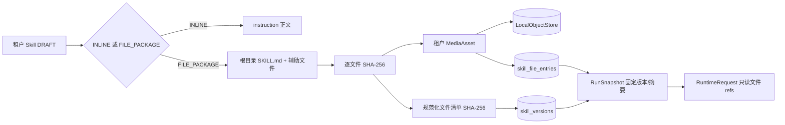
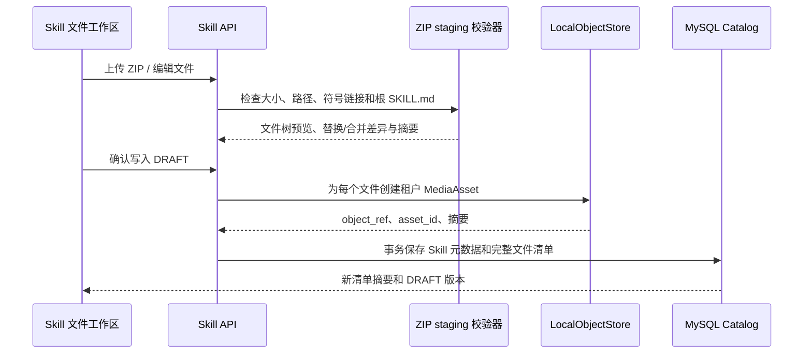
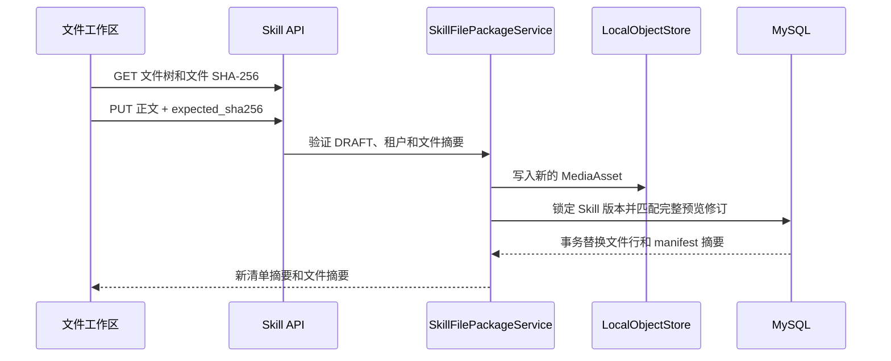
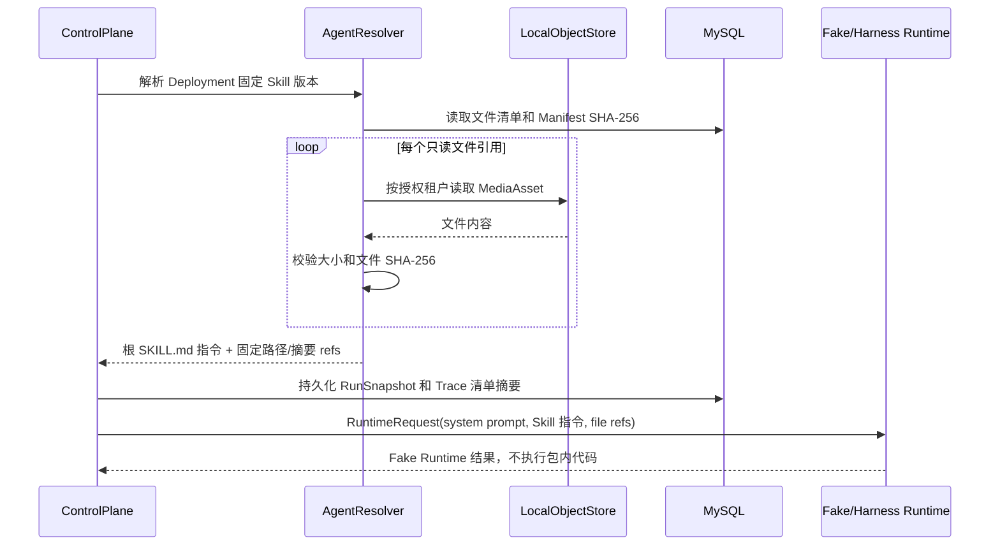

# Skill 文件包存储与校验

## 架构



Skill 的业务版本仍由 `skill_versions` 管理，文件字节由现有 `LocalObjectStore` 保存，MySQL 只存租户作用域内的 MediaAsset 和路径、大小、摘要清单。运行时不会把文件包解释为脚本；入口指令作为只读文本交给 Runtime。

## 文件包入口与清单

`INLINE` 保持历史行为：`instruction` 必须非空，文件入口和文件摘要为空，清单为空。

`FILE_PACKAGE` 的唯一入口路径固定为根目录 `SKILL.md`。文件包版本要求清单中恰好包含该路径；嵌套的第二个 `SKILL.md`、重复路径和大小写/Unicode 规范化后冲突的路径会被领域校验拒绝。`instruction` 留空，入口文本以 `SKILL.md` MediaAsset 保存，避免 MySQL 与对象内容出现两份可变正文。

每个 `skill_file_entries` 行关联同平台、同租户的精确 Skill 版本和 MediaAsset，包含规范相对路径、MIME 类型、解压后字节数和文件 SHA-256。文件清单摘要按路径排序后编码：

```json
{"manifest_schema_version":1,"files":[{"content_sha256":"...","file_path":"SKILL.md","mime_type":"text/markdown; charset=utf-8","size_bytes":123}]}
```

使用 UTF-8、无空白分隔符、键排序的 canonical JSON 计算 SHA-256。MediaAsset ID 不进入摘要，因此同一内容包复制到其他租户/对象存储后，清单摘要仍保持一致。

路径必须是相对 POSIX 路径，拒绝绝对路径、空片段、`.`/`..`、反斜杠、NUL、Windows 盘符、重复规范化路径和超过 512 字符的路径。

## 数据模型

唯一可执行迁移位于 [V005__skill_file_packages.sql](migrations/V005__skill_file_packages.sql)，仅用于 disposable database 的回滚脚本位于 [V005__skill_file_packages.down.sql](migrations/V005__skill_file_packages.down.sql)。

| 对象 | 内容 | 边界 |
|---|---|---|
| `skill_versions.content_format` | `INLINE` 或 `FILE_PACKAGE` | 默认 `INLINE`，历史 Skill 无需搬迁 |
| `skill_versions.entry_path` | 唯一入口相对路径 | `FILE_PACKAGE` 必须是根 `SKILL.md` |
| `skill_versions.file_manifest_sha256` | 规范文件清单摘要 | 不包含租户 MediaAsset ID |
| `skill_file_entries` | 文件路径、MediaAsset、MIME、大小、内容摘要 | `(platform_id, tenant_id)` 同时关联 Skill 版本和 MediaAsset |

领域类型位于 [catalog.py](../backend/src/agent_platform/domain/catalog.py)，MySQL 读写位于 [mysql_catalog.py](../backend/src/agent_platform/infrastructure/mysql_catalog.py)。`SkillVersion` 持有排序后的文件元数据；DRAFT 版本可整体保存，PUBLISHED/DEPRECATED 版本仍遵循不可变约束。

## 上传与提交时序



ZIP 预览只写纯内存 staging 元数据，不缓存文件正文；staging 绑定租户、Skill 版本、ZIP SHA-256、预览时 DRAFT 修订和 15 分钟过期时间。提交时客户端重传同一 ZIP，服务端重新流式解压并核对摘要。当前本地 staging 只在服务进程内有效，服务重启后需要重新预览。

ZIP 上限为压缩包 20 MiB、解压后总量 50 MiB、单文件 10 MiB、文件数 256、压缩比 100:1。解压采用有界分块读取。路径穿越、绝对路径、重复规范化路径、符号链接、加密 ZIP、CRC 错误、超限文件和缺少根 `SKILL.md` 都会拒绝整个包。ZIP 校验失败时不写入 Skill 文件清单；对象写入中断产生的 MediaAsset 会标记删除并交由对象清理流程回收。MySQL 事务只会在所有目标文件元数据校验完成后一次性替换 DRAFT 清单，事务失败不会留下半套 `skill_file_entries`。

## API 与状态

文件工作区 API 必须遵循：

- 文件列表只读取当前租户和精确 Skill 版本；内容经 MediaAsset 授权后由对象仓储读取。
- ZIP 先预览，再显式确认 `replace` 或 `merge`；同一版本清单在一个 MySQL 事务内原子替换。
- 在线写入、重命名和删除必须携带 `expected_sha256`；摘要冲突返回 `409`，重新读取后编辑。
- `INLINE` 和 `FILE_PACKAGE` 在同一 Skill 主表按版本记录；已发布版本和 Hub REFERENCE 文件只读。
- ZIP 根目录没有 `SKILL.md`、入口路径不正确、清单摘要不一致或路径冲突，统一拒绝整个提交。

当前 ZIP 导入接口：

- `POST /api/v1/skills/{skill_id}/versions/{version}/files/zip/preview?strategy=replace|merge`：请求体为原始 `application/zip`，返回 staging ID、压缩包摘要、目标清单摘要、文件树和 added/updated/removed 差异；响应不含正文或对象引用。
- `POST /api/v1/skills/{skill_id}/versions/{version}/files/zip/commit/{staging_id}`：重传同一 ZIP；归档摘要或 DRAFT 修订不一致时返回 `409 IDEMPOTENCY_CONFLICT`。成功后返回文件数、根入口、清单摘要和 DRAFT 状态。
- `replace` 用 ZIP 完整替换文件清单；`merge` 按路径覆盖同名文件并保留其余旧文件。两种方式均要求本次上传包含根 `SKILL.md`。
- `GET /api/v1/skills/{skill_id}/versions/{version}/files`：返回当前租户的精确版本文件树、内容摘要和只读状态；INLINE Skill 展示虚拟 `SKILL.md`。
- `GET /api/v1/skills/{skill_id}/versions/{version}/files/content?file_path=`：读取单个文件，UTF-8 内容返回文本，其他字节以 Base64 返回；不会泄露对象地址。
- `POST /api/v1/skills/{skill_id}/versions/{version}/files`、`PUT` 同一路径、`POST .../files/rename` 和 `DELETE .../files?file_path=&expected_sha256=`：创建、编辑、重命名、删除 DRAFT 文件。正文在 `content_text` 与 `content_base64` 中二选一，更新/重命名/删除都必须传当前文件的 SHA-256。

文件编辑时序：



写操作只允许租户管理员；同一租户成员可读取文件清单和内容。REFERENCE 代理与已发布版本均不可编辑；根 `SKILL.md` 不能重命名或删除。文件 SHA 不匹配或预览期间 DRAFT 被其他写操作修改时返回 `409 IDEMPOTENCY_CONFLICT`，越租户查询按 `404 RESOURCE_NOT_FOUND` 隐藏。

运行时序：



`runs.snapshot_json.skill_file_packages` 保存 Skill ID/版本、根入口、清单 SHA-256 和每个文件的路径、MediaAsset ID、授权读取租户、MIME、大小、摘要和来源模式。`RuntimeRequest` 接收相同的只读 refs；Run 查询 API 只返回路径和摘要，不暴露 MediaAsset ID 或租户 ID。Hub REFERENCE 每次启动新 Run 时重新校验精确版本 Grant 和整个文件清单摘要；文件字节按 Hub 发布租户授权读取，COPY 则按接收租户本地 MediaAsset 读取。撤销 Grant 阻止新 Run 读取引用，已写入的 RunSnapshot 保留原版本和摘要。

Hub 发布 FILE_PACKAGE Skill 时，授权后的 Hub Manifest 记录源 MediaAsset ID、路径和内容摘要；未授权的目录详情不返回这些字段。COPY 将每个文件读入接收租户的 LocalObjectStore，写入新的 `media_assets` 和 `skill_file_entries`；REFERENCE 不创建租户副本，只写只读代理，由 HubResolver 按 Grant 读取发布方资产。源 Skill 文件清单通过 `skill_file_entries` 外键保护源 MediaAsset；复制资产通过接收租户文件行保护。当前 Hub 文件内容按该 Manifest 版本读取，未发布的新 Skill 版本不会自动进入既有 Hub Package。

## 验证

```bash
cd backend
python -m pytest tests/test_skill_file_package_domain.py -q
AGENT_PLATFORM_MYSQL_TEST_ALLOW_CREATE_DATABASE=1 \
MYSQL_HOST=127.0.0.1 MYSQL_PORT=3306 MYSQL_USER=<一次性账号> MYSQL_PASSWORD=<一次性密码> \
python -m pytest tests/integration/test_mysql_skill_file_package_migration.py -q
python -m ruff check src tests
```

已验证：INLINE 兼容、FILE_PACKAGE 根入口唯一、清单摘要与文件排序稳定、路径规范、摘要错误拒绝、文件版本状态不可变；MySQL 8.4.10 V005 正向/回滚、所有新增表/字段中文 COMMENT、Skill/MediaAsset 同租户复合外键，以及文件元数据 MySQL 保存/读取。ZIP 预览/提交 HTTP 流程、压缩/解压上限、路径穿越/符号链接拒绝、上传失败和 MySQL 外键错误回滚、单文件 CRUD 的摘要并发控制、LocalObjectStore 摘要读取和 GC 引用保护也已验证。Fake Runtime 收到固定根入口和只读文件 refs，不执行包内脚本；MySQL 重启后 Trace 恢复同一 manifest 摘要，Skill Span 保存入口路径/文件数。

未验证：多进程部署时的共享 ZIP staging 恢复；本地实现限定为单服务进程，预览过期或进程重启后重新预览即可。
