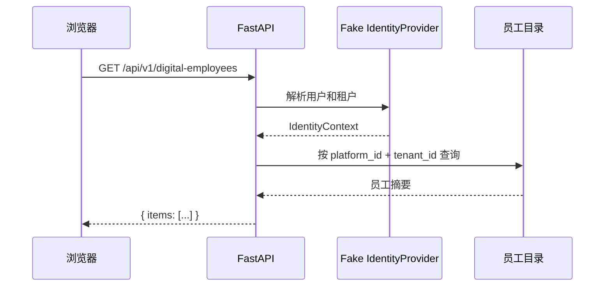
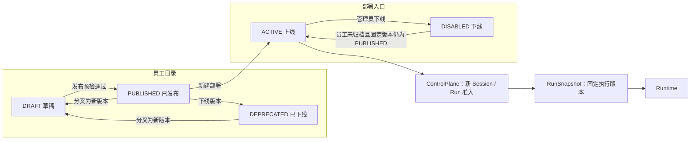
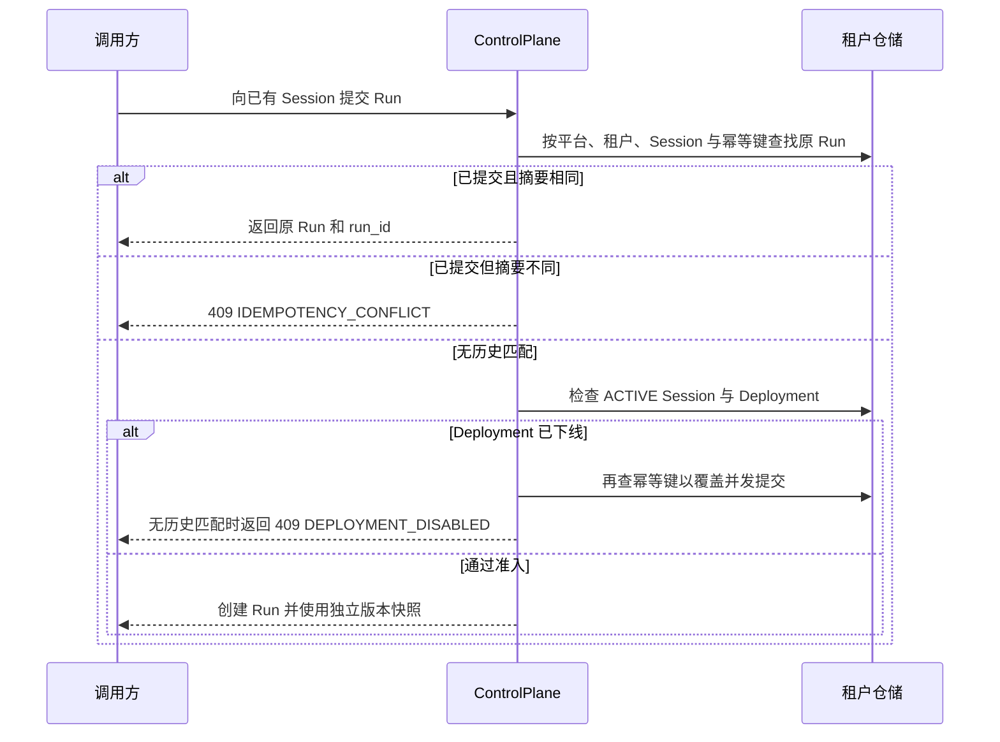

# 接口与状态流程

本文保留当前已实现的管理接口与生命周期说明。Harness Worker、MCP Stdio、审批状态和工作台 API 的完整目标契约见[Harness 数字员工执行闭环设计](Harness员工执行闭环设计.md)。

## 当前接口

下方只列健康检查和员工目录的入口示例，不是完整路由清单。Conversation 消息、Session/Run、Trace、Usage、资源目录和部署管理路由已分布在各 route_modules 中。

当前路由已覆盖员工/资源管理、Conversation 列表/消息/异步 turn、Session/Run、Run 取消、Trace、Usage 和 Tool Approval 预览/确认/拒绝。Conversation turn 会在 MySQL 入队，由独立 Run Worker 消费；MySQL/Compose 默认使用 DeepSeek Harness，Fake 可通过部署配置显式启用。旧 Session Run API 仍同步执行；Approval Action Worker 仍独立于主 Run Worker。

```text
GET /api/health
GET /api/v1/digital-employees
```

当前本地 Fake 身份通过请求头提供：

```text
X-Fake-User: admin-local
```

生产环境将替换为 Dadi IdentityProvider，不改变应用层 IdentityContext。

## 数字员工查询流程



## 员工版本与 Deployment 生命周期



回滚只可切换到 PUBLISHED 版本，并保留部署原有的 ACTIVE/DISABLED 状态。版本下线也不会停用当前使用该版本的部署。

| 对象 | 状态 | 行为 |
|---|---|---|
| 员工版本 | `DRAFT` | 管理员可编辑同一版本、测试已保存配置或发布；依赖预检通过后转为 PUBLISHED |
| 员工版本 | `PUBLISHED` | 只读；可作为新建部署或回滚的目标，也可分叉或下线 |
| 员工版本 | `DEPRECATED` | 只读终态，可分叉；不能重新发布、用于新建部署和回滚，或使固定了该版本的部署重新上线 |
| Deployment | `ACTIVE` | 可接收新 Session 和 Run；继续使用任何现有固定版本，包括随后被下线的版本 |
| Deployment | `DISABLED` | 停止接收新 Session 和 Run；已通过准入的运行仍可完成，既有 Session 和 RunSnapshot 保留 |

以下路径均以 `/api/v1` 为前缀。路径中的 `version` 和 `source_version` 是员工版本号。

| 方法与路径 | 结果和约束 |
|---|---|
| `GET /digital-employees/{employee_id}/versions/{version}` | 读取精确版本及其精确配置引用 |
| `PUT /digital-employees/{employee_id}/versions/{version}` | 保存未归档员工的 DRAFT；更新同一版本，提交精确 Skill/Tool 和 Profile 引用 |
| `POST /digital-employees/{employee_id}/versions/{source_version}/fork` | 无请求体；从未归档员工的 PUBLISHED/DEPRECATED 源生成新 DRAFT，返回新版本（201） |
| `POST /digital-employees/{employee_id}/versions/{version}/deprecate` | 无请求体；把 PUBLISHED 转为 DEPRECATED，返回精确版本（200）；未归档员工重复下线不新增审计 |
| `POST /deployments`、`POST /deployments/{deployment_id}/rollback` | 只能选择未归档员工的 PUBLISHED 版本。回滚到非 PUBLISHED 版本返回 `DEPENDENCY_VALIDATION_ERROR`（409），历史 RunSnapshot 不变 |
| `POST /deployments/{deployment_id}/disable` | 无请求体；把 ACTIVE 转为 DISABLED，返回部署（200） |
| `POST /deployments/{deployment_id}/enable` | 无请求体；当员工未归档且当前固定版本仍为 PUBLISHED，把 DISABLED 转为 ACTIVE，返回部署（200） |
| `POST /sessions`、`POST /sessions/{session_id}/runs` | 创建新 Session、Run 前检查部署是否 ACTIVE；Run 先查历史幂等键 |
| `GET /audit-events` | 租户管理员可按 `resource_type`、`resource_id`、`event_type` 查询并分页；普通成员无权读审计 |

数据模型：复用 `digital_employee_versions.status`、`deployments.status` 与 `audit_events`；新草稿复制系统指令、精确 Skill/Tool 绑定与顺序、ExecutionProfile ID/版本、ModelRoute、Workspace/Sandbox Profile ID/版本和审批策略。MySQL 在事务中锁定相关状态，新建部署、回滚、重新上线均核对员工版本；状态更新与审计同一事务提交。无表、字段或 migration 变化。

审计沿用平台/租户范围并记录操作者和时间。员工版本事件 `EMPLOYEE_VERSION_DEPRECATED` 的资源类型为 `digital_employee_version`，资源 ID 为员工 ID，payload 包含 `employee_id` / `version`；部署事件 `DEPLOYMENT_DISABLED` 和 `DEPLOYMENT_ENABLED` 的资源类型为 `deployment`，资源 ID 为 Deployment ID，payload 含 `employee_id`、`version`、`previous_status` 和 `status`。



完整设计和本轮验证记录见[员工版本编辑与下线设计](superpowers/specs/2026-11-16-员工版本编辑与下线设计.md#验收与验证)。

## Harness 工作台目标接口与状态

本节以[Harness 数字员工执行闭环设计](Harness员工执行闭环设计.md)为规范来源。目标新增接口包括：

| 方法与路径 | 目标行为 |
|---|---|
| GET /api/v1/conversations?employee_id=&status=&cursor=&limit= | 已实现，MySQL 集成待验证；按认证用户参与权和员工绑定过滤，稳定游标返回最后消息摘要、最新 Run 状态和待审批数 |
| POST /api/v1/conversations/{id}/turns | 已实现：请求含 text、idempotency_key、可选 employee_id；解析当前用户的活动员工绑定，在同一事务提交用户消息和 QUEUED Run；同幂等摘要重放原 ID，返回 202 |
| POST /api/v1/runs/{id}/cancel | 已实现：仅 Run 提交者可请求；排队 Run 直接 CANCELLED，已领取 Run 转 CANCELLING，由 Worker 处理 Runtime.cancel |
| POST /api/v1/tool-approvals/{id}/approve | 已实现；校验 Run 提交者、有效期、preview_sha256 和幂等键，只排入一次性动作 |
| POST /api/v1/tool-approvals/{id}/reject | 已实现；Run 提交者幂等拒绝并关闭绑定 Run |
| GET /api/v1/tool-approvals/{id} | 已实现；仅提交者读取经过 SHA-256 校验的对象存储预览 |

Run 状态包括 QUEUED、STARTING、RUNNING、AWAITING_APPROVAL、CANCELLING、SUCCEEDED、FAILED、CANCELLED、UNKNOWN。QUEUED 取消直接结束；运行中取消先进入 CANCELLING，只有 Runtime 确认停止才进入 CANCELLED，否则进入 UNKNOWN，不自动重试。审批记录自身维护 PENDING、APPROVED、REJECTED、EXPIRED、RUNNING、SUCCEEDED、FAILED、UNKNOWN；APPROVED 即为可领取动作，不另设 QUEUED 中间态。

### Conversation Turn 与审批时序

~~~mermaid
sequenceDiagram
    participant UI as 工作台
    participant API as backend
    participant DB as MySQL
    participant W as Worker
    participant H as Harness
    participant MCP as MCP Stdio

    UI->>API: POST turn + idempotency_key
    API->>DB: 写消息、Snapshot、QUEUED Run
    API-->>UI: 202 + run_id
    W->>DB: claim + lease/fencing
    W->>H: RunSnapshot 解析后的请求
    H->>MCP: 只读查询与 preview
    W->>DB: 创建 ApprovalRequest，Run 进入 AWAITING_APPROVAL
    UI->>API: approve(approval_id, preview_digest, idempotency_key)
    API->>DB: 原子批准并排入一次性 Tool Action
    W->>MCP: 消费批准后执行单个写工具
    W->>DB: 记录结果、Trace、Run 和审计
    UI->>API: 轮询 Conversation / Run / Trace
~~~

页面不得直接调用执行引擎或 MCP。租户、操作者、worker_id、fencing token、审批状态和有效工具列表都由服务端身份、仓储及策略层计算。

## 错误边界

| 场景 | HTTP 行为 |
|---|---|
| 缺少身份 | `401` |
| 身份禁用 | `401` |
| 管理写操作或审计查询缺少租户管理员权限 | `AUTHORIZATION_DENIED` / 403 |
| 跨租户或不存在的版本、部署等资源 | `RESOURCE_NOT_FOUND` / 404 |
| 员工已归档，或版本下线、部署启停不满足状态条件 | `INVALID_STATE` / 409 |
| 修改 PUBLISHED/DEPRECATED 配置 | `IMMUTABLE_VERSION` / 409 |
| 发布依赖预检失败，或回滚目标版本为非 PUBLISHED | `DEPENDENCY_VALIDATION_ERROR` / 409 |
| 已下线部署拒绝新会话或运行 | `DEPLOYMENT_DISABLED` / 409 |
| 同平台、租户、Session 复用幂等键但摘要改变 | `IDEMPOTENCY_CONFLICT` / 409 |
| 参数错误 | `422` |
| Runtime 不支持能力 | 明确能力错误 |

## 数字员工最小闭环（2026-11-14）

本轮新增 Tool、Skill、数字员工版本、Deployment、Session、Run 和 Trace 接口；完整流程见《数字员工最小闭环》。当时的最小闭环使用进程内内存仓储和 Fake Runtime，后端测试命令为 cd backend && python -m pytest -q，前端测试命令为 cd frontend && npm test -- --run。

~~~mermaid
sequenceDiagram
    participant U as 管理端
    participant API as FastAPI
    participant CAT as CatalogService
    participant CP as ControlPlaneService
    participant F as FakeRuntimeAdapter
    participant T as Trace
    U->>API: 发布 Tool/Skill/EmployeeVersion
    API->>CAT: 校验依赖并创建 Deployment
    U->>API: 创建 Session/Run
    API->>CP: 固化版本快照
    CP->>F: 执行 prompt
    F-->>CP: Result + Usage + opaque ref
    CP->>T: 保存 Span 时间线
    U->>API: 查询 Run Trace
    API-->>U: ordered spans
~~~
