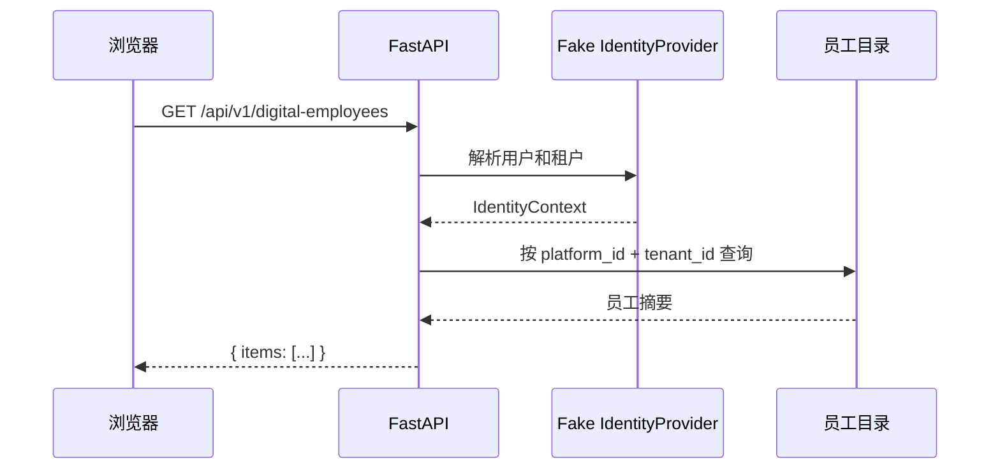
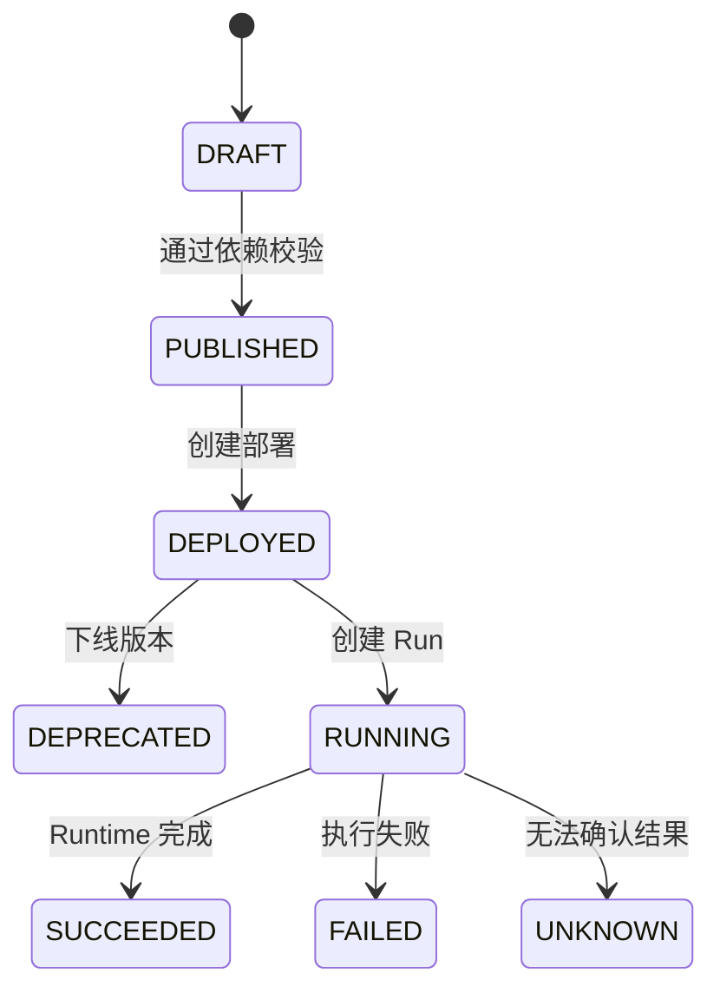

# 接口与状态流程

## 当前接口

```text
GET /api/health
GET /api/v1/digital-employees
```

当前本地 Fake 身份通过请求头提供：

```text
X-Fake-User: admin-local
```

生产环境将替换为 Dadi IdentityProvider，不改变应用层 IdentityContext。

## 数字员工查询流程



## 运行状态规划



## 错误边界

| 场景 | HTTP 行为 |
|---|---|
| 缺少身份 | `401` |
| 身份禁用 | `401` |
| 跨租户资源 | 按不存在处理或拒绝 |
| 参数错误 | `422` |
| Runtime 不支持能力 | 明确能力错误 |

## 数字员工最小闭环（2026-11-14）

本轮新增 Tool、Skill、数字员工版本、Deployment、Session、Run 和 Trace 接口；完整流程见《数字员工最小闭环》。当前实现使用进程内内存仓储和 Fake Runtime，后端测试命令为 cd backend && python -m pytest -q，前端测试命令为 cd frontend && npm test -- --run。

~~~mermaid
sequenceDiagram
    participant U as 管理端
    participant API as FastAPI
    participant CAT as CatalogService
    participant CP as ControlPlaneService
    participant F as FakeRuntimeAdapter
    participant T as Trace
    U->>API: 发布 Tool/Skill/EmployeeVersion
    API->>CAT: 校验依赖并创建 Deployment
    U->>API: 创建 Session/Run
    API->>CP: 固化版本快照
    CP->>F: 执行 prompt
    F-->>CP: Result + Usage + opaque ref
    CP->>T: 保存 Span 时间线
    U->>API: 查询 Run Trace
    API-->>U: ordered spans
~~~
