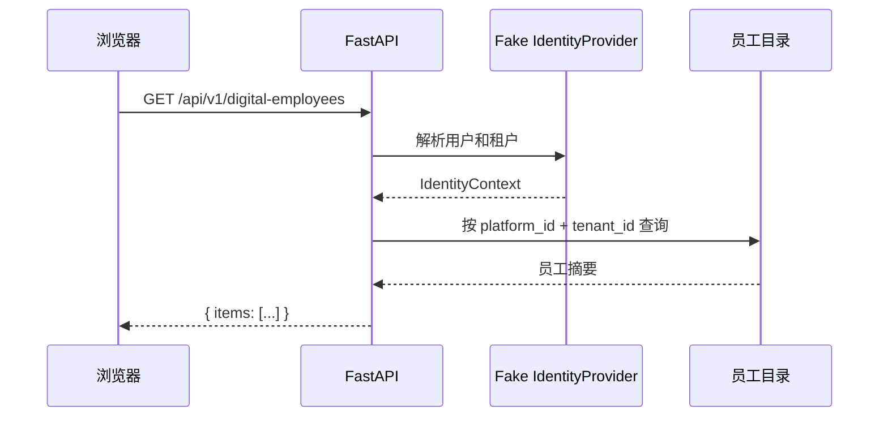
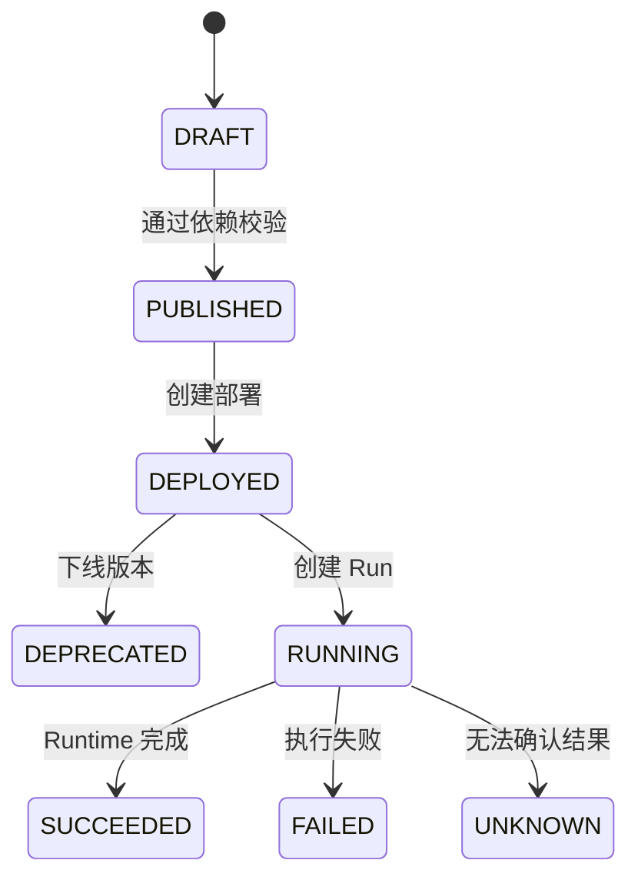

# 接口与状态流程

## 当前接口

```text
GET /api/health
GET /api/v1/digital-employees
```

当前本地 Fake 身份通过请求头提供：

```text
X-Fake-User: admin-local
```

生产环境将替换为 Dadi IdentityProvider，不改变应用层 IdentityContext。

## 数字员工查询流程



## 运行状态规划



## 错误边界

| 场景 | HTTP 行为 |
|---|---|
| 缺少身份 | `401` |
| 身份禁用 | `401` |
| 跨租户资源 | 按不存在处理或拒绝 |
| 参数错误 | `422` |
| Runtime 不支持能力 | 明确能力错误 |
