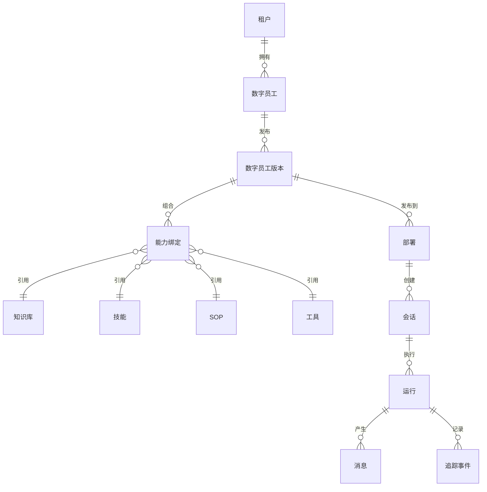
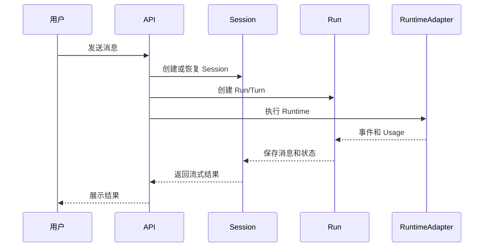

# 数字员工数据模型

## 第一阶段模型



## DigitalEmployee

```text
DigitalEmployee
- id
- platform_id
- tenant_id
- name
- role_name
- description
- owner_user_id
- status
- published_to_gallery
```

## DigitalEmployeeVersion

```text
DigitalEmployeeVersion
- id
- digital_employee_id
- version
- status: DRAFT / PUBLISHED / DEPRECATED
- execution_profile_id
- context_policy_id
- memory_policy_id
- workspace_policy_id
- approval_policy_id
```

已发布版本不可直接修改。运行时必须记录使用的版本。

## 能力绑定

```text
CapabilityBinding
- binding_id
- digital_employee_version_id
- capability_type: KNOWLEDGE / SKILL / SOP / TOOL
- resource_id
- resource_version
- config_revision
- enabled
```

## Session、Run、Message


