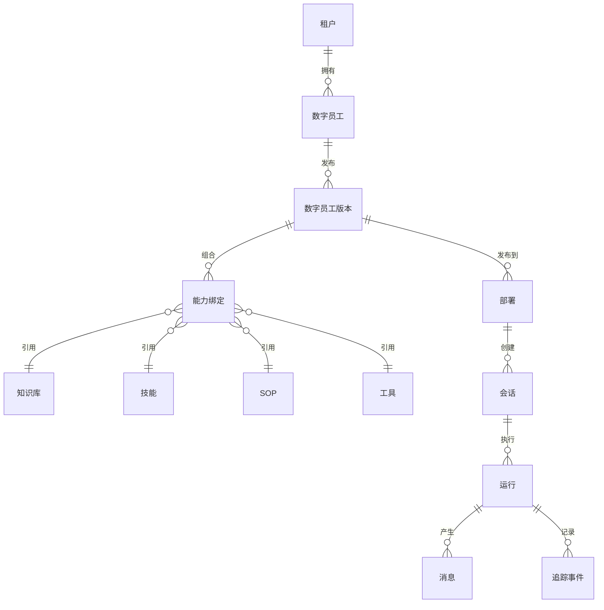
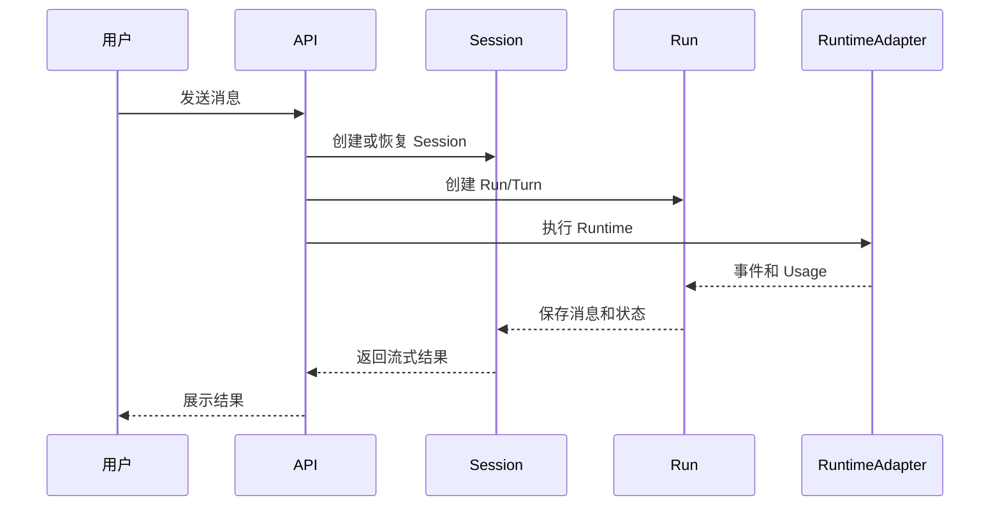

# 数字员工数据模型

## 第一阶段模型



## DigitalEmployee

```text
DigitalEmployee
- id
- platform_id
- tenant_id
- name
- role_name
- description
- owner_user_id
- status
- published_to_gallery
```

## DigitalEmployeeVersion

```text
DigitalEmployeeVersion
- id
- digital_employee_id
- version
- status: DRAFT / PUBLISHED / DEPRECATED
- system_prompt
- skill_version_refs: Skill ID + 精确版本
- tool_version_refs: Tool ID + 精确版本
```

已发布版本不可直接修改。EmployeeVersion 只固化员工内容和能力绑定；ExecutionProfile、ModelRoute、Workspace、Sandbox 与审批策略归接收租户 Deployment 管理。旧版本的运行字段保留为可空历史兼容列，新建、编辑和分叉版本不写入这些字段。

## 能力绑定

```text
CapabilityBinding
- binding_id
- digital_employee_version_id
- capability_type: KNOWLEDGE / SKILL / SOP / TOOL
- resource_id
- resource_version
- config_revision
- enabled
```

## Harness 员工执行闭环扩展

当前 Conversation、AgentBinding、Session、RunSnapshot、ToolInvocationRecord、审计事件和租户范围已有基础模型；Worker 侧 MCP Profile 与一次性审批请求仍是待设计实现对象。完整字段表、JSON 示例、唯一约束和状态关系以[Harness 数字员工执行闭环设计](Harness员工执行闭环设计.md)为准。

RunSnapshot 当前嵌入 runs.snapshot_json，不是独立关系表。
ToolInvocationRecord 当前以 platform_trace_spans 中的 tool 类型 Span 持久化，不是独立调用表。

~~~mermaid
erDiagram
    TENANT ||--o{ MCP_SERVER_PROFILE : owns
    MCP_SERVER_PROFILE ||--o{ TOOL_VERSION : exposes
    EMPLOYEE_VERSION ||--o{ TOOL_BINDING : allows
    SKILL_VERSION ||--o{ SKILL_TOOL_DECLARATION : declares
    CONVERSATION ||--o{ AGENT_BINDING : binds
    AGENT_BINDING }o--|| SESSION : owns
    CONVERSATION ||--o{ MESSAGE : contains
    SESSION ||--o{ RUN : executes
    RUN ||--|| RUN_SNAPSHOT : freezes
    RUN ||--o{ TOOL_INVOCATION_RECORD : records
    TOOL_INVOCATION_RECORD ||--o| TOOL_APPROVAL_REQUEST : requires
~~~

### MCPServerProfile

新增配置按租户和精确版本管理。核心字段为 profile_id/version、transport、command、args_json、working_directory_ref、environment_secret_refs_json、enabled_tool_names_json、tool_catalog_sha256、startup_timeout_ms、tool_timeout_ms 和 status。环境变量仅保存 SecretRef，不保存密钥明文；命令使用参数数组和 allowlisted 工作目录。

### ToolVersion MCP 映射

沿用已有 ToolVersion 的协议、JSON 输入 Schema 和认证引用；MCP 版本再固定 MCPServerProfile 版本、remote_tool_name、schema 摘要、风险级别 READ/PREVIEW/WRITE、对应 preview 工具和审批策略。有效权限是员工绑定、Skill 声明、租户授权与 Profile allowlist 的交集。

### ToolApprovalRequest

一次审批只绑定一个 Run、ToolInvocation、ToolVersion/MCP Profile 精确版本、requested_by/approved_by、确认幂等键、加密 arguments_ref、preview_ref、两个内容摘要、过期时间和状态；只有 Run 提交者本人可批准。批准动作自身具有 worker lease/fencing/consumed_at，避免重复点击产生第二次写操作。

新增表及字段尚未创建。实现时 migration SQL 必须统一放在 docs/migrations/，逐表逐字段写中文 COMMENT，并通过 MySQL information_schema 集成测试验证。

## Session、Run、Message


