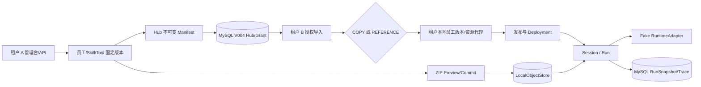
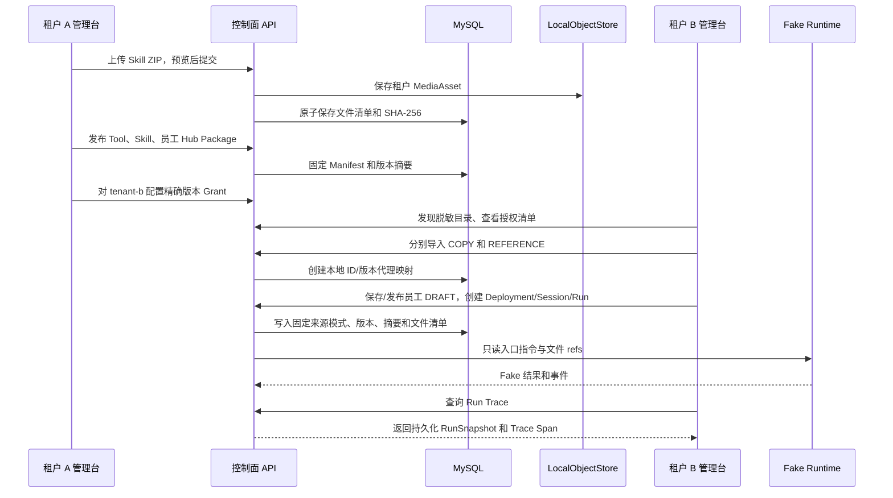

# 数字员工资源中心验收记录

## 验收范围

本次 Change 实现数字员工管理台、Skill 文件工作区和资源中心最小闭环：发布方发布已发布 Skill/Tool/员工固定版本，平台租户发现脱敏目录，发布方为精确版本授予 COPY/REFERENCE，接收方导入并绑定到员工版本，完成发布、部署、Session、Fake Runtime Run 与 Trace 查询。





## 数据与接口索引

- Resource Center 表、Grant、Manifest、COPY/REFERENCE、安全边界与 HTTP 示例： [资源中心模型与授权](资源中心模型与授权.md)。
- Skill `INLINE`/`FILE_PACKAGE`、根 `SKILL.md`、ZIP Preview/Commit、存储时序与运行快照： [技能文件包存储与校验](技能文件包存储与校验.md)。
- 员工目录、精确版本、DRAFT PUT、发布预检、权限和错误响应： [员工目录查询与版本 API](员工目录查询与版本%20API.md)。
- 控制台路由、每个管理页面的列表/详情/表单/确认交互、租户缓存和组件测试： [前端交互设计](前端交互设计.md)。
- SQL 来源只位于 `docs/migrations/`： [迁移目录约定](migrations/README.md)。V004 创建 Hub/Grant/导入表；V005 创建 Skill 文件清单并扩展 Skill 版本元数据。

核心现有数据仍由 V003 的 Catalog/Deployment、Session/Run/Trace 表承载。V004 将来源 Hub 固定版本和接收方权限映射到关系表；V005 的 `skill_file_entries` 通过平台/租户复合外键关联 Skill 版本及 MediaAsset。RunSnapshot 内保存 Hub 来源模式、精确版本、Manifest SHA-256 和 Skill 文件路径/内容摘要；Run Trace 不向浏览器泄露 MediaAsset ID 或对象地址。

## 验证环境与结果

| 项目 | 结果 |
|---|---|
| MySQL | 8.4.10，一次性 Docker 容器，测试数据库由 fixture 创建并删除 |
| 后端完整测试 | Tool/Skill 管理和 API 路由分组后 213 passed，0 skipped；使用 MySQL 8.4.10 disposable 测试数据库，包含单元、路由和集成测试 |
| MySQL + LocalObjectStore 闭环 | 双租户 API E2E 通过：租户 A ZIP/Tool/员工包发布与 Grant；租户 B COPY/REFERENCE、员工版本、发布、Deployment、Session、Run、Trace；两种模式快照的来源 ID/版本/摘要与 Skill 文件清单固定 |
| 安全与失败场景 | Hub 未授权、Grant 撤销、恶意 ZIP 路径/超限、文件提交回滚、Secret/SecretRef 脱敏、租户隔离、REFERENCE 只读和 GC 保护用例通过 |
| MySQL 注释 | V004/V005 集成测试通过 `information_schema.TABLES`、`information_schema.COLUMNS` 验证新增表/字段中文 COMMENT；Disposable down migration 通过 |
| API 结构 | Handler 按 Catalog、Deployment/Execution、Resource Center、Skill Files、Conversations 拆分；Docker `/openapi.json` 返回 44 条路径，核心路由可访问 |
| Ruff | `python -m ruff check src tests` 通过 |
| Python 编译 | `python -m compileall -q src tests` 通过 |
| 前端测试 | Tool 管理页、Skill 创建、旧 Gallery 路由迁移及员工工作台按资源类型分 Tab 后，11 个文件、24 个用例通过 |
| 前端生产构建 | TypeScript 与 Vite build 通过；主 JS chunk 约 1.22 MB（gzip 376.52 kB），Vite 建议后续拆包 |
| 管理 API 权限 | 管理员创建/编辑 DRAFT Tool、发布 Tool/Skill 通过；成员写请求返回 403 |
| OpenSpec | `openspec validate digital-employee-resource-center --strict` 通过，35/35 tasks complete |
| Docker 管理台 | MySQL、backend、web 均 healthy；租户 A 包含一个验收员工 DRAFT v1，固定绑定一个 PUBLISHED Skill 和一个 PUBLISHED Tool |
| 旧路由迁移 | `/` 重定向至数字员工页；`/workspace/gallery` 和 `/enterprise/platform` 返回 302 到资源中心 |

MySQL migration checksum（SHA-256）：

| Migration | Checksum |
|---|---|
| V001 | `630e83292872c40cd44cb21cfc2782da3b6f5d01d62c7b13e2513c4a8866a62d` |
| V002 | `c662451e751c48bf9228e406b5282db91dc33aaee3b20cefba150d686fbf03b7` |
| V003 | `6191b8998aefde50ee258b73e73deab0df36839cac0fcaf0203dd39662276f13` |
| V004 | `1a7590ba12d71cb7fb1654c8498f9aa0dde5dce48bc0c753c79db43c34ccc3ae` |
| V005 | `4ce7b9864eb331fe26aaf37d1d7cce5f51f4fdcd5e5155b8c3fb53ff3b829d8d` |

## 可复查命令与日志

以下测试使用本地一次性 MySQL；密码应通过环境变量提供，本文不保存凭据。

```bash
cd backend
AGENT_PLATFORM_MYSQL_TEST_ALLOW_CREATE_DATABASE=1 \
MYSQL_HOST=127.0.0.1 MYSQL_PORT=3307 MYSQL_USER=root MYSQL_PASSWORD=<临时一次性密码> \
python -m pytest -q
python -m ruff check src tests
python -m compileall -q src tests

cd ../frontend
npm test
npm run build

cd ..
openspec validate digital-employee-resource-center --strict
```

验证日志位于本机临时目录：

- 后端全量测试：`/tmp/agentdemo-backend-pytest.log`
- Tool/Skill 管理补齐后的 MySQL 全量测试：`/tmp/agentdemo-backend-followup-mysql.log`
- 路由模块拆分后的 MySQL 全量测试：`/tmp/agentdemo-routes-refactor-backend.log`
- Tool/Skill 管理补齐后的 Ruff：`/tmp/agentdemo-backend-followup-ruff.log`
- Tool/Skill 管理补齐后的 `compileall`：`/tmp/agentdemo-backend-followup-compileall.log`
- Ruff：`/tmp/agentdemo-backend-ruff.log`
- `compileall`：`/tmp/agentdemo-backend-compileall.log`
- 前端 Vitest：`/tmp/agentdemo-frontend-pytest.log`
- 前端生产构建：`/tmp/agentdemo-frontend-build.log`
- Tool/Skill 管理补齐后的前端 Vitest：`/tmp/agentdemo-frontend-followup-pytest.log`
- Tool/Skill 管理补齐后的前端生产构建：`/tmp/agentdemo-frontend-followup-build.log`
- 根路径/旧 Gallery 路由迁移后的前端 Vitest：`/tmp/agentdemo-frontend-route-followup-pytest.log`
- 根路径/旧 Gallery 路由迁移后的前端生产构建：`/tmp/agentdemo-frontend-route-followup-build.log`
- 员工工作台按资源类型分页后的前端 Vitest：`/tmp/agentdemo-workspace-redesign-pytest.log`
- 员工工作台按资源类型分页后的前端生产构建：`/tmp/agentdemo-workspace-redesign-build.log`
- OpenSpec strict validation：`/tmp/agentdemo-openspec-validation.log`

## 未验证与后续边界

- 生产身份提供方、真实模型/Runtime、生产 Secret Vault 未接入；验收使用本地 Fake Identity/Fake Runtime。
- 对象存储为 `LocalObjectStore`；MinIO、S3、OSS、COS 的凭据、生命周期和故障切换留待独立 Change。
- ZIP staging 是单进程内存态；多进程共享 staging、服务重启续传不在本次范围，过期或重启后重新预览即可。
- 知识库数据模型、页面、对象索引和检索按用户确认延后；本次管理台不创建这些数据或入口。
- 当前 Vite 生产构建有主包体积提示；如需生产投放，后续可单独实施路由级代码分割并按首屏预算验收。

## 员工版本与部署生命周期追加回归

2026-11-17 按后续生命周期范围补充了 API、内存/MySQL、审计事务、并发、Run 幂等重放和已开始运行完成回归，后端全量 MySQL 测试结果为 **225 passed, 0 skipped**。管理员/成员视图、窄屏、键盘焦点、确认/错误提示和跨身份导航也已完成浏览器验收。完整数据模型、状态/API 说明、时序图和可复查命令见 [员工版本与部署生命周期回归记录](员工版本与部署生命周期回归记录.md)。
