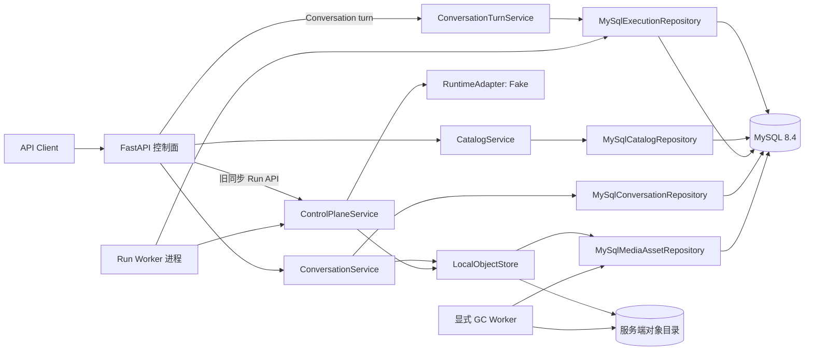
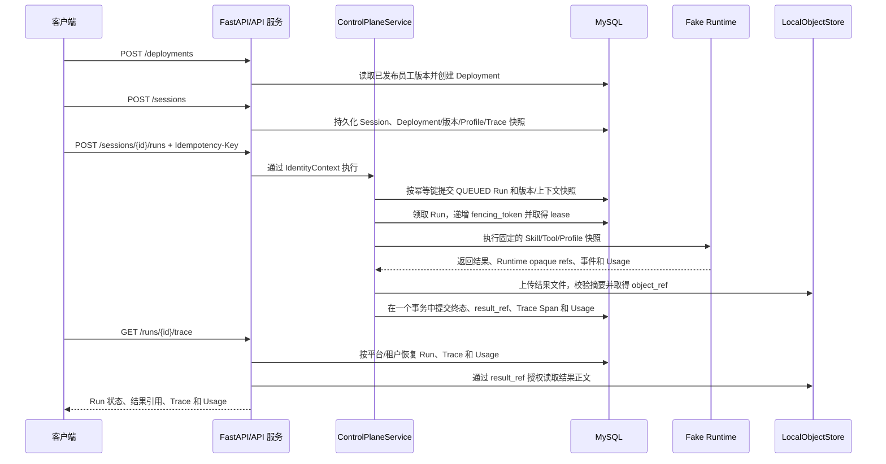
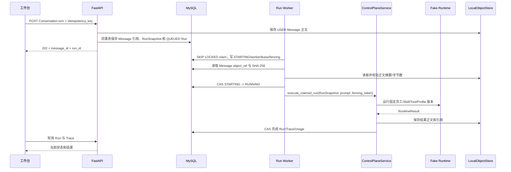
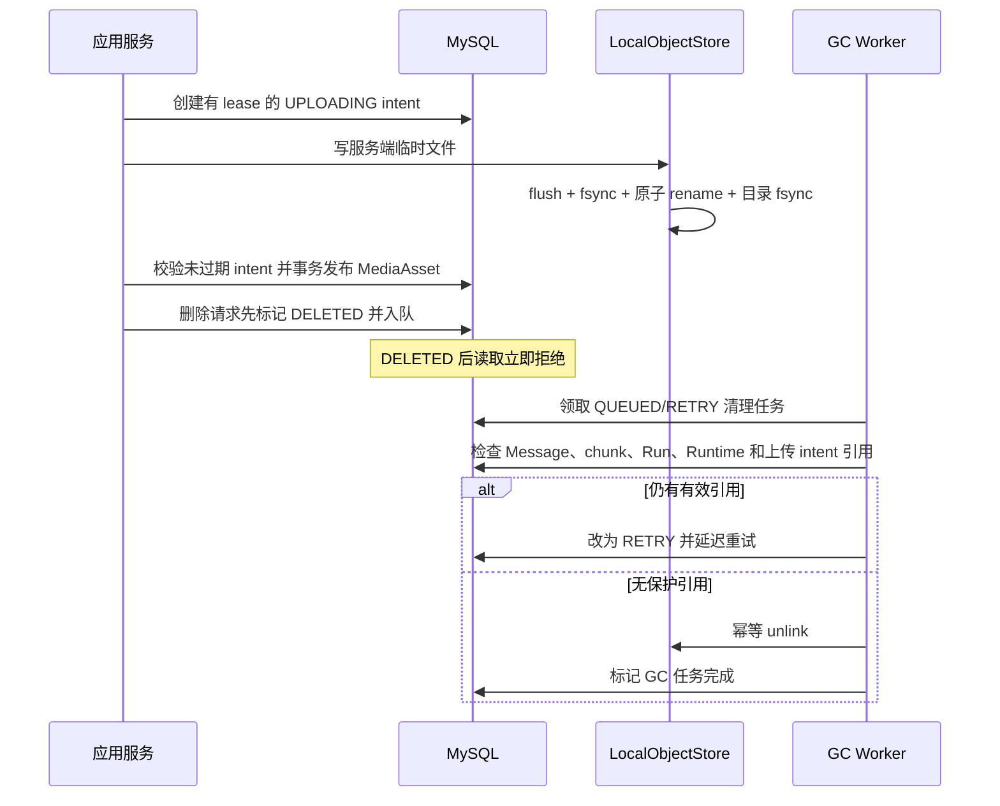
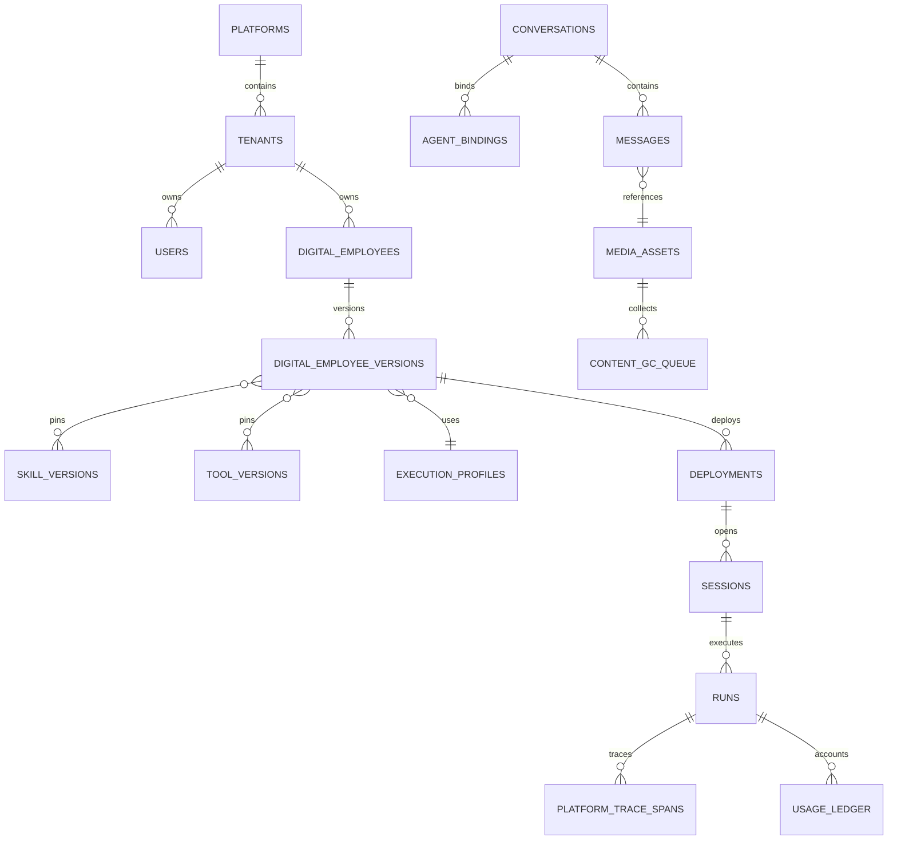
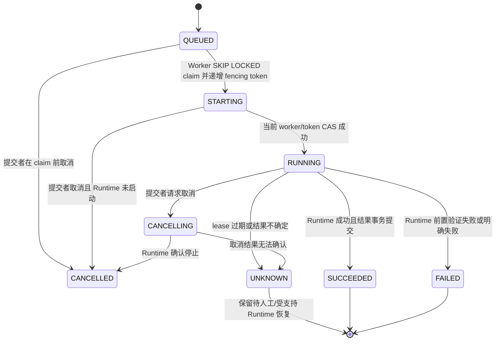
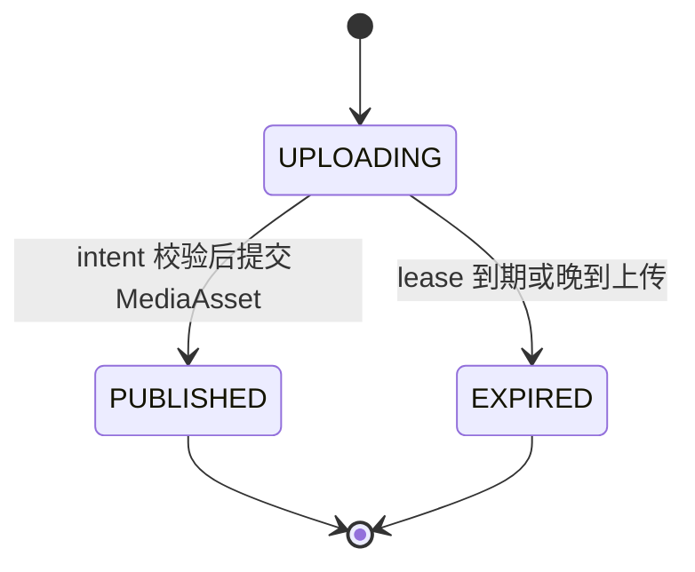
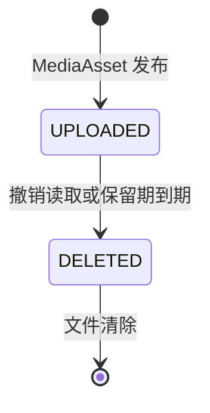
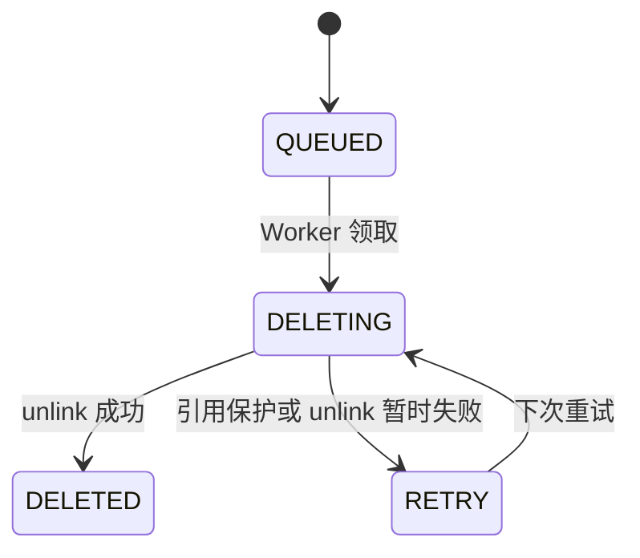

# 本地控制面闭环与运维

## 范围与运行模式

本地控制面同时保留同步 Session Run 兼容路径，并提供新的异步工作台路径：发布数字员工、绑定 Skill/Tool、部署、创建 Conversation turn、MySQL 持久化 QUEUED Run、独立 Run Worker 调用 Fake Runtime、查询 Trace/Usage；消息正文和运行结果保存在 LocalObjectStore，MySQL 保存索引与 opaque 对象引用。

MySQL 模式要求调用者显式设置 `AGENT_PLATFORM_MODE=mysql`，并配置 MySQL、对象目录和 Fake identity。没有 MySQL 配置时，应用入口不会退回内存仓储。单元测试可直接调用 `create_app()` 使用 Fake 模式；运行 `agent_platform.main:app` 必须明确指定 `AGENT_PLATFORM_MODE=mysql` 或 `AGENT_PLATFORM_MODE=fake`。

Fake Runtime 只验证平台的 API、版本固定、持久化和观测契约。当前 Change 未验证真实 Runtime、云对象存储或多节点共享文件系统。

## 架构



FastAPI 路由只调用应用服务。MySQL Repository 负责 `platform_id + tenant_id` 范围查询；对象读取先验证 MediaAsset 元数据，再通过服务端生成的对象 key 访问文件。LocalObjectStore 的对象 key 不包含客户端文件名；平台和租户出现在对象引用与元数据中，但磁盘路径只使用随机 key。

## Session、Run 与 Trace 时序

以下第一段是保留的同步兼容路径；员工工作台使用第二段异步路径，API 返回 202 后由独立 Worker 执行。



### 工作台异步 Run 与 Worker 时序



同一 `session_id + idempotency_key + request_digest` 返回原 Run；同一幂等键对应不同摘要时返回冲突。Run 结果事务任何阶段失败都会回滚状态、Trace 和 Usage；Run 不会被报告为终态成功。lease 过期后 Run 变为 `UNKNOWN`，旧 fencing token 写入影响零行，应用不自动重放未知 Runtime 调用。

## 上传、删除与 GC 时序



上传大小、摘要、租户和 intent lease 都会校验。对象写入成功但 MySQL 发布失败时，内容不可通过平台读取；intent 过期后扫描会把未引用对象加入 GC。删除先撤销读取，unlink 失败进入可重试状态。已完成 GC 的对象若重新出现，下一次删除或失效 intent 发布会重新排队。

## 数据模型与状态



`sessions`、`runs`、`messages`、`message_chunks`、`content_upload_intents` 和 `content_gc_queue` 复用 V001/V002；不另建平行 Session/Run 表。V003 增加 Catalog 版本、Conversation/AgentBinding、Run 快照、Trace/Usage、MediaAsset 及兼容字段。所有本 Change 新增或变更的表字段都有中文 MySQL `COMMENT`，通过 `information_schema` 集成检查验证。

| 记录 | 主要内容 | 正文保存位置 |
|---|---|---|
| Session | 部署、员工/Profile/ModelRoute 版本、Trace ID、Runtime opaque refs | MySQL |
| Run | 幂等摘要、fencing token、状态、版本/上下文快照、结果引用 | MySQL；结果正文在对象目录 |
| Trace Span | 顺序、类型、状态、脱敏属性 | MySQL |
| Usage | Token、成本、币种、定价版本；更正写入追加表 | MySQL |
| Message | Session/Conversation/发送者/顺序、正文引用与摘要 | MySQL 保存引用；正文在对象目录 |
| MediaAsset | 租户、对象引用、摘要、字节数、保留策略、加密版本 | MySQL 保存元数据；文件在对象目录 |









## API 与验收入口

`/api/v1/tools`、`/skills`、`/digital-employees`、`/execution-profiles`、`/model-routes`、`/deployments` 使用 MySQL-backed 应用服务。执行和查询端点包括：

- `POST /api/v1/sessions`
- `POST /api/v1/sessions/{session_id}/runs`
- `POST /api/v1/runs/{run_id}/cancel`（仅 Run 提交者）
- `GET /api/v1/runs/{run_id}`
- `GET /api/v1/runs/{run_id}/trace`
- `GET /api/v1/runs/{run_id}/usage`
- `POST /api/v1/conversations`
- `POST /api/v1/conversations/{conversation_id}/bindings`
- `POST /api/v1/conversations/{conversation_id}/messages`
- `GET /api/v1/conversations/{conversation_id}/messages`

租户来自 Fake IdentityProvider 解析的 `X-Fake-User`，请求 body 中伪造的 `tenant_id` 会被拒绝。跨租户单资源按 404 处理，列表只返回当前租户结果。MySQL 模式必须在 app factory 注入所有 Repository 和 ObjectStore；配置失败不会静默回落到内存实现。

## 本地启动

先创建空 MySQL 8.4 数据库并显式安装后端可选依赖：

```bash
cd backend
python -m pip install -e '.[dev,mysql]'
cd ..
export MYSQL_HOST=127.0.0.1
export MYSQL_PORT=3306
export MYSQL_DATABASE=agent_platform
export MYSQL_USER=agent_platform
export MYSQL_PASSWORD='<本地数据库密码>'
```

migration 只读预检和显式应用：

```bash
agent-platform-migration preflight --migrations-dir docs/migrations
agent-platform-migration apply --migrations-dir docs/migrations
agent-platform-migration preflight --migrations-dir docs/migrations
```

Fake identity seed 是独立的显式命令，重复运行幂等；API 启动不会创建平台、租户或用户：

```bash
agent-platform-seed-fake-identity
```

MySQL + Fake Runtime 本地模式：

```bash
export AGENT_PLATFORM_MODE=mysql
export AGENT_PLATFORM_IDENTITY_PROVIDER=fake
export AGENT_PLATFORM_DATA_ROOT="$HOME/.local/share/agent-platform"
cd backend
python -m uvicorn agent_platform.main:app --host 127.0.0.1 --port 8000
```

对象目录必须在仓库和 Web root 外。默认 Raw Payload 策略关闭。显式启用对象静态加密时，从 SecretProvider 注入 Base64 密钥和版本引用；不要把真实密钥写入 shell 历史、仓库、SQL 或日志：

```bash
export AGENT_PLATFORM_OBJECT_ENCRYPTION_REQUIRED=1
export AGENT_PLATFORM_STORAGE_SECRET_REF='local/object-key'
export AGENT_PLATFORM_STORAGE_KEY_VERSION='v1'
export AGENT_PLATFORM_STORAGE_KEY_B64='<从本地密钥管理器注入>'
# 轮换期间继续保留被对象元数据引用的旧版本：
export AGENT_PLATFORM_STORAGE_KEY_B64_V0='<旧版本从密钥管理器注入>'
```

仅运行离线 Fake API 测试时可明确设置 `AGENT_PLATFORM_MODE=fake`；该模式不证明 MySQL、对象持久化或真实 Runtime 的生产能力。

## 异步 Run Worker

员工工作台的 Conversation turn API 在 MySQL 事务内保存用户消息、RunSnapshot 和 QUEUED Run，HTTP 请求返回 202。独立 `worker` Compose 服务使用同一 MySQL 数据库和对象存储卷领取 Run；旧 `/sessions/{id}/runs` 同步路径保持原样。

Run Worker 配置位于 `deploy/control-plane/.env.example`：

| 配置 | 默认值 | 说明 |
|---|---:|---|
| `AGENT_PLATFORM_ID` | `plt-local` | Worker 平台级 claim 的范围；claim 后所有查询恢复到返回的 tenant_id |
| `AGENT_PLATFORM_WORKER_POLL_SECONDS` | `1` | 空队列时的轮询间隔 |
| `AGENT_PLATFORM_WORKER_LEASE_SECONDS` | `30` | 单 Run 租约时长，必须大于 heartbeat 周期 |
| `AGENT_PLATFORM_WORKER_HEARTBEAT_SECONDS` | `10` | 当前 worker/token 的续租和取消观察周期 |
| `AGENT_PLATFORM_WORKER_CANCEL_GRACE_SECONDS` | `10` | 请求 Runtime.cancel 后等待可信停止结果的时间 |

`AGENT_PLATFORM_WORKER_ID` 未配置时取容器 hostname。Worker 使用 `AGENT_PLATFORM_MODE=mysql`、Fake IdentityProvider 和显式已迁移的 V007 schema；bootstrap 迁移服务处理 V001–V007，Worker 启动只执行只读 preflight。`AGENT_PLATFORM_RUNTIME_ENGINE` 默认为 `fake`；显式设为 `deepseek` 后 Worker 使用每 Run 独立 Harness、稳定 Session Home 和 profile-filtered Stdio proxy。Harness Home 位于共享的 `AGENT_PLATFORM_DATA_ROOT/harness-sessions/` 卷中。

`QUEUED` Run 被领取后进入 STARTING，再由有效 claim CAS 到 RUNNING。提交者取消尚未领取的 Run 时直接进入 CANCELLED；运行中取消由 Worker 调用 RuntimeAdapter.cancel。租约丢失或取消结果无法确认会进入 UNKNOWN、递增 fencing token，且不会自动重试。旧 token 即使迟到返回也无法提交 Run/Trace/Usage。

本地配置完成后可执行：

```bash
cd deploy/control-plane
docker compose config --quiet
docker compose up -d --build mysql bootstrap backend worker web
docker compose logs -f worker
```

执行 `docker compose config --quiet` 只校验配置，不会启动容器。Worker 容器不暴露 HTTP 端口。本机 Compose 实际运行证据与静态配置检查分开记录：只有 Worker 容器健康运行且 Run 已被领取/提交，才算队列消费验证通过。

## 备份、恢复与故障处置

一致性备份前先停止 API/Worker，随后备份同一时间点的 MySQL 和 `AGENT_PLATFORM_DATA_ROOT`。该目录包含对象正文和 Harness 原生历史；生产部署需要保证 Harness Home 卷静态加密：

```bash
mysqldump --single-transaction -h "$MYSQL_HOST" -P "$MYSQL_PORT" -u "$MYSQL_USER" -p \
  "$MYSQL_DATABASE" > /secure/backup/agent-platform.sql
tar -C "$AGENT_PLATFORM_DATA_ROOT" -czf /secure/backup/agent-platform-data.tgz objects harness-sessions
```

恢复到空白目标环境时，先创建数据库并停掉 API/Worker，再恢复对象目录和数据库，最后运行只读 preflight：

```bash
mkdir -p "$AGENT_PLATFORM_DATA_ROOT"
tar -C "$AGENT_PLATFORM_DATA_ROOT" -xzf /secure/backup/agent-platform-data.tgz
mysql -h "$MYSQL_HOST" -P "$MYSQL_PORT" -u "$MYSQL_USER" -p "$MYSQL_DATABASE" \
  < /secure/backup/agent-platform.sql
agent-platform-migration preflight --migrations-dir docs/migrations
```

若对象引用缺文件或密钥版本不可用，读取必须失败关闭。不要直接在有数据的环境运行 `V003__agent_platform_foundation.down.sql`；生产回退应回退应用并保留向前兼容 schema。破坏性 schema 回退必须单独审批并验证备份。

GC 由显式 one-shot Worker/运维任务运行；先撤销读取，再扫描有效引用，unlink 失败会记录稳定错误码并重试。Runtime 结果未知时不要重放 Run；保留 `UNKNOWN` 和 lease/fencing 记录，先确认 Runtime 是否支持可验证的 resume。

```bash
agent-platform-object-gc
```

## 存储与 Runtime 验证边界

| Provider/能力 | 本 Change 状态 | 说明 |
|---|---|---|
| MySQL 8.4 + LocalObjectStore | 已在一次性实例验证 | 包含迁移、重启读取、加密、摘要校验、租户隔离、失败重试和 GC |
| Fake Runtime | 已验证行为闭环 | 仅证明控制面调用、结果引用、Trace/Usage；不是生产 Runtime 认证 |
| 独立 Run Worker / Session Home lease | MySQL 8.4 集成已验证；本地 Compose Worker 已启动并消费 Run | 后端全量 327 项通过；本机两轮同 Session Fake Run 成功；Worker 重启后新 Session、旧同步 Run API 和过期租约收敛均成功。旧 Fake Session 在新 Worker 内无法恢复时收敛为 UNKNOWN/INTERRUPTED/QUARANTINED；DeepSeek 持久恢复和真实 DolphinScheduler 仍待验收 |
| MinIO | 未实现/未验证 | 选择后明确失败，不回落到本地磁盘 |
| S3 | 未实现/未验证 | 选择后明确失败，不回落到本地磁盘 |
| OSS | 未实现/未验证 | 选择后明确失败，不回落到本地磁盘 |
| COS | 未实现/未验证 | 选择后明确失败，不回落到本地磁盘 |
| 真实 Runtime / 多节点 / 云 KMS | 未验证 | 后续 Change 单独验收 |

三栏员工运行工作台与 Conversation/Run/Trace/Approval API 容器已接通，并通过前端 54 项测试与生产构建。disposable MySQL 8.4 后端全量测试 327 项通过，Harness Engine 178 项通过、3 项跳过；本机 DeepSeek SDK/过滤 Stdio proxy 契约通过。当前本机 Docker backend/web/Worker 已用工作区代码重建并运行，schema 已应用至 V007；StaffDeck MCP Profile、审批后 OFFLINE 创建及真实 Harness 容器链路仍待验收。

## 验证命令与证据

```bash
cd backend
python -m pytest tests -q
python -m ruff check src tests
python -m compileall -q src
```

MySQL 集成使用随机 disposable database，通过 `AGENT_PLATFORM_MYSQL_TEST_ALLOW_CREATE_DATABASE=1` 显式开启；测试 teardown 删除该数据库。发布审计结果、版本、迁移 checksum、通过/跳过项和日志目录记录在 `docs/验证记录.md`。迁移回滚脚本只在 disposable database 验证。

### 实现与测试索引

| 能力 | 实现 | 主要验证 |
|---|---|---|
| Catalog/Deployment | [`mysql_catalog.py`](../backend/src/agent_platform/infrastructure/mysql_catalog.py) | [`test_mysql_catalog_api.py`](../backend/tests/integration/test_mysql_catalog_api.py)、[`test_mysql_catalog_service.py`](../backend/tests/integration/test_mysql_catalog_service.py) |
| Session/Run/Trace/Usage | [`control_plane.py`](../backend/src/agent_platform/application/control_plane.py)、[`mysql_execution.py`](../backend/src/agent_platform/infrastructure/mysql_execution.py) | [`test_mysql_execution_repository.py`](../backend/tests/integration/test_mysql_execution_repository.py) |
| Conversation/Message | [`conversations.py`](../backend/src/agent_platform/application/conversations.py)、[`mysql_conversations.py`](../backend/src/agent_platform/infrastructure/mysql_conversations.py) | [`test_mysql_conversations.py`](../backend/tests/integration/test_mysql_conversations.py) |
| LocalObjectStore/MediaAsset/GC | [`storage.py`](../backend/src/agent_platform/ports/storage.py)、[`mysql_storage.py`](../backend/src/agent_platform/infrastructure/mysql_storage.py) | [`test_mysql_local_object_store.py`](../backend/tests/integration/test_mysql_local_object_store.py)、[`test_workspaces_storage.py`](../backend/tests/test_workspaces_storage.py) |
| Migration 与中文 COMMENT | [`V003__agent_platform_foundation.sql`](migrations/V003__agent_platform_foundation.sql) | [`test_production_control_plane_migration.py`](../backend/tests/integration/test_production_control_plane_migration.py)、[`test_mysql_migration_runner.py`](../backend/tests/integration/test_mysql_migration_runner.py) |
