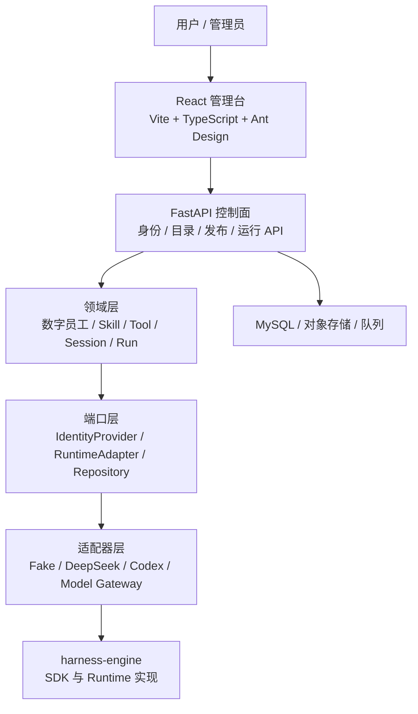
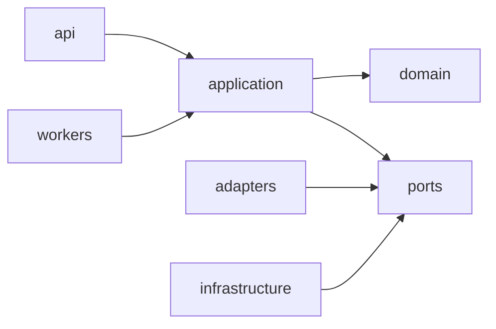

# Agent 平台架构总览

状态：第一批垂直切片已实现
更新时间：2026-11-14

## 总体分层



## 依赖方向



- `domain` 不依赖 FastAPI、数据库驱动或供应商 SDK。
- `api` 不直接调用 DeepSeek、Codex 或 CLI。
- `RuntimeAdapter` 负责 Runtime 生命周期和事件转换。
- `harness-engine` 保持独立，后端只通过端口依赖它。
- 租户上下文由请求边界解析后显式传入应用服务。

## 第一批实现边界

```text
已实现：Fake Identity、租户过滤、数字员工只读 API、Gallery 页面
待实现：版本发布、Skill 绑定、RuntimeAdapter、Session/Run、Trace、MySQL
```

## 第一批代码关联

- 后端入口：`backend/src/agent_platform/main.py`
- 后端 API：`backend/src/agent_platform/api/`
- Fake 身份：`backend/src/agent_platform/adapters/identity/fake.py`
- 前端入口：`frontend/src/main.tsx`
- Gallery：`frontend/src/features/digital-employees/EmployeeGallery.tsx`
- 验证命令：`backend/.venv/bin/python -m pytest backend/tests -q`、`npm test`、`npm run build`

## 后端与 Runtime 关系

详细的控制面、Worker、RuntimeAdapter 和 `harness-engine` 边界见：[后端与 Harness 引擎关系](后端与Harness引擎关系.md)。
