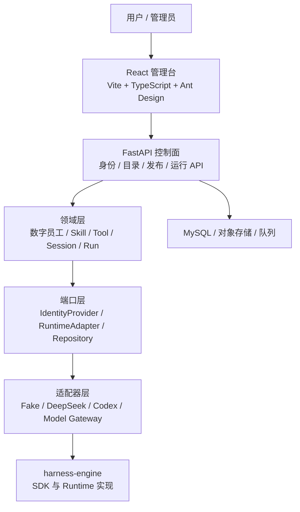
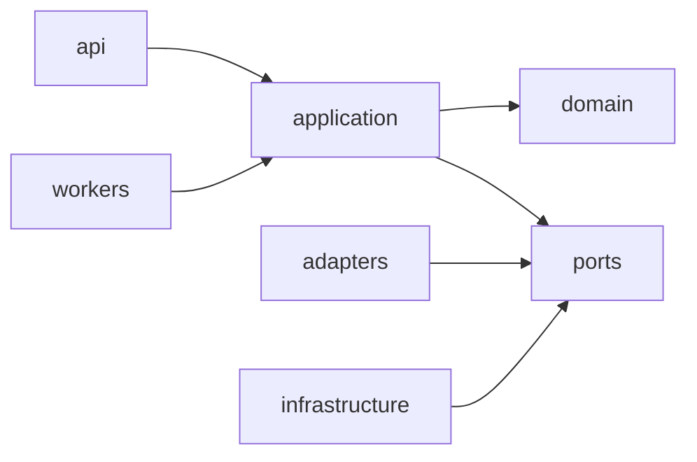

# Agent 平台架构总览

状态：控制面、目录、版本化资源、MySQL Run Worker 和每 Run Harness 适配已有实现；真实 DolphinScheduler 业务纵切待非生产验收
更新时间：2026-11-19

## 总体分层

## 依赖方向

- `domain` 不依赖 FastAPI、数据库驱动或供应商 SDK。
- `api` 不直接调用 DeepSeek、Codex 或 CLI。
- `RuntimeAdapter` 负责 Runtime 生命周期和事件转换。
- `harness-engine` 保持独立，后端只通过端口依赖它。
- 租户上下文由请求边界解析后显式传入应用服务。

## 当前实现边界

- 已有：数字员工/Skill/Tool/Deployment、Conversation/Session/Run/Trace、RunSnapshot、MySQL 仓储、RuntimeAdapter 端口、Fake Runtime，以及独立 harness-engine 和 Stdio MCP Server 示例。
- 已有异步执行骨架：Conversation turn API 将 Run 入队，独立 Run Worker 通过 V007 MySQL Session Home lease/fencing 领取并提交结果；Runtime 默认 Fake，可显式设置 `AGENT_PLATFORM_RUNTIME_ENGINE=deepseek`。
- 已有员工运行工作台、Conversation 分页 API、持久化一次性写审批、MCP Stdio Host/过滤代理和每 Run 独立 Harness；V006/V007 已在 disposable MySQL 8.4 验证。
- 尚未形成真实业务闭环：StaffDeck DolphinScheduler MCP Profile 尚未导出，非生产 OFFLINE 创建、容器内 Harness 重启和 UNKNOWN 对账未联调。
- 知识库不在本轮 Harness 工作台范围内，继续待定。

## 第一批代码关联

- 后端入口：`backend/src/agent_platform/main.py`
- 后端 API：`backend/src/agent_platform/api/`
- Fake 身份：`backend/src/agent_platform/adapters/identity/fake.py`
- 前端入口：`frontend/src/main.tsx`
- Gallery：`frontend/src/features/digital-employees/EmployeeGallery.tsx`
- 验证命令：`backend/.venv/bin/python -m pytest backend/tests -q`、`npm test`、`npm run build`

## 后端与 Runtime 关系

详细的控制面、Worker、RuntimeAdapter 和 `harness-engine` 边界见：[后端与 Harness 引擎关系](后端与Harness引擎关系.md)。

Harness 员工执行闭环、Worker/MCP Stdio、数据字段、审批流程、API 和工作台交互的统一方案见：[Harness 数字员工执行闭环设计](Harness员工执行闭环设计.md)；页面布局原型见：[海豚调度员工工作台](原型/海豚调度员工工作台.html)。

媒体、附件和 Runtime 产物的本地/S3/MinIO/OSS/COS 配置化存储见：[对象存储与媒体处理设计](对象存储与媒体处理设计.md)。
