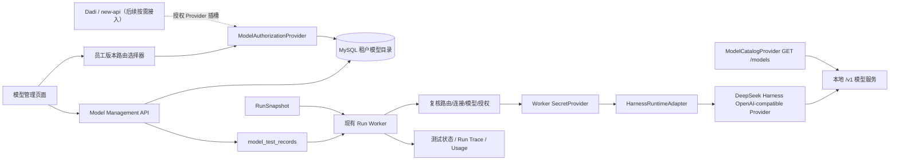
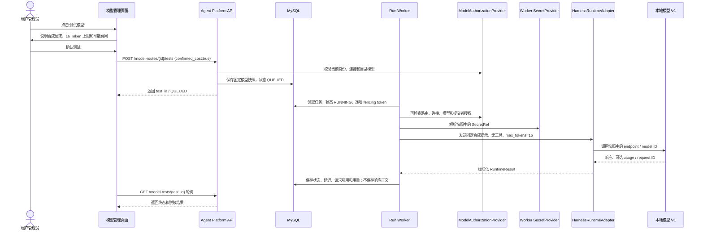

# 模型管理与模型接入

本功能先由 Agent Platform 按租户管理 OpenAI 兼容连接、连接下的多个模型、员工可绑定的 ModelRoute，以及连接/模型可用性测试。Worker 使用 Run 创建时固定的模型配置调用本地模型接口。

网关接入仍按后续阶段处理：不启动 Dadi 或 new-api，也不把用户级网关授权折叠成租户目录状态。独立页面原型保留在 [模型管理 HTML 原型](原型/模型管理.html)；本文是流程、数据和接口设计说明。

## 设计边界

- 连接、模型目录、路由和测试记录都带平台与租户作用域。一个连接可以维护多个模型 ID。
- Run 快照固定路由版本、连接版本、模型 ID、协议、地址、参数、价格引用和 SecretRef 元数据。后续修改连接或路由不会改写已提交 Run 的配置。
- `ModelAuthorizationProvider` 在 Run 创建和 Worker 出站前检查当前身份、路由、连接与模型。员工版本编辑器只读取当前身份获准的 ACTIVE 路由。
- API 和数据库只保存 SecretRef。Worker 在连接探测、目录同步、模型测试或 Run 调用时解析密钥，短期传入该次 Harness 子进程环境；Harness 结束后清理该环境。
- 连接测试只验证认证与目录接口，不调用模型推理。模型测试在显式确认后发送固定合成提示，无员工正文、无工具、最多输出 16 Token。
- 连接同步与模型测试共用 `model_test_records`，由已有 Run Worker 领取，不新增 Worker 容器。Run 与模型测试轮换处理，避免测试排队任务被持续 Run 流量饿死。
- Dadi/new-api 连接器、网关签发凭证、用户中心和 Dadi 用户授权均是后续集成点。

## 架构图



## 流程与时序

### 建立连接、发现模型并创建路由

1. 租户管理员保存连接名称、API 协议、Base URL、目录方式和凭据引用 ID。API 不接收或返回 API Key 明文。
2. 管理员可发起连接测试或远端目录同步。API 创建 `QUEUED` 测试记录后立即返回测试 ID。
3. Run Worker 领取任务、递增 fencing token，并在 Worker 进程中解析 SecretRef。远端目录调用 `GET {Base URL}/models`，同步结果归属同一租户连接。
4. 不支持远端目录的连接仍可手工维护多个模型 ID。
5. 管理员选择一个模型 ID 创建 ModelRoute。员工版本编辑器请求 `/model-routes/selectable`，只显示当前身份授权的 ACTIVE 路由，并显示路由别名和实际模型 ID。

### 测试模型



取消或关闭确认窗口不会创建任务。任务发出后若发生超时或 Worker 租约过期，状态转为 `UNKNOWN` 并提升 fencing token；系统不会自动重放可能已被供应商接收的请求。

## 数据模型

所有 MySQL 表和字段定义以 `docs/migrations/V008__tenant_model_management.sql` 为准。新增字段均有中文 `COMMENT`，MySQL 集成测试从 `information_schema.TABLES` 和 `information_schema.COLUMNS` 检查注释。

| 对象 | 主键与租户边界 | 主要字段 | 用途 |
|---|---|---|---|
| `model_connections` | `(platform_id, tenant_id, connection_id)` | `name`、`provider_kind`、`protocol`、`endpoint`、`auth_secret_ref/scope/provider`、`catalog_mode`、`status`、`version` | 存储租户共享连接和 SecretRef，不绑定单一模型 ID |
| `model_catalog_items` | `(platform_id, tenant_id, connection_id, model_id)` | `display_name`、`capabilities_json`、`context_window`、`catalog_source`、`status`、`last_seen_at` | 同一连接下维护多个远端或手工模型 ID；不存用户授权结果 |
| `model_routes` | `(platform_id, tenant_id, route_id)` | V008 增加 `model_connection_id`、`catalog_model_id`、`route_version`；原有 profile 保留参数和别名 | 员工版本绑定稳定路由；配置改变时版本递增 |
| `model_test_records` | `(platform_id, tenant_id, test_id)` | `connection_id`、`route_id`、`model_id`、`test_kind`、`state`、`snapshot_json`、Worker 租约、`fencing_token`、延迟、上游请求引用、Token 用量、错误类别 | 异步连接/模型测试任务和脱敏结果，不存 prompt/响应正文 |
| `RunSnapshot` JSON | 运行租户的 Run 主记录 | `model_route_snapshot`：路由/连接版本、供应商、模型 ID、协议、endpoint、参数、价格引用、SecretRef 元数据 | 固定提交时的运行配置；Worker 复核当前授权后仍使用此快照 |

`model_test_records.snapshot_json` 只包含操作类型和非敏感连接/模型快照。模型测试结果只保存状态、耗时、请求引用、可选用量和稳定错误类别。模型输出不保存。

## API 与状态

所有管理 API 从认证身份派生 platform/tenant，不信任请求体中的租户覆盖值。管理员负责连接和路由管理；成员只能访问当前身份允许读取的资源。

| 方法与路径 | 用途 | 结果 |
|---|---|---|
| `GET /api/v1/model-connections` | 列出当前租户连接 | `items[]`，SecretRef 元数据，不含密钥 |
| `POST /api/v1/model-connections` | 创建连接 | `201`，初始 `version=1` |
| `GET /api/v1/model-connections/{id}` | 读取租户连接 | 租户外返回 404 |
| `PUT /api/v1/model-connections/{id}` | 更新连接配置 | 新版本，`version + 1` |
| `GET /api/v1/model-connections/{id}/models` | 列出一个连接的目录项 | 一个连接可返回多个 model ID |
| `POST /api/v1/model-connections/{id}/models` | 手工录入模型 ID | `201`，来源 `MANUAL` |
| `POST /api/v1/model-connections/{id}/sync-models` | 排入远端目录同步 | `202`，只接受 `REMOTE` 目录方式 |
| `POST /api/v1/model-connections/{id}/tests` | 排入连接测试 | `202`，认证/目录测试，不发补全 |
| `GET/POST /api/v1/model-routes` | 列出或创建租户路由 | 列表包含 `authorization_source`；创建必须引用同租户 ACTIVE 目录模型 |
| `GET/PUT /api/v1/model-routes/{id}` | 读取或更新路由 | 更新后 `route_version + 1` |
| `POST /api/v1/model-routes/{id}/disable` | 停用路由 | 阻止新的 Run、测试和员工选择 |
| `POST /api/v1/model-routes/{id}/enable` | 重新启用路由 | 仅在连接和目录模型仍可用时成功 |
| `POST /api/v1/model-routes/{id}/tests` | 排入具体模型测试 | 必须传 `{ "confirmed_cost": true }`，返回 `202` |
| `GET /api/v1/model-tests/{id}` | 获取测试状态与脱敏结果 | 租户外返回 404 |
| `GET /api/v1/model-routes/selectable` | 员工编辑器可选路由 | 当前租户和身份授权的 ACTIVE 路由，并带授权来源 |

测试状态由 Worker 按以下迁移写入：

| 当前状态 | 目标状态 | 规则 |
|---|---|---|
| `QUEUED` | `RUNNING` | Worker 原子领取并取得新 fencing token / 租约 |
| `RUNNING` | `SUCCEEDED` | 收到有效连接目录结果或模型响应 |
| `RUNNING` | `FAILED` | 凭据、目录、模型或供应商返回明确失败 |
| `RUNNING` | `UNKNOWN` | 超时或租约过期，无法确认上游是否已处理 |
| `SUCCEEDED/FAILED/UNKNOWN` | — | 终态不可覆盖，不自动重试 |

连接测试即使连接选择“手工目录”，也会探测认证目录接口；目录不支持时返回脱敏目录错误，手工模型录入仍可继续。目录同步仅允许 `REMOTE` 模式。模型测试使用固定提示“Reply with the single token OK.”、无员工上下文、无工具和 16 Token 上限。Harness 提供精确用量时标记 `EXACT`，没有时按词数回退到 `ESTIMATED`；若可用，保留上游 request ID。

## 租户、授权与凭据边界

1. Catalog Repository 的读取和写入均带 `platform_id + tenant_id`；跨租户资源按不存在处理，写入越权返回 `AUTHORIZATION_DENIED`。
2. `PlatformModelAuthorizationProvider` 初版仅允许当前租户 ACTIVE 连接/模型。应用通过 `ModelAuthorizationProvider` 注入，为后续 Dadi 用户授权适配器留边界。
3. Run 创建时检查当前身份；Worker 领取后再检查路由、连接、模型是否 ACTIVE，以及提交者当前是否授权。Worker 身份只用于可信仓储访问，模型授权主体仍使用 Run 持久化的提交用户 ID，角色不从用户请求伪造。
4. `SecretRef` 只有引用 ID、作用域和解析 Provider。环境变量解析名称为 `AGENT_PLATFORM_MODEL_SECRET_<SCOPE>_<SECRET_ID>`，名称会先大写并把非字母数字符号替换为下划线。未配置或不支持的凭据返回稳定错误类别。
5. 凭据在 API/浏览器、MySQL、RunSnapshot、EngineRequest、Provider patch YAML、测试结果和日志中均不出现。仅在 Worker 调用时传给 Harness 子进程环境；Engine 关闭时清空。

## 主要错误类别

| 类别 | 含义 |
|---|---|
| `MODEL_SECRET_UNAVAILABLE` | SecretRef 未配置可用值 |
| `MODEL_SECRET_PROVIDER_UNSUPPORTED` | 当前环境 Provider 不支持该 SecretRef |
| `MODEL_CREDENTIAL_INVALID` | 上游拒绝凭据（HTTP 401/403） |
| `MODEL_CATALOG_UNAVAILABLE` | 目录端点不可达、超时或不支持 |
| `MODEL_CATALOG_INVALID_RESPONSE` | `/models` 返回格式不合法 |
| `MODEL_NOT_FOUND` | 上游拒绝所选 model ID（HTTP 404） |
| `MODEL_TEST_TIMEOUT` | 测试超时且结果不确定，状态为 `UNKNOWN` |
| `MODEL_TEST_OUTCOME_UNKNOWN` | 没有可判定的上游失败响应，状态为 `UNKNOWN` |
| `MODEL_PROVIDER_ERROR` | 上游返回明确错误（例如 HTTP 5xx） |
| `AUTHORIZATION_DENIED` | 当前租户/身份无权选择或调用路由 |
| `WORKER_LEASE_EXPIRED` | Worker 租约过期；任务转 `UNKNOWN` 并围栏旧执行 |

异常原文和 Provider 响应正文不会写进 `error_category`。

## 本地开发与后续网关接入

开发本地 Agent Platform 时只启动控制面和前端；需要运行真实模型时，再在 Agent Platform 的 MySQL/Worker 部署中启动既有 Run Worker。连接 Base URL 使用 `http://host.docker.internal:63072/v1`，因为请求从 Docker Worker 容器发出。

`deploy/control-plane/docker-compose.yml` 为本地租户 A 的 `SecretRef` 示例预留了 `AGENT_PLATFORM_MODEL_SECRET_TENANT_A_LOCAL_MODEL_KEY`，且只传给 Run Worker。若连接中的 SecretRef ID 使用 `local-model-key`，把实际值配置在被忽略的本机 `.env` 中；不要将密钥提交到仓库，也不要发到聊天中。其他 SecretRef ID 需要为对应环境变量增加 Worker 配置。

Dadi/new-api 目录、授权和容器不属于当前运行依赖。后续接入时替换 `ModelCatalogProvider`、`ModelAuthorizationProvider` 或 `SecretProvider` 实现；租户连接、ModelRoute、RunSnapshot 和员工版本绑定保持现有边界。网关授权结果必须按当前身份实时计算，不写成所有租户用户共享的 catalog `ACTIVE` 状态。

## 原型与实现对应关系

独立 HTML 原型保留在 [docs/原型/模型管理.html](原型/模型管理.html)。原型包含连接/多模型目录、ModelRoute、平台授权来源、Docker Worker 地址提示、测试结果和费用确认窗口。原型按钮只改变页面内的示例状态，不请求 API 或模型端点；真实 React 页面走本文列出的 API。

## 已验证项与未验证项

### 已验证

- MySQL 前向迁移、中文表/字段注释、租户仓储和模型测试 fencing 集成测试。
- RunSnapshot 固定模型配置、Runtime/Harness 配置传递、SecretRef 脱敏、Run Worker 授权复核和模型测试异步处理。
- 连接目录认证、手工目录、测试状态和脱敏错误的确定性测试。
- React 模型连接、目录、路由和费用确认流程；员工编辑器仅读取身份授权后的路由。
- 本地 `http://localhost:63072/v1` 曾验证可从宿主机/Docker Worker 到达；无有效密钥时返回 HTTP 401。

### 最终验证记录

| 验证 | 结果 |
|---|---|
| 后端模型管理、路由、授权、控制面、Harness 与 Worker 单元测试 | `89 passed` |
| MySQL 迁移、表/字段中文注释、租户仓储/API、模型测试租约和 RunSnapshot 集成测试 | `28 passed` |
| 前端全量 Vitest | `67 passed`，15 个测试文件 |
| 前端 TypeScript 与 Vite 生产构建 | 通过；Rollup 提示主 bundle 大于 500 kB |
| `openspec validate tenant-model-management --strict` | Change 有效 |
| Ruff 与 `git diff --check` | 通过 |
| HTML 原型内联脚本语法检查 | 通过 |
| 当前本机 MySQL schema | 已从 V007 显式迁移至 V008；现有 1 个连接、12 个目录模型、1 条路由 |
| 本地连接与目录探测 | `http://host.docker.internal:63072/v1` 连接测试成功；同步发现 12 个模型 ID |
| UI 确认的模型测试 | `gpt-6.1-sol` 状态 `SUCCEEDED`，耗时 2190 ms，用量 `ESTIMATED`（输入 6、输出 1）；响应正文不保存在测试记录 |
| Docker Worker Run | 使用 DeepSeek Profile、新 Session 和 `gpt-6.1-sol` 路由后状态 `SUCCEEDED`；响应为“我无法获取当前运行模型的具体 ID。”；Trace 的 `request/context` 记录 `gpt-6.1-sol` / `openai-compatible` 和成功 assistant 消息；Run 用量为 `ESTIMATED`（输入 2、输出 2） |
| API Key 隔离 | 本机 MySQL 快照/路由/测试记录以及 Backend/Worker Docker 日志扫描均未发现实际 API Key；凭据只在忽略的本地 `.env` 与 Worker 运行环境中 |
| Docker Compose 更新 | API、Worker、Web 已用当前工作区构建并健康启动；`/api/v1/model-connections` 返回 200 |

### 未验证 / 后续项

- 本次不启动 Dadi 或 new-api，不验证网关返回的用户授权模型和撤销流程。
- 首次 Worker Run 使用 `fake` Profile 创建的 Session，被 DeepSeek Worker 判为未知结果；该次没有模型用量或响应。随后改为 DeepSeek Profile 并创建新 Session，Run 成功；不会重放首个 `UNKNOWN` Run。
- Run 响应无法自报运行模型名称；以 RunSnapshot 和 Trace 的 `request/context` 模型/provider 字段确认选中了 `gpt-6.1-sol`。
- 已运行容器中没有 Dadi 或 new-api；StaffDeck/DolphinScheduler 验收服务属于已有本机环境，本次没有启动它们。
- 前端 React 19 与当前 antd 5 测试环境会输出兼容性告警；功能测试和 Vite 构建仍可运行。

## 验证命令

测试数据库仅用于可丢弃集成测试。以下命令从本机控制面环境文件读取 MySQL 参数，不打印密码；pytest 使用 `--tb=no` 避免失败回溯展示连接配置。

```bash
PYTHONPATH=harness-engine/src backend/.venv/bin/pytest \
  backend/tests/test_model_management_api.py \
  backend/tests/test_model_management_domain.py \
  backend/tests/test_model_management_providers.py \
  backend/tests/test_model_authorization.py \
  backend/tests/test_model_test_worker.py \
  backend/tests/test_model_test_execution.py \
  backend/tests/test_model_route_service.py \
  backend/tests/test_catalog_service.py \
  backend/tests/test_app_configuration.py \
  backend/tests/test_runtime_employee_context.py \
  backend/tests/test_control_plane_service.py \
  backend/tests/test_claimed_run_execution.py \
  backend/tests/test_run_worker.py \
  backend/tests/test_harness_runtime_adapter.py \
  harness-engine/tests/test_deepseek_engine.py -q --tb=short

set -a
source deploy/control-plane/.env
set +a
export MYSQL_HOST=127.0.0.1 MYSQL_PORT=3309 MYSQL_USER=root
export MYSQL_PASSWORD="$MYSQL_ROOT_PASSWORD"
export AGENT_PLATFORM_MYSQL_TEST_ALLOW_CREATE_DATABASE=1
PYTHONPATH=harness-engine/src backend/.venv/bin/pytest \
  backend/tests/integration/test_mysql_migration_runner.py \
  backend/tests/integration/test_mysql_catalog_repository.py \
  backend/tests/integration/test_mysql_catalog_api.py \
  backend/tests/integration/test_mysql_execution_repository.py -q --tb=no

cd frontend
npm test -- --reporter dot
npm run build

openspec validate tenant-model-management --strict
```

静态 HTML 原型内联 JavaScript 的语法检查：

```bash
node -e 'const fs=require("fs"); const vm=require("vm"); const html=fs.readFileSync("docs/原型/模型管理.html","utf8"); const scripts=[...html.matchAll(/<script>([\s\S]*?)<\/script>/g)]; if(!scripts.length) throw new Error("missing prototype script"); for(const script of scripts) new vm.Script(script[1]); console.log("HTML prototype script syntax OK")'
```
