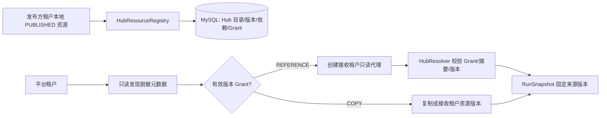
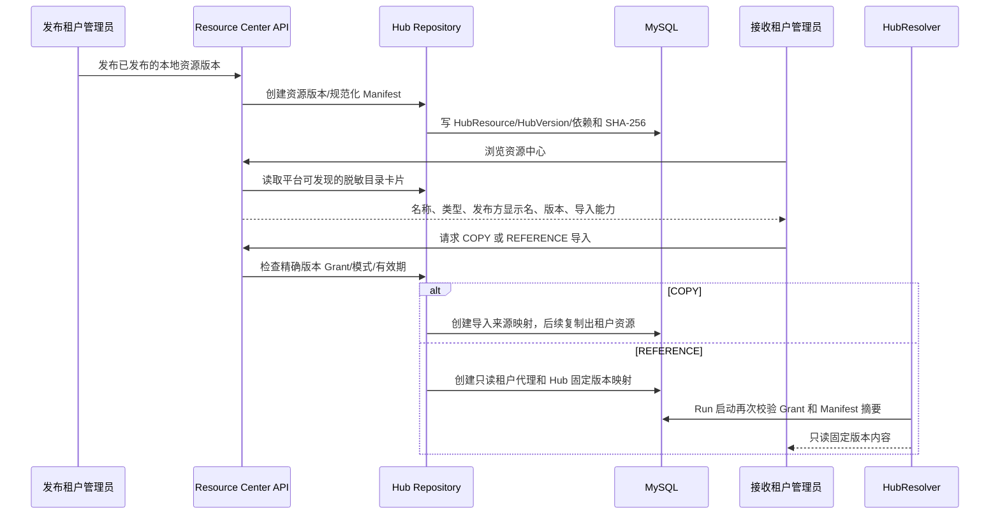

# 资源中心模型与授权

## 范围

资源中心先支持已发布的数字员工、Skill 和 Tool 版本。平台内租户默认可发现已发布资源的脱敏目录元数据；读取 Package 清单/对象或执行 COPY、REFERENCE 必须有针对接收租户和精确版本的有效 Grant。知识库页面、内容实体和检索不在当前实现范围。

## 架构与流程





## 数据模型

迁移文件：[V004__resource_center.sql](migrations/V004__resource_center.sql)，回滚仅用于 disposable database：[V004__resource_center.down.sql](migrations/V004__resource_center.down.sql)。

| 表 | 主键 | 作用 | 租户边界/重要索引 |
|---|---|---|---|
| `hub_resources` | `(platform_id, hub_resource_id)` | 平台目录元数据、发布方、可见性和资源状态 | 发布租户/用户联合 FK；`idx_hub_discovery` 按平台、可见范围、状态、类型更新时间查目录 |
| `hub_resource_versions` | `(platform_id, hub_resource_id, version)` | 不可变源版本、Manifest JSON/SHA-256、包 MediaAsset 引用 | 固定 publisher tenant；引用发布租户的 users、tenants 和 media_assets |
| `hub_resource_dependencies` | `(platform_id, hub_resource_id, hub_version, dependency_id)` | Package 的固定 Hub 依赖和稳定顺序 | 源、目标版本都经平台复合 FK 关联 |
| `hub_resource_grants` | `(platform_id, grant_id)` | 精确资源版本到接收租户的 COPY/REFERENCE 权限和审计 | 发布/接收租户分别联合 FK；按接收租户/状态/资源/版本索引 |
| `tenant_resource_imports` | `(platform_id, tenant_id, import_id)` | 租户本地代理到 Hub 来源版本、模式和摘要的映射 | 接收租户、Grant、Hub 版本、导入用户复合 FK；本地资源代理映射唯一 |

V004 还为现有 `tool_versions` 增加 `requires_recipient_credentials`，指示 COPY 后是否必须绑定接收租户的凭据引用。Hub Manifest 只暴露该布尔要求，不带发布租户 SecretRef；接收租户设置 `auth_secret_ref` 后才可发布该本地 Tool。

目录可见性 `PLATFORM` 表示所有同平台租户可以看到脱敏卡片；`RESTRICTED` 只对发布租户和有活跃 Grant 的接收租户显示。目录卡片仅返回 Hub 资源 ID、类型、名称、描述、发布租户显示名、最新已发布版本和当前可用导入模式，不返回 publisher tenant ID、source resource ID、Manifest 内容或对象地址。

`hub_resource_grants` 针对精确 Hub 版本，且至少允许 COPY/REFERENCE 之一。新版本不继承旧版本 Grant。过期/撤销 Grant 不可读取 Package 或开始新的 Run。撤销只更新 Grant 状态和时间，不删除历史导入/审计。

`tenant_resource_imports` 将 `COPY`/`REFERENCE` 资源映射到接收租户本地资源标识。现有 `employee_skill_bindings` 和 `employee_tool_bindings` 仍引用同租户的 Skill/Tool ID+version，不改变 V003 复合外键。运行解析通过 `(platform_id, tenant_id, local_resource_type, local_resource_id, local_resource_version)` 反查来源映射，不以发布方资源 ID 跨租户查询 Catalog。

REFERENCE 运行时 `RunSnapshot` 在现有 `runs.snapshot_json` 中增加 `hub_resource_refs`：本地资源类型/ID/版本、Hub 资源 ID/精确版本、Manifest SHA-256 和 `REFERENCE` 模式。该快照不复制 Hub 正文；Runtime 请求只接收已校验的员工指令、Skill 入口指令和当前允许的 Tool 名。读取每个 REFERENCE 包前重新验证租户 Grant、发布状态和摘要；撤销/过期/摘要不符会拒绝新 Run，已完成 Run 的快照不被后续 Hub 版本改写。

## API/状态契约

当前后端仓储接口位于 [resource_center.py](../backend/src/agent_platform/ports/resource_center.py)，MySQL 实现位于 [mysql_resource_center.py](../backend/src/agent_platform/infrastructure/mysql_resource_center.py)，领域类型及 Manifest 构造位于 [resource_center.py](../backend/src/agent_platform/domain/resource_center.py)。

- `save_resource(identity, resource)`：只接受当前平台/租户的发布方身份和 DRAFT 资源。
- `save_version(identity, version)`：验证 canonical Manifest JSON 和 SHA-256 一致后插入版本；不允许覆盖版本。
- `publish_version(identity, hub_resource_id, version)`：仅发布当前租户自己的 DRAFT 精确版本；资源目录更新为 PUBLISHED。
- `list_discoverable(identity, resource_type, keyword, limit)`：平台默认可发现资源返回脱敏摘要；RESTRICTED 资源需发布方身份或有效 Grant。`available_modes` 只列当前接收租户被授权的模式。
- `get_authorized_version(identity, hub_resource_id, version, mode)`：在返回 Manifest/Package 内容前验证资源和版本已发布，并验证发布方身份或对应精确版本和模式的有效 Grant；未授权/过期统一按不存在处理。
- `save_grant(identity, grant)` / `revoke_grant(identity, grant_id)`：只有发布方租户管理员能操作；历史授权行保留。

当前已接入的资源发布 HTTP 接口：

- `POST /api/v1/hub/resources`：将当前租户指定的已发布 Employee/Skill/Tool 版本打成 Hub DRAFT，响应 Hub ID、Hub 版本和 manifest 摘要。Employee/Skill 包依赖精确的、已发布到 Hub 的 Tool/Skill 版本；缺失映射时 `409 DEPENDENCY_VALIDATION_ERROR`。
- `POST /api/v1/hub/resources/{hub_resource_id}/versions`：在同一 Hub 条目追加本地新版本，已有版本保持不可变。
- `POST /api/v1/hub/resources/{hub_resource_id}/versions/{version}/publish`：发布 Hub DRAFT 版本。

目录发现与脱敏详情 HTTP 接口：

- `GET /api/v1/hub/resources?resource_type=&keyword=&mode=&limit=`：默认按平台可发现范围返回已发布资源的脱敏卡片；`mode=COPY|REFERENCE` 时只返回当前接收租户有对应有效 Grant 的条目；`limit` 为 1–200，结果按更新时间倒序并以 Hub ID 稳定打破并列。
- `GET /api/v1/hub/resources/{hub_resource_id}/versions/{version}`：返回某已发布版本的脱敏元数据、摘要、依赖数量和当前可用导入模式；不返回 Manifest、依赖资源 ID、来源租户 ID、MediaAsset ID 或对象地址。

接收租户的 COPY/REFERENCE 接口：

- `POST /api/v1/hub/imports`：请求包含 `hub_resource_id`、`hub_version` 和 `mode=COPY|REFERENCE`；递归处理该版本依赖，返回本地资源 ID/版本、来源摘要和 `ACTIVE` 状态。COPY 物化为租户 DRAFT；REFERENCE 物化为租户本地 PUBLISHED 代理，后续 Run 通过 `HubResourceResolver` 按授权固定版本读取。
- COPY 的 Skill/Tool/员工被物化为接收租户 DRAFT 资源，员工包依赖的 Skill 和 Tool 也递归复制并记录导入来源。重复请求返回同一个导入记录，不重复创建资源。
- REFERENCE 的员工、Skill 和 Tool 代理只保留本地关联 ID 与最小展示字段；运行正文始终从有效授权的 Hub Manifest 解析。员工和 Skill Manifest 声明的子依赖必须与租户本地绑定顺序及版本完全匹配。
- Hub FILE_PACKAGE Skill Manifest 仅在有效 Grant 后包含源租户 MediaAsset ID、路径和摘要。COPY 将文件写为接收租户新 MediaAsset 并建立 `skill_file_entries`；REFERENCE 不复制对象，在每次新 Run 时按当前 Grant 从 Hub 固定版本读取，只读入口和文件 refs 固化到 RunSnapshot。
- Hub Tool Package 标记了接收方凭据要求时，本地副本保存该布尔要求，不继承发布租户 SecretRef；未配置接收方自己的 SecretRef 前不能发布 Tool。

导入管理接口：

- `GET /api/v1/hub/imports?status=&resource_type=&limit=`：只返回当前租户的导入记录，按导入时间和 ID 稳定倒序；支持按状态、资源类型过滤。
- `POST /api/v1/hub/imports/{import_id}/upgrade`：请求提供更高的 `hub_version`；复用原导入模式并通过目标精确版本 Grant 校验，返回新的本地代理 ID。旧导入、员工版本绑定和历史 Run 不变；员工 DRAFT 需显式重新绑定新代理。
- `DELETE /api/v1/hub/imports/{import_id}`：接收租户管理员撤销 REFERENCE 映射，阻止后续 Run 解析该代理，保留本地代理、旧 Run 和来源审计。COPY 是接收租户独立资源，不能通过此接口撤销。
- `DELETE /api/v1/hub/grants/{grant_id}`：发布租户管理员撤销 Grant；新导入和新的 REFERENCE Run 解析失败，既有 RunSnapshot 保持可读。

管理写操作要求租户管理员；导入列表限定当前平台和租户。升级目标必须属于同一 Hub 资源且版本号高于当前版本，任一依赖缺少授权时整次升级失败，不覆盖当前导入。

平台可发现资源无 Grant 时，目录卡片仍可展示名称、类型和发布方显示名，但 `available_modes=[]`，详情只含脱敏字段，COPY/REFERENCE 请求仍失败。RESTRICTED 资源只有发布租户或拥有该精确版本活跃 Grant 的租户可以看见目录条目。详情查询不会因为用户知道 Hub ID 就绕过 visibility 规则。

以上写操作要求当前租户管理员；资源来源必须属于当前租户。未发布的源版本、跨租户源资源和错误的 Hub 资源类型均拒绝。

COPY 会形成租户独立资源；REFERENCE 代理在 Run 中只读、固定 Hub 版本和 SHA-256。两种模式都不自动跟随上游新版本。撤销 Grant 阻止后续导入和新的 REFERENCE Run 解析，既有 RunSnapshot 不被改写。错误映射：隐藏不存在资源返回 `404 RESOURCE_NOT_FOUND`；租户伪造和写权限不足 `403 AUTHORIZATION_DENIED`；版本状态/摘要/依赖冲突 `409`。

### HTTP 请求/响应示例

身份由 `X-Fake-User`（本地开发）解析；请求体中的 `tenant_id` 只用于一致性检查，服务端身份才是租户范围的权威来源。

发布方先创建 Hub DRAFT，再发布该精确版本：

```http
POST /api/v1/hub/resources
Content-Type: application/json
X-Fake-User: admin-local
```

```json
{
  "tenant_id": "tenant-a",
  "resource_type": "SKILL",
  "source_resource_id": "skill-123",
  "source_resource_version": 4,
  "visibility": "PLATFORM"
}
```

```json
{
  "hub_resource_id": "hub-456",
  "resource_type": "SKILL",
  "name": "工单规范",
  "visibility": "PLATFORM",
  "version": 1,
  "status": "DRAFT",
  "manifest_sha256": "<64 位 SHA-256>",
  "dependency_count": 1
}
```

调用 `POST /api/v1/hub/resources/hub-456/versions/1/publish` 后，平台目录可显示脱敏卡片。平台可发现只代表看得到目录；读取 Manifest、COPY/REFERENCE 仍需该租户和 Hub 精确版本的有效 Grant。

发布方为接收租户开通模式：

```http
POST /api/v1/hub/resources/hub-456/versions/1/grants
```

```json
{
  "tenant_id": "tenant-a",
  "recipient_tenant_id": "tenant-b",
  "copy_allowed": true,
  "reference_allowed": true,
  "expires_at": null
}
```

接收方先通过 `GET /api/v1/hub/resources?resource_type=SKILL&keyword=工单&limit=50` 发现资源；无 Grant 时 `available_modes` 是空数组。仅在授权后调用 `GET /api/v1/hub/resources/hub-456/versions/1/manifest?mode=REFERENCE` 查看授权依赖/文件清单，再提交导入：

```json
{
  "tenant_id": "tenant-b",
  "hub_resource_id": "hub-456",
  "hub_version": 1,
  "mode": "REFERENCE"
}
```

导入响应包含 `import_id`、本地资源类型/ID/版本、Hub 精确版本、模式、Manifest 摘要和 `ACTIVE` 状态。升级请求为 `{ "tenant_id": "tenant-b", "hub_version": 2 }`；响应是新导入代理，旧代理与员工绑定不变。接收方可对 REFERENCE 调用 `DELETE /api/v1/hub/imports/{import_id}`；发布方对 Grant 调用 `DELETE /api/v1/hub/grants/{grant_id}`。前者撤销本地代理，后者阻止后续授权读取和新 Run，二者都保留历史 RunSnapshot。

### 权限与错误响应

| 操作 | 租户成员 | 租户管理员 | 租户范围 |
|---|---|---|---|
| 查询平台可发现目录/脱敏详情 | 允许 | 允许 | 平台资源 visibility 校验；不返回未授权 Manifest |
| 查询自己的导入记录 | 允许 | 允许 | 只返回当前平台和租户记录 |
| 查看发布方自己的 Grant | 拒绝 | 允许 | 仅可见自己发布的 Hub 条目和精确版本 |
| 发布、追加版本、授权、撤销 Grant | 拒绝 | 允许 | 源资源与发布者必须属于当前租户 |
| COPY、REFERENCE 导入、升级、撤销 REFERENCE | 拒绝 | 允许 | 接收方身份和精确版本 Grant 双重校验 |
| Run 解析 REFERENCE | 不适用 | 不适用 | 每次新 Run 校验当前租户代理、Grant、Hub 版本和摘要 |

错误 JSON 统一包含 `code`、`message`、`request_id` 和 `details`。主要映射：

| HTTP | 错误码 | 含义 |
|---|---|---|
| 404 | `RESOURCE_NOT_FOUND` | 资源不存在、属于其他租户或当前身份不可见；防止探测隐藏资源 |
| 403 | `AUTHORIZATION_DENIED` | 当前用户角色无写权限，或请求租户与身份不一致 |
| 409 | `DEPENDENCY_VALIDATION_ERROR` | 源版本未发布、依赖未在 Hub 发布、Grant 缺失或依赖版本冲突 |
| 409 | `IMMUTABLE_VERSION` | 尝试修改已发布版本 |
| 409 | `INVALID_STATE` | COPY 来源撤销、非活动导入升级或撤销 COPY 等状态不允许 |
| 409 | `IDEMPOTENCY_CONFLICT` | 版本摘要、预览修订或 ZIP staging 与提交不一致 |
| 422 | `INVALID_ARGUMENT` | 参数枚举、分页上限、Grant 时间、ZIP 或清单校验失败 |

FILE_PACKAGE ZIP 的前端交互和后端原始字节请求契约见[技能文件包存储与校验](技能文件包存储与校验.md)“上传与提交时序”；接口先 `preview` 再重传同一 ZIP 到 `commit/{staging_id}`，提交以 DRAFT 修订、staging 租户和 ZIP SHA-256 三者一致为条件。该流程先校验整个归档，再写对象并原子替换文件清单，不允许部分提交。

路由行为测试映射：目录发现、发布、Grant、Manifest 与租户作用域由 [test_mysql_resource_center_service.py](../backend/tests/integration/test_mysql_resource_center_service.py) 覆盖；同文件中的 `test_mysql_local_object_store_resource_center_copy_reference_full_api_flow` 通过 MySQL + LocalObjectStore HTTP API 验证两个租户的 ZIP 发布、Tool/员工包发布、COPY/REFERENCE、员工版本、部署、Run 和 Trace 快照；导入、显式升级、撤销和文件包引用由同文件中的其他集成用例覆盖；ZIP preview/commit、恶意路径拒绝由 [test_skill_file_packages.py](../backend/tests/test_skill_file_packages.py) 覆盖；员工读写权限、DRAFT 保存和发布预检由 [test_employee_management_api.py](../backend/tests/test_employee_management_api.py) 与 [test_mysql_catalog_api.py](../backend/tests/integration/test_mysql_catalog_api.py) 覆盖；Deployment/审计查询及回滚由 [test_deployment_audit_api.py](../backend/tests/test_deployment_audit_api.py) 覆盖。

## 验证

主要集成测试：[test_mysql_resource_center_migration.py](../backend/tests/integration/test_mysql_resource_center_migration.py)、[test_mysql_resource_center_repository.py](../backend/tests/integration/test_mysql_resource_center_repository.py)、[test_mysql_resource_center_service.py](../backend/tests/integration/test_mysql_resource_center_service.py)；Manifest 规范化测试：[test_hub_manifest.py](../backend/tests/test_hub_manifest.py)。

```bash
cd backend
python -m pytest tests/test_hub_manifest.py -q
AGENT_PLATFORM_MYSQL_TEST_ALLOW_CREATE_DATABASE=1 \
MYSQL_HOST=127.0.0.1 MYSQL_PORT=3306 MYSQL_USER=<一次性账号> MYSQL_PASSWORD=<一次性密码> \
python -m pytest tests/integration/test_mysql_resource_center_migration.py \
  tests/integration/test_mysql_resource_center_repository.py -q
python -m ruff check src tests
```

已验证：MySQL 8.4.10 应用 V004 与 down 恢复 V003；所有新增表/字段具有中文 COMMENT；目录平台可发现而不授予 Package 读取；COPY/REFERENCE Grant 精确区分、撤销生效、Restricted 元数据和过期授权按策略隐藏。

已验证：REFERENCE Run 用授权 Hub Manifest 中的固定 Employee/Skill/Tool 内容执行 Fake Runtime；RunSnapshot 经 MySQL 持久化并重新读取后保留来源模式、Hub 版本和摘要；撤销 Grant 会拒绝新 Run，上游 Tool 发布 Hub v2 不改写既有 Run 和 v1 快照。导入管理 API 过滤当前租户记录、升级后保留 v1 本地代理、撤销 Reference 映射，以及发布方撤销 Grant 均通过 MySQL 集成测试。Hub FILE_PACKAGE Skill COPY 建立接收租户 MediaAsset，REFERENCE 按来源租户授权解析文件入口并运行 Fake Runtime；源和副本文件的 GC 引用保护通过 MySQL/LocalObjectStore 集成测试。

未验证：真实身份中心、多节点和云对象存储提供方；知识库数据和检索（明确延后）。
