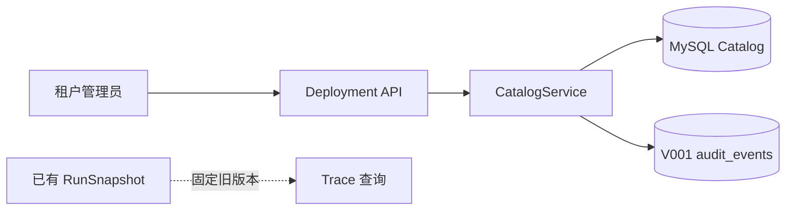
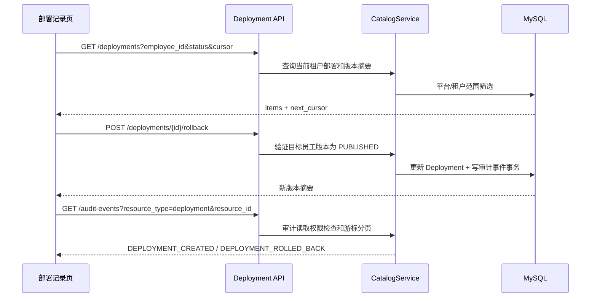

# 部署与审计查询

## 架构



Deployment 使用租户内稳定 ID，指向一个已发布的员工版本。创建和回滚操作在 MySQL 同一事务中写入 `deployments` 和既有 `audit_events`；既有 RunSnapshot 是运行时副本，Deployment 切换不会回写历史 Run。



## 数据模型

本变更使用已有表，不新增 SQL migration：

| 表 | 作用 | 查询/写入边界 |
|---|---|---|
| `deployments` | 当前 Deployment 员工版本、状态和创建时间 | `(platform_id, tenant_id, deployment_id)`；回滚更新当前指向 |
| `digital_employee_versions` | 回滚目标和版本摘要 | 目标版本必须存在且为 `PUBLISHED` |
| `audit_events` | 创建 Deployment 和回滚审计 | `(platform_id, tenant_id)` 过滤；不存员工指令或 Run 正文 |
| `runs.snapshot_json` | 运行时员工/Skill/Tool 固定版本快照 | Deployment 回滚不修改已有快照 |

审计事件使用现有 `audit_events` 字段：`actor_type=USER`、当前 `actor_user_id`、`resource_type=deployment`、`resource_id=deployment_id`、`event_type` 和 JSON 版本差异。payload 仅含员工 ID、回滚前版本和目标版本。

## API 与状态

以下路径均以 `/api/v1` 为前缀：

- `GET /deployments?employee_id=&status=&limit=&cursor=`：当前租户过滤，按 `deployment_id` 稳定升序游标分页；条目同时保留兼容 `version` 并返回 `version_summary`（版本状态、Skill/Tool 数量、ExecutionProfile 和 ModelRoute）。
- `POST /deployments`：管理员创建部署；服务端只接受 `PUBLISHED` 员工版本。
- `POST /deployments/{deployment_id}/rollback`：管理员回滚；目标必须为同租户 `PUBLISHED` 员工版本，服务端原子更新部署和审计事件。
- `GET /audit-events?resource_type=&resource_id=&event_type=&limit=&cursor=`：租户管理员按资源/事件过滤，按 `created_at DESC, event_id DESC` 倒序分页。

审计事件类型：

| 事件 | 触发条件 | payload |
|---|---|---|
| `DEPLOYMENT_CREATED` | 新建 Deployment | employee_id、目标版本 |
| `DEPLOYMENT_ROLLED_BACK` | Deployment 从当前版本切换至旧 PUBLISHED 版本 | employee_id、previous_version、version |

错误映射：未知或跨租户 Deployment/Employee 按 `404 RESOURCE_NOT_FOUND`；角色不足 `403 AUTHORIZATION_DENIED`；草稿/废弃版本不能部署或回滚，返回 `409 DEPENDENCY_VALIDATION_ERROR`；游标或过滤参数非法返回 `422 INVALID_ARGUMENT`。

## 验证

```bash
cd backend
python -m pytest tests/test_deployment_audit_api.py -q
AGENT_PLATFORM_MYSQL_TEST_ALLOW_CREATE_DATABASE=1 \
MYSQL_HOST=127.0.0.1 MYSQL_PORT=3306 MYSQL_USER=<一次性账号> MYSQL_PASSWORD=<一次性密码> \
python -m pytest tests/integration/test_mysql_catalog_service.py -q
python -m ruff check src tests
```

已验证：部署列表员工/状态过滤、版本摘要、创建/回滚审计事件查询、游标分页、成员不能查看审计、回滚目标必须 PUBLISHED，以及回滚前创建的 RunSnapshot 继续固定原员工版本。MySQL 保存 Deployment 和审计事件处于同一事务。

未验证：超大审计事件量的查询性能与归档策略；当前 API 使用 MySQL 索引 `(platform_id, tenant_id, resource_type, resource_id, created_at)` 和事件 ID 打破时间并列。
