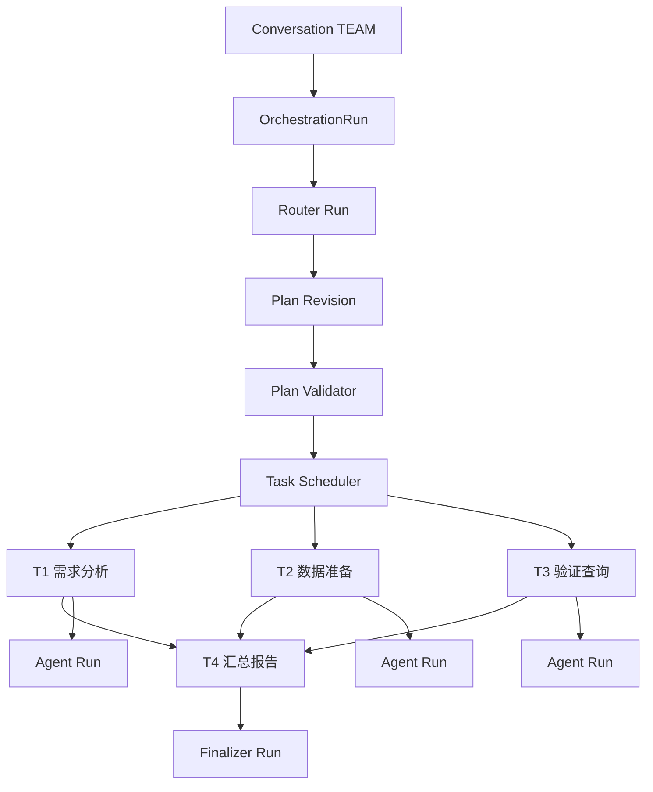
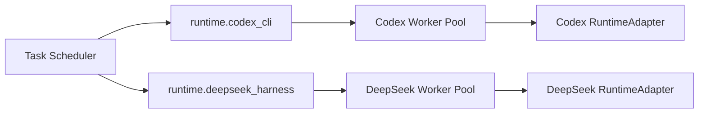

# Design

## Context

参见 `proposal.md` 的目标与范围。本项目当前已经有用户可见 Conversation、AgentBinding、独立 Session/Run、EngineProviderRegistry、RuntimeAdapter、ObjectStore、MediaAsset 和员工执行工作台。当前群聊路由仍以单个员工绑定和显式触发为中心，缺少父级编排、任务图、异构引擎 Worker Pool 和产出物交付索引。

本设计必须保持以下边界：

- `SINGLE_AGENT` Conversation 继续使用现有单员工 turn、固定 Session/Run 和工作台快照。
- `TEAM` Conversation 才创建 OrchestrationRun 和任务子 Run。
- EngineProvider、ModelRoute、Runtime Session 和凭据由受信 Run Worker 边界管理；API/Web 不注入模型 Secret，Router Agent 不直接访问供应商。
- 大段消息正文、Prompt、工具输出和文件正文进入租户隔离 ObjectStore，MySQL 保存引用、摘要和状态。
- 当前原型基线为 `docs/原型/agent团队群聊.html`，实现必须沿用其模式切换、团队配置、成员活动、任务详情、最近事件、运行配置和产出物交互。

## Goals / Non-Goals

**Goals:**

- 在同一执行工作台中提供单员工和团队两种互斥 Conversation 模式。
- 用不可变 TeamVersion 固定团队成员、路由/汇总 Agent、运行策略和交付策略。
- 用 OrchestrationRun + Task DAG 表达任务拆分、依赖、并行、认领、执行、取消和聚合结果。
- 为每个 EngineProvider 提供独立队列和 Worker Pool，按 `engine_name` 隔离领取和执行。
- 以任务能力要求、成员固定 EngineProfile/ModelRoute、并发额度和 Worker 健康为分配依据。
- 通过标准化 TaskOutput 和 ExecutionArtifact 跨引擎传递上下文并交付文件。
- 让用户能查看当前成员活动、任务详情、最近事件、引擎、Worker Pool、产出物和交付状态。
- 保持租户、角色、凭据、幂等、Trace、Usage 和现有单员工接口兼容。

**Non-Goals:**

- 本期不在运行中的 Session 中切换引擎。
- 本期不实现外部 IM 文件附件和人工任务认领；OutboundDelivery 扩展只保留接口边界。
- 本期不实现跨团队共享 Session、跨引擎私有上下文迁移或原始思考链展示。
- 本期不允许 Router Agent 直接修改数据库、执行工具或读取 SecretRef。

## Decisions

### 1. 用 ConversationMode 分流单员工和团队

新增 `conversation_mode`，值为 `SINGLE_AGENT` 或 `TEAM`，在 Conversation 创建时固定。

- `SINGLE_AGENT`：复用 `ConversationTurnService.submit()`，解析一个活动 AgentBinding，创建一个固定 Session 的 Run。
- `TEAM`：校验 ConversationTeamBinding，先持久化 PLANNING Orchestration 与 QUEUED Router Run；Run Worker 执行 Router 后服务端校验 DAG 并写入计划。CONFIRM 模式由用户确认后，Scheduler 为 READY Task 创建成员子 Run。
- `continue-as-team` 创建新的 TEAM Conversation，保存 `source_conversation_id`，不修改原 Conversation。

选择这个边界是为了避免把单员工 API 改造成同时猜测两种执行语义。替代方案是在同一个 turn 接口中根据绑定数量动态分流，容易让幂等、权限和错误响应不一致，因此不采用。

### 2. TeamVersion 采用不可变快照

团队草稿可以编辑，发布后生成不可变 TeamVersion。ConversationTeamBinding 固定 `team_id + team_version`，成员 AgentBinding 在创建 Conversation 时固定各自 Session。

TeamVersion 保存：

- Router Agent member_id。
- Finalizer Agent member_id。
- `planning_mode`、`assignment_mode`、`approval_mode`。
- 最大任务数、DAG 深度、编排并发数、成员并发数。
- 最大 Attempt、重规划次数、预算和超时。
- 失败继续策略和产出物交付策略。

替代方案是在每次任务执行时读取 Team 当前配置，会导致旧 Conversation 的成员、引擎和审批策略漂移，因此不采用。

### 3. 用 DAG 和父子 Run 表达编排

OrchestrationRun 是控制面父对象，不直接执行模型。每个 Task 通过 `TaskAttempt` 关联一个具体子 Run：



Task 的依赖只允许形成 DAG。Router Run 和成员子 Run 都以 QUEUED 状态持久化，并关联对象存储中的 SYSTEM 输入消息。Run Worker 按固定 Session/Run 快照领取并执行；工作台查询在 Run 终态后幂等推进 Orchestration、TaskAttempt、Artifact 与群聊消息。API 进程只处理控制面数据，不运行需要租户 SecretRef 的 Runtime。

### 4. 每个 EngineProvider 使用独立 Worker Pool

每个 RunSnapshot 都固定 `engine_name`。Run Worker 可设置 `AGENT_PLATFORM_WORKER_ENGINE_NAMES`，MySQL claim 会按其引擎过滤；一个 Worker Pool 可由多个同引擎进程组成，每个 Worker Pool 拥有自己的：

- Worker 进程和健康心跳。
- 并发上限和租约。
- EngineProviderAdapter 注册。
- 凭据解析边界。
- 队列长度和失败指标。



`claim_next_queued_run` 接受 `engine_names` 过滤。Worker 领取后再次校验 RunSnapshot、Session.engine_name 和本地 Provider 注册表。Provider 缺失、未启用或能力不符时，Run 进入稳定错误，不回退 Fake 或其他引擎。V014 的短期心跳按 Worker/EngineProvider 保存；工作台仅把最近 30 秒内有心跳的 Pool 标记为健康，并以 MySQL QUEUED Run/有效 lease 显示队列深度和活跃执行数。

### 5. 任务声明能力，成员固定引擎

Router Agent 输出 `required_capabilities`、候选成员和可选 preferred_engine。服务端通过 EngineProviderRegistry 做最终校验。任务不能向 Router Agent 传递 SecretRef 或供应商私有字段。

能力至少包括：

- `tool_calls`
- `mcp`
- `workspace`
- `sandbox`
- `approvals`
- `reasoning`
- `reasoning_effort`
- `reasoning_budget`
- `max_output_tokens`

用户锁定成员优先；成员必须为 ACTIVE 且满足能力。没有可用成员时任务为 `BLOCKED`，显示 `ENGINE_CAPABILITY_UNSUPPORTED` 或 `ENGINE_POOL_UNAVAILABLE`。

### 6. 跨引擎上下文只传标准化结果和 Artifact

上游任务完成后生成 TaskOutput：

- `task_id`
- `summary`
- `structured_output_ref`
- `artifact_ids`
- `source_engine`
- `source_model`
- `content_sha256`
- `created_at`

下游 RuntimeRequest 只接收经过权限过滤的任务摘要、结构化结果和 Artifact 引用。不同引擎的 runtime_session_ref、thread_ref、隐藏 Prompt 和原始思考链保持 opaque 或不进入下游上下文。

### 7. Artifact 使用现有 ObjectStore/MediaAsset 作为内容层

新增 `execution_artifacts` 作为执行层索引，复用 `MediaAsset` 保存文件元数据和 ObjectStore 保存正文。ArtifactCollector 按引擎收集 Runtime 文本、Workspace 文件、SQL、补丁和报告；RuntimeAdapter 不直接写 Artifact 表。

DeliveryService 生成 Delivery Manifest，ArtifactDelivery 记录预览、下载、打包和外部渠道投递状态。Artifact 是不可变内容；重试产生新的 Attempt/Artifact 版本并保留来源链。

### 8. 工作台统一上下文但分离操作面

原型中的顶部模式切换和右上角上下文是实现基线：

- 团队模式：右上角只显示当前团队、团队配置、新建团队；团队配置弹框包含成员 EngineProvider、ModelRoute、能力和 Worker Pool，不额外显示运行配置按钮。
- 单员工模式：右上角只显示当前数字员工和运行配置；右侧显示单 Session/Run 快照。
- 团队右侧显示任务/产出物；成员当前活动的“查看任务”和“查看最近事件”分别打开任务详情弹框和事件弹框。
- 单员工的“以团队协作继续”创建新 TEAM Conversation。

### 9. 事件和 Trace 采用追加事件 + 统一关联键

Orchestration、Task、TaskAttempt、Run、Worker Pool 和 Artifact 事件使用追加写入。所有事件关联：

```text
platform_id, tenant_id, conversation_id, orchestration_id,
plan_revision, task_id, attempt_id, run_id, trace_id,
member_id, engine_name, worker_pool, sequence
```

原始 Prompt、Secret、隐藏思考链和完整工具响应不写入用户可见事件。工作台按服务端 sequence 处理同秒事件。

## Data Model and Migration

### 1. 新增表

所有表都必须使用 `platform_id`、`tenant_id` 租户复合范围，表和字段写入准确中文 `COMMENT`，索引覆盖租户、状态、更新时间和幂等键。

| 表 | 关键字段及中文含义 |
|---|---|
| `teams` | `team_id` 团队标识；`name` 团队名称；`status` 草稿/发布状态；`created_by` 创建用户 |
| `team_versions` | `team_id` 团队标识；`version` 不可变版本；`router_member_id` 路由成员；`finalizer_member_id` 汇总成员；`policy_json` 编排和交付策略 |
| `team_members` | `member_id` 成员标识；`team_version` 所属版本；`employee_id/version` 员工版本；`deployment_id` 部署；`role` 角色；`capabilities_snapshot_json` 能力快照；`max_concurrency` 并发上限 |
| `conversation_team_bindings` | `conversation_id` 对话标识；`team_id/version` 固定团队版本；`orchestration_mode` 编排模式；`approval_mode` 审批模式 |
| `orchestration_runs` | `orchestration_id` 编排标识；`input_message_id` 输入消息；`plan_revision` 计划版本；`status` 聚合状态；`idempotency_key` 幂等键；`counters_json` 任务计数 |
| `orchestration_tasks` | `task_id` 任务标识；`orchestration_id` 父编排；`title` 任务名称；`status` 任务状态；`required_capabilities_json` 能力要求；`assigned_member_id` 分配成员；`output_ref` 结果引用 |
| `orchestration_task_dependencies` | `task_id` 下游任务；`depends_on_task_id` 上游任务；`condition` 依赖条件 |
| `orchestration_task_attempts` | `attempt_id` 尝试标识；`task_id` 任务；`attempt_no` 尝试次数；`run_id` 子 Run；`engine_name` 执行引擎；`worker_pool` Worker 池；`error_code` 错误类别 |
| `orchestration_task_events` | `event_id` 事件标识；`task_id` 任务；`actor_type/id` 操作者；`event_type` 事件类型；`payload_json` 脱敏事件数据；`sequence` 服务端顺序 |
| `execution_artifacts` | `artifact_id` 产出物标识；`task_id/run_id` 来源任务和 Run；`media_asset_id` 内容资产；`source_engine` 来源引擎；`visibility` 可见范围；`status` 产出物状态 |
| `artifact_links` | `artifact_id` 产出物；`parent_artifact_id` 组合来源；`relation_type` 输入/输出/打包关系 |
| `artifact_deliveries` | `delivery_id` 交付标识；`artifact_id` 产出物；`channel_name` 渠道；`idempotency_key` 幂等键；`status` 投递状态；`external_message_id` 外部消息标识 |

### 2. 现有表变更

- `conversations` 增加 `conversation_mode`，说明单员工或团队模式。
- `runs` 增加 `orchestration_id`、`task_id`、`parent_run_id`、`attempt_no`。
- `agent_bindings` 增加 `team_member_id` 和角色/能力快照引用。
- 必要的 `messages`/`conversation_participants` 索引保持现有租户和顺序语义。

### 3. Migration 和回滚

1. 使用 V011 创建团队编排表和兼容字段；使用 V012 为 `orchestration_task_attempts` 增加 `worker_id` 与 `fencing_token`；使用 V013 使 TEAM Conversation 能为同一员工的多个 TeamMember 保存独立 Session 绑定；使用 V014 保存按 EngineProvider 归属的短期 Worker 心跳。每项都保留对应 down migration 和中文 COMMENT。
2. 先创建团队、编排、任务、Attempt、事件和 Artifact 表，再增加现有表 nullable 关联字段。
3. 回填已有 Conversation 的 `conversation_mode=SINGLE_AGENT`，不创建团队绑定。
4. 添加中文表/字段 COMMENT、租户复合索引、状态 CHECK 和幂等唯一键。
5. MySQL 集成测试通过 `information_schema.TABLES` 和 `information_schema.COLUMNS` 验证注释、字段和索引。
6. 上线前停止新 TEAM Conversation 创建，等待或取消未完成编排；回滚时先停调度，再保留已交付 Artifact，最后删除新表或回退 nullable 字段。
7. 历史 migration 不改写；新增注释或元数据使用 forward migration。

## API and State

### Conversation/Team

```http
POST /api/v1/teams
POST /api/v1/teams/{team_id}/versions/{source_version}/fork
POST /api/v1/teams/{team_id}/versions/{version}/members
DELETE /api/v1/teams/{team_id}/versions/{version}/members/{member_id}
PUT /api/v1/teams/{team_id}/versions/{version}/policy
PUT /api/v1/teams/{team_id}/versions/{version}/roles
POST /api/v1/teams/{team_id}/versions/{version}/publish
GET /api/v1/teams/{team_id}/versions/{version}
GET /api/v1/teams/{team_id}/worker-pools
POST /api/v1/conversations
POST /api/v1/conversations/{conversation_id}/continue-as-team
POST /api/v1/conversations/{conversation_id}/team-turns
GET /api/v1/conversations/{conversation_id}/team-activity
```

### Orchestration/Task

```http
POST /api/v1/conversations/{conversation_id}/orchestrations
GET /api/v1/orchestrations/{orchestration_id}
GET /api/v1/orchestrations/{orchestration_id}/tasks
GET /api/v1/orchestrations/{orchestration_id}/events?cursor=...
POST /api/v1/orchestrations/{orchestration_id}/plan/approve
POST /api/v1/orchestrations/{orchestration_id}/pause
POST /api/v1/orchestrations/{orchestration_id}/resume
POST /api/v1/orchestrations/{orchestration_id}/cancel
POST /api/v1/orchestrations/{orchestration_id}/replan
PATCH /api/v1/orchestration-tasks/{task_id}
POST /api/v1/orchestration-tasks/{task_id}/retry
POST /api/v1/orchestration-tasks/{task_id}/cancel
```

### Artifact/Delivery

```http
GET /api/v1/orchestrations/{orchestration_id}/artifacts
GET /api/v1/orchestration-tasks/{task_id}/artifacts
GET /api/v1/artifacts/{artifact_id}
GET /api/v1/artifacts/{artifact_id}/preview
POST /api/v1/artifacts/{artifact_id}/download-url
GET /api/v1/artifacts/{artifact_id}/download
POST /api/v1/orchestrations/{orchestration_id}/deliver
POST /api/v1/artifact-deliveries/{delivery_id}/retry
```

### 单员工兼容

现有 `POST /api/v1/conversations/{conversation_id}/turns`、消息、Run、Trace、取消和运行策略接口保持不变。向 TEAM Conversation 调用单员工 turn 返回 `CONVERSATION_MODE_MISMATCH`；向 SINGLE_AGENT Conversation 调用团队编排接口返回相同类别的模式错误。

## Permissions and Credential Boundaries

| 操作 | Owner/管理员 | Member | Viewer | Router/Worker |
|---|---:|---:|---:|---:|
| 创建/编辑团队草稿 | 是 | 按授权 | 否 | 否 |
| 发布 TeamVersion | 是 | 否 | 否 | 否 |
| 查看成员、引擎和 Worker Pool | 是 | 是 | 是 | 内部 |
| 提交团队需求 | 是 | 是 | 否 | 否 |
| 确认计划、分配、重试、取消 | 是 | 按策略 | 否 | 请求/执行 |
| 查看任务详情和最近事件 | 是 | 是 | 是 | 内部 |
| 预览/下载 Artifact | 按可见性 | 按可见性 | 只读 | 否 |
| 发起外部交付 | 是 | 按策略 | 否 | 否 |

- API 从认证 IdentityContext 获取 platform/tenant/user，不信任请求体身份字段。
- Router Agent 只能看到脱敏成员能力、负载和任务摘要；不能读取 SecretRef 明文。
- Worker 在本地解析接收方租户 SecretRef，使用 RunSnapshot 固定的 ModelRoute。
- RunSnapshot、Trace、TaskEvent 和 Artifact 元数据不写入 API Key、密码、Token 或环境变量明文。
- ObjectStore 通过 platform + tenant + MediaAsset 授权读取；下载返回短期签名 URL。

## Errors, Retry, Idempotency and Cancellation

- 计划错误：`PLAN_INVALID`、`TASK_GRAPH_CYCLE`、`TEAM_MEMBER_NOT_AVAILABLE`。
- 引擎错误：`ENGINE_CAPABILITY_UNSUPPORTED`、`ENGINE_POOL_UNAVAILABLE`、`ENGINE_MODEL_INCOMPATIBLE`、`MODEL_SECRET_UNAVAILABLE`。
- 运行错误：沿用 `FAILED`、`UNKNOWN`、`CANCELLED`，不自动重放可能已到达供应商的请求。
- 幂等范围：`conversation_id + idempotency_key`、TaskAttempt、Artifact 上传和 ArtifactDelivery。
- 可重试错误回到 `READY` 或创建新的 Attempt；权限、能力、协议和凭据错误不自动重试。
- 父级取消停止新任务派发，向运行中的子 Run 发出取消请求，等待 Worker 释放租约后聚合为 `CANCELLED`。
- TaskAttempt 使用 lease/fencing token 防止旧 Worker 在租约失效后写入终态。

## Observability and Audit

必须关联 `conversation_id`、`orchestration_id`、`plan_revision`、`task_id`、`attempt_id`、`run_id`、`trace_id`、`member_id`、`engine_name` 和 `worker_pool`。

指标包括：计划延迟、DAG 深度、任务等待、Worker Pool 队列长度、并发数、认领延迟、Run 成功率、重试、重新分配、取消、Token/费用、Artifact 收集和交付耗时。

审计事件包括：Team 草稿保存/发布、Conversation 绑定、计划生成/确认、成员分配、Worker 认领、Run 阶段、状态变化、Artifact 创建、交付和权限拒绝。

## Prototype Mapping

实现必须逐项对照 `docs/原型/agent团队群聊.html`：

- 执行工作台顶部模式切换。
- 团队模式当前团队、团队配置、新建团队和成员当前活动。
- 单员工模式当前数字员工、运行配置、Session/Run 快照和“以团队协作继续”。
- 团队任务队列、状态统计、成员活动任务详情弹框和最近事件弹框。
- Router 计划确认弹框、暂停/恢复、任务重试/取消。
- Artifact 预览、下载、交付确认、部分失败交付。
- 加载、空、错误、阻塞、只读、扫描中和成功状态。

原型使用演示数据，不连接真实服务、不包含凭据；实现中的字段、按钮、状态颜色和中文文案必须与原型保持一致。

## External Services and Responsibility Boundaries

- Codex CLI、DeepSeek Harness 和 Fake Runtime：本期只接入已注册的 RuntimeAdapter 与独立 Worker Pool；不新增供应商 SDK 或外部网关。
- new-api、外部 IM、Dadi/DolphinScheduler 等：本期不连接，后续通过明确的 Provider/Channel Adapter 和 OutboundDelivery 扩展。
- ModelRoute 目录发现和 SecretRef 解析仍由现有模型管理/Worker 边界负责，编排服务只引用已授权的 route_id。

## Verified / Unverified

### 已验证

- 现有项目已具备 Conversation、AgentBinding、Session/Run、EngineProviderRegistry、RuntimeAdapter、ObjectStore 和 MediaAsset 基础。
- 当前原型已覆盖模式切换、团队配置、单员工运行配置、成员活动、任务/事件弹框和产出物交付演示。
- proposal、delta spec、中文设计文档和原型字段已对齐。

### 未验证

- 多个 Worker Pool 的真实跨进程部署、队列过滤和租约 fencing。
- Router Agent 结构化计划的真实模型输出和计划校验。
- TaskAttempt/Artifact/Delivery 的 MySQL 事务、并发和 GC 保护。
- Codex/DeepSeek Workspace 产出物收集和跨引擎上下文注入。
- 外部渠道附件投递和运行中动态重规划。

## Validation Commands

```bash
openspec validate agent-team-orchestration --strict
python -m pytest backend/tests/test_engine_provider_registry.py backend/tests/test_runtime_adapter.py -q
python -m pytest backend/tests/test_session_runtime_resolution.py -q
python -m pytest backend/tests/test_content_store.py backend/tests/test_mysql_migration_runner.py -q
python -m pytest backend/tests/test_team_orchestration.py backend/tests/test_worker_pool_routing.py -q
python -m pytest backend/tests/test_execution_artifacts.py -q
python -m pytest backend/tests/integration/test_mysql_team_orchestration.py -q
git diff --check
```
