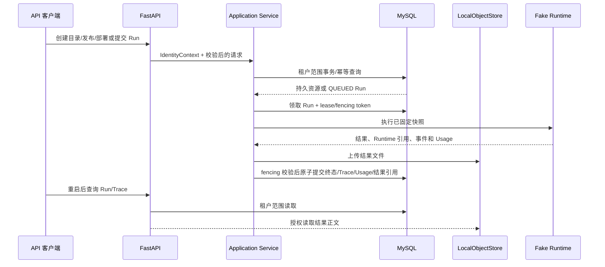

# 设计

## 背景

当前 FastAPI 应用默认创建进程内 `InMemoryCatalogRepository`、`ControlPlaneService` 和 `ConversationService`，服务重启会丢失目录、Session、Run、Trace 与消息索引。V001/V002 已提供租户、用户、Session/Run、Message/chunk、上传 intent 和 GC 基础表；V003 尚未作为共享环境 migration 应用。LocalObjectStore 原来把授权元数据保存在内存中，单纯保留磁盘文件不足以证明重启后仍是有效租户对象。

Harness Session/Run schema 与平台领域对象通过后端自己的应用/领域类型和 Repository 分离。后端可以由自己的适配器访问共用 MySQL 表，但不能导入 Harness persistence model。当前只要求 LocalObjectStore 可运行，ObjectStore port 保持 provider-neutral。

## 目标与非目标

### 目标

- 让 MySQL 成为目录、部署、对话、Session、Run、Trace、Usage、上传 intent 和对象元数据的事实源。
- 每条 Repository 查询和关联都使用 `platform_id + tenant_id` 范围。
- 服务重启后能恢复本地对象字节和对应授权元数据。
- 替换仓储时保持幂等、lease/fencing、明确的 `UNKNOWN` 结果和既有 API 契约。
- 在一次性 MySQL 8.4 实例中验证完整 API → MySQL → LocalObjectStore → Fake Runtime → MySQL/Trace 链路。
- 显式选择存储提供方，为后续 MinIO/S3/OSS/COS 适配器保持稳定接口。

### 非目标

- 构建数字员工/Skill/Tool 管理 UI 或聊天工作台；持久 API 稳定后再开独立 Change。
- 在本 Change 中增加 MinIO、S3、OSS、COS、云 KMS 或生产对象存储部署。
- 引入外部队列、Redis 或多节点调度器；本 Change 以 MySQL 协调 Run。
- 接入真实 DeepSeek/Codex Runtime、Dadi 身份/模型网关、IM 渠道或生产 Kubernetes Sandbox。
- 自动重放 Runtime 结果不确定的调用，或把 `UNKNOWN` Run 报告为成功。

## 决策

### 1. 复用 V001/V002 的 Session、Run、Message 和清理基础表

V001/V002 保持不可变。后端用自己的 DTO 和 SQL adapter 访问既有 `sessions`、`runs`、`messages`、`message_chunks`、`content_upload_intents`、`content_gc_queue` 表。Deployment/版本快照、Trace 关联、Runtime opaque 引用、上下文快照、Profile/ModelRoute 引用等平台字段在 V003 中增量添加。

V003 在首次应用到任何共享数据库前必须冻结 schema 和 checksum。如果共享环境已经应用旧 V003 草案，不能改写已应用 migration，必须制定前向 V004。应用启动只做只读 schema 检查；不得执行 DDL。

**备选方案：**新建另一组 Platform Session/Run 主表。拒绝原因：会为同一个生命周期创建两个数据源，消息/chunk 外键和 fencing 语义也会分裂。

### 2. MySQL Repository 放在 Infrastructure 边界

Application Service 持续接收已解析的 `IdentityContext`。MySQL Repository 实现内存仓储的接口，每个查询都显式绑定 platform/tenant 谓词，复合外键使用相同范围。SQL row 不进入 Domain。

首批持久仓储覆盖：

- Catalog：数字员工、不可变版本、Skill、Tool、Profile、ModelRoute、Deployment 和能力引用。
- 组合关系：有序员工到 Skill/Tool 版本绑定，以及 Skill 声明的 Tool 版本 allowlist。
- 对话与执行：Conversation、AgentBinding、Session、Run、Message 和 message chunk。
- 可观测性：Trace Span、Runtime 引用、Usage 以及 append-only 用量调整。
- 对象元数据：上传 intent、MediaAsset/对象引用和 GC 队列。

FastAPI app factory 在显式 MySQL 配置时注入 MySQL Repository。内存实现只供单元测试和显式 Fake 模式使用；MySQL 连接失败不得静默回落到内存仓储。

**备选方案：**通过环境变量静默切换所有仓储，配置缺失时回退 Fake。拒绝原因：生产数据库故障可能被误认为成功写入，但数据会在重启时消失。

### 3. MySQL 与 LocalObjectStore 作为可恢复的双资源操作

MySQL 与文件 rename 无法共用一个原子事务，因此上传和删除使用持久化 intent/GC 状态：

```text
上传：MySQL 创建租户范围 UPLOADING intent 和 lease
    → 本地临时文件写入/fsync
    → 原子 rename 并同步目录
    → MySQL 校验 lease/摘要并提交 MediaAsset 引用
失败：留待 bounded retry/GC；未提交对象引用不可读取

删除：MySQL 事务撤销读取并入队
    → GC Worker 幂等 unlink
    → MySQL 标记清理完成
```

MySQL MediaAsset 是重启后的授权来源。对象引用包含平台/租户范围，但磁盘路径只使用服务端生成的随机 key；客户端文件名不会形成文件系统路径。读取检查租户元数据和文件内容摘要。GC 保护有效 Message、chunk、Run 结果、Runtime 引用和未过期上传 intent。过期 intent 的迟到写入不能发布引用；若清理扫描后又出现对象，迟到提交会重新入队。

Local 文件位于 Web root 之外，文件权限限制到服务账号。显式加密使用 AES-GCM；密钥只通过 `SecretProvider`/`SecretRef` 短时读取，密钥版本保存在 MediaAsset 和 UploadIntent 元数据中。没有可用密钥时拒绝要求加密的对象操作；不得声称未加密对象是静态加密。

**备选方案：**直接写最终 key，再插入 DB row。拒绝原因：数据库提交失败会留下没有授权记录且不受控的对象。

### 4. LocalObjectStore 是当前唯一要求的提供方

`StorageProfile.provider=local` 解析为显式配置的本地 root。未安装的 provider 返回明确 unavailable 错误，不能回退到本地磁盘。API、MediaAsset、UploadIntent、RuntimeAttachmentRef 保持 provider-neutral，后续 Change 可让 MinIO/S3/OSS/COS 实现同一 port，并单独验证密钥、加密和签名 URL。

**备选方案：**为模拟生产强制使用 MinIO。拒绝原因：用户选择了 local-first 验证路径；云对象服务不是验证 MySQL 事务、租户隔离、重启和 GC 语义的前置条件。

### 5. 管理 UI 与 API 契约分开

本 Change 让目录/Profile/Deployment API 持久化，并补齐验证重启和租户隔离所需的查询能力；不做 Dashboard、Skill editor、发布向导或聊天 UI。MySQL-backed catalog API 通过重启和租户隔离测试后，即可并行启动管理台 Change，无需等待 MinIO 或真实 Runtime。Session/聊天工作台在 Message、Run、Trace API 具备跨进程恢复后另行建设。

### 6. Run 执行可恢复，保守处理不确定结果

提交 Run 时先写幂等键、请求摘要、员工/Profile/ModelRoute 快照、Trace ID 和 QUEUED 状态，再由 Worker 领取并递增 fencing token。每次状态转换验证当前 token。Runtime 引用和最终对象引用只能由当前 lease 提交。本 Change 的 Fake Runtime 由同步控制面触发同一提交协议；后续可以替换为独立 Worker，不改变状态契约。

如果 Runtime 可能已经启动，但进程在终态提交前退出，Run 转为 `UNKNOWN`。恢复只能检查可信的 opaque Runtime 引用；在未验证 resume 能力前不自动重放。Fake Runtime 是本地 E2E 目标，真实 Runtime 认证留到后续 Change。

### 7. Deployment 是独立可回滚记录

Deployment 以自身 `deployment_id` 标识一次可回滚部署；同一员工版本可以被多次部署，员工和版本组合使用普通复合索引，不加唯一约束。回滚更新目标 Deployment 指向的版本，同时保留其他部署记录和既有 Run 的版本快照。

### 8. Migration 与回滚策略

`docs/migrations/` 是可执行 migration SQL 的唯一目录。Migration Runner 记录版本/checksum 并取得部署级锁；V001/V002 不改。V003 在首次共享应用前冻结；如果已在共享环境应用则使用 V004。Migration 采用增量方式，正向和 disposable DB 回滚路径都要验证。生产应用回滚保留扩展 schema；破坏性 DDL 必须单独批准备份和恢复计划。

本 Change 每张新表和每个新建/变更字段都有中文 MySQL table/column `COMMENT`。MySQL 集成检查查询 `information_schema.TABLES` 与 `information_schema.COLUMNS` 验证注释确实落库。V001/V002 是逐字节不变的历史 migration；中文注释规则适用于 V003/V004 新建或变更对象。

### 9. 兼容 V001/V002 的 CHAR(26) 主键宽度

V001/V002 的 Session、Run、Message、upload intent、GC 主键使用 `CHAR(26)`。写入这些列的后端 ID 必须是恰好 26 字符的 opaque ID；带资源类型前缀或 UUID hex 只用于 SQL 定义足够长的其他字段。Repository 和集成测试验证 DB 往返不截断。不得在本 Change 中扩宽 V001/V002 主键。

**备选方案：**把历史 key 列都扩成 `VARCHAR(64)`。拒绝原因：会改变 V001/V002 外键定义并增加兼容风险。

### 10. Fake identity seed 显式执行

V001 Session 行引用平台、租户和用户。本地 Fake IdentityProvider 仍作为显式本地模式的请求身份源，但普通 API 启动不偷偷插入 identity rows。测试与本地环境使用显式幂等 seed command/fixture；生产身份同步由配置的身份适配器负责。

## 数据与事务时序



## 风险与取舍

- **风险：**Harness 与平台生命周期共用 V001/V002 表。→ 使用 backend-owned DTO，不导入 Harness model，V003 只做增量平台字段。
- **风险：**V003 草案可能被不一致应用。→ rollout 前核对 migration history/checksum；已应用旧 V003 时使用 V004。
- **风险：**文件系统和 MySQL 不能原子提交。→ 先写 intent，校验后发布引用，孤儿由可重试 GC 清理。
- **风险：**本地盘丢失会丢失正文。→ LocalObjectStore 仅用于单节点本地/预生产，生产多节点必须规划共享存储与备份。
- **风险：**密钥丢失或轮换会使加密对象不可读。→ 记录 key version，通过 SecretRef 解析旧版本；启用生产敏感数据前先演练备份/恢复。
- **风险：**Worker/Runtime 故障导致结果不确定。→ 保留 UNKNOWN，不自动重放。
- **风险：**仓储替换会改变事务和查询语义。→ 为内存路径已有行为补齐 MySQL 集成和跨进程测试。

## Migration 计划

1. 检查一次性 MySQL 版本和 migration history；冻结 V001/V002 checksum，核实 V003 是否仍未应用到共享环境。
2. 完成 V003 Catalog、Profile、Conversation、Session/Run 快照、Trace/Usage 和 LocalObjectStore 元数据 schema；共享环境已有 V003 时使用 V004。
3. 增加显式 migration runner、版本/checksum 检查；应用启动只做只读预检。
4. 实现 MySQL Repository 并经 app factory 注入；测试使用内存实现，V001/V002 对应主键使用 26 字符 opaque ID。
5. 连接 LocalObjectStore 与 MediaAsset/upload-intent/GC 元数据，验证重启、部分失败、迟到 PUT、删除和重试。
6. 在一次性 MySQL 8.4 + LocalObjectStore 环境运行 API 跨进程、租户和事务故障测试。
7. 回滚应用但保留增量 schema。破坏性回滚前先恢复 DB/对象备份；本 Change 不自动删除业务数据。

## 待确认事项

- V003/V004 选择由上线前 migration history 核对确定；未记录核对结果前不得修改共享数据库。
- 若要保留敏感 Raw Payload，需要部署配置明确本地 SecretProvider 的密钥来源与版本轮换流程。
