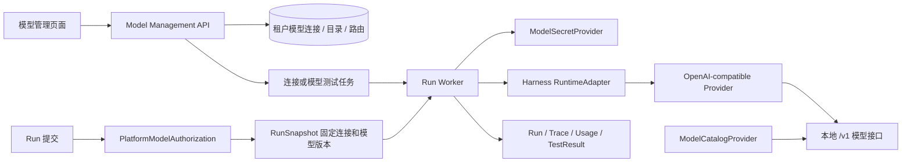

# Design

## Context

See [proposal.md](proposal.md) for motivation and scope. The existing `ModelProfile` combines tenant, provider, endpoint, protocol, model ID, `SecretRef`, and request parameters; `ModelRoute` adds a tenant-scoped alias and status. The API supports create/list, and the employee-version editor can select routes.

The execution path is not connected to that configuration yet. `RunSnapshot` and `RuntimeEmployeeContext` carry only `model_route_id`; the DeepSeek Harness factory reads provider/model from process configuration. `HarnessRuntimeAdapter` currently estimates usage from whitespace counts. The local OpenAI-compatible endpoint is reachable from the Docker Worker through `host.docker.internal`, while unauthenticated `/v1/models` returns HTTP 401.

## Goals / Non-Goals

**Goals:**

- Model connections, model catalog entries, and routes are all tenant-scoped. One connection can serve multiple model IDs.
- Run submission pins the exact non-secret model configuration that the Worker will use.
- Connection and model tests use the same connection configuration and secret resolution path as normal calls.
- Keep model invocation, model discovery, and model authorization behind separate provider-neutral boundaries.
- Preserve the existing employee-to-ModelRoute relationship and support a later gateway catalog/authorization adapter.

**Non-Goals:**

- Starting or integrating Dadi Model Gateway or new-api in this change.
- Implementing gateway-issued credentials, per-user Dadi grants, or user-center integration.
- Storing raw API keys in application tables or making them available to the browser after creation.
- Exposing arbitrary model parameters or tool schemas to end users.

## Decisions

### Tenant-owned connection, catalog item, and route

Separate endpoint configuration from model identity so one URL and credential can expose many models without duplicating connection configuration.

| Object | Stored data | Tenant boundary |
|---|---|---|
| `ModelConnection` | Provider kind, protocol, base URL, `SecretRef`, catalog mode, status and version | `platform_id + tenant_id` |
| `ModelCatalogItem` | External model ID, display name, capabilities, context window and discovery source | Same tenant and parent connection |
| `ModelRoute` | Stable alias, connection ID, model ID, generation parameters, status and version | Same tenant as connection and catalog item |
| `ModelTestRecord` | Test kind, target, state, latency, usage, request reference and error category | Same tenant; no raw prompt/response or credential |

Add a forward migration under `docs/migrations/` and retain a reversible rollback. Backfill each existing ModelRoute by grouping current records by tenant/provider/endpoint/protocol/SecretRef into ModelConnections; create one catalog entry per distinct model name and point the route to it. Preserve existing API response fields during migration, deriving them from the referenced connection/model where needed. Every new or changed table and column requires a Chinese MySQL `COMMENT`; migration integration tests must verify comments through `information_schema`.

### Provider, catalog, and authorization are separate boundaries

- `ModelProvider` performs a completion using a pinned route. Phase one implements the OpenAI-compatible local endpoint through the existing Harness custom-provider path.
- `ModelCatalogProvider` lists models from a connection or accepts manually entered IDs. Phase one supports authenticated `GET /v1/models` and manual entry when discovery is unavailable.
- `ModelAuthorizationProvider` checks whether an identity may use a route. Phase one applies platform tenant and employee-access rules. A future Dadi adapter can return models authorized for the current identity and perform a final gateway-side check.

The connection records a `provider_kind`; catalog and authorization sources are independent configuration. A Dadi-to-new-api deployment is represented as one Dadi connection from Agent Platform. A direct new-api connection is added only when the platform intentionally bypasses Dadi.

Gateway-authorized model availability is identity-specific. Do not store a user's gateway authorization result as a tenant-wide catalog status. Cache catalog metadata separately from authorization decisions, and re-check gateway permission when a Run executes.

### Connection test and model test are distinct jobs

- A connection test resolves the SecretRef and checks endpoint authentication and catalog discovery. For OpenAI-compatible connections, `GET /models` is used when supported. A 404 or unsupported list operation reports `catalog_unavailable` and permits manual model entry; it is not silently treated as a successful catalog sync.
- A model test sends one synthetic, non-streaming completion with no tools and a small output limit. It tests the selected model ID, not just the endpoint. The UI asks the administrator to confirm because this is a real model call and may incur cost.
- Both are asynchronous jobs stored in `ModelTestRecord` and processed by the existing Run Worker process. No extra Worker container is introduced. The API returns a test ID and `QUEUED`; clients poll `QUEUED`, `RUNNING`, `SUCCEEDED`, `FAILED`, or `UNKNOWN`.
- Connection tests never generate model output. Model-test timeouts with uncertain provider completion become `UNKNOWN` and are not automatically retried.
- Results contain status, latency, model ID, provider request ID, available usage, and a stable sanitized error category. They do not retain API keys, full prompts, raw response payloads, or employee content.

### Secret references are resolved only in the Worker

The management UI selects or records a SecretRef; it never returns a secret value. Add an environment-backed `ModelSecretProvider` for the local phase, mapping a tenant-scoped reference to a Worker environment variable. The existing `SecretProvider` protocol remains the boundary for a future vault implementation. Connection and route `repr`, API serialization, snapshots, test results, and logs redact credentials.

The management role that creates or changes a connection is also the only role that can bind a SecretRef. End-user Run submission cannot override the endpoint, model ID, protocol, or credential.

### RunSnapshot pins a model execution configuration

At Run creation, resolve the employee's ModelRoute and validate that the route, connection, and model all belong to the current platform and tenant, are active, and are allowed by platform policy. Persist an immutable snapshot containing:

- route ID/version and alias;
- connection ID/version and provider kind;
- model catalog ID and external model name;
- protocol, endpoint, request parameters, and pricing snapshot reference;
- SecretRef metadata only.

The Worker revalidates current platform authorization immediately before dispatch, but uses the snapshot's endpoint and model data. A new route/connection version affects new Runs only. The Worker resolves the SecretRef at dispatch and passes the configuration to `RuntimeRequest` as a typed model-execution value. `HarnessRuntimeAdapter` maps it into the DeepSeek Harness custom OpenAI-compatible provider configuration. For the local Docker Desktop endpoint, the configured URL uses `http://host.docker.internal:63072/v1`, not container-local `localhost`.

### Model usage and status are explicit

If the Harness SDK exposes provider usage or request IDs, normalize them into platform `UsageRecord`/`ModelCallUsage` and attach them to Run, Trace, and model-test results. If it does not, keep `ESTIMATED` and include the estimation method. Do not replace current estimates with token counts inferred from model names or pricing assumptions.

Connection status is `ACTIVE` or `DISABLED`; its last probe state is `NOT_TESTED`, `SUCCEEDED`, or `FAILED`. Model routes are `ACTIVE` or `DISABLED`. Test jobs use the states above. Stable errors include missing credential, invalid credential, endpoint unreachable, catalog unavailable, model not found, authorization denied, timeout, invalid response, and result unknown.

### Management UI and API

The existing [模型管理原型](../../../docs/原型/模型管理.html) is the reference for the initial page structure: connection and model catalog, model routes, and authorization source. Replace its demonstration states with real APIs.

Proposed endpoints:

| Method and path | Purpose |
|---|---|
| `GET/POST /model-connections` | List and create connections in the caller's tenant |
| `GET/PUT /model-connections/{id}` | Read or publish a new connection version |
| `POST /model-connections/{id}/sync-models` | Queue model catalog discovery |
| `GET /model-connections/{id}/models` | List catalog items for the tenant connection |
| `POST /model-connections/{id}/tests` | Queue a connection test |
| `POST /model-routes` | Create an alias for one tenant model |
| `POST /model-routes/{id}/tests` | Queue an explicit inference test |
| `GET /model-tests/{id}` | Poll test status and sanitized result |
| `GET /model-routes/selectable` | List active routes available to the current identity |

Employee version editing keeps binding a ModelRoute. It queries `selectable` routes, not raw ModelConnections or unfiltered model IDs. The test button includes a confirmation describing that it sends a real bounded prompt.

## Data Flow



## State and Failure Handling

| Operation | State/result | Behavior |
|---|---|---|
| Connection created | `ACTIVE`, probe `NOT_TESTED` | Can be edited/tested; not marked verified |
| Connection test | `QUEUED` → `RUNNING` → `SUCCEEDED/FAILED` | No completion request; safe catalog failures allow manual entry |
| Model test | `QUEUED` → `RUNNING` → `SUCCEEDED/FAILED/UNKNOWN` | One bounded inference; unknown is not retried |
| Route disabled or unauthorized | Run preparation `FAILED` | Reject before provider request |
| Credential resolution fails | Test/Run `FAILED` | Stable error, no secret text in logs |
| Provider response uncertain after timeout | Test/Run `UNKNOWN` | No automatic replay to avoid duplicate charge |

## Migration Plan

1. Add a new forward migration (next available version after checking the repository) creating tenant model connections, catalog records, and model-test records; extend route references and snapshot persistence. Add Chinese table/column comments and down migration boundaries.
2. Backfill existing ModelRoutes into one connection per unique tenant/provider/endpoint/protocol/SecretRef tuple and one catalog row per distinct model name. Keep the legacy API shape during rollout.
3. Deploy Backend and Worker with dual read of legacy fields/new references, then switch new writes to connection-backed routes.
4. Deploy the management UI and employee route selector. Confirm migrated routes remain selectable before removing any compatibility read path in a later change.

Rollback keeps the old ModelRoute fields readable. Do not drop old columns or rewrite applied migrations in this change; a later migration can remove compatibility fields after all deployments use connection references.

## Risks / Trade-offs

- **[Risk] An administrator can configure a URL that reaches internal services.** → Restrict schemes, reject credentials embedded in URLs, require the model-management permission, and apply Worker egress/host allowlists with an explicit local-development allowance for `host.docker.internal`.
- **[Risk] A model test can incur provider cost or return an uncertain result after timeout.** → Require explicit confirmation, cap prompt/output/time, record usage, and never automatically retry `UNKNOWN` tests.
- **[Risk] Local endpoint rejects discovery or uses a nonstandard model ID.** → Support manual catalog entries and provide a separate inference test for the selected ID.
- **[Risk] Current Harness Runtime reports estimated whitespace-based usage.** → Preserve `ESTIMATED` until the pinned SDK exposes exact usage; add provider request IDs only when available.
- **[Risk] Environment-backed secrets are not a multi-tenant production vault.** → Keep resolution behind `SecretProvider`; use the environment adapter only for local development and add a vault adapter in a separate production-readiness change.
- **[Risk] Gateway authorization varies by caller.** → Keep catalog metadata separate from identity-specific authorization; do not implement or globally cache gateway grants in this phase.

## Validation Plan

## 已验证项和未验证项

已验证：宿主机和当前 Docker Worker 都能连接本地 `63072` 服务；未带凭据访问 `/v1/models` 返回 HTTP 401，说明端点可达且需要有效凭据。租户级 ModelRoute、员工选择器、Fake Provider 和 Harness 自定义 OpenAI-compatible 配置骨架已存在。

未验证：认证后的模型目录同步、有效模型 ID、Harness 使用该端点完成真实推理、实际模型测试任务、SDK 精确用量，以及真实用户/租户权限。Dadi/new-api 目录和授权也不属于本 change。

## 验证命令

以下命令是实施阶段计划执行的校验，不代表本提案阶段已经执行：

```bash
openspec validate tenant-model-management --strict
backend/.venv/bin/pytest backend/tests/test_model_routes.py backend/tests/test_model_management.py -q
backend/.venv/bin/ruff check backend
cd frontend && npm test && npm run build
```

实施期间新增的 MySQL 集成测试还需检查 `information_schema.TABLES` 与 `information_schema.COLUMNS` 的中文 COMMENT，并在本地凭据配置完成后由 Worker 手动验证真实连接与模型测试。

## Validation Plan

Planned validation (not run during proposal authoring):

- Unit/contract coverage for same-tenant connection/catalog/route relationships, snapshot immutability, credential redaction, catalog discovery/manual fallback, test state transitions, authorization rejection, and provider usage normalization.
- MySQL integration coverage for forward migration, rollback boundary, tenant isolation, and Chinese table/column comments through `information_schema.TABLES` and `information_schema.COLUMNS`.
- Worker/Harness integration using the local endpoint from the Docker Worker: connection test, a selected model test, one real Run, denial before outbound call, timeout to `UNKNOWN`, and no automatic retry.
- Frontend coverage for tenant-scoped connection list, multiple models per connection, secret-reference form, connection/model test states, route binding, and empty/error states.
- Record separate verified/unverified claims for authenticated `/v1/models`, actual model inference, exact usage support, and worker-container availability.
