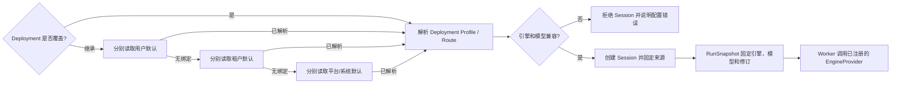

# Design

## 背景

目标与动机见 `proposal.md`。运行配置从共享的 EmployeeVersion 移到接收方作用域，由全局默认和每个 Deployment 的独立覆盖共同决定。

当前实现情况：

- `ExecutionProfile` 当前在领域对象和 API 中要求 `model_alias`，数据库列 `execution_profiles.model_alias` 也是 `NOT NULL`；它还有一个可空的 `model_route_id`。V009 需要将别名改为可空，同时保留旧值供兼容读取。
- `ExecutionProfileBinding`/`PolicyResolver` 已实现 User > Tenant > Platform > System 的解析顺序，但当前解析器只在内存中，尚无管理 API。V003 已创建支持平台、租户、用户和项目作用域的 `execution_profile_bindings`。
- 当前员工版本必须绑定 ExecutionProfile；资源中心员工包会序列化发布方引擎、模型和策略，COPY 导入时会根据部分内容创建接收方 Profile。
- 当前 Engine 边界采用适配器模式。DeepSeek Harness 已接入；仓库中已有 Codex app-server/exec 适配器。Claude Code 尚未注册为生产 EngineProvider。
- 新 Deployment 当前直接进入 ACTIVE；Session 从 EmployeeVersion 解析并保存 Profile/Route 引用，RunSnapshot 已固定解析后的模型配置。

## 目标与非目标

**Goals:**

- 员工发布方和资源中心包保持可移植，不包含发布方 ModelRoute、运行 Profile、沙箱、工作区或凭据引用。
- 租户可分别设置默认 EngineProfile 和 ModelRoute；用户也可在租户策略范围内分别设置个人默认。
- Deployment 可继承默认值，或单独覆盖 EngineProfile/ModelRoute，使员工 A、B、C 能使用不同引擎。
- 每个新 Session 解析一组有效运行配置，并固定到该 Session 的 Runs；快照保留引擎、模型、来源作用域和配置修订。
- 使用稳定 EngineProvider ID 注册引擎，并在执行前校验引擎、模型和能力组合。

**Non-Goals:**

- 不支持每个 Run 随意切换引擎。Session 创建后固定运行配置；解析结果变更需要新建 Session。
- 用户、租户或 Deployment 默认值变化时，不实时改写既有 Session/Run 快照。
- 不从发布方复制运行配置或凭据到接收方；本 Change 不接入 Dadi/new-api。
- Claude Code 仅作为未来适配器示例；其授权、生命周期、隔离和能力契约验证完成前不启用。

## 设计决策

### 1. 使用作用域默认值和 Deployment 覆盖

ExecutionProfile 选择引擎，不锁定用户选择的模型。ModelRoute 独立选择。旧 `model_route_id` 和 `model_alias` 作为迁移/兼容数据：V009 将精确路由回填到独立绑定或 Deployment 修订中。没有独立模型绑定时，旧 Profile 可提供兼容回退；任何显式 ModelRoute 都优先。新 Profile 的两个模型字段均可为空。Workspace/Sandbox/审批列保留供历史读取，但当前 Worker 未消费这些策略；新 Profile 的写入表单和 API 拒绝这些字段，历史版本需清除后再发布。Deployment 修订有两种模式：

- `INHERIT`：不保存员工专属的引擎或 ModelRoute 覆盖。创建 Session 时分别解析各自的用户/租户/平台默认值。
- `OVERRIDE`：Deployment 可固定 ExecutionProfile、ModelRoute 或两者。某个字段为空时继续继承其作用域默认，因此选择引擎不会锁定模型。

引擎和模型分别解析。引擎优先级为 `Deployment ExecutionProfile > User default > Tenant default > Platform/System default`。模型优先级为 `Deployment ModelRoute > User default > Tenant default > Platform/System default > legacy Profile route/alias 或 EngineProvider 原生默认`。Deployment 可只覆盖引擎、只覆盖模型或同时覆盖两者。模型选择器独立显示已授权 ModelRoute；更换引擎时不会自动选择或锁定路由。租户策略限制用户可选的 Profile、引擎和路由。若独立解析出的引擎和模型不兼容，Session 返回兼容性错误；系统不得静默替换用户选定的模型。用户可以独立选择，系统在执行前指出不支持的组合。

ExecutionProfile 使用稳定 Profile ID 和不可变版本。DRAFT 可原地编辑；PUBLISHED 不可修改。“创建新版本”会在相同 Profile ID 下复制为 DRAFT vN+1。发布 vN+1 不会自动更改默认值或 Deployment 绑定，管理员需要显式重新绑定。这样目录按 Profile 聚合，同时保留历史精确引用。

每个 Session 使用创建者的 IdentityContext 解析默认值，保存选定的 Profile/版本、ModelRoute 快照，以及独立的 `runtime_profile_source`/`runtime_model_route_source`，并将其固定给该 Session 的每个 Run。共享会话不会因之后提交者的身份而更换引擎或模型。更新任一全局默认只影响新 Session。若无法解析 EngineProfile 或其 Provider 已停用，创建 Session 返回 `RUNTIME_CONFIGURATION_REQUIRED`；需要 ModelRoute 的引擎若没有有效 Route，也会在创建 Session 前失败。解析器不会静默选择 Fake、最新 Profile 或其他路由。

MySQL 表 `execution_profile_bindings` 已表示平台、租户和用户的 EngineProfile 绑定，需要补充持久化 Repository/Service/API。新增独立的 `model_route_bindings` 表保存作用域 ModelRoute 默认，使用户能独立调整模型和引擎。现有作用域表没有 System 行，因此 System fallback 继续由受控部署配置提供。两种绑定都遵循现有唯一约束和租户复合键规则。

### 2. 将员工之间的差异保存在 Deployment

`/enterprise/workbench` 保留现有对话列表、时间线和 Run 快照栏。当前员工选择器旁增加紧凑的 `运行配置` 按钮及来源/修订标签。按钮打开原地对话框，提供 `继承默认` 和 `此员工单独配置` 两种选择。继承模式显示实际解析来源，例如“个人默认 · Codex CLI”；覆盖模式允许管理员分别选择本地授权 ExecutionProfile 与 ModelRoute。当前 Worker 尚未应用 Deployment 级 Workspace/Sandbox/附加审批覆盖；API 会对这些新非空值返回 `ENGINE_CAPABILITY_UNSUPPORTED`，UI 对历史修订显示提示并在下一修订中清除。全局默认单独在 `模型管理 > 默认运行环境` 配置；工作台对话框只提供跳转入口，不重复嵌入全局表单。

```text
┌ 当前员工 [A · 订单分析 ▾] [员工配置：Codex CLI · 覆盖]
├ 对话列表           │ 时间线 / 任务输入              │ 本次 Run 快照
│                    │                                │ Engine · Model · Session
└────────────────────┴────────────────────────────────┴──────────────────
                     运行配置按钮 → 小型对话框
```

以下员工 Deployment 展示不同的有效配置：

| 员工 Deployment | 选择方式 | 有效 Engine/Model |
|---|---|---|
| A | 显式覆盖 | `codex_cli` + 租户授权且兼容的 ModelRoute |
| B | 显式覆盖 | `deepseek_harness` + 租户授权且兼容的 ModelRoute |
| C | 适配器验证后显式覆盖 | `claude_code` + 适配器支持的模型和授权 |
| 其他员工 | 继承 | User > Tenant > Platform/System default |

员工包内容不会影响运行配置解析。COPY 和 REFERENCE 导入相同的可移植员工定义；各租户分别绑定本地配置。

### 3. 注册不同的 EngineProvider 并校验模型

`engine_name` 作为稳定的 Profile 标识，通过 EngineProvider 注册表解析。每个 Provider 声明支持的协议和能力，例如 Session 恢复、取消、工具调用、MCP、Workspace 和 Sandbox 要求。Profile 选择器只展示已注册且符合租户策略的 Provider。

注册表在创建 Session 前校验 EngineProfile 与 ModelRoute 组合。例如，Provider 可能只接受原生模型协议或部分 OpenAI 兼容路由。选择引擎不会缩小或改写 ModelRoute 字段；组合不兼容时，在执行前返回稳定的配置错误。缺少凭据或 Session 能力不受支持时同样失败；系统不会通过 fallback 静默更换引擎或模型。Worker 继续使用统一的 Engine 生命周期和 Sandbox 边界。

DeepSeek Harness 通过当前 HarnessRuntimeAdapter 注册。Codex app-server RuntimeAdapter 使用每 Session 独立 CODEX_HOME、OpenAI Responses ModelRoute 和接收租户 SecretRef；它不声明 Platform Tool/MCP、定制 Workspace/Sandbox 或审批能力。生产环境只有运维显式设置 `AGENT_PLATFORM_CODEX_APP_SERVER_ENABLED=1` 且命令可执行时才注册；命令默认是 `codex app-server --stdio`，可用 `AGENT_PLATFORM_CODEX_APP_SERVER_COMMAND` 覆盖。Claude Code 和其他未来引擎保持未注册，直到同样通过协议、生命周期、凭据和隔离检查。Profile 行只保存引擎 ID 与资源引用，不允许任意 Shell 命令。

### 4. 对 Deployment 覆盖配置版本化并固定解析结果

每次 Deployment 配置变更都会创建单调递增且不可变的 `config_version`。`INHERIT` 修订的 Profile/Route 覆盖字段为空；`OVERRIDE` 修订至少固定一项精确的 ExecutionProfile ID/版本或 ModelRoute，也可包含经过许可的本地覆盖项。首次选择任一模式会激活 `PENDING_CONFIGURATION` Deployment。后续编辑创建新修订；回滚时将历史修订复制为一个新修订。

创建 Session 时同时快照 Deployment 模式/修订和解析后的 ExecutionProfile/ModelRoute，并记录 `runtime_profile_source`（`DEPLOYMENT_OVERRIDE`、`USER_DEFAULT`、`TENANT_DEFAULT`、`PLATFORM_DEFAULT` 或 `SYSTEM_DEFAULT`）。RunSnapshot 保存同一解析结果。现有 Session 保持原配置；用户/租户默认变化只影响继承默认的新 Session，显式 Deployment 覆盖不受全局默认变更影响。



## 数据模型、API 与状态

### 全局默认值

EngineProfile 默认复用 V003 的 `execution_profile_bindings`。其唯一键 `(platform_id, tenant_id, scope_type, scope_id)` 保证每个作用域只有一个 Profile 绑定。新增独立 `model_route_bindings` 表保存 ModelRoute 默认，使用户更换模型时不必替换引擎 Profile。Platform 绑定沿用现有平台作用域；System 默认仍由部署配置提供。

V009 alters `execution_profiles.model_alias` from `NOT NULL` to nullable and changes its COMMENT to `历史兼容模型别名；新 Session 模型由独立 ModelRoute 或运行时默认解析`:

```sql
ALTER TABLE execution_profiles
    MODIFY COLUMN model_alias VARCHAR(128) NULL
    COMMENT '历史兼容模型别名；新 Session 模型由独立 ModelRoute 或运行时默认解析';
```

新的 ExecutionProfile 请求/领域模型将 `model_alias` 设为可选。对新 Session，已解析的 ModelRoute 向适配器提供 Provider 模型名称；仅当没有独立路由默认时，历史 Profile alias/route 才作为回退。V009 保留旧别名和路由；新 Profile 可将两个模型字段留空。

V009 新增 `model_route_bindings`，让 ModelRoute 默认拥有独立生命周期：

| 字段 | 含义 | 中文 SQL COMMENT |
|---|---|---|
| `platform_id` | 所属平台 | `所属平台标识` |
| `tenant_id` | Route 所属租户 | `模型路由默认归属租户标识` |
| `binding_id` | 作用域绑定稳定 ID | `模型路由作用域绑定标识` |
| `scope_type` | `user`、`tenant` 或 `platform` | `模型路由默认作用域类型` |
| `scope_id` | 用户、租户或平台作用域 ID | `模型路由默认作用域标识` |
| `route_id` | 该作用域默认 ModelRoute | `当前作用域默认模型路由标识` |
| `status` | `ACTIVE` 或 `DISABLED` | `模型路由默认绑定状态` |
| `created_by` | 设置该绑定的用户，可空供迁移使用 | `设置默认模型路由的用户标识` |
| `created_at` | 绑定创建时间 | `模型路由默认绑定创建时间` |
| `updated_at` | 最近更新时间 | `模型路由默认绑定更新时间` |

表 COMMENT：`用户租户平台作用域的模型路由默认绑定`。主键为 `(platform_id, tenant_id, binding_id)`；唯一键 `(platform_id, tenant_id, scope_type, scope_id)` 保证每个作用域只有一个绑定槽位；增加便于按路由和创建者查询的索引。租户复合外键引用 `tenants`、`model_routes` 和 `users`。CHECK 约束限制作用域和状态枚举。已停用或撤销的显式路由解析失败，不会静默换成其他模型。

全局默认入口放在现有模型管理页的第三个页签 `默认运行环境`，与 `连接与模型`、`模型路由` 并列。这里分别设置用户和租户的 EngineProfile 与 ModelRoute 默认。租户管理员可从已注册 EngineProvider 创建只含引擎字段的 Profile；新 Profile 不要求 ModelRoute 或模型别名。ModelRoute 在既有 `模型路由` 页签维护并独立选择。Workspace/Sandbox/附加审批配置不在本期 Profile 编辑表单中开放；旧版本包含这些非空字段时，fork 生成草稿后必须清除才能发布。更换引擎后，界面保留全部已授权 Route；若解析组合不兼容，在创建 Session 前提示，不替换为其他模型。用户可修改个人引擎和模型默认，租户默认仅管理员可改。工作台对话框中的 `管理默认运行环境` 跳转到第三个页签。连接创建/测试和 ModelRoute 创建仍在原页签完成。

Profile 目录使用同一稳定 ID 聚合各版本。已发布行提供 `创建新版本`，将 vN 复制到 DRAFT vN+1 编辑器。保存草稿不改变 Session/Run 行为；发布后，现有默认值和 Deployment 绑定仍指向 vN，直到管理员显式切换到 vN+1。Profile fork/update/publish API 已实现；PUBLISHED 版本不可变，每次编辑不创建新 Profile ID。ModelRoute 默认独立于 Profile 版本，选择另一个模型不需要复制 EngineProfile。

建议提供以下 API：

| Endpoint | 行为 | 权限与来源 |
|---|---|---|
| `GET /api/v1/execution-profile-bindings/effective` | 返回当前用户最终默认 EngineProfile 与解析来源 | 按当前 IdentityContext 做 User > Tenant > Platform > System 解析 |
| `GET/PUT /api/v1/execution-profile-bindings/user` | 读取或设置当前用户个人默认 Profile | 用户只能修改自己的默认值，并只能选租户已授权的 PUBLISHED 精确版本；PUT 空值清除个人绑定 |
| `GET/PUT /api/v1/execution-profile-bindings/tenant` | 读取/设置租户默认 Profile | 仅租户管理员可写，响应不含凭据 |
| `GET /api/v1/model-route-bindings/effective` | 返回当前用户最终默认 ModelRoute 和解析来源 | 独立执行路由作用域解析；兼容性由 Session Resolver 检查 |
| `GET/PUT /api/v1/model-route-bindings/user` | 读取或设置当前用户个人默认 ModelRoute | 用户只能修改自己的路由绑定，并只能选租户已授权 Route；PUT 空值清除个人绑定 |
| `GET/PUT /api/v1/model-route-bindings/tenant` | 读取/设置租户默认 ModelRoute | 仅租户管理员可写 |
| `GET /api/v1/execution-profiles` | 列出当前租户可用 Profile 精确版本 | 返回引擎和运行策略摘要；可标记历史 alias/route 为兼容回退，不返回凭据 |
| `POST /api/v1/execution-profiles` | 创建并发布可复用的 EngineProvider Profile | 仅租户管理员；新 Profile 的 `model_alias`/ModelRoute 可为空；当前 Worker 未消费的 Workspace/Sandbox/附加审批字段被拒绝 |
| `POST /api/v1/execution-profiles/{id}/versions/{version}/fork` | 从发布版本创建同 Profile ID 的 DRAFT 下一版本 | 旧版本不变；新版本可编辑 |
| `PUT /api/v1/execution-profiles/{id}/versions/{version}` / `POST .../publish` | 编辑 DRAFT 并发布 | PUBLISHED 版本返回 `IMMUTABLE_VERSION`；当前 Worker 未消费的 Workspace/Sandbox/非 none 审批字段返回 `ENGINE_CAPABILITY_UNSUPPORTED` |
| `GET/PUT /api/v1/deployments/{id}/runtime-config` | 读取/修改 Deployment 的 INHERIT/OVERRIDE 修订 | 仅租户管理员可写；运行成员只读 |

Deployment 表仍保留历史 Workspace/Sandbox/审批引用列和 V009 迁移值。为避免系统把未运行的策略当作已应用，新建或更新 Deployment 配置时这些值必须为空；非空 API 请求返回 `ENGINE_CAPABILITY_UNSUPPORTED`（409）。历史修订只有在字段与其固定 ExecutionProfile 精确一致时才允许创建 Session；不一致或附加审批不能由 Worker 强制执行时显式拒绝。

### `deployment_runtime_config_versions`

新建 MySQL 表，迁移文件为 `docs/migrations/V009__deployment_runtime_config.sql`：

| 字段 | 含义 | 中文 SQL COMMENT |
|---|---|---|
| `platform_id` | 所属平台 | `所属平台标识` |
| `tenant_id` | 接收方租户 | `接收方租户标识` |
| `deployment_id` | 所属 Deployment | `配置所属的 Deployment 标识` |
| `config_version` | Deployment 内单调递增修订 | `Deployment 运行配置修订号` |
| `config_mode` | `INHERIT` 或 `OVERRIDE` | `运行配置模式，继承默认或固定员工配置` |
| `execution_profile_id` | 可选的员工专属引擎 Profile 覆盖；为空则继承作用域默认 | `员工专属 ExecutionProfile 覆盖标识，可空表示继承默认` |
| `execution_profile_version` | Profile 覆盖的精确版本 | `员工专属 ExecutionProfile 覆盖版本号` |
| `model_route_id` | 可选的独立 Deployment ModelRoute 覆盖 | `员工专属模型路由覆盖标识，可空表示继承默认` |
| `model_route_snapshot_json` | ModelRoute 覆盖的非凭据快照，可含受控 SecretRef | `员工专属模型路由快照，不含凭据明文` |
| `workspace_profile_id` | 可选的 Deployment Workspace 覆盖标识 | `员工专属工作区配置标识` |
| `workspace_profile_version` | 可选的 Deployment Workspace 覆盖版本 | `员工专属工作区配置版本` |
| `sandbox_profile_id` | 可选的 Deployment Sandbox 覆盖标识 | `员工专属沙箱配置标识` |
| `sandbox_profile_version` | 可选的 Deployment Sandbox 覆盖版本 | `员工专属沙箱配置版本` |
| `approval_policy_json` | 额外审批限制，不可放宽安全下限 | `Deployment 附加审批策略，不得弱于安全下限` |
| `runtime_options_json` | 白名单非敏感高级运行参数 | `白名单非敏感运行参数，不得包含凭据或任意环境变量` |
| `created_by` | 修订创建人，系统回填时可空 | `创建运行配置修订的用户标识` |
| `created_at` | 修订创建时间 | `运行配置修订创建时间` |

表 COMMENT：`Deployment 接收租户不可变的运行配置修订`。主键 `pk_deployment_runtime_config_versions` 为 `(platform_id, tenant_id, deployment_id, config_version)`，同时作为 Deployment 当前修订的引用目标。增加创建者索引 `idx_runtime_config_creator(platform_id, tenant_id, created_by)`；主键支持查询 Deployment 历史修订。复合外键 `fk_runtime_config_deployment`、`fk_runtime_config_profile`、`fk_runtime_config_route`、`fk_runtime_config_workspace`、`fk_runtime_config_sandbox` 和 `fk_runtime_config_creator` 均包含平台/租户范围。CHECK 约束包括 `ck_runtime_config_mode`、`ck_runtime_config_inherit_no_engine_route_override`（INHERIT 不含 Profile/Route 覆盖）、`ck_runtime_config_override_has_value`（OVERRIDE 至少覆盖 Profile 或 Route）、`ck_runtime_config_profile_version_pair`、`ck_runtime_config_workspace_pair` 和 `ck_runtime_config_sandbox_pair`。`model_route_snapshot_json` 和运行参数中不得包含凭据明文。

增加可空字段 `deployments.runtime_config_version`，COMMENT 为 `Deployment 当前生效的接收方运行配置修订；为空时表示待配置`，并将 `PENDING_CONFIGURATION` 纳入状态检查。更新 `deployments.status` COMMENT 为 `Deployment 生命周期状态，包括待配置、运行中或已停用`。增加可空字段 `sessions.runtime_config_version`，COMMENT 为 `Session 固定的 Deployment 配置修订；历史 Session 可为空`；同时增加 `runtime_profile_source`，COMMENT 为 `Session 解析 ExecutionProfile 的作用域来源`，以及 `runtime_model_route_source`，COMMENT 为 `Session 解析 ModelRoute 的作用域来源`。两个来源字段接受 `DEPLOYMENT_OVERRIDE`、`USER_DEFAULT`、`TENANT_DEFAULT`、`PLATFORM_DEFAULT`、`SYSTEM_DEFAULT` 或 `LEGACY_PROFILE`；历史 Session 可为空。完成回填后再添加 Session 到配置修订的复合外键。`runtime_config_version` 为空的历史 Session 继续使用旧固定字段。

EmployeeVersion 运行字段保留为可空的历史兼容字段。V009 为这些列更新 COMMENT，标明旧含义及新归属：

| digital_employee_versions 字段 | V009 中文 COMMENT |
|---|---|
| `execution_profile_id` | `历史兼容的 ExecutionProfile 标识；新版本运行配置由 Deployment 或作用域默认解析` |
| `execution_profile_version` | `历史兼容的 ExecutionProfile 版本；新版本运行配置由 Deployment 或作用域默认解析` |
| `model_route_id` | `历史兼容的模型路由标识；新版本运行配置由 Deployment 或作用域默认解析` |
| `workspace_profile_id` | `历史兼容的工作区配置标识；新版本运行配置由 Deployment 或作用域默认解析` |
| `workspace_profile_version` | `历史兼容的工作区配置版本；新版本运行配置由 Deployment 或作用域默认解析` |
| `sandbox_profile_id` | `历史兼容的沙箱配置标识；新版本运行配置由 Deployment 或作用域默认解析` |
| `sandbox_profile_version` | `历史兼容的沙箱配置版本；新版本运行配置由 Deployment 或作用域默认解析` |
| `approval_policy_json` | `历史兼容的审批策略；新版本运行策略由 Deployment 或作用域默认解析` |

新的 EmployeeVersion 和资源中心包不再写入这些字段。迁移从现有本地 Profile/Route 为已有 Deployment 回填 `OVERRIDE` 配置，保持当前行为。迁移保留 V003 历史文件并复用现有绑定表。

### Session/Deployment 状态

管理员选择 `INHERIT` 或 `OVERRIDE` 后，Deployment 结束 `PENDING_CONFIGURATION` 状态。继承模式要求 Session 创建者能沿全局优先级解析到已授权 Profile。若无 Profile，或引擎/模型组合不受支持，`POST /sessions` 返回 `RUNTIME_CONFIGURATION_REQUIRED` 或 `ENGINE_MODEL_INCOMPATIBLE`（409），且不创建不完整 Session。之后修改 Profile 绑定只影响新建 Session。

V009 保留 `workspace_profile_id`、`sandbox_profile_id` 和 `approval_policy_json` 字段以回填历史值；当前 Worker 未将 Deployment 级这些字段组装到 RuntimeRequest 或工具审批流。因此新增写入请求带非空 Workspace/Sandbox 或 `require_approval_for` 时返回 `ENGINE_CAPABILITY_UNSUPPORTED`（409），不创建配置修订。迁移后的历史 Deployment 若某一项与选定 Profile 的精确值不一致，Session 创建也以相同错误拒绝，不得静默丢弃覆盖。租户可在未来适配器接通后再开放这些输入。

## 权限和凭据边界

- 租户管理员管理租户默认值和 Deployment 覆盖；用户只能管理个人默认值。租户策略可关闭个人覆盖或限制可用引擎和 ModelRoute。
- 用户只能选择当前平台/租户已授权的 Profile 和 Route。跨租户查询返回 404；无权更新返回 403。
- Deployment 覆盖始终优先于用户/租户默认。全局默认变化不得静默更换显式指定的员工引擎。
- EngineProvider 注册表是允许列表；Profile 不能引入任意可执行程序或命令。每个 Provider 必须通过 Sandbox/进程、凭据、取消和能力检查。
- ModelRoute 的 SecretRef 只能由接收方租户的 SecretProvider 解析。API 和界面不泄露 SecretRef 或密钥明文。Snapshot 可以保留 Worker 需要的受控引用，但不得包含凭据明文。
- 有效工具范围仍受员工/Skill Tool allowlist 和风险策略约束。用户默认不能绕过员工 Deployment 的审批/安全下限。

## 失败、重试、幂等和可观测性

- Profile 绑定写入时校验期望修订；并发冲突返回 `RUNTIME_CONFIG_REVISION_CONFLICT`，不覆盖已有配置。
- 缺少默认值、Profile 已停用、适配器缺失、ModelRoute 协议无效或能力不受支持时，创建 Session 前失败。不得回退至 Fake、latest 或其他租户资源。
- 未接通的 Deployment 级 Workspace/Sandbox/附加审批配置在保存时返回 `ENGINE_CAPABILITY_UNSUPPORTED`，运行时发现历史修订与 Profile 不一致时也显式失败；不得保存后继续运行并忽略策略。
- Run 幂等摘要包含已解析的 Profile/Route 快照和 Deployment 配置版本。相同请求重放同一 Run；解析或来源快照不同时不能复用幂等键。
- Trace 和审计记录 `deployment_id`、`config_version`、`engine_name`、模型/路由 ID 和解析来源（`DEPLOYMENT_OVERRIDE` / `USER_DEFAULT` / `TENANT_DEFAULT` / `PLATFORM_DEFAULT` / `SYSTEM_DEFAULT`），不记录凭据值。
- 全局默认变化只影响新 Session；执行中和历史 Run 保持原快照。未知 Runtime 结果沿用现有 UNKNOWN 状态和不自动重试规则。

## 迁移、发布和回滚

1. V009 预检解析现有 Deployment 员工 Profile、ModelRoute、Workspace/Sandbox 引用和作用域 Profile 绑定。无效引用会停止迁移并报告脱敏后的 ID。没有 ModelRoute 的历史 alias 保留为兼容回退，并报告给租户后续配置。
2. 创建带租户复合外键和中文表/字段 COMMENT 的 `model_route_bindings`。从现有 Profile 绑定路由回填独立 Route 绑定；Deployment 专属 Route 覆盖写入 Deployment 配置。只有历史 alias 的数据保留 alias 回退并报告给资源所有者映射，不虚构连接或凭据。之后的新写入保持 Route 独立。
3. 创建 `deployment_runtime_config_versions`，补齐中文 COMMENT、租户外键、索引和独立的 EngineProfile/ModelRoute 覆盖字段。从现有 EmployeeVersion/Profile 为每个 Deployment 回填 `OVERRIDE` 配置修订 1，并保留当前 Route。
4. 增加 Deployment 当前修订指针、`PENDING_CONFIGURATION` 状态和 Session 配置版本/Profile 来源/ModelRoute 来源字段；完成回填后再添加指针外键。
5. 将 `execution_profiles.model_alias` 改为可空，COMMENT 设为 `历史兼容模型别名；新 Session 模型由独立 ModelRoute 或运行时默认解析`，保留已有别名。EmployeeVersion 运行字段改为可空并更新历史兼容 COMMENT，不清除历史值。新 Profile 可以写入空 alias；新 EmployeeVersion 不再写运行字段。
6. 在现有 `execution_profile_bindings` 表实现 EngineProfile 绑定持久化和授权；在 V009 表实现 ModelRoute 绑定。增加用户/租户默认管理 API 和审计事件。
7. 依次发布 Resolver/Worker 兼容逻辑、资源包格式变化、员工编辑器、模型管理默认/版本页签和紧凑工作台对话框。EngineProvider 通过适配器能力检查后再启用。
8. 使用两种本地资源不同的租户验证独立 EngineProfile/ModelRoute 优先级、A/B/C Deployment 覆盖、不兼容组合、历史 Session 和 schema 注释。

发布按 expand/contract 执行：先部署能读取空 `model_alias` 且支持独立 ModelRoute 解析的服务，再应用 V009；所有 Worker 都读取 ModelRoute 快照后，才允许新 Profile 写空 alias。回滚前先关闭新设置写入和空 alias Profile 创建，再回退 UI/API。生产环境保留 V009 数据、列和所有快照。新 Profile/EmployeeVersion 可能含空的历史字段，不能回滚到要求字段非空的二进制版本。Down migration 只在一次性数据库验证，不删除生产修订，也不改写 V003/V008。

## 可观测性与验证

原型位于 `docs/原型/员工Deployment运行配置.html`，模拟 `/enterprise/workbench` 三栏布局和现有模型管理页签。全局默认位于 `模型管理 > 默认运行环境`；工作台轻量对话框只提供继承/覆盖和跳转入口。示例展示 Codex CLI、DeepSeek Harness 与未启用的 Claude Code。原型标明为静态演示，不发送网络请求。

**已验证：**V009 migration、中文表/列 COMMENT、租户复合外键和现有 Deployment 回填通过 disposable MySQL 集成；回填 Route 快照符合当前 `ModelRouteSnapshot` 格式且迁移后能创建真实 Session。EngineProfile 与 ModelRoute 默认 API 独立保存、跨应用重启读取；Deployment INHERIT/OVERRIDE 修订并发校验通过。ExecutionProfile 同 Profile ID fork/update/publish API、PUBLISHED 不可变、管理员权限、未接通环境字段拒绝与 MySQL 重启版本读取通过。员工包不传递发布方环境；两租户 MySQL COPY/REFERENCE 流程给两种 Deployment 分别固定 Codex CLI/OpenAI Responses ModelRoute 和 DeepSeek Harness/Chat Completions ModelRoute，并断言 RunSnapshot 的精确引擎及模型。Session Resolver 的独立优先级、单字段覆盖、默认更新只影响新 Session、旧 Run 快照和不兼容拒绝均有测试。EngineProvider 未注册项、能力边界、别名规范化和不回退经过验证；Worker Snapshot Profile 撤销、Codex SecretRef 缺失、UNKNOWN 隔离、INHERIT 残留覆盖清除与 Trace 错误类别通过测试。Codex app-server 假服务器 start/turn/resume 与隔离测试通过；本机 Codex CLI 0.169.0-alpha.11.1 initialize/thread-start smoke 通过，未发起模型 Turn。后端 `338 passed, 71 skipped`，Ruff 检查通过；全量 MySQL 集成 `70 passed`；前端 `76 passed`、TypeScript/Vite build 通过；静态原型离线启动和默认页签/成员权限状态通过。

**未验证：**Codex 对真实模型服务的 Turn、用量和长时间恢复未做网络调用；生产只有显式设置 `AGENT_PLATFORM_CODEX_APP_SERVER_ENABLED=1` 且 Codex 命令可执行时才注册该 adapter；命令默认为 `codex app-server --stdio`，可用 `AGENT_PLATFORM_CODEX_APP_SERVER_COMMAND` 覆盖；Claude Code 尚未注册；真实租户连接和租户授权目录仍需人工验收。Vite 构建通过，但报告主 JS bundle 超过 500 kB 的体积提示，后续可按页面拆分。

实现后验证命令：

```bash
openspec validate workbench-runtime-configuration-options --strict
cd backend && python -m pytest tests -q
cd frontend && npm test -- --run
cd frontend && npm run build
```

MySQL 集成测试还需通过 `information_schema.TABLES`/`COLUMNS` 检查 V009 注释，并验证 Deployment 回填、Profile 绑定优先级、并发修订、跨租户外键和回滚边界。

## 外部 Provider 边界

本 Change 不接入 Dadi Model Gateway 或 new-api。模型目录发现和路由授权仍由现有 ModelCatalogProvider/ModelAuthorizationProvider 负责。EngineProvider 是 Agent 执行适配器，与 ModelRoute/模型服务 Provider 属于独立维度；仅注册且通过能力校验的组合可供选择。Claude Code 等未来适配器在验证完成前不会显示为可用。

## 待确认事项

当前没有阻塞规划的问题。优先级为 Deployment 覆盖 > 用户默认 > 租户默认 > 平台/系统默认；用户默认在 Session 创建时解析并固定，全局默认变更只影响新 Session。租户管理员可通过 Engine/Profile allowlist 策略决定是否允许个人默认。
