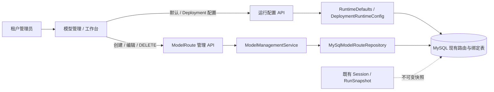
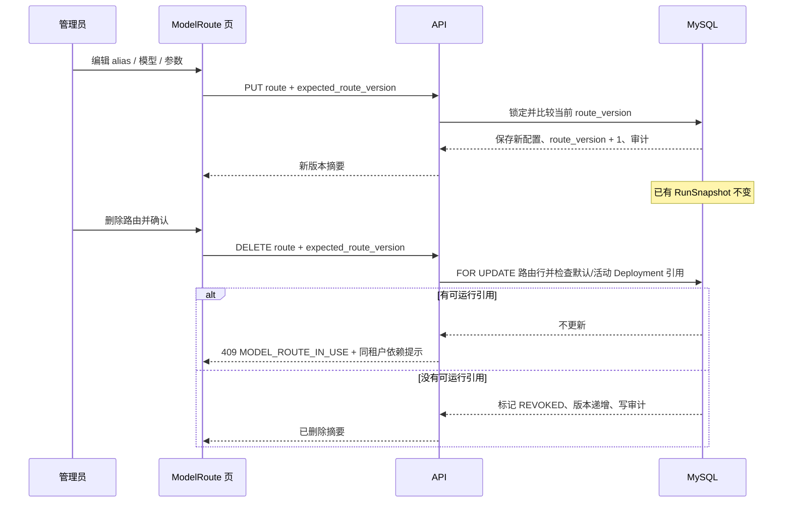
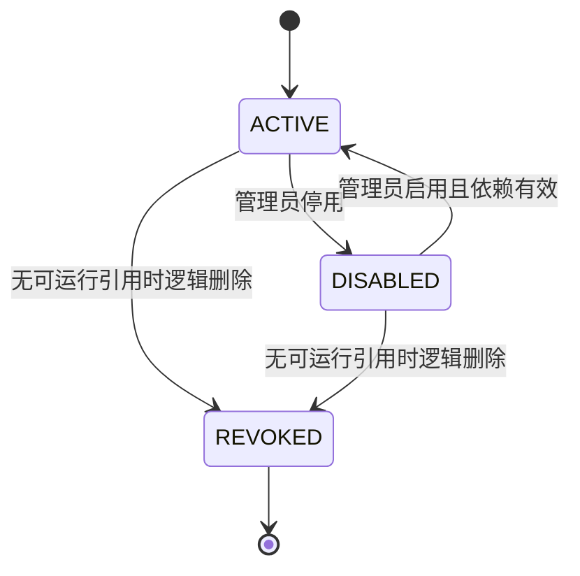

# Design

## Context

见 `proposal.md`。当前代码已有作用域默认、Deployment 修订、ModelRoute 创建/编辑后递增 `route_version`、启停、测试和快照能力；本变更主要补齐原型布局、ModelRoute 页入口/表单与逻辑撤销。

现有 `model_routes.status` CHECK 已包含 `ACTIVE`、`DISABLED`、`REVOKED`，`model_routes`、`model_route_bindings`、`deployment_runtime_config_versions` 均保留租户复合键/外键。`ModelRouteSnapshot` 已将连接版本、模型、协议、端点、参数和 SecretRef 固定到 Session/Run。因而无需修改 schema 或历史 migration。

## Goals / Non-Goals

**Goals:**

- 默认运行环境与工作台弹窗遵从既有独立 HTML 原型，同时保留当前租户权限、来源提示、空/加载/错误状态和快照语义。
- 在 ModelRoute 页完成管理员创建、编辑、测试、停用/启用和逻辑删除的可发现流程。
- 通过路由版本期望值、引用检查和事务行锁，避免陈旧编辑、并发绑定与删除互相覆盖。

**Non-Goals:**

- 不物理删除 ModelRoute，不增加 schema migration。
- 不新增连接协议、引擎适配器或真实模型调用；“创建/编辑路由”不触发连接或推理请求。
- 不修改已有 RunSnapshot，也不把凭据明文带入浏览器、接口、审计或日志。

## Decisions

### 页面与组件

- `默认运行环境`按原型采用两个主要区域：作用域默认表单与 Profile 版本目录。有效 EngineProfile/ModelRoute、来源、解析顺序和保存反馈明确呈现；窄屏纵向排列。
- 工作台弹窗使用原型的“全部继承默认 / 设置员工覆盖”切换。继承态展示两项有效值和来源；覆盖态分别显示引擎和模型选择框，空值表示该维度继续继承。切换引擎不改路由选择。成员只读态不显示提交操作。
- 保留现有视觉 token 和导航，不复制静态原型里的演示 Profile、凭据或路由数据到运行页面。

### ModelRoute CRUD 与逻辑删除

- ModelRoute 页表头新增“创建路由”，表格行提供“编辑、测试模型、停用/启用、删除”。创建/编辑抽屉从本租户 ACTIVE 连接和模型目录选择模型；编辑只允许别名、连接目录模型、非敏感参数和定价引用，不显示 Secret 值。
- 更新请求必须携带 `expected_route_version`。仓储在同一事务比较当前版本并递增 `route_version`；冲突返回 `MODEL_ROUTE_VERSION_CONFLICT`（409）。已创建 Session/RunSnapshot继续保留创建时的完整路由快照。
- 删除采用 `REVOKED` 逻辑状态。REVOKED 记录保留用于路由历史和外键，列表以“已删除”呈现，不可编辑、启用、绑定或进入 selectable 路由目录；重复 DELETE 返回当前状态且不重复记审计。`DISABLED` 仍可恢复，不能恢复 REVOKED。
- 撤销检查 `model_route_bindings` 的有效默认、ACTIVE Deployment 当前配置，以及可能被有效默认/活动 Deployment 使用的 EmployeeVersion/Profile 历史路由 fallback。发现仍可被新 Session 使用的引用时返回 `MODEL_ROUTE_IN_USE`（409）和同租户可安全展示的依赖摘要，不改变状态。历史 RunSnapshot 不算活动引用。
- 撤销事务先锁定路由行，再检查引用并更新状态/版本/审计。作用域默认写入和 Deployment 配置保存在引用路由时也要在提交事务内共享锁定 ACTIVE 路由，确保并发撤销只能与新绑定二选一成功。默认绑定更新已有路由锁；Deployment 持久化需补充同等检查。
- REVOKED 的路由别名仍受租户唯一别名约束，不复用别名；管理员可为新路由选择新别名。该限制避免同租户内历史别名产生歧义。

### 架构与交互时序





### 数据模型与状态

本变更不新增表或字段；使用现有字段：

| 数据对象 | 作用 | 变更边界 |
|---|---|---|
| `model_routes.status` | `ACTIVE`、`DISABLED`、`REVOKED` 生命周期 | `REVOKED` 终态；不可恢复；现有表级/字段级中文 COMMENT 保持不变 |
| `model_routes.route_version` | 路由配置修订 | 成功编辑、状态变更或撤销时递增；更新比较期望版本 |
| `model_route_bindings` | User/Tenant/Platform 默认引用 | 有效绑定引用目标路由时阻止逻辑删除；外键保留 |
| `deployment_runtime_config_versions` | Deployment 的不可变当前/历史修订 | ACTIVE Deployment 的当前路由引用阻止删除；历史修订仍保留 |
| Session/RunSnapshot JSON | 实际执行路由快照 | 不随编辑、停用或撤销回写；既有 Run 可继续查看 |

状态图：



如果 REVOKED 路由位于 DISABLED Deployment 的配置中，该部署恢复 ACTIVE 前必须重新验证并更新运行配置；不能让它以已撤销路由创建新 Session。

### API、权限与凭据边界

| 方法与路径 | 行为 | 权限/并发 |
|---|---|---|
| `POST /api/v1/model-routes` | 从当前租户 ACTIVE 连接/目录模型创建路由 | `model:manage`；跨租户按 404 拒绝 |
| `PUT /api/v1/model-routes/{route_id}` | 更新别名、连接目录模型或非敏感参数 | `model:manage`；body 必须含 `expected_route_version`，过期返回 409 |
| `DELETE /api/v1/model-routes/{route_id}?expected_route_version=N` | 原子检查引用并转为 `REVOKED` | `model:manage`；被引用返回 409；重复删除幂等 |
| `POST /api/v1/model-routes/{route_id}/disable` / `enable` | 可恢复停用/启用 | `model:manage`；禁止启用 REVOKED 路由 |
| `GET /api/v1/model-routes` | 管理页查询当前租户所有路由状态 | `model:read`；不暴露 Secret 明文 |
| `GET /api/v1/model-routes/selectable` | 为默认/Deployment 表单提供可用路由 | 仅 ACTIVE 且授权可用的路由；REVOKED/跨租户隐藏 |

API 身份来自已验证 `IdentityContext`，不接受请求体覆盖租户。普通成员可读，不得创建、编辑、启停或删除。表单只提交 SecretRef 所关联的连接 ID，不读取密钥；成功/失败响应、错误详情和审计只包含路由 ID、版本、状态及可安全显示的同租户引用名。

### 错误、并发、审计与可观测性

- `MODEL_ROUTE_VERSION_CONFLICT`（409）：更新/删除基于旧版本；保留新值并要求刷新。
- `MODEL_ROUTE_IN_USE`（409）：存在默认或活动配置引用；返回同租户依赖摘要，不返回其他租户记录。
- `DEPENDENCY_VALIDATION_ERROR`（409）：新路由引用停用连接/目录模型或重新启用时依赖失效。
- `AUTHORIZATION_DENIED`（403）和统一资源不存在（404）：写权限、跨租户拒绝。
- 失败的写操作不改路由状态、不递增版本、不写成功审计；UI 保留抽屉草稿并显示可操作原因。
- 编辑和 REVOKED 操作记租户审计，包含 actor、精确 route_id、旧/新版本和状态，不包含 endpoint 密钥或 Secret 值。旧表 `audit_events.resource_id` 是 CHAR(26)，ModelRoute ID 可超过该长度；审计将 `resource_id` 置空并把完整 route_id 放入 `payload_json`，不截断 ID，也无需 schema migration。DELETE 已 REVOKED 时返回当前状态，不重复记成功变更事件；既有创建/停用/启用审计方式不在本变更扩展。
- 目录请求失败保留当前表单；只读 GET 可重试。创建、更新和撤销均不自动调用模型测试；模型测试仍要求单独点击确认。

### 迁移、回滚和验证

- 无数据库 migration；V003 `ck_model_route_status` 已允许 `REVOKED`，当前索引和租户复合主键继续生效。`information_schema` 不应出现本次新增表/列。
- 应用回滚不恢复路由状态。部署含 REVOKED 路由后，禁止直接回退到会将所有非 ACTIVE 状态重新显示为可启用的旧管理界面；先部署支持 REVOKED 终态的兼容版本。
- 已验证的基础：现有 API 已支持创建、更新时递增 `route_version`、启停和 selectable 过滤；现有 UI 测试覆盖目录创建入口和模型测试确认。
- 本变更待验证：新增 DELETE 原子引用检查、并发绑定/撤销、运行配置页面与原型交互、窄屏/键盘状态、真实浏览器与本地 MySQL 集成。

验证命令：

```bash
cd backend && PYTHONPATH=.:../harness-engine/src .venv/bin/pytest tests/test_model_route_lifecycle_api.py -q
cd backend && PYTHONPATH=.:../harness-engine/src AGENT_PLATFORM_MYSQL_TEST_ALLOW_CREATE_DATABASE=1 MYSQL_HOST=127.0.0.1 MYSQL_PORT=33306 MYSQL_USER=root MYSQL_PASSWORD='' .venv/bin/pytest tests/integration/test_mysql_catalog_api.py -q
cd backend && .venv/bin/ruff check src tests
cd frontend && npm test -- --run src/features/models/ModelManagementPage.test.tsx src/features/models/DefaultRuntimeEnvironmentTab.test.tsx src/features/platform/ConversationWorkbenchPage.test.tsx
cd frontend && npm run build
openspec validate --changes --strict
git diff --check
```
