# Design

## Context

See `proposal.md` for motivation. 当前页面已经分别存在默认运行环境、Deployment 运行配置和工作台策略摘要，但 Deployment 弹框仍是窄单栏表单，保存策略后没有从同一入口启动新 Session 的可见闭环。平台已有 `RuntimeOptions`、`runtime_strategy_bindings`、Session/RunSnapshot、EngineProvider capability 和 OpenAI-compatible ModelRoute；本期复用这些边界，不新增业务表。

当前真实验收入口已探测可达：`http://host.docker.internal:63072/v1`，模型目录需要租户 `local-model-key` SecretRef。密钥只允许通过 Run Worker 的未提交环境变量注入。

## Goals / Non-Goals

**Goals:**

- 抽出 `RuntimeStrategyPanel`，统一默认环境、Deployment 和工作台新 Session 入口。
- 双栏展示策略编辑、有效值、来源、覆盖差异、能力和快照影响范围。
- 保存并新建对话，使用真实 OpenAI-compatible ModelRoute 完成一轮 NATIVE Run。
- 保持 Session/RunSnapshot 不可变、租户隔离、秒级事件和原始思考链不落库。
- 提供真实模型成功、凭据缺失、超时、能力不支持和刷新恢复证据。

**Non-Goals:**

- 不将供应商私有字段暴露给前端，不自动切换模型或 Fake。
- 不在本期验证 Codex 真实 Turn、生产身份、Secret Manager 或多节点恢复。
- 不新增策略表；若发现必须改变表结构，停止实现并新增 forward migration 设计。

## Decisions

### 1. 独立双栏面板，而不是继续扩展 Modal 表单

`RuntimeStrategyPanel` 负责展示和编辑策略，宿主页面传入作用域、Deployment 上下文、能力和保存/新建回调。双栏让“编辑”与“当前生效/即将使用”分离，解决当前 470px 单栏拥挤问题。默认环境和 Deployment 继续保留各自的权限与资源选择，面板只管理回答策略。

### 2. 保存与新 Session 分成两个服务端动作

保存动作先带 `expected_config_version` 创建不可变修订；“保存并新建对话”在保存成功后再次走 Session 创建 API。这样并发冲突、旧 Session 快照和审计语义与现有控制面一致，前端不会把未提交表单直接当成运行事实。

### 3. 真实模型使用现有 OpenAI-compatible ModelRoute

Worker 通过租户 ModelRoute 的 endpoint、model ID、protocol 和 SecretRef 发出真实请求。API/Web 不读密钥；Worker 使用现有 `AGENT_PLATFORM_MODEL_SECRET_<SCOPE>_<SECRET_ID>` 映射。`local-model-mock` 只作为失败/离线测试辅助，不能作为 NATIVE 验收证据。

### 4. capability 先于出站

面板展示 provider capability；Session 创建和 Worker 出站前再次校验。DeepSeek/Codex 未验证的私有字段不在前端出现，预算或 reasoning 字段不支持时返回 `ENGINE_CAPABILITY_UNSUPPORTED`，不降级。

### 5. 阶段与真实答复分开

工作台继续使用统一 RuntimeEvent 映射思考、工具、答复和错误阶段；真实模型只返回最终可见文本、脱敏 request reference 和可获得 Usage。原始思考正文、隐藏 Prompt、凭据和完整工具 payload 不进入消息、Trace 或日志。

## Architecture

```mermaid
flowchart LR
  P[RuntimeStrategyPanel] --> API[Control Plane API]
  API --> RES[Strategy Resolver]
  RES --> SNAP[Session/RunSnapshot]
  SNAP --> WORKER[Run Worker]
  WORKER --> CAP[Engine/Route Capability]
  CAP --> ADAPTER[RuntimeAdapter]
  ADAPTER --> ROUTE[OpenAI-compatible ModelRoute]
  ROUTE --> EVENTS[RuntimeEvent + Usage]
  EVENTS --> STORE[Trace/Run/Message]
  STORE --> WB[Workbench]
```



## UI and state

面板状态包括 `loading`、`ready`、`dirty`、`saving`、`conflict`、`error`、`readonly` 和 `saved`。策略字段支持 `INHERIT`；清除覆盖时发送空策略并回到来源摘要。保存按钮只在管理员有权限、配置已加载且不存在能力错误时启用。

保存成功后状态展示：配置修订号、有效策略、来源和“新建对话”按钮。新建对话失败时保留已保存状态，显示稳定错误和重试，不重复创建 Conversation。

## Data, API and states

复用现有数据：

| 数据 | 用途 | 边界 |
|---|---|---|
| `runtime_strategy_bindings` | 用户/租户/平台默认策略 | `runtime_options_json` 只保存白名单字段 |
| Deployment runtime revision | Deployment 覆盖 | `expected_config_version` 并发控制 |
| Session runtime snapshot | 新 Session 有效策略、来源和版本 | 创建后不可随默认变化 |
| RunSnapshot | 本次 Run 实际策略和 ModelRoute | 不保存凭据 |
| Trace/Usage | 阶段、耗时、Usage、请求引用 | 不保存原始思考正文 |

API 组合：

- 面板读取：Deployment 修订、有效策略、来源、EngineProvider capability、ModelRoute 摘要。
- 面板保存：携带 `expected_config_version`，冲突返回 `RUNTIME_CONFIG_REVISION_CONFLICT`。
- 保存并新建：保存成功后创建新 Conversation/Session，服务端解析并固定快照。
- Turn 提交：沿用现有幂等键，Run Worker 只从快照读取引擎、模型和策略。

## Permissions and credential boundary

- 租户管理员可修改租户默认和 Deployment 覆盖；成员按现有权限只读或只保存个人默认。
- 所有资源查询都使用当前 platform/tenant/user 身份，不信任前端租户字段。
- Endpoint、模型 ID 和 SecretRef 摘要可展示；Secret 值只进入 Worker 子进程环境。
- API、Web、MySQL、Trace 和日志均不得出现 Secret 值或 Authorization header。

## Error, retry and idempotency

- 配置并发冲突：不覆盖他人修订，前端保留编辑内容并提示重新读取。
- ModelRoute 不兼容或 capability 不支持：保存/创建前拒绝，不发送真实请求。
- 401/403、模型不存在、协议错误：Run FAILED，记录稳定错误类别。
- 真实请求超时且结果未知：Run UNKNOWN，不能自动重放。
- 保存并新建使用保存修订号和 Conversation 幂等键，重试不重复创建 Session/Run。
- 回滚只切换新 Deployment 修订或 ModelRoute；旧 Session/Run 不变。

## Observability

真实 NATIVE Run 必须能关联：`session_id`、`run_id`、`trace_id`、EngineProvider、ModelRoute 版本、模型 ID、脱敏 provider request reference、策略摘要、阶段时间、耗时和 Usage 状态。工作台展示策略和阶段；内部事件默认折叠。

## Migration and rollback

本期不新增表和字段，不修改历史 migration。部署顺序：构建 API/Web → bootstrap 运行现有 migration → 重启 backend/worker/approval-worker/web → 使用真实 ModelRoute 做单轮验收。若面板异常，回滚前端/API 镜像即可；已有快照和历史数据保持可读。

## Prototype and documentation

新增独立原型 `docs/原型/运行策略独立面板.html`，先复用 `员工Deployment运行配置.html`、`海豚调度员工工作台.html` 和当前 `frontend/src/styles.css` 的已有视觉令牌与布局层级，再增加双栏策略预览；不得引入第二套颜色、按钮或状态徽标。原型使用演示数据，不连接真实 Endpoint，覆盖管理员、成员只读、加载、空、错误、能力不支持、保存成功和真实 Run 结果状态。同步更新 `docs/思考模式与回答策略方案.md`、`docs/当前方案需求与设计总览.md`、`docs/验证记录.md` 和前端交互追踪矩阵。

## Verified and unverified

已验证：当前 OpenAI-compatible Endpoint 可达，带现有 SecretRef 可读取模型目录；现有 RuntimeOptions、Session/RunSnapshot 和 Worker 链路已有自动化覆盖。

待本期验证：真实 NATIVE Chat Completion、策略面板保存并新建 Session、真实答复刷新恢复、请求引用/Usage 记录、缺失凭据和超时边界。

仍未验证：真实 Provider 的私有 reasoning 字段逐项语义、精确 reasoning token、Codex 真实 Turn、生产身份、Secret Manager、长时恢复和成本/配额。

## Verification commands

```bash
curl -fsS -H "Authorization: Bearer $AGENT_PLATFORM_MODEL_SECRET_TENANT_A_LOCAL_MODEL_KEY" \
  http://127.0.0.1:63072/v1/models
cd backend && PYTHONPATH=../harness-engine/src .venv/bin/python -m pytest -q
cd ../frontend && npm test -- --run && npm run build
cd .. && openspec validate --changes --strict
docker compose --env-file deploy/control-plane/.env \
  -f deploy/control-plane/docker-compose.yml up --build -d
curl -fsS http://127.0.0.1:8088/api/health
```
