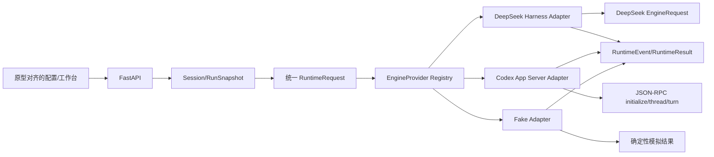

# Design

## Context

当前平台已经把 ExecutionProfile、ModelRoute、DeploymentRuntimeConfig、Session、RunSnapshot 和 RuntimeAdapter 分开建模。`RuntimeRequest` 已承载 EmployeeContext、Skill 文件、ToolDefinition、MCP、ModelRouteSnapshot 和类型化 `RuntimeOptions`；DeepSeek Harness、Codex App Server 和 Fake 通过各自 Adapter 接入。回答策略默认绑定、Deployment 覆盖、Session/Run 快照、capability 校验和工作台阶段已经实现，真实 Provider 字段语义仍按未验证边界处理。

用户可见基线由以下原型共同定义：

- `docs/原型/员工Deployment运行配置.html`
- `docs/原型/DeepSeekHarness默认引擎配置.html`
- `docs/原型/海豚调度员工工作台.html`
- `docs/原型/当前方案总览.html`

实现必须先满足这些原型的布局、浅色管理台令牌、字段文案、状态和秒级时间，再补充真实 Runtime 映射。

## Goals / Non-Goals

**Goals:**

- 用类型化 RuntimeOptions 表达思考模式、推理强度、预算、答复详细程度、输出/工具/超时限制。
- 让回答策略从默认值/Deployment 配置进入 Session 和 RunSnapshot，并在 Worker 中保持不可变。
- 让 EngineProvider capability 明确回答策略是否支持，由 Adapter 映射不同供应商输入。
- 严格复现现有工作台原型：三栏布局、策略摘要、思考/工具/答复阶段、审批、内部事件和秒级时间。
- 保存可审计策略摘要和用量，不保存原始思考链。
- 保持旧 Session、旧 Run、旧 ModelRoute 和旧消息历史兼容。

**Non-Goals:**

- 本 Change 不实现真实供应商的隐藏思考链展示。
- 不让前端直接发送 DeepSeek/Codex 私有参数。
- 不自动切换模型、引擎或 Fake Runtime 规避 capability 错误。
- 不在本期开放 Workspace、Sandbox、网络策略或完整成本计费策略。
- 不改变原型以外的全局视觉风格，也不新增第二套工作台布局。

## Decisions

### 1. 使用平台统一回答策略，不暴露供应商字段

新增类型化策略对象，逻辑字段为：

```text
reasoning_mode: INHERIT | OFF | AUTO | DEEP
reasoning_effort: AUTO | LOW | MEDIUM | HIGH
reasoning_budget_tokens: null | positive integer
response_verbosity: CONCISE | STANDARD | DETAILED
max_output_tokens: null | positive integer
max_tool_steps: positive integer
timeout_seconds: positive integer
```

Deployment/默认环境保存 `INHERIT` 或覆盖值；Session Resolver 解析有效值；RunSnapshot 保存最终值。这样 Codex、DeepSeek 和 Fake 只需要实现 Adapter 映射，不会把供应商字段污染到配置页面。

**备选方案：** 直接把 `thinking`、`reasoning_effort`、`max_completion_tokens` 等供应商字段放进 `runtime_options`。不采用，因为不同引擎字段不同、租户配置不可迁移，也无法在保存时做统一 capability 校验。

### 2. capability 由 EngineProvider 与 ModelRoute 联合决定

在公开 capability 摘要中增加无凭据字段：

```text
reasoning
reasoning_effort
reasoning_budget
max_output_tokens
```

Session 创建前验证 EngineProvider、ModelRoute 和策略组合。`AUTO` 在能力未知时可以保留为 provider default；`DEEP`、固定预算和高强度必须获得明确支持。

**备选方案：** 保存时不校验，运行时让供应商失败。拒绝，因为用户会看到“已保存/已运行”但实际策略没有生效，且原型要求在 Session 创建前给出兼容性反馈。

### 3. 运行阶段用统一 Trace 事件，不扩展 Run 主状态机

工作台显示 `准备运行`、`思考中`、`调用工具`、`生成答复` 等阶段，但 Run 主状态仍使用现有 `QUEUED/RUNNING/AWAITING_APPROVAL/SUCCEEDED/FAILED/UNKNOWN`。阶段以标准化 RuntimeEvent/TraceSpan 表达，避免把供应商内部步骤变成持久化状态机。

同一秒内事件以服务端 `sequence_no` 或 Trace `sequence` 排序；前端按用户时区格式化为 `YYYY-MM-DD HH:mm:ss`。

### 4. Adapter 只做映射和归一化



- DeepSeek Adapter 将策略映射到 EngineRequest/SDK 可验证的字段；未验证的 Provider 字段不得假设已支持。
- Codex Adapter 将策略映射到 app-server thread/turn 参数；当前 Adapter 的 Tool/MCP 限制保持显式拒绝。
- Fake Adapter 接受统一策略并产生确定性阶段事件，用于 UI/契约测试，不声称提供真实 reasoning。
- 所有 Adapter 返回统一 RuntimeResult、UsageRecord 和 RuntimeEvent。

### 5. 严格以现有原型作为视觉验收基线

原型与实现建立以下一一对应：

| 原型 | 实现区域 | 必须保持的内容 |
| --- | --- | --- |
| Deployment 运行配置 | `DeploymentRuntimeConfigurationDialog` | 继承/覆盖、EngineProfile/ModelRoute、回答策略区、兼容性提示、旧 Session 保留快照 |
| 默认运行环境 | `DefaultRuntimeEnvironmentTab` | 作用域、引擎/模型独立选择、回答策略默认值、Profile 版本目录 |
| 海豚调度工作台 | `ConversationWorkbench` | 左中右三栏、策略 chip、阶段时间线、工具/审批、Run 快照、空/加载/错误/只读 |
| 当前方案总览 | docs/原型入口 | 已实现/方案设计/待验证状态分层 |

不引入深色 Harness 皮肤、独立轮播壳或第二套状态徽标。颜色、边框、字体、圆角和间距沿用当前 React 工作台 `styles.css` 的 `workbench-*` 令牌。

### 6. 快照和消息边界

Session 保存有效回答策略和来源；RunSnapshot 保存该 Run 实际策略。消息只保存用户和助手最终正文；思考阶段、策略、耗时和 reasoning token 进入 Trace/Usage。原始推理正文、隐藏 Prompt 和供应商内部上下文不进入 Message/ObjectStore/Trace。

## 数据模型、API 与状态

### 逻辑数据模型

| 对象 | 新增/变化字段 | 约束 |
| --- | --- | --- |
| RuntimeOptions | mode、effort、budget、verbosity、max_output、max_tool_steps、timeout | 白名单、范围校验、无凭据 |
| EngineProviderCapabilities | reasoning、reasoning_effort、reasoning_budget、max_output_tokens | 公开布尔能力摘要 |
| Session | effective RuntimeOptions、strategy source | 创建时固定 |
| RunSnapshot | effective RuntimeOptions、strategy source | Run 创建后不可变 |
| Trace/Usage | phase、strategy summary、duration、reasoning tokens | 不保存原始思考链 |

Deployment、Session 和 RunSnapshot 优先复用现有 `runtime_options_json`/JSON 快照；用户/租户默认策略独立创建 `runtime_strategy_bindings`，避免把回答策略错误地绑定到 EngineProfile 或 ModelRoute。新表使用 forward migration，并为表/字段写中文 COMMENT；不能修改已应用历史 migration。

### API 行为

- `GET/PUT /api/v1/deployments/{id}/runtime-config`：读写回答策略和现有 EngineProfile/ModelRoute 覆盖。
- `GET/PUT /api/v1/execution-profile-bindings/{scope}`：读写默认引擎策略。
- `GET/PUT /api/v1/model-route-bindings/{scope}`：读写默认模型和回答策略关联摘要。
- `GET/PUT /api/v1/runtime-strategy-bindings/{scope}`：读写用户/租户默认回答策略。
- `POST /api/v1/sessions`：返回有效策略、来源和 capability 摘要。
- `POST /api/v1/conversations/{id}/turns`：允许范围内的本轮策略覆盖写入 RunSnapshot。
- `GET /api/v1/runs/{id}`、`GET /api/v1/runs/{id}/trace`：返回策略摘要、阶段事件、秒级时间和用量。

### 状态

```text
Deployment: PENDING_CONFIGURATION → ACTIVE ⇄ DISABLED
Run: QUEUED → RUNNING → SUCCEEDED
Run: RUNNING → AWAITING_APPROVAL → SUCCEEDED / FAILED / UNKNOWN
Phase event: PREPARING → THINKING → TOOL_CALLING → RESPONDING → COMPLETED
```

## 权限和凭据边界

- 管理员可修改租户默认和 Deployment 策略；成员只读。
- 当前用户只能提交允许范围内的本轮策略覆盖。
- Strategy snapshot 只能在当前 platform/tenant 范围读取。
- Engine/Model SecretRef 只由 Worker 解析；不返回策略输入中的凭据值。
- Trace/Usage 保存非敏感阶段和用量，不保存原始思考链。

## 错误、重试、幂等和观测

| 场景 | 处理 |
| --- | --- |
| 未知策略字段 | `INVALID_ARGUMENT`，不生成新修订 |
| 策略超出引擎能力 | `ENGINE_CAPABILITY_UNSUPPORTED`，不出站 |
| Engine/Model 不兼容 | `ENGINE_MODEL_INCOMPATIBLE`，不自动替换 |
| 同幂等键同策略 | 返回原 Run/Snapshot，不重复调用 |
| 同幂等键策略变化 | `IDEMPOTENCY_CONFLICT` |
| Runtime 超时 | 按现有 FAILED/UNKNOWN 边界收敛，不自动重试不确定请求 |
| Provider 不返回 reasoning token | Usage 标记 `UNAVAILABLE` 或 `ESTIMATED` |

日志和 Trace 只记录 `run_id`、`session_id`、engine、route、strategy summary、phase、status、duration 和稳定错误码。

## 迁移计划与回滚

1. 先更新 OpenSpec、中文设计文档和原型，作为评审基线。
2. 执行新增的默认策略绑定 migration，验证中文表/字段 COMMENT 和租户复合键。
3. 增加 RuntimeOptions 解析和 capability 契约测试，保持空 `runtime_options` 的旧行为兼容。
4. 先接 Fake/确定性 Mock，再接 DeepSeek/Codex Adapter 的实际参数映射。
5. 发布前端字段和工作台阶段，但对未注册 capability 的字段保持只读或方案状态。
6. 上线后只允许新 Session 使用策略；历史 Session/Run 继续使用旧快照。
7. 回滚时保留 JSON 中已写入的策略字段和默认绑定，旧版本读取未知字段时按默认策略展示，不能删除历史快照。

## 原型和验证命令

原型文件：

- `docs/原型/员工Deployment运行配置.html`
- `docs/原型/DeepSeekHarness默认引擎配置.html`
- `docs/原型/海豚调度员工工作台.html`
- `docs/原型/当前方案总览.html`

```bash
python -m pytest backend/tests -q
python -m ruff check backend/src backend/tests
cd frontend && npm test && npm run build
cd .. && openspec validate --changes --strict
```

## 已验证项和未验证项

已验证：现有原型 HTML 解析、原型状态标记、OpenSpec change 校验、当前工作台消息历史回归、现有前端构建和后端测试。

未验证：真实 DeepSeek/Codex Provider 的 reasoning 私有字段、真实 reasoning token 统计、真实生产身份和长时 Runtime 恢复。

## Open Questions

- DeepSeek Harness 和 Codex App Server 的最终 reasoning 参数名及预算语义，必须在各自 SDK/协议契约测试中确认；在此之前只开放统一字段和 Mock 行为。
