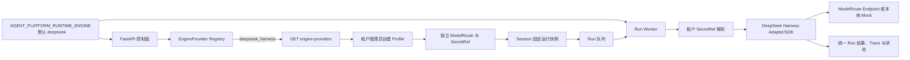
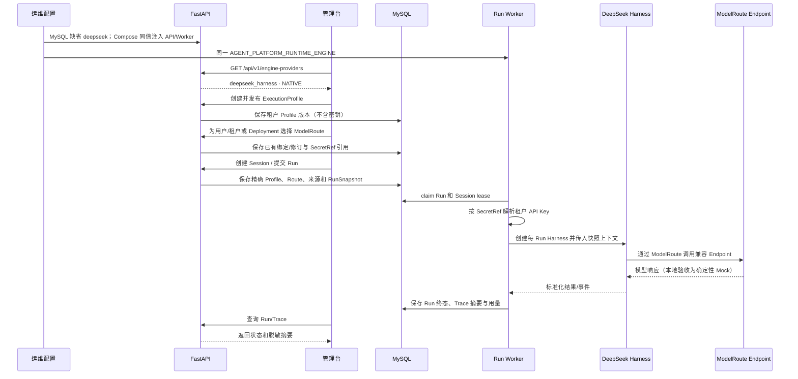

# Design

## Context

参见 `proposal.md` 的 Why。当前 `_build_runtime_adapter()` 已能构造 DeepSeek Harness Adapter，Docker 后端镜像也安装固定版本的 DeepSeek Harness SDK。MySQL 启动入口默认 `fake`；Compose 没有把 `.env` 的引擎值传入 API 与 Worker，现有验收 overlay 又只为 Worker 覆盖 DeepSeek。`GET /api/v1/engine-providers` 依据 API 进程的注册表返回选项，故控制面会隐藏 DeepSeek。注册表还把 `deepseek_harness` 与 `deepseek` 作为两个可见项。

约束：Fake 身份仅用于本地环境；引擎与 ModelRoute 独立配置；租户密钥只允许 Worker 解析；已有 Session/Run 使用固定版本快照；`docs/` 中文文档和静态原型必须与功能变更一起交付。

## Goals / Non-Goals

**Goals:**

- MySQL 模式默认选择 DeepSeek Harness；Fake 模式继续默认 Fake，MySQL/Compose 可通过显式 `AGENT_PLATFORM_RUNTIME_ENGINE=fake` 切回。
- API 的 Provider 清单、Profile 校验和 Worker 实际执行使用同一运行引擎配置。
- 新建 Profile 使用唯一规范 EngineProvider ID `deepseek_harness`；历史 `deepseek` Profile 可解析到同一 Adapter。
- 用兼容的租户 ModelRoute 和确定性本地模型 Mock 跑通 Profile → Session → Run → Worker → Harness → 统一结果的链路。
- 交付独立中文使用/运维文档及静态原型，明确真实模型凭据和模型请求的边界。

**Non-Goals:**

- 不新增或修改数据库表、字段、索引、迁移或 RunSnapshot 格式。
- 不把 DeepSeek API Key 写进仓库、Profile、API 容器、审计、Trace 或 RunSnapshot。
- 不实现 ModelRoute 的自动创建、模型目录发现、凭据管理 UI、其他 Harness Provider 或生产 Secret Manager。
- 不把确定性本地 Mock 验收描述为真实 DeepSeek 云端推理。

## Decisions

### 1. MySQL 默认值与 Fake 模式分开处理

`create_app_from_environment()` 在显式 `AGENT_PLATFORM_MODE=fake` 下仍选择 Fake；MySQL 模式未设置 `AGENT_PLATFORM_RUNTIME_ENGINE` 时选择 `deepseek`。Compose 为 backend API 和 Run Worker 使用同一插值配置，`.env.example` 默认值为 `deepseek`，并把非敏感的 DeepSeek profile/provider/model 设置传给两个进程。租户模型凭据仍只通过 SecretRef 传入 Worker。运维显式设为 `fake` 时，两个容器一起切回 Fake。

**原因：** Profile 在 API 创建/发布时校验 EngineProvider，而 Run 在 Worker 执行；两者必须使用同一配置。只改 Worker 会再次造成 Profile 不可见，只改 API 则可能创建无法执行的 Profile。将引擎值放进共享环境锚点也会让只跑 migration/seed 的 bootstrap 容器获得不必要的运行设置，因此在 backend 与 worker 两个服务处分别引用同一 Compose 插值值。

**替代方案：** 单独设置 API Provider 可见开关会把“可选择”与“可执行”拆成两个事实；设置双份不同的 API/Worker 值则允许漂移；两者都不采用。

### 2. 规范 Provider ID 与历史别名

EngineProvider 选择器只公开 `deepseek_harness`。注册表在解析历史 `deepseek` Profile 或 RunSnapshot 时将名称规范化到 `deepseek_harness`，但不额外注册一个会重复显示的 Provider。运行 Adapter 的内部 `engine_name=deepseek` 保持不变，避免修改 HarnessRuntimeAdapter 和既有 Runtime 引用格式。

**原因：** 产品可见 Profile 名应表达执行技术，运行时工厂配置值仍沿用已稳定的 `deepseek`。将二者通过注册表别名关联，能避免 UI 重复项及存量 Profile 失效。

### 3. 复用租户 ModelRoute 作为模型和凭据边界

Profile 只固定 `engine_name`。ModelRoute 单独固定模型 ID、协议、Endpoint 与 SecretRef；新 Session 将 Profile/Route 来源与精确版本写入既有快照。Worker 按快照解析 SecretRef，并通过现有 Harness Adapter 注入单次运行环境。Profile 创建不要求保存或复制模型凭据。

DeepSeek Harness 使用 ModelRoute 时要求 `openai-compatible`、`openai-chat-completions` 或 `openai-completions` 协议。没有兼容 Route 时，在 Session 创建前返回现有 `ENGINE_MODEL_INCOMPATIBLE` 或 `RUNTIME_CONFIGURATION_REQUIRED`；SecretRef 无法解析时 Run 返回稳定配置错误，不能转用 Fake。

**替代方案：** 在 ExecutionProfile 内增加 API Key、模型 ID 或默认 Route 会破坏运行环境与员工配置解耦，也会扩大租户凭据暴露面，不采用。

### 4. 用确定性本地 Mock 验证，不调用真实供应商

验收使用已有本地 OpenAI 兼容 Mock、租户 SecretRef 测试映射和真实 DeepSeek Harness SDK 适配器。测试断言 API 返回规范 Provider、Profile 可以创建/发布，且 Worker 的 Run 结果和 Trace 来自 DeepSeek Adapter。Mock 的响应不代表真实模型的能力、质量或可用性。

### 架构图



### 流程/时序图



## 数据模型、API 与状态

不新增数据表或字段，沿用现有持久化模型：

| 现有对象 | 关键数据 | 所有权/约束 | 本期行为 |
|---|---|---|---|
| `execution_profiles` | 租户 ID、Profile ID、版本、`engine_name`、状态 | Tenant-scoped；发布版本不可变 | 新版写 `deepseek_harness`；旧 `deepseek` 读时别名解析 |
| `model_routes` / connection | Endpoint、协议、模型 ID、连接版本、SecretRef | 接收租户拥有并授权；Route 与 EngineProfile 独立 | 只接受 DeepSeek 支持的 OpenAI 兼容协议 |
| `execution_profile_bindings` / `model_route_bindings` | 用户/租户/平台范围默认引用及版本 | 认证 Identity 决定作用域；成员不能写租户默认 | 不改变绑定优先级 |
| Deployment runtime revision | Profile/Route 精确 ID 和版本 | 属于 Deployment 租户；管理员可版本化更新 | 不改变现有修订和并发冲突语义 |
| Session/Run Snapshot | 固定的 Engine、Route、来源、运行配置版本 | 创建后只读；不含密钥明文 | Worker 只按固定快照运行 |

接口不新增：

| API | 角色/范围 | 返回或状态 |
|---|---|---|
| `GET /api/v1/engine-providers` | 已认证身份；清单来自当前服务注册 | DeepSeek 默认时返回一个 `deepseek_harness` / `NATIVE`；Fake 覆盖时返回 `fake` / `SIMULATION`；不含命令和 SecretRef |
| `POST /api/v1/execution-profiles` 与发布接口 | 当前租户管理员，沿用现有 API 授权 | 仅接受当前 API 已注册的 Provider；未注册引擎返回稳定错误 |
| `GET/PUT /api/v1/model-route-bindings/...` 或 Deployment runtime API | 用户仅能设个人默认；租户管理员可设租户默认/本租户 Deployment | 继续按独立优先级解析；API 不返回密钥明文 |
| Session/Run API 与 Trace 查询 | 当前租户授权用户 | 建立不可变运行快照；执行错误通过 Run 状态和脱敏错误码返回 |

状态：Provider `NATIVE` 表示服务已装配该 Runtime；本地 Mock 是模型 Endpoint，不改变 Harness 的 NATIVE 模式。Fake Provider 以 `SIMULATION` 展示。Profile 仍沿用 `DRAFT`、`PUBLISHED` 等既有生命周期。

## 权限、租户与凭据边界

- EngineProvider 是部署级能力清单，不按租户暴露额外资源；Profile、Route、Deployment 仍由 API 按 Identity 的 `platform_id`/`tenant_id` 校验。
- 只有租户管理员可创建/发布 Profile 和修改租户默认/Deployment 运行配置；成员可以使用授权的 Profile 创建 Session，但不能改管理配置。跨租户 Profile/Route 仍被隐藏或按既有 404/依赖错误拒绝。
- SecretRef 值仅由 Worker 的 `EnvironmentModelSecretProvider` 解析。API 环境不注入模型密钥；ModelRoute 响应、Profile、Session/Run Snapshot、Trace 和审计只保留 SecretRef 或非敏感摘要。
- `AGENT_PLATFORM_RUNTIME_ENGINE` 是运维部署配置，不接受普通 API 用户请求修改。API 与 Worker 的配置需由同一 Compose 变量传入并共同重启。`AGENT_PLATFORM_DEEPSEEK_PROFILE`、`AGENT_PLATFORM_DEEPSEEK_PROVIDER` 和 `AGENT_PLATFORM_DEEPSEEK_MODEL` 是非敏感运行参数；API/Worker 使用同一值，SecretRef 密钥不经过 API。

## 异常、重试、幂等与可观测性

- 未注册 Provider、ModelRoute 协议不兼容、SecretRef 缺失使用现有稳定错误类型；任何错误都不静默回退 Fake。
- SDK 缺失或运行时无法构造时按启动/Run 的稳定失败路径记录；镜像已固定安装 DeepSeek SDK，CI 仍需覆盖 Adapter 构造和 SDK 合约测试。
- API 创建 Profile/Deployment、Session/Run 继续使用现有租户幂等键和版本冲突语义；本期不添加新的重试或幂等层。
- Worker 继续使用已有 claim/lease/fencing 与 Run 终态规则。模型调用超时或结果不确定时不得盲目重复可能触发工具操作的 Run；按现有 UNKNOWN/失败策略隔离。
- Trace 记录 engine/provider、ModelRoute 版本、request ID、耗时、标准化结果和错误分类，不写模型 Key、完整敏感 prompt、环境变量或本地配置文件内容。
- 本地使用 `docker compose logs backend worker` 和 Run/Trace API 查验；外部请求由用户配置 Route Endpoint，平台不自动探测或登记供应商模型目录。

## 迁移与回滚

- 无数据库 migration，不触碰历史表或已应用迁移校验和。
- 部署时先构建包含固定 DeepSeek SDK 的后端镜像，再以同一引擎变量更新 API 与 Worker；API 与 Worker 必须在同一维护窗口重启，避免新建 Profile 可见但执行端未装配。
- 回滚时将同一配置改为 `fake`，重启 API/Worker 并确认 `/engine-providers` 只返回 Fake。已发布的 DeepSeek Profile 和历史 Snapshot 保留；Fake 环境不允许新 Run 使用 DeepSeek Profile，待再次启用 DeepSeek 后方可执行。
- 已经执行的 Run 不重放；配置切换只影响新 Session/Run，运行中的 Run 继续由当前 Worker 根据既有 Snapshot 和 lease 完成或进入既有 UNKNOWN 隔离。

## 验收目标

- 默认 MySQL/Compose 下 Provider API 和“新建 ExecutionProfile”只呈现一个原生 DeepSeek Harness 选项，Profile 可创建、发布。
- 使用已授权、协议兼容且带租户 SecretRef 的 ModelRoute 后，Session 固定正确 Profile/Route 版本；Worker 通过 Harness SDK 调用本地确定性 Mock 并保存成功 Run/Trace。
- 普通成员无法变更 Profile/租户默认/Deployment 配置；跨租户 Route 不可绑定；凭据值不出现在 API、数据库快照、Trace 或日志。
- 显式切回 Fake 后 API/Worker 一致，DeepSeek 不再作为原生 Provider 暴露。

## 已验证项、未验证项与命令

已验证的现状：本机 `/api/v1/engine-providers` 只返回 Fake；本机数据库已有不可用的 `deepseek` Profile 草稿和 ACTIVE 本地模型路由；后端镜像构建定义包含 `harness-engine[deepseek,mcp]`。

实现完成后需要验证：

```bash
docker compose --env-file deploy/control-plane/.env \
  -f deploy/control-plane/docker-compose.yml config

cd backend && pytest -q tests/test_engine_provider_registry.py tests/test_app_configuration.py tests/test_control_plane_api.py
cd backend && ruff check src tests
cd frontend && npm test -- --run
cd frontend && npm run build
```

本机 Harness Run 需在专用验收环境配置确定性 Mock Endpoint 与租户 SecretRef，然后查询 Provider、创建并发布 Profile、配置兼容 Route、创建 Session/Run 并检查 Trace。**尚未验证：** 本次实现前的全新默认 DeepSeek Compose 启动、真实 DeepSeek 云端凭据/推理、生产 Secret Manager、真实生产身份系统和公网安全配置。

## 原型与使用文档

- 静态运维/管理原型：`docs/原型/DeepSeekHarness默认引擎配置.html`。原型仅含演示数据，不调用 API，不包含凭据。
- 功能、流程、数据/API、权限、安全、验收和本地使用步骤：`docs/DeepSeekHarness默认引擎运行与验收.md`。
