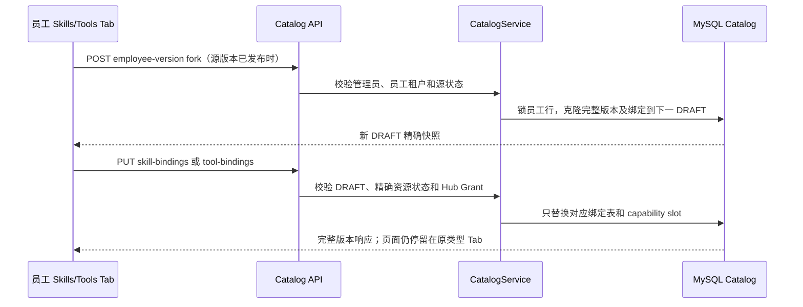

# 设计

## 背景

动机和范围见 `proposal.md`；外部可观察行为见三个能力规格。当前前端只有只读 EmployeeGallery，Dashboard/SkillList/ChatWorkspace 是占位页。后端已提供员工、Skill/Tool、Profile/ModelRoute、Deployment 的基础创建/列表/发布 API，但没有员工详情/版本读取、草稿版本更新、Hub 和 Skill 文件操作端点。

V003 已提供 `digital_employees`、`digital_employee_versions`、`employee_skill_bindings`、`employee_tool_bindings`、`skill_versions`、`tool_versions`、`skill_tool_declarations`、`deployments` 和 `audit_events`。Skill 版本当前保存 inline `instruction`，没有文件清单。所有租户拥有的数据通过 `(platform_id, tenant_id)` 隔离；员工 Skill/Tool 绑定的外键要求资源属于同一租户。共享资源因此需要平台级 Hub 包和经授权的租户代理，不能放宽现有复合外键。

## 目标与非目标

**目标：**

- 员工详情作为 Skill/Tool 配置入口，所有编辑都绑定员工 DRAFT 版本。
- 资源中心发布、发现和导入员工、Skill、Tool 的固定版本包；复制生成租户副本，引用保留只读来源关系。
- FILE_PACKAGE Skill 以根 `SKILL.md` 为唯一入口，支持 ZIP 导入和在线文件树操作，并为每个 Skill 版本固化文件摘要。
- Run 启动时解析本地或 Hub 资源、校验授权和摘要，并将来源版本写入 RunSnapshot；运行时文件只读。
- 复用 V003 的 Catalog/Deployment 关系；新增 DDL 集中在 `docs/migrations/`，新字段和表都带中文 COMMENT。

**非目标：**

- 知识库 UI、KnowledgeBase 数据实体、文件索引、向量检索和 RAG 执行；`KNOWLEDGE_BASE` 暂不开放 Hub 发布/导入 API。
- 真实运行时代码执行、在线 ZIP 脚本运行、工具密钥跨租户复制、Hub 内容的原地编辑。
- Hub 资源自动跟随 `latest`、运行中回写源文件、跨租户直接查询对方的租户表。
- MinIO/S3/OSS/COS 和真实身份提供方。

## 设计决策

### 1. 员工详情管理绑定，资源中心管理租户目录与共享发现

主导航采用“数字员工、资源中心、部署记录”。员工详情页管理员工资料、精确 Skill/Tool 绑定和版本发布；资源中心提供本租户 Skill/Tool 目录与跨租户 Hub 发现、发布和导入。Skill/Tool 不独立占一级导航，资源创建和版本生命周期不要求先进入某个员工；绑定仍必须回到员工 DRAFT，不能由资源目录隐式改写员工版本。员工新建后先创建基础记录，再进入版本向导；基本信息更新不改变已有版本；Skill/Tool/执行配置改变时必须编辑一个 DRAFT 员工版本。

资源中心提供“技能与工具、发现资源、我发布的、我导入的”四个页签。租户目录中的 Skill/Tool 按类型切换，表单将身份字段与内容/调用契约分组；Skill 编辑跳到精确版本文件工作区，Tool 编辑仅允许 DRAFT。Hub 页签类型包含 DigitalEmployee、Skill、Tool；共享资源详情显示发布方、版本、依赖、摘要和可用导入模式。实现用 React Router、TanStack Query 和 Ant Design；文件编辑状态不放入 MySQL。

员工页面原型：

```text
+----------------------+-----------------------------------------------------------+
| Agent Platform       | 租户 tenant-a                     用户 admin-local        |
+----------------------+-----------------------------------------------------------+
| 数字员工             | 员工详情 / 客服助手 / v4 DRAFT            [部署 v3]        |
| 资源中心             | 基本信息 | 技能管理 | 工具管理 | 版本与发布 | 部署记录    |
| 部署记录             |-----------------------------------------------------------|
|                      | Skill 客服问答 v2  COPY · 本租户 · 已发布                 |
|                      | Skill 工单规范 v5  REFERENCE · 共享资源中心 · 只读        |
|                      | [添加本地 Skill] [从资源中心添加]                         |
|                      | 有效 Tool：工单查询 v1                                     |
+----------------------+-----------------------------------------------------------+
```

FILE_PACKAGE Skill 编辑页：

```text
+----------------------+---------------------------+-----------------------+
| 员工详情             | Skill: 客服问答 v3 DRAFT | 文件属性              |
| 技能管理             | [概览] [文件] [Tool]     | SKILL.md              |
|                      |---------------------------| Markdown · 4.2 KB     |
|                      | 文件树     编辑区         | SHA-256: ...          |
|                      | SKILL.md   # 客服问答     | 来源：本租户 COPY      |
|                      | refs/api.md ...           |                       |
|                      | [新建] [上传 ZIP] [删除]  [保存草稿] [校验]              |
+----------------------+---------------------------+-----------------------+
```

文件页面只在 DRAFT 下开放编辑。ZIP 上传先预览文件树、replace/merge 差异和校验错误，再由管理员确认。REFERENCE 文件显示只读标识和来源摘要，提供“复制到租户”操作。已发布 Skill 通过“基于此版本创建新版本”进入编辑态。

### 2. Hub 是平台级不可变 Package Registry，租户引用经代理映射

Hub 的资源 ID 由平台生成。Hub 包保存资源类型、发布租户、可见范围、可用导入模式、版本、规范化 `manifest_json` 和 `manifest_sha256`。发布包不可变；变更内容会创建新 Hub 版本。

可见性和授权分开：已发布资源的脱敏目录元数据默认对平台租户可发现；包内容/对象地址和依赖导入数据只有在授权后才能访问。发现不自动赋予导入权，COPY/REFERENCE 均需有效 Grant。Grant 可按资源和接收租户配置 `copy_allowed` / `reference_allowed`；新发布版本默认不继承接收租户 Grant，需发布方明确授权。

租户导入统一先生成本地代理记录：

- COPY：将资源元数据、依赖版本和文件对象复制到接收租户，生成新本地 ID；后续编辑和发布由接收租户管理。可以保留 Hub 来源映射用于溯源。
- REFERENCE：建立租户代理与 Hub 精确版本/摘要映射；对象文件/Package 正文由 Hub Resolver 按 Grant 获取，不复制大对象。展示用元数据可缓存在代理中，但 Run 的权威来源仍是 Hub 固定版本。
- 现有 `employee_skill_bindings` / `employee_tool_bindings` 仍指向同租户本地代理版本，因此既有复合外键继续生效。租户导入表负责将代理版本映射到 Hub 源版本；Catalog Service 在保存、发布和 Run 解析时校验映射和权限。

运行时解析路径：

```text
EmployeeVersion -> 本地 Skill/Tool 代理 ID/版本
    -> tenant_resource_imports 判断 COPY/REFERENCE
       COPY: 读取租户本地不可变版本和对象
       REFERENCE: Hub Resolver 检查 Grant、Hub 版本和 manifest_sha256
    -> RunSnapshot 固定本地引用及 Hub 源版本/摘要
    -> Runtime 读取只读 Skill 文件/资源
```

Run 创建时校验 Grant 并把需要的入口文本/小型 manifest 作为执行快照；大对象通过带租户和 Run 范围的只读 RuntimeAttachmentRef 暴露。撤销 Grant 后阻止新 Run 和新导入；已启动 Run 使用已固定快照，完成后依照对象保留策略清理。Hub 资源被撤销不重写已发布员工版本或历史 RunSnapshot。

备选方案是把 Skill/Tool 绑定改成可指向任意租户数据的外键或 SQL 查询。拒绝原因：会绕过现有 `platform_id + tenant_id` 约束，且来源方撤销、内容变化和 Run 审计难以保持一致。

### 3. Hub 文件包不包含凭据；运行期间所有来源版本只读

Hub Tool Package 仅含协议、Handler 名称、Schema、风险策略和非敏感配置；不发布 Secret 明文或发布租户 SecretRef。V004 的 `tool_versions.requires_recipient_credentials` 用中文 COMMENT 记录 COPY 后需要接收方凭据；接收租户设置自己的 `auth_secret_ref` 之前，Tool 保持 DRAFT 且不可发布。

Skill/Tool/Hub 资源在运行时都使用发布版本快照。REFERENCE 通过只读解析器读取；COPY 也不能从 Run 中改写。Run 生成的文件、编辑结果和 Tool 输出作为独立结果对象保存。用户要修改来源资源时，创建租户副本或新版本并在新员工 DRAFT 中绑定。

### 4. Skill 的 INLINE/FILE_PACKAGE 互不破坏既有使用

现有 INLINE Skill 保持 `instruction` 行为。V005 给 `skill_versions` 加 `content_format`、`entry_file_path`、`file_manifest_sha256`：

- INLINE：`instruction` 必须非空，入口路径和文件摘要为空。
- FILE_PACKAGE：入口路径固定为根目录 `SKILL.md`，`instruction` 可以为空；Domain 校验改为按 `content_format` 判断。
- `SkillContentResolver` 在发布校验时确认唯一入口存在；Run 开始时读取入口文件作为 Skill 指令，将其他文件作为只读附件引用传给 RuntimeAdapter。Fake Runtime 验证引用/摘要，不执行任意包内脚本。

V005 新建 `skill_file_entries`，一个 Skill 版本一个文件清单；每条记录关联一个同租户 MediaAsset。版本复制时可复用不可变对象引用；修改/替换文件会创建新 MediaAsset 并更新新草稿的清单，不改写旧版本对象。GC 检查文件清单引用，仍有 Skill 版本使用的对象不可删除。

ZIP 解包在临时区完成并全部校验后再原子提交清单；建议初始上限为压缩包 50 MB、展开总大小 100 MB、最多 500 个文件、单文件 10 MB，需可配置。拒绝绝对路径、`..`、反斜杠路径、符号链接和规范化后重复路径；任一致命错误都不产生部分文件清单。在线编辑也仅针对 DRAFT，保存携带 `expected_sha256` 解决并发修改冲突。

备选方案是把 ZIP 本身作为唯一 Skill 内容。拒绝原因：前端不能显示/修改单文件，无法安全删除、排序或 diff，也难以把入口文件和辅助文件分别传给 Runtime。

### 5. API 请求使用租户代理 ID，授权上下文来自服务端

继续使用 `/api/v1` 和当前 FastAPI app factory。浏览器只提交员工、版本、Skill/Tool 本地代理 ID、Hub 资源 ID/版本和选择模式；`platform_id`、`tenant_id`、操作者从认证 `IdentityContext` 取得。写 API 需要租户管理员权限；成员可以按权限读取。

拟新增/扩展接口：

| 方法与路径 | 行为 |
|---|---|
| `GET /digital-employees/{id}` | 读取租户员工详情 |
| `PATCH /digital-employees/{id}` | 更新员工基本信息，不改版本 |
| `GET /digital-employees/{id}/versions` | 读取版本历史 |
| `GET /digital-employees/{id}/versions/{version}` | 返回绑定精确版本和 Hub 来源 |
| `PUT /digital-employees/{id}/versions/{version}` | 更新 DRAFT 员工版本；PUBLISHED 返回 409 |
| `POST /digital-employees/{id}/versions/{source_version}/fork` | 克隆 PUBLISHED 员工完整配置到下一 DRAFT |
| `PUT /digital-employees/{id}/versions/{version}/skill-bindings` | 仅替换 DRAFT Skill 绑定 |
| `PUT /digital-employees/{id}/versions/{version}/tool-bindings` | 仅替换 DRAFT Tool 绑定 |
| `GET /skills?include_versions=true` | 为资源选择器读取全部精确 Skill 版本 |
| `POST /skills/{id}/versions/{version}/fork` | 从本地 PUBLISHED Skill 创建 DRAFT |
| `POST /skills/{id}/versions/{version}/publish` | 校验并发布精确 Skill DRAFT 版本 |
| `GET /skills/{id}/versions/{version}/files` | 读取文件清单、入口、摘要和只读状态 |
| `POST /skills/{id}/versions/{version}/files` | 在 DRAFT 创建文本文件 |
| `PUT /skills/{id}/versions/{version}/files/{file_id}` | 更新 DRAFT 文件，要求 `expected_sha256` |
| `DELETE /skills/{id}/versions/{version}/files/{file_id}` | 删除 DRAFT 文件 |
| `POST /skills/{id}/versions/{version}/imports` | 安全上传/预览 ZIP，提交后生成文件清单 |
| `POST /hub/resources` | 由本地 PUBLISHED 资源创建 Hub 草稿包 |
| `POST /hub/resources/{hub_id}/versions/{version}/publish` | 发布不可变 Hub 版本和分享规则 |
| `GET /hub/resources?type=&keyword=&mode=` | 查询本租户可发现的资源 |
| `POST /hub/resources/{hub_id}/grants` | 为接收租户配置 COPY/REFERENCE 权限 |
| `POST /hub/imports` | 按固定 Hub 版本和模式导入为租户代理 |
| `GET /hub/imports` | 查看本租户导入来源和状态 |
| `POST /hub/imports/{id}/refresh` | 显式生成新的本地版本/引用代理 |

成功响应带本地资源 ID、版本、状态和 `source_ref`；REFERENCE 文件操作返回只读标记。越权资源返回 404，权限缺失返回 403，依赖/摘要冲突和不可变版本返回 409，非法 ZIP/路径返回 422。Hub 资源撤销、导入、升级写入 `audit_events`。

### 6. Skill/Tool 定向编辑只写资源绑定，已发布内容先分叉

员工详情的 Skills 与 Tools Tab 各自打开类型专属抽屉。租户目录只展示已发布的精确资源版本；资源中心抽屉先按类型过滤目录，展示授权方式、版本和依赖信息。COPY/REFERENCE 导入成功后只把返回的租户代理 ID/版本追加到当前 DRAFT。

若当前选择的是员工 PUBLISHED 版本，前端先调用员工 fork API；MySQL 锁定员工聚合行，在一个事务内按单调版本号创建 DRAFT 并复制系统指令、Skill/Tool 绑定、Capability slot、执行配置和审批策略。并发 fork 串行分配版本号。之后抽屉操作新 DRAFT；原版本及 Deployment/RunSnapshot 不变。

Skill/Tool 定向绑定分别在事务中替换 `employee_skill_bindings` 或 `employee_tool_bindings`，并只重建同类型的 `capability_bindings.slot`。完整 `PUT /digital-employees/{id}/versions/{version}` 仍服务于版本配置页。类型绑定 API 不接收系统指令或运行配置字段，以结构边界避免误覆盖。

Skill 文件工作区提供精确版本分叉和发布。分叉 Skill 的新版本复制依赖与不可变 MediaAsset 引用，不复制或覆盖对象字节；Hub REFERENCE 的 fork 按 409 拒绝并要求先 COPY。DRAFT 文件包发布时由 Domain 校验唯一根 `SKILL.md`、依赖和摘要；旧版本保持 PUBLISHED。



数据库仅使用 V003 已存在的版本和绑定表；本次不新增 migration。`GET /skills?include_versions=true` 为绑定选择器提供历史精确版本，默认 Skill 目录仍返回每个 Skill 的最新版本。

## 数据库结构设计

可执行 SQL 仍只放 `docs/migrations/`；V003 已冻结，本设计拆成 V004 Hub 和 V005 Skill 文件包。新表和字段都加中文 MySQL COMMENT，并以 `information_schema.TABLES/COLUMNS` 校验。知识库表和检索模型不纳入本 Change。

### V004 `resource-center`

| 表 | 主键 | 关键字段及中文说明 |
|---|---|---|
| `hub_resources` | `(platform_id, hub_resource_id)` | `resource_type` 类型；`publisher_tenant_id` 发布租户；`publisher_user_id` 发布者；`name`/`description` 展示信息；`visibility` 可见范围；`status` 发布状态；创建/更新时间 |
| `hub_resource_versions` | `(platform_id, hub_resource_id, version)` | `manifest_json` 完整不可变清单；`manifest_sha256` 摘要；`artifact_ref` 大对象引用；发布状态、创建/发布时间 |
| `hub_resource_dependencies` | Hub 版本 + 依赖顺序 | 依赖类型、Hub 资源/版本、是否必需、顺序；发布时校验依赖完整 |
| `hub_resource_grants` | `(platform_id, grant_id)` | 资源、接收租户、`copy_allowed`、`reference_allowed`、状态、有效期、撤销时间、授权人；资源/接收租户唯一 |
| `tenant_resource_imports` | `(platform_id, tenant_id, import_id)` | Hub 资源/版本、模式、租户本地代理类型/ID/版本、manifest 摘要、同步状态、导入人/时间 |

Hub 资源是平台级元数据；`hub_resources.publisher_tenant_id` 标明来源。授权表检查接收租户；导入映射将资源变成本地代理，Catalog 的现有绑定仍使用接收租户本地 ID。

同一 V004 还向 `tool_versions` 增加 `requires_recipient_credentials BOOLEAN NOT NULL DEFAULT FALSE`，以中文 COMMENT 标识 COPY Tool 后是否必须配置接收租户自己的 SecretRef；密钥引用本身不进入 Hub Manifest。

### V005 `skill-file-packages`

在 `skill_versions` 增加 `content_format VARCHAR(16)`（INLINE/FILE_PACKAGE）、`entry_file_path VARCHAR(1024)`（FILE_PACKAGE 固定 `SKILL.md`）、`file_manifest_sha256 CHAR(64)`（规范化文件清单摘要），每列添加中文 COMMENT。`skill_file_entries` 以 `(platform_id, tenant_id, skill_id, skill_version, file_id)` 为主键，记录 `relative_path` 相对路径、`media_asset_id` 文件对象、`mime_type`、`size_bytes`、`content_sha256` 和 `created_at`；同版本路径唯一，并以复合外键关联 Skill 版本和 MediaAsset。

## 风险和迁移

- **引用权限被撤销** → 新 Run/新导入失败；已经开始的 Run 使用已固定快照完成，不重新解析 `latest`。
- **ZIP 路径穿越/压缩炸弹** → staging 解包、路径规范化、大小/数量上限、拒绝符号链接，整包原子提交。
- **Hub Tool 含租户凭据** → 包清单只允许 SecretRef 占位信息，接收方必须绑定自己的 SecretRef。
- **Skill file GC 删除仍在用的文件** → GC 必须检查 `skill_file_entries` 和 Hub/Run 引用，只有无引用对象才能入队删除。
- **REFERENCE 的 Hub Resolver 临时不可用** → 新 Run fail closed；已构造的 RunSnapshot/执行快照保持审计可读。
- **知识库缺少内容和检索服务** → 首期不发布/导入知识库类型，后续单独新增 KnowledgeBase 与索引 adapter。

迁移顺序为：确认 V003 已应用并读取 checksum → 显式预检 → 应用 V004 → 应用 V005 → 中文 COMMENT 和外键/唯一索引校验 → COPY/REFERENCE 和文件上传集成测试。生产回滚保留增量 schema；down 脚本仅在 disposable DB 演练。
