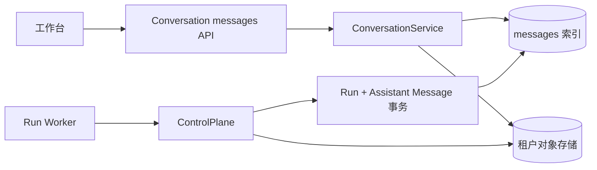
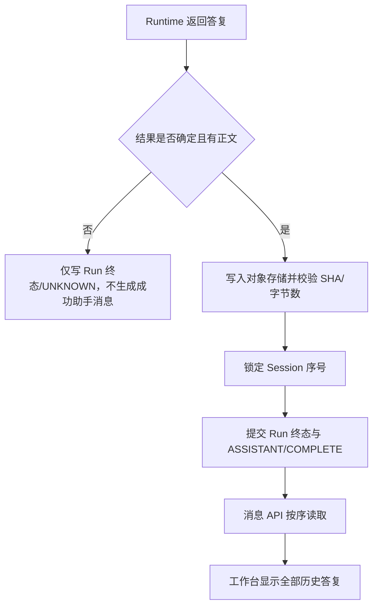

# Design

## 功能设计

助手答复在 Runtime 返回成功且结果正文已写入租户对象存储后，生成一条与 `run_id` 关联的 `ASSISTANT/COMPLETE` Conversation 消息。普通终态由 Run 和消息同一租户事务提交；审批预览进入 `AWAITING_APPROVAL` 后在审批状态已固定的租户事务中幂等补写答复索引。重复提交或旧 fencing token 不得重复插入。

读取 Conversation 时按 `session_id + sequence_no` 返回 USER 和 ASSISTANT 消息，前端仅把当前 Run 的 Trace/审批事件作为增量信息追加，不能用当前 Run 结果替换历史消息。

在服务端消息尚未完成回写的短暂窗口，前端按 Conversation ID 缓存已经读取过的 Run 结果并去重；切换租户时清空缓存，重新打开页面以后以服务端消息为准。

## 架构图



## 流程图



## 数据模型

复用现有 `messages`：

| 字段 | 含义 | 约束 |
| --- | --- | --- |
| `message_id` | 助手消息标识 | 租户范围唯一 |
| `session_id` | 所属控制面 Session | 必须与 Run 相同 |
| `run_id` | 产生答复的 Run | 同租户外键 |
| `sequence_no` | Session 内顺序 | 由 Session 行锁递增 |
| `role`/`source` | `ASSISTANT`/`assistant` | 完成消息必须有正文引用 |
| `content_ref` | 对象存储不透明引用 | 不写正文 |
| `content_sha256`、`byte_length`、`content_type` | 完整性元数据 | 与对象内容一致 |

无需新增 migration；若实现发现历史 schema 不含助手字段，部署前必须停止 Worker，先恢复对应 V002 结构，回滚只回滚代码，不删除历史消息。

## API 与状态

- `GET /api/v1/conversations/{id}/messages` 继续返回 `items`，其中 `source` 同时允许 `user`、`assistant`，按 `sequence_no` 升序。
- 成功 Run：Run 进入 `SUCCEEDED` 或 `AWAITING_APPROVAL`，并有一条 `ASSISTANT/COMPLETE`。
- 失败、取消、UNKNOWN：不创建成功答复；已有流式部分结果按既有状态语义处理。
- 多次请求由现有 idempotency key 和 fencing token 防重。

## 权限和凭据边界

消息读取继续通过 Conversation participant、platform、tenant 和 ObjectStore 授权；前端不接受客户端自报租户。对象正文、Prompt、凭据和工具参数不进入 MySQL、Trace 或日志。助手消息的 `sender_id` 使用受信服务身份，不代表用户提交者。

## 异常、重试和幂等

对象上传成功但事务失败时保留孤儿回收路径，不向用户伪造已保存历史；Run 结果持久化失败收敛到既有 `UNKNOWN`。相同 Run/fencing token 重入时使用唯一 `(platform, tenant, run_id, role)` 约束或事务内存在性检查，不能产生第二条助手消息。旧 token 直接拒绝。

## 可观测性

保留现有 Run/Trace/Usage；新增结构化日志只记录 `run_id`、`message_id`、租户范围和稳定错误码，不记录正文。回归测试验证第一次答复在第二次提交后仍存在。

## 迁移与回滚

本期不改表结构。上线顺序为先部署兼容读取的前端，再部署 Worker/ControlPlane 写入助手消息；回滚代码时保留已写入消息，由旧读取端按 `source` 忽略或展示。不得删除历史 `ASSISTANT` 行或对象。

## 已验证项

- 前端双轮问答回归测试设计完成。
- 现有消息 API 已具备按序读取和对象存储授权路径。

## 未验证项

- 本机未连接用户给出的真实 Session `xzma2w5xq5fj5emvyjrozo362u`，无法读取其生产数据。
- 真实 DeepSeek SDK、MySQL 和对象存储的跨进程恢复需在集成环境验证。

## 验证命令

```bash
cd frontend && npm test -- --run src/features/platform/ConversationWorkbenchPage.test.tsx
cd frontend && npm run build
cd backend && pytest -q tests/test_conversation* tests/integration/test_mysql_conversations.py
```
